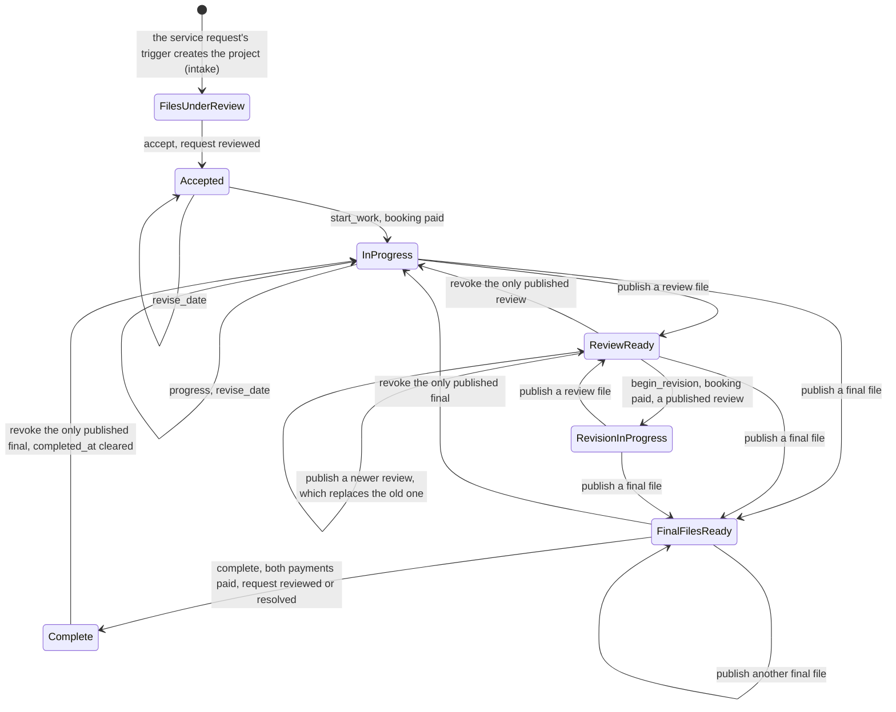
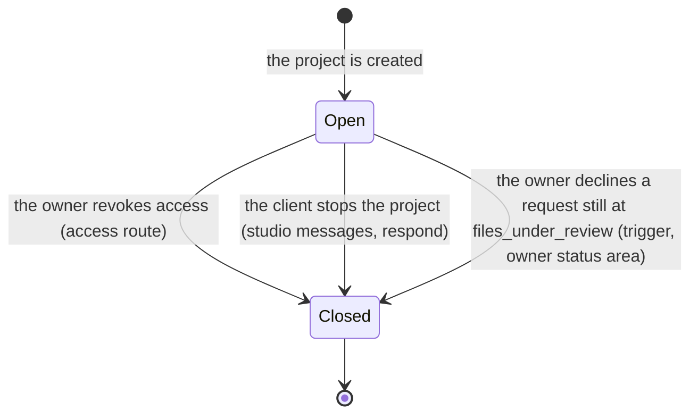
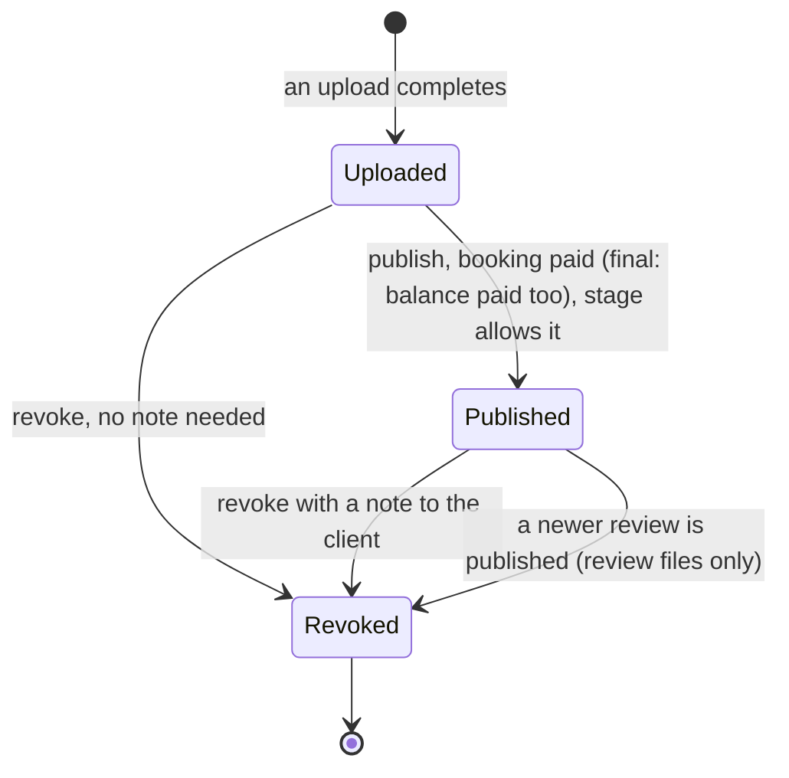
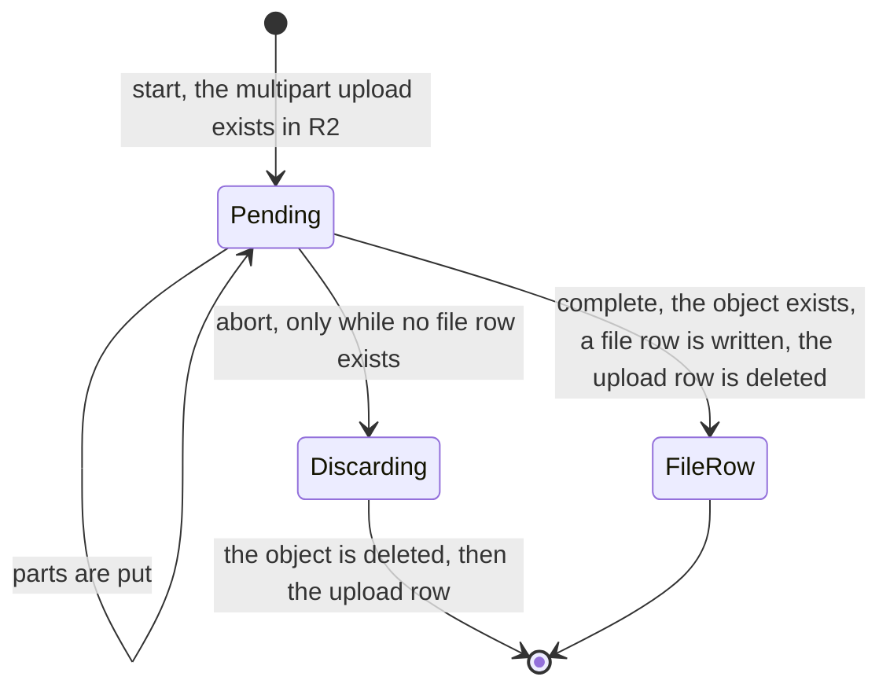
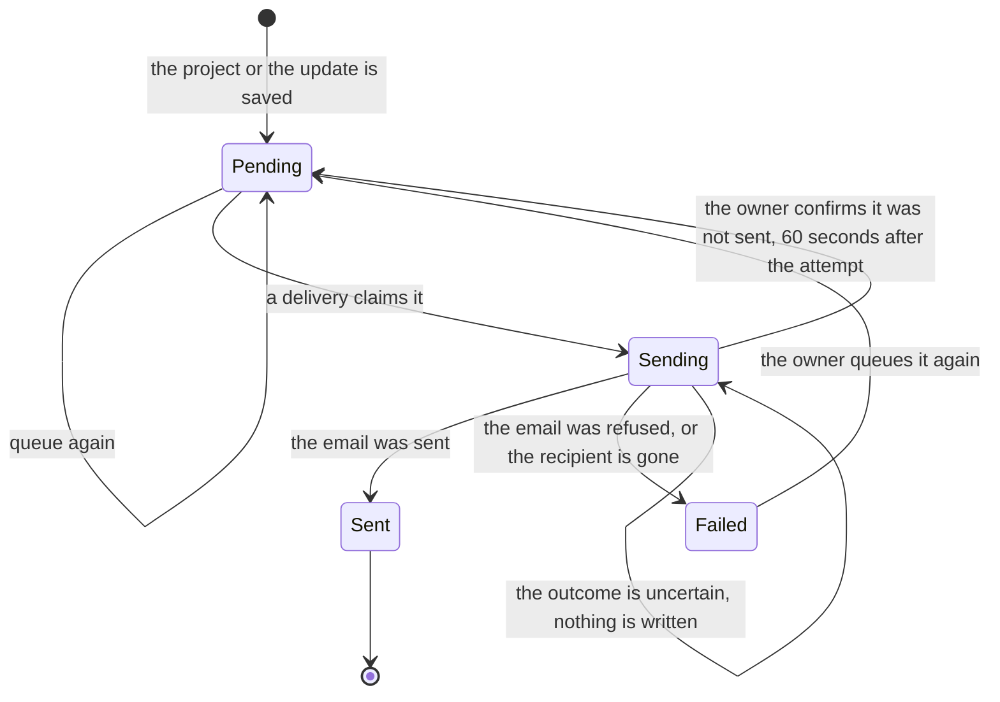
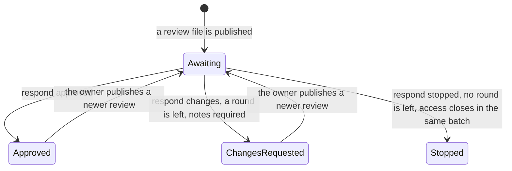

# Audio projects: conversion design

Status: proposed, 2026-11-15. This is the design PR for step 7 of `docs/plans/2026-11-effect-conversion.md`, reviewed before
any conversion code. It changes nothing under `src/`: it adds this document and three Quint models
(`verification/audio-project-messages.qnt`, `verification/audio-project-files.qnt`,
`verification/audio-project-notices.qnt`) with their mutants in `scripts/lib/quint-mutants.mjs`. Every claim about today's
code cites a file and line on `origin/main` at `14cce493`; the lib files are `src/lib/audio-project-*.ts`.

## What the owner is asked

1. The defects in section 7: F1 and F2 follow the standing answer rules and are fixed without a question (F1 is 500 for an
   unexpected failure where nine handlers answer 503 today). F3 (the studio file route when R2 holds a different size than
   the row) is a judgment call: recommended 500, as an inconsistent stored state is not an unavailable service.
2. One decision that needs the owner and is NOT in the fixes: closing one project's access ends the client's sessions for
   all of that client's projects (section 7, Q1). Recommended: keep it, as the sessions table has no project column and a
   forced sign-in is the cautious side.
3. Nothing about the models, the stack or the boundary is asked; they are listed so the review can change them.

## The area today

Eight route files, nine handlers (`uploads.ts` has a POST and a PUT; the studio file route serves GET and HEAD with one
function). Every owner route checks, in this order: the owner (403 `{ok:false}`), the portal flag (404 "Not found"), the
bindings (503), the body (`musicRequest`), the command's shape (400), then the action in one `try` whose `catch` answers
every throw of any kind with 503 and a fixed sentence. The studio routes check the flag, the bindings and the cookie
(`studioSessionFromRequest`) and answer 404 for anything they cannot show.

| Route | Handler | Actions | Code |
|---|---|---|---|
| `owner/projects/[id]/access` | POST | revoke | access.ts:1-49 |
| `owner/projects/[id]/invitation` | POST | send (queue, then deliver in `waitUntil`) | invitation.ts:1-73 |
| `owner/projects/[id]/messages` | POST | send, read | messages.ts:1-97 |
| `owner/projects/[id]/updates` | POST | accept, progress, start_work, begin_revision, complete, revise_date, retry_email | updates.ts:1-117 |
| `owner/projects/[id]/uploads` | POST, PUT | start, complete, abort, recover; one part | uploads.ts:1-179 |
| `owner/projects/[id]/files/[fileId]` | POST | publish, revoke | files/[fileId].ts:1-119 |
| `studio/projects/[id]/files/[fileId]` | GET, HEAD | stream or download one file | files/[fileId].ts:1-69 |
| `studio/projects/[id]/messages` | POST | send, read, respond (approved, changes, stopped) | messages.ts:1-197 |

`git grep -ln "audio_project" src/pages/api` also names `owner/requests/[id]/software.ts` (it reads `audio_projects` to
refuse a software offer for a request that has an audio project; offers area). Nothing else under `src/pages/api` writes
the audio project tables. The nine golden corpora, all present on `main`:
`owner-project-access`, `owner-project-file`, `owner-project-invitation`, `owner-project-messages`,
`owner-project-update-notices`, `owner-project-updates`, `owner-project-uploads`, `studio-project-file`,
`studio-projects-messages`.

### The boundary

Inside the area (converted, with their tests): the eight routes, `audio-project-files.ts` (the studio's file read and
stream), `audio-project-invitations.ts`, `audio-project-messages.ts` (writes and the rules), `audio-project-publishing.ts`,
`audio-project-revocation.ts`, `audio-project-updates.ts` (writes, notices, saving), `audio-project-uploads.ts`.

Outside, and left in place because code outside the area calls them: `listProjectMessages`, `revisionRoundsLeft`,
`latestReviewDecision` and `REVISION_ROUNDS` (the studio and owner pages), `clientProjectFiles` (the studio page),
`listProjectUpdates` and `projectToday` (pages, `owner-reporting.ts`), `validProjectDate` (agreement fields, software
projects, the software project route), `validateProjectMessage` (the owner request messages route and the software
studio messages route), `readBodyWithin` (agreement attachments, the update visual route), `defaultFirstUpdate`, and
`audio-project-next-step.ts` (pure, used by the owner page). Of these `latestReviewDecision`, `revisionRoundsLeft` and
`clientProjectFiles` keep a decision in SQL; they stay for the pages (28 reads in `.astro` files are not assigned a step by
the plan) and the converted area does not call them. The pure ones (`validateProjectMessage`, `validProjectDate`,
`projectToday`, `readBodyWithin`, `privateProjectObjectKey`) are read from where they are: they decide with no SQL and use
no Zod. `src/lib/audio-client-access.ts` (sign-in) belongs to the studio sign-in area; this area stops importing it
(`clientPortalEnabled` is a one-line check done in the route's binding step, `hashValue` is the existing `hashing` from
`agreement-services.ts`, `deleteRetiredCodes` is one statement in this area's store, and the session is read in this area's
store, below).

The plan's step 0 splits the shared helpers into modules of their own (the pure parts of `audio-client-access.ts` and the
date helpers of `audio-project-updates.ts`). On `origin/main` at `14cce493` that split has not landed: `clientPortalEnabled`
is still imported from `audio-client-access.ts` (for example by `src/pages/api/audio-intake.ts`), and `validProjectDate`
and `projectToday` still live in `audio-project-updates.ts`, which the conversion deletes. The conversion therefore needs
that prerequisite PR first (reported to the coordinator), or it must keep a one-line `clientPortalEnabled` check of its own
and leave the two date helpers in a small module, which is the same split under another name.

`src/server/services.ts:544-570` already has a `ProjectInvitation` service whose `deliver` calls the unconverted
`deliverProjectInvitation` for the public intake flow. The conversion replaces that call with the new invitation delivery
flow, so intake and the owner route share one implementation and `audio-project-invitations.ts` is deleted.

## 1. The machines

No machine exists for these entities (`src/server/machines/` holds the generic `next`, `failure` and `settled`). This
section proposes three, drawn here, to be written in the conversion as `audioProject`, `projectFile` and `projectNotice` in
`src/server/machines/`; the stores take every status list from `sourcesOf` and a test holds each list to its machine
(offers area, section 1). The upload row (pending, discarding) has two states and no moves a machine would show; it is
drawn for people only.

### The project

The stage column holds seven values (`migrations/music/0005_audio_projects.sql:4-5`). Access is a separate fact
(`revoked_at`), drawn after the stage. The trigger `audio_project_after_service_request` creates the project at
`files_under_review` (intake).

Moves by action (statement numbers are in section 4): `accept` (U2), `start_work` (U5), `begin_revision` (U8), `complete`
(U11), `revise_date` (U14, a date move, no stage move), `progress` (U1, a note, no move), publish (P2 and P4), revoke a file
(F3). `progress` applies in every stage but `files_under_review` and `complete`; `revise_date` in every stage but `complete`,
and needs the due date `accept` sets, so it applies from `accepted` on. `files_under_review` refuses progress (updates.ts:130); `complete` refuses any further update (updates.ts:115).

Closed is absorbing: no statement of this area clears `revoked_at`. Every client read and every owner write checks it.

### A file

Revoked is absorbing. A published review is replaced by the next published review in the publish batch (P3); finals are
never replaced. A published final also expires one year after publication (`expires_at`); expiry is read by a rule, never
written.

### An upload

### A notice (the invitation and an update notice)

`audio_projects.invitation_status` and `audio_project_updates.notification_status` share the four values and the three
statements (queue, claim, outcome), so one machine and one model cover both.

`sent` is final for an invitation and for an update (the owner's retry refuses it: updates.ts:372, invitations.ts:80).

### The client's answer to a review

Not stored as a state; derived from the messages table. A review is the latest published review file. It awaits an answer
until a client message with a `review_decision` is created at or after that file's `published_at`. Publishing a newer
review starts a new round. The client answers `approved` (always), `changes` (while fewer than two revision rounds have
begun) or `stopped` (only once two have begun); `stopped` closes the project's access in the same batch.

## 2. The rules

Pure functions built with `rule(...)` or `alwaysWrites(...)` in `src/server/rules/`, one file per concern. A refusal is a
`Data.TaggedError` with a `say` sentence in its own file; the route maps each tag with `Effect.catchTags`. The sentences
below are today's, exactly (the fixes in section 7 change status codes, never a sentence).

| Rule file | Rules | Refusals (status, sentence) |
|---|---|---|
| `audio-project-access.ts` | `revokeAccess`: the project exists and is open | AccessAlreadyClosed (409, "Project access is already closed.") |
| `audio-project-notices.ts` | `queueNotice`: status failed or pending, or sending and confirmed and stale (60 s); project open, request not withdrawn, email present; `claimNotice`: status pending, project open; `deliveryOutcome`: sent, failed, or uncertain (writes nothing) | NoticeNotQueueable (409, "This invitation cannot be sent again here." for the invitation, "This email cannot be retried here." for an update) |
| `audio-project-messages.ts` | `postOwnerMessage`, `postClientMessage` (session open, project open, request not withdrawn, stage not complete, fewer than 12 client messages in the last 300 seconds), `answerReview` (stage review_ready, a published review that awaits an answer, the named review is the latest, the decision allowed by the rounds used, the same session and rate rules) | MessageNotAccepted (409, none: `{ok:false}`), ClientRateLimited (429, "Please wait a few minutes before sending another message."), ReviewNotAnswerable (409, "That answer is not available for this review. Refresh the page to see where your song stands.") |
| `audio-project-updates.ts` | one rule per action, each from the plain facts: state (stage, due dates, request status, access) and payments | ProjectCannotTakeUpdate (409, "This project cannot take that update right now.") |
| `audio-project-files.ts` | `publishFile`: file uploaded, object key matches, object size matches, project open, request not withdrawn, booking paid, final needs balance paid, stage allows the version; `revokeFile`: file uploaded or published, a published file needs a note of 1 to 1,000 characters, project open; the stage reset decision | FileNotPublishable (409, "This file cannot be published yet. Check the project and payment state."), FileNotRevocable (409, "This file cannot be revoked here. A shared file needs a short note to the client.") |
| `audio-project-uploads.ts` | `startUpload`, `finishUpload`, `putPart` (the part length, the discard state), `abortUpload` | UploadNotReady (409, "This project is not ready for file upload."), UploadGone (404, "This upload is no longer available."), UploadSizeMismatch (409, "The file size did not match. It was not published."), UploadNotFinishable (409, "This upload cannot be finished now."), PartWrongSize (400, "This file part has the wrong size.") |
| `studio-project-file.ts` | `serveProjectFile`: session open, the session's email owns the request, project open, request not withdrawn, file published and not revoked, `published_at` not after now, not expired, the stage and payment conditions of the version, the object key matches, a download needs `downloadable`, a final is available one year | FileHidden (404, "File not found", with `cache-control: private, no-store`) |

A lost guard. The write re-checks today's conditions (section 4) and a guard that refuses is not retried: the request answers
what its refused write answers today, with the same tag a read-time refusal uses (MessageNotAccepted 409, ClientRateLimited
429, ReviewNotAnswerable 409, FileNotPublishable 409, FileNotRevocable 409, ProjectCannotTakeUpdate 409, NoticeNotQueueable
409, UploadNotFinishable 409, AccessAlreadyClosed 409). No race answers 404 or 401: the corpus cases that change a fact
"after the lookup" or "before the insert" answer 409 (or 429) today, and the session and the project are read in the same
batch as the rest so a read-time 404 happens only where the old lookup answered it.

Hidden answers: every client refusal of the file route is one tag, FileHidden, so an unknown file, another client's file, a
revoked file, an unpaid review and a closed project answer alike. The studio messages route answers 404 `{ok:false}` for
the project it cannot show before it reads anything of the message, so another client's project and a missing one alike
(studio messages.ts:77); that stays.

The studio session is read in this area's store with plain columns (`audio_client_sessions`: `email`, `expires_at`,
`revoked_at`, by the hash of the cookie's token), and decided by the existing `openStudioSession` rule
(`src/server/rules/agreement-session.ts:122`) through the existing store function `readStudioSession`
(`src/server/agreement-store.ts:337`), both already used by the agreement download. The project is read as plain columns
(`audio_projects` joined to `owner_requests` by key, no filters), and a rule compares the session's email with the
request's. The unconverted `clientProjectForSession` and `clientProjectFile` are not called.

## 3. The flows and the services

One flow per action, composing the store and the rules in the order the old code ran its calls (the harness counters land
in rows), with `now` and ids passed in as thunks:

| Flow | Shape |
|---|---|
| `revokeProjectAccess` | read project (plain); rule; batch (R1 to R4, with the client's email read first); best-effort `deleteRetiredCodes` after the batch, as today (a failure logs one fixed line through `logUnexpected`) |
| `queueInvitation`, `retryUpdateNotice` | read notice and open facts in one batch; `queueNotice`; guarded write; then `waitUntil` delivery |
| `deliverNotice` (the invitation and an update notice share it) | read; `claimNotice`; claim (CAS); read recipient facts; rule; `Mail.send`; outcome write (CAS). `tapError` and `catchTag` mark the notice failed when the recipient read fails, as today |
| `postOwnerMessage`, `postClientMessage`, `answerReview`, `markRead` | one read batch (session, project, request, review, counts); rule; guarded insert (section 6); a lost guard answers what a refused write answers today (409, or 429 when the count is full) |
| `saveProjectUpdate` | one read batch; the action's rule; guarded batch (U1 to U16); a lost guard answers 409, no retry |
| `startUpload`, `putPart`, `finishUpload`, `abortUpload` | the section 6 protocol; R2 calls through `AudioBucket` with `Effect.tryPromise`, as `agreement-download` reads its bucket |
| `publishFile`, `revokeFile` | read; rule; R2 `head` (publish); guarded batch; `waitUntil` notice delivery |
| `serveProjectFile` | session; project and file facts in one batch; rule; R2 head and get; the access upsert last (B3 below) |

Services. Reused: `MusicDb`, `AudioBucket`, the existing `hashing` helper and `ProjectInvitation` (reimplemented as the
flow). New: one small mail service, `StudioNoticeMail`, over `sendStudioSignInNotice` (`audio-resend.ts`), which answers
sent, refused or uncertain. `liveMail` (`services.ts`) wraps `sendMail` (`resend.ts`), a different function from
`sendAudioMessage`, and the corpus records the Resend call byte for byte, so `Mail` is reused only if a differential test
shows the two send identical requests and classify outcomes alike; until then the wrapper is the safe choice, as
`AgreementMail` is for the agreement mail.
The R2 calls are the five the flows make on `AudioBucket` (`head`, `get`, `delete`, `createMultipartUpload` with
`resumeMultipartUpload`); each is wrapped in `Effect.tryPromise` and fails with a named error carried by the store or flow
that makes it (`ObjectStoreFailed`). The portal flag and the missing-binding 503 come from `bindingsOrUnavailable`.

## 4. The store: every statement and its class

Classes: (a) plain read, (b) write guarded by key or constraint, (c) compare-and-set write, (d) decides an outcome. After
the conversion there is no (d): each (d) below becomes a plain read, a rule that refuses by name, and a write. As in the
offers design (`docs/plans/2026-11-offers-conversion.md`, section 2, "Conditions only a guard checks today" and "Guard
failures and retries"), **the write keeps today's conditions as its compare-and-set guard** (the project is open, the
stage is one of the allowed, the payment is paid, the count is under the cap), the rule reads the same facts first and
refuses by name, and **a refused guard is not retried**: it answers what a refused write answers today. Equality with the
snapshot would refuse races that succeed today (an upload completing while a publish moves the stage from `in_progress`
to `review_ready`). Two facts a rule needs together are read in one `batch`. Every new read must match no golden hook
pattern: the hooks run just before the matching statement (`tests/golden/README.md`), so the new read sees the old row and
the guard refuses, as today.

The one condition that stays in a statement for a reason other than "guard": the stage reset after a file revoke (F3). It
is not an answer, it changes a stored row, and its alternative (decide from a read count, refuse when the count moved)
would answer 409 to a revoke that succeeds today when two files of a version are revoked at once, so it keeps `stage IN
(...) AND NOT EXISTS(another published file of the version)` as its guard. It is classed (c); the models check it
(`RevokeStaleReset`). It is the one place where a reviewer may want a different answer to the question "who decides".

| ID | Statement | Today | After |
|---|---|---|---|
| R1 | UPDATE `audio_projects` SET `revoked_at`... WHERE `revoked_at IS NULL` RETURNING (revocation.ts:15) | (c) | (c) |
| R2 | UPDATE `audio_client_sessions` ... WHERE `email=(subquery by project and revocation id)` (revocation.ts:19) | (d) | (b) with the email read first |
| R3 | DELETE `audio_client_signin_codes` WHERE `email=(subquery)` (revocation.ts:24) | (d) | (b) |
| R4 | INSERT `audio_project_audit` SELECT ... WHERE revocation id (revocation.ts:29) | (b) | (b) |
| R5 | DELETE `audio_client_codes` WHERE `email=(subquery)`, best effort (audio-client-access.ts:666-683) | (d) | (b) |
| F1 | SELECT `version,status` of the file (revocation.ts:50) | (a) | (a) |
| F2 | UPDATE the file to revoked WHERE `status=?` AND EXISTS open project (revocation.ts:66) | (c)+(d) | (c): the read status; the rule refuses a closed project first |
| F3 | UPDATE the stage to `in_progress` WHERE stage IN and NOT EXISTS another published file (revocation.ts:75) | (d) | (c), kept as described above |
| F4 | INSERT audit WHERE `changes()=1` (revocation.ts:91) | (d) | (b) guarded by F3's own result |
| F5 | INSERT `audio_project_updates` from the file's revocation id (revocation.ts:100) | (b) | (b) |
| P1 | SELECT the file (publishing.ts:26) | (a) | (a), with the project, request and payments in the same batch |
| P2 | UPDATE the file to published WHERE status AND EXISTS(access, payments, stage) RETURNING (publishing.ts:52) | (d) | (c): `status='uploaded'` and the conditions today's EXISTS checks; the rule refuses first |
| P3 | UPDATE the other published review files to revoked, WHERE the file's `publication_id` (publishing.ts:71) | (b) | (b) |
| P4 | UPDATE the stage WHERE the file's `publication_id` (publishing.ts:76) | (c) | (c) |
| P5 | INSERT `audio_project_updates` ... RETURNING id (publishing.ts:80) | (b) | (b) |
| I1 | UPDATE invitation pending to sending WHERE pending, open, EXISTS(request kind, status, email) (invitations.ts:17) | (d) | (c): pending and open, as today |
| I2 | SELECT the recipient's email, filtered by kind, status, email and access (invitations.ts:29) | (d) | (a): the columns, decided by the rule |
| I3 | UPDATE invitation to failed WHERE sending AND open (invitations.ts:35) | (c) | (c) |
| I4 | UPDATE invitation to sent or failed WHERE sending AND open (invitations.ts:57) | (c) | (c) |
| I5 | UPDATE invitation to pending WHERE status IN, or sending and stale, AND open AND EXISTS(request) (invitations.ts:76) | (d) | (c): the same conditions; the rule refuses first |
| N1 to N5 | the same five for `audio_project_updates.notification_status` (updates.ts:310, 320, 326, 348, 368) | N1 (c), N2 (d), N3 (c), N4 (c), N5 (d) | (c), (a), (c), (c), (c) |
| O1 | SELECT `request_id` FROM `audio_projects` (owner messages.ts:48, inline in the route) | (a) | (a), in the read batch |
| M1 | INSERT the owner's message SELECT FROM project and request WHERE stage, access, status (messages.ts:84) | (d) | (c): today's conditions |
| M2 | INSERT the client's message SELECT ... session, access, stage, and a count subquery (messages.ts:109) | (d) | (c): today's conditions, the count under the cap among them |
| M3 | INSERT the decision SELECT ... session, access, review awaiting, rounds, named review, count (messages.ts:157) | (d) | (c): today's conditions |
| M4 | UPDATE `audio_projects` revoked WHERE EXISTS the stopped decision, in the stop batch (messages.ts:192) | (d) | (c), in the same batch as M3 |
| M5 | INSERT audit `client-stopped` WHERE EXISTS the stopped decision (messages.ts:197) | (d) | (b) |
| M6 | SELECT the rate count (messages.ts:259) | (a) | folded into the read batch |
| M7 | UPDATE the owner's read mark WHERE id, request, actor, `read_at IS NULL` (messages.ts:280) | (b) | (b) |
| M8 | UPDATE the client's read mark WHERE EXISTS(session, project, request) (messages.ts:292) | (d) | (b) after the session and project are read and ruled |
| U1 | INSERT a progress note WHERE stage and access (updates.ts:133) | (d) | (c) |
| U2, U3, U4 | accept: UPDATE the project (`files_under_review`, `updated_at`, open, request reviewed), INSERT the update, INSERT the audit by `changes()=1` (updates.ts:150, 162, 167) | (c)+(d), (d), (d) | (c), (b), (b) |
| U5, U6, U7 | start_work: UPDATE the project (`accepted`, `updated_at`, open, request not withdrawn, booking paid), INSERT the update, INSERT the audit (updates.ts:180, 186, 191) | (c)+(d), (d), (d) | (c), (b), (b) |
| U8, U9, U10 | begin_revision: UPDATE the project (`review_ready`, `updated_at`, open, request not withdrawn, a published review), INSERT, INSERT (updates.ts:204, 211, 216) | (c)+(d), (d), (d) | (c), (b), (b) |
| U11, U12, U13 | complete: UPDATE the project (`final_files_ready`, `updated_at`, open, request status, both paid, a published final), INSERT, INSERT (updates.ts:234, 250, 255) | (c)+(d), (d), (d) | (c), (b), (b) |
| U14, U15, U16 | revise_date: UPDATE the project (`current_due_at`, `updated_at`, not complete, open, request not withdrawn), INSERT, INSERT (updates.ts:267, 280, 295) | (c)+(d), (d), (d) | (c), (b), (b) |
| U17 | SELECT the project state, request status and payments (updates.ts:73) | (a) | (a) |
| S1 | SELECT 1 WHERE EXISTS(project, request, payment, stage) (uploads.ts:40) | (d) | (a): the columns, one rule |
| S2 | INSERT the upload row SELECT WHERE EXISTS(...) (uploads.ts:70) | (d) | (c): today's conditions |
| S3 | SELECT the upload (uploads.ts:104) | (a) | (a) |
| S4 | INSERT the file row SELECT FROM the upload WHERE `state='pending'` AND EXISTS(...) ON CONFLICT DO NOTHING (uploads.ts:211) | (d) | (c): `state='pending'` and today's conditions |
| S5 | SELECT the file by id (uploads.ts:227) | (a) | (a) |
| S6 | DELETE the upload row (uploads.ts:233) | (b) | (b) |
| S7 | UPDATE the upload to discarding WHERE NOT EXISTS the file (uploads.ts:254) | (d) | (c): `NOT EXISTS the file` kept as the guard; the model's `AbortNoCas` is the removal of this statement's mark |
| S8 | DELETE the upload row WHERE EXISTS the file (uploads.ts:261) | (d) | (b) after the read |
| S9 | DELETE the upload row WHERE `state='discarding'` AND NOT EXISTS the file (uploads.ts:288) | (c)+(d) | (c) |
| C1 | the client's file and file list reads: five joins and nine filters, ORDER BY (files.ts:78, 98) | (d) | (a): plain rows, one rule |
| C2 | `clientProjectForSession`: join of session, request, project, payments with filters | (d) | (a): the session, the project, the request, the payments |
| B3 | INSERT or UPDATE `audio_project_file_access` ON CONFLICT (files.ts:182) | (b) | (b) |

The counts of statements by class are recomputed from this table in the conversion record, where the plan's counts are updated.

## 5. The database triggers

`audio_project_after_service_request` (intake): this area never creates a project and does not call it; it relies on every
service request having one row and states that in the rule files that read a project (a missing project is a 404 for the
owner and a hidden answer for the client).

`audio_project_close_declined_request` (owner status area): the owner declining a request still at `files_under_review`
sets the project's `revoked_at` and writes an audit row (`migrations/music/0015_audio_project_close_declined.sql`). This
area does not fire it, but it is the second writer of `revoked_at` besides R1 and M4, and every guard in section 4 that
names the access checks `revoked_at IS NULL` at the write, so a decline in the middle of any protocol is a lost guard and
is modelled as access closing (the models' `ownerRevokes` step). It is named in the rule files that read the access.

## 6. Verification: which protocols are real

A read followed by a write that depends on it, where another request can change the facts between, is real when no single
statement holds the whole decision. After the conversion the rule reads first and the write re-checks today's conditions
(section 4), so the old single-statement atomicity stays for each write, and what the models check is the set of
conditions each write keeps: each is needed, and none is missing. A refused guard is not retried, so no model has a retry.
The models are written before any code and run in the pooled driver (`verify:quint:all`). Measured on a 12-core laptop shared with other work, `verify:quint:all` exits 0 in about 46 to 60 seconds of wall time with
the three models in the pool, and the per-check times of the three models add up to about 63 seconds (each check ran in
parallel with others, so this overstates CPU time). The plan's budget is 2 minutes 30 seconds on a 4-core CI runner, which
this has not been measured on (UNVERIFIED until CI reports it).

**Messages and review decisions** (`verification/audio-project-messages.qnt`, module `projectMessages`). Three requests,
a client session, the owner's publishing, beginning a revision and closing access between a request's read and its write,
and a clock for the 5 minute window (scaled: 2 messages in 2 ticks, 2 revision rounds). The read is one batch (one step),
the write one statement that checks today's conditions, the stop one batch. A write the guard refuses writes nothing and
the request answers what a refused write answers today (409, or 429 when the count is full): the corpus cases "send when
the session is revoked after the lookup" and the nine like it record exactly that.

| Property | Mutant that breaks it |
|---|---|
| `clientRateBounded`: no window holds more messages than the cap | `NoCount`: the write does not check the count |
| `oneDecisionPerReview` | `NoDecision`: no check of the decisions since the review |
| `decisionNamesLatestReview`: an answer names the review that was latest when written | `NoReview`: no check of the latest review |
| `changesWithinRounds`: changes only while a round is left, a stop only once they are used | `RuleNoRounds`: neither the rule nor the write checks the rounds |
| `writtenForOpenAccess`: session and project open at the write | `NoAccess`: no check of session and access |
| `answeredInReviewStage` | `NoStage`: no check of the stage |
| `stopClosesAccess`: no state holds the stopped decision with the access open | `StopSplit`: the close is a separate statement after the decision |

**Files, uploads and completion** (`verification/audio-project-files.qnt`, module `projectFiles`). Five requests with
parts: one starts an upload, one completes it, one aborts it, two are the owner's publish, revoke or completion of a file;
the world closes access, withdraws the request or voids a payment while a request is between its read and its write.
Starting points cover a fresh project, a published review, a published final, an extra uploaded file of either version
and two published finals. R2 is separate steps (create, complete, delete, abort). This is the "upload completes while
access is revoked" protocol: the file row is a guarded write after R2 completed the object, so the object can exist with
no row (an orphan the owner's abort or the incomplete-upload lifecycle removes), and the model checks the reverse never
happens. A lost guard writes nothing and answers 409.

| Property | Mutant that breaks it |
|---|---|
| `uploadsOnlyForOpenProject` | `StartNoAccess` |
| `filesOnlyForOpenProject` | `InsertNoAccess` |
| `noFileFromDiscarded`: no file row from an upload being discarded | `InsertNoState`: the insert does not require a pending upload row |
| `fileHasObject`: an uploaded or published file has its R2 object | `AbortNoCas`: abort deletes the object without first marking the row discarding |
| `publishedOnlyWhenAllowed` | `PublishNoAccess`, `PublishNoPayment`, `PublishNoStage` |
| `oneLiveReview` | `NoSupersede` |
| `readyStagesHaveFiles`: review_ready has a published review, final_files_ready and complete a published final | `RevokeStaleReset`: the revoke decides the stage reset from the count of other published files it read; `CompleteNoStage`: complete does not check the stage |
| `completedOnlyWhenPaid` | `CompleteNoPayment` |

Findings from writing it. The old completion statement also required a published final (updates.ts:243), but its stage
condition already implies it, because revoking the last final resets the stage in the same batch; the model's completion
therefore checks the stage and the payments, and a mutant that drops the stage breaks the property. The stage reset after
a revoke must be decided where the write happens (section 4, F3): a reset decided from the count the read saw leaves a
project at `final_files_ready` with no published final when two finals are revoked at once (`RevokeStaleReset`). The
revoke also requires an open project (F2), which the model checks as part of its guard.

**Notices** (`verification/audio-project-notices.qnt`, module `projectNotices`). One notice (the invitation or an update
notice), three deliveries, the owner's retry, and the project's access closing during a delivery. "An invitation claim
racing a revoke" is this model: the claim checks the status and the access, and the outcome write does not mark a notice
sent that was not.

| Property | Mutant that breaks it |
|---|---|
| `oneEmailPerQueuing` | `ClaimNoStatus` |
| `claimOnlyWhileOpen` | `ClaimNoOpen` |
| `queueOnlyWhileOpen` | `QueueNoOpen` |
| `sentNeverRequeued` | `QueueAnyStatus` |
| `sentMeansMailed` | `UncertainSent` |
| `failedMeansNotMailed` | `UncertainFailed`: an uncertain answer written as failed lets a retry send a second email |

Not modelled, and why: revoking access is one batch of atomic statements (R1 to R4) and a sign-in racing it is the studio
sign-in area's model (`signin-codes.qnt`, `noAuditForClosedProject`); the client's file read is a read with no write but
the access upsert (B3, a key-guarded upsert); the update batches U2 to U16 already carry `updated_at` and the stage as
conditions, which the files model covers for the same facts, and a lost guard answers 409 with no retry because the owner's
page shows the stale state (the corpus cases named "race: accept loses on updated_at" and the others record this). Two
things the models take as given, not proven: the session and the project's access are read in the same batch as the rest,
and a message's timestamp is the request's `now`, passed in as a thunk.

The notices model leaves one honest gap: an email may go out for a project closed between the recipient read and the send
(the read, the call and the write are three steps and the call cannot be guarded). That is the same on branch A and is not
a property.

## 7. Defects found by reading

Each is fixed on `claude/effect-15-audio-projects-fixes`, tests first, by the standing answer rules, unless it is marked.

| ID | Defect | Fix |
|---|---|---|
| F1 | An unexpected failure of a D1 call in each handler answers 503 with the route's sentence: the `catch` at access.ts:40, invitation.ts:64, messages.ts:88, updates.ts:108, uploads.ts:120 and 176, files/[fileId].ts:110, and the studio routes at messages.ts:188 and files/[fileId].ts:60. The standing rule says 500 and the sentence unchanged. What can throw inside each `try` is a D1 call and, in the uploads, the owner file and the studio file routes, an R2 call. | The `catch` answers 500 with the same sentence, except where the thrown thing is a known condition (F2, and the two R2 cases under "Not fixed"). A missing binding and a missing context stay 503. The corpus cases that record a failed D1, R2 or KV call change, each only in status (the cases that answer 503 for a missing binding do not). |
| F2 | A part put while the upload is being discarded throws "This upload is being discarded." from `putProjectUploadPart` (uploads.ts:166) and the PUT answers 503. It is a lost race. | 409 with the PUT route's own sentence, "This part could not be uploaded. Please try again." (a status change only; a sentence that names the lost race would be a copy choice, listed under STOP below). |
| F3 | The studio file route answers 503 when the object's size differs from the row (files.ts:131). An inconsistent stored state is not an unavailable service. | 500, the same body ("File unavailable"). Judgment call, in "What the owner is asked". |

Not fixed, with the reason:

- Q1 (a decision for the owner). Closing one project's access ends every session of the client's email
  (revocation.ts:19). A project is gated by its own `revoked_at`, so the session close is not needed for access; it only
  forces another sign-in for the client's other projects. Changing it means sessions keyed per project (a migration and a
  sign-in change), or leaving sessions open. Recommended: keep. The corpus case "another project of the same email loses
  its sessions too" records it.
- STOP, wording. A failed file revoke answers with the publish route's sentence, "The file could not be published. Please
  try again." (files/[fileId].ts:112), because the route has one `catch` for both actions. A sentence that names the revoke
  is a new copy line, so it is the owner's; today's sentence is kept on the revoke path with the status 500.
- STOP, wording and status. An R2 error 10024 ("the multipart upload does not exist") on a part or on a completion is a
  lost race (an abort or the incomplete-upload lifecycle got there first), not an outage; the corpus cases "put: R2 fails to
  take the part" and "complete: no object and R2 fails to complete" record 503 for any R2 failure. Mapping 10024 to 404
  "This upload is no longer available." uses an existing sentence, but is a behaviour the owner did not decide; left as 500
  with the route's sentence, like any other R2 failure.
- The invitation's outcome write requires an open project (invitations.ts:62), so an email sent just after a revoke leaves
  the invitation at `sending`, while the update notice's write has no such condition. Both are harmless (the project is
  closed) and neutral to keep. The notices model treats the rule as: write the outcome while the status is `sending`.

## 8. Answers and what changes in the corpus

On the fixes branch the changed cases are the outage cases of the nine corpora (F1, status 503 to 500, body sentence
unchanged), one uploads PUT case (F2), and the studio file case "R2 head size differs" if one exists (F3). Every other case
is byte-identical. On the conversion branch `golden:neutral --all <fixes tip> HEAD` must print NEUTRAL; the changed D1
statements of section 4 are the expected "neutral with D1 changes".

Input readers (Effect Schema, in `src/server/audio-project-input.ts`, with frozen Zod copies under
`tests/fixtures/legacy-validators/` and a seeded differential test): the eight command unions above. `body` of a message
is `unknown`, read as text by `validateProjectMessage`. `uuid` for `uploadId`; `peaks` 16 to 400 integers 0 to 100;
`mediaType` and `version` enums.

## 9. The PR stack

1. `claude/effect-15-audio-projects-design`: this document and the three models. No `src/` file changes.
2. `claude/effect-15-audio-projects-fixes`: F1 to F3, each reproduced by a failing test first; fixture re-records in
   commits that contain fixture files only.
3. `claude/effect-15-audio-projects`: the conversion; the record `docs/prelaunch-qa-2026-11-15-audio-projects.md`; step 7
   marked converted in the plan.

## 10. Open questions

- `begin_revision` is not capped at two rounds (the client's request for changes is). An owner can begin a third round;
  nothing in the code or the corpus says whether that is intended. Left as is.
- Whether the 60 second staleness window of a stuck notice should be a rule input named once for the invitation and the
  update notice (today each repeats it): the design shares it in `audio-project-notices.ts`.
