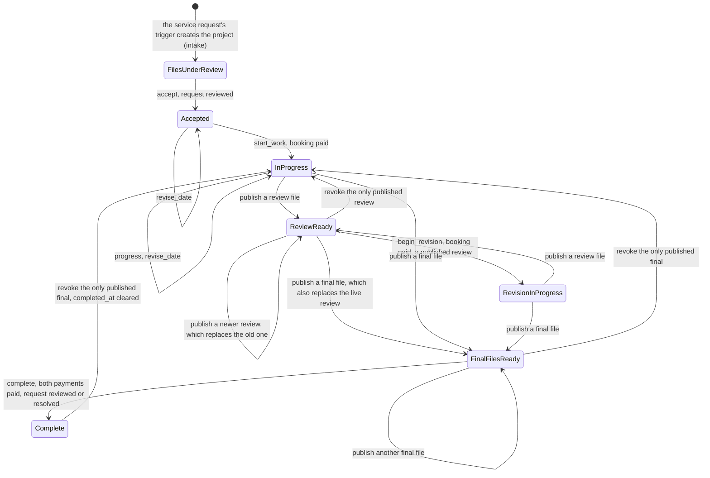
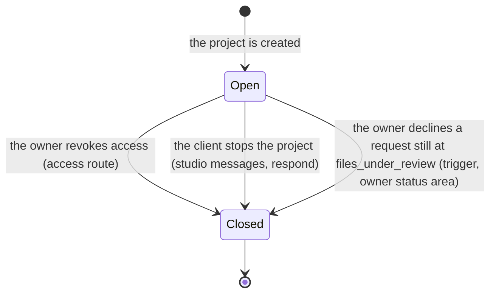
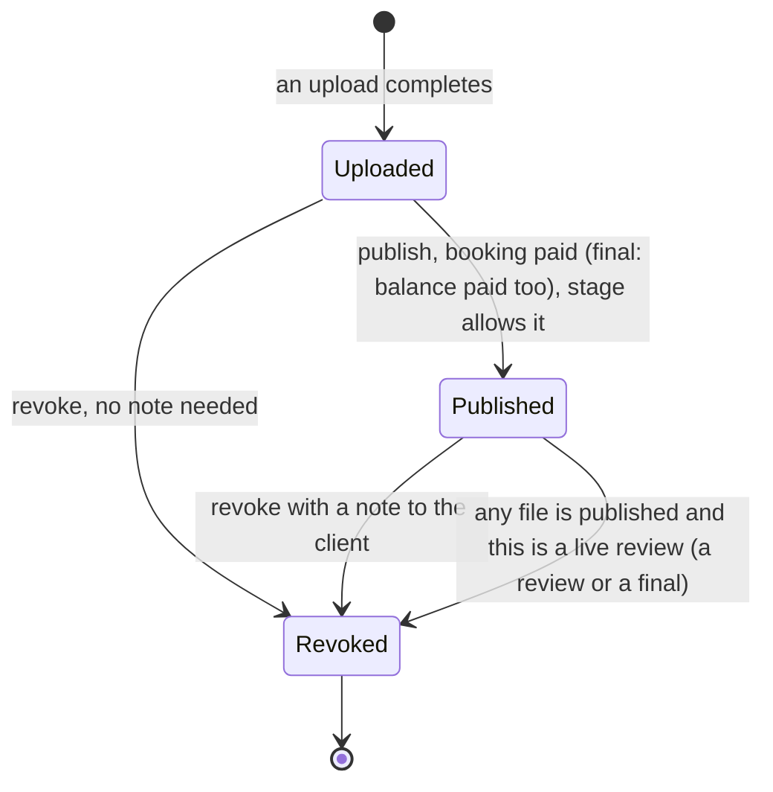
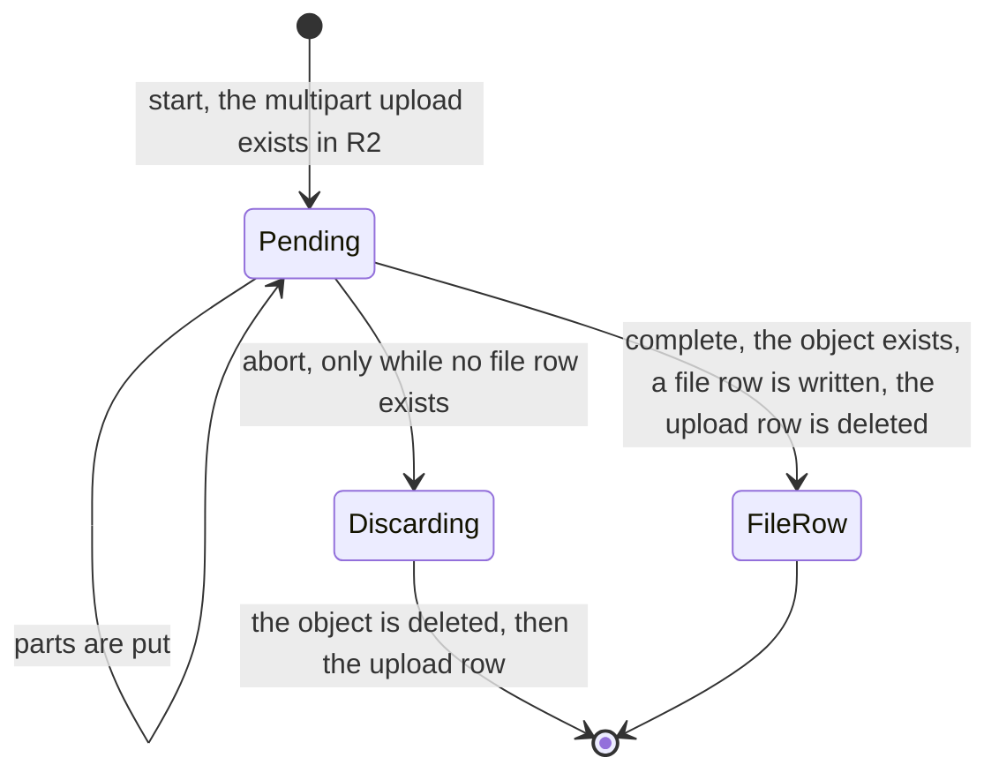
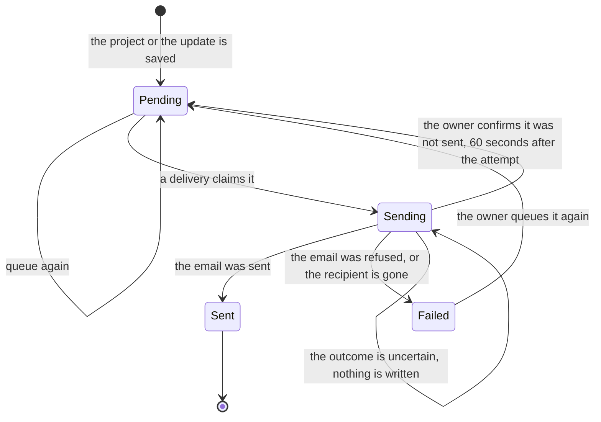
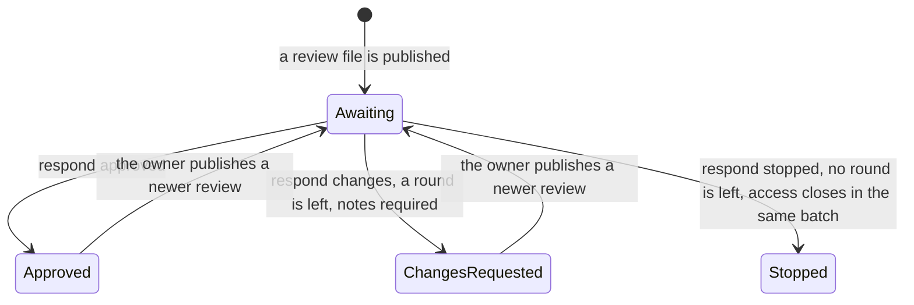

# Audio projects: conversion design

Status: proposed, 2026-11-15. This is the design PR for step 7 of `docs/plans/2026-11-effect-conversion.md`, reviewed before
any conversion code. It changes nothing under `src/`: it adds this document and three Quint models
(`verification/audio-project-messages.qnt`, `verification/audio-project-files.qnt`,
`verification/audio-project-notices.qnt`) with their mutants in `scripts/lib/quint-mutants.mjs`, their sections in `docs/verification.md` and the driver's checks in
`tests/scripts/quint-run.test.ts`. Every claim about today's
code cites a file and, where it gives a line, a line on `origin/main` at `7beca022`; the lib files are `src/lib/audio-project-*.ts`.
The area's route and lib files have the same line counts there as at `14cce493`, except the
studio file route (67 lines now, not 69); claims about `audio-client-access.ts` and `audio-project-updates.ts`, which the
step 0 split changed, cite the file only.

## What the owner is asked

1. One question: should a failed file revoke get a sentence of its own? Today it answers with the publish route's sentence,
   "The file could not be published. Please try again.", because the route has one `catch` for both actions (section 7,
   "Left for the owner"). A sentence that names the revoke is new copy. If the answer is no, today's sentence stays on the
   revoke path, with the status 500, which is what the fixes do.
2. Nothing else is asked. F1 to F5 in section 7 follow the house failure rules (an unexpected failure answers 500 and is
   logged once; a refused request or a lost race answers 409; no new sentences). Two behaviours are today's and the design
   keeps both (section 7, "Today's behaviour, kept"): closing one project's access ends the client's sessions for all of that
   client's projects, and the owner can begin a third revision round.

## The area today

Eight route files, nine handlers (`uploads.ts` has a POST and a PUT; the studio file route serves GET and HEAD with one
function). Every owner route checks, in this order: the owner (403 `{ok:false}`; the uploads route answers its 403 and its 404 with its own sentences, "Owner access required." and "Not found."), the portal flag (404 "Not found"), the
bindings (503), the body (`musicRequest`), the command's shape (400), then the action in one `try` whose `catch` answers
every throw of any kind with 503 and a fixed sentence. The studio routes check the flag, the bindings and the cookie
(`studioSessionFromRequest`): a missing cookie answers 401 on the messages route and 404 "File not found" on the file route, and anything else they cannot show answers 404.

| Route | Handler | Actions | Code |
|---|---|---|---|
| `owner/projects/[id]/access` | POST | revoke | access.ts:1-49 |
| `owner/projects/[id]/invitation` | POST | send (queue, then deliver in `waitUntil`) | invitation.ts:1-73 |
| `owner/projects/[id]/messages` | POST | send, read | messages.ts:1-97 |
| `owner/projects/[id]/updates` | POST | accept, progress, start_work, begin_revision, complete, revise_date, retry_email | updates.ts:1-117 |
| `owner/projects/[id]/uploads` | POST, PUT | start, complete, abort, recover; one part | uploads.ts:1-179 |
| `owner/projects/[id]/files/[fileId]` | POST | publish, revoke | files/[fileId].ts:1-119 |
| `studio/projects/[id]/files/[fileId]` | GET, HEAD | stream or download one file | files/[fileId].ts:1-67 |
| `studio/projects/[id]/messages` | POST | send, read, respond (approved, changes, stopped) | messages.ts:1-197 |

`git grep -ln "audio_project" src/pages/api` also names `owner/requests/[id]/software.ts` (it reads `audio_projects` to
refuse a software offer for a request that has an audio project; offers area). Nothing else under `src/pages/api` writes
the audio project tables. The nine golden corpora, all present on `main`:
`owner-project-access`, `owner-project-file`, `owner-project-invitation`, `owner-project-messages`,
`owner-project-update-notices`, `owner-project-updates`, `owner-project-uploads`, `studio-project-file`,
`studio-projects-messages`.

### The boundary

Inside the area (converted, with their tests): the eight routes, `audio-project-files.ts` (the studio's file read and
stream), `audio-project-invitations.ts`, `audio-project-messages.ts` (writes and the rules), `audio-project-publishing.ts`,
`audio-project-revocation.ts`, `audio-project-updates.ts` (writes, notices, saving), `audio-project-uploads.ts`.

Outside, and left in place because code outside the area calls them: `listProjectMessages`, `revisionRoundsLeft`,
`latestReviewDecision` and `REVISION_ROUNDS` (the studio and owner pages), `clientProjectFiles` (the studio page),
`listProjectUpdates` (the pages), `validateProjectMessage` (the owner request messages route and the software
studio messages route), `readBodyWithin` (agreement attachments, the update visual route), `defaultFirstUpdate`, and
`audio-project-next-step.ts` (pure, used by the owner page). Of these `latestReviewDecision`, `revisionRoundsLeft` and
`clientProjectFiles` keep a decision in SQL; they stay for the pages (28 reads in `.astro` files are not assigned a step by
the plan) and the converted area does not call them. The pure ones (`validateProjectMessage`, `readBodyWithin`,
`privateProjectObjectKey`, and `validProjectDate` and `projectToday` in `project-dates.ts`) are read from where they are: they decide with no SQL and use
no Zod. `src/lib/audio-client-access.ts` (sign-in) belongs to the studio sign-in area. The studio routes and
`src/server/flows/agreement-session.ts` still import `studioSessionFromRequest` from it, and this area keeps that one pure
import of the cookie reader; it imports nothing else from it (`clientPortalEnabled` comes from `client-portal.ts` in the route's binding step, `hashValue` is the existing `hashing` from
`agreement-services.ts`, `deleteRetiredCodes` is one statement in this area's store, and the session is read with the
existing `readStudioSession`, below).

The plan's step 0 split the shared helpers into modules of their own, and it has landed on `main` (PR #305):
`src/lib/client-portal.ts` holds `clientPortalEnabled`, `normalizeClientEmail`, `hashValue` and `keyedHash`, and
`src/lib/project-dates.ts` holds `validProjectDate` and `projectToday`. The converted area imports those two modules and
no longer imports `audio-client-access.ts`; the date helpers already left `audio-project-updates.ts` in that PR.

`src/server/services.ts:544-570` already has a `ProjectInvitation` service whose `deliver` calls the unconverted
`deliverProjectInvitation` for the public intake flow. The conversion replaces that call with the new invitation delivery
flow, so intake and the owner route share one implementation and `audio-project-invitations.ts` is deleted.

## 1. The machines

No machine exists for these entities (`src/server/machines/` holds the generic `next`, `failure` and `settled`). This
section proposes three, drawn here, to be written in the conversion as `audioProject`, `projectFile` and `projectNotice` in
`src/server/machines/`; the stores take every status list from `sourcesOf` and a test holds each list to its machine
(offers area, section 1). The upload row (pending, discarding) has two states and no moves a machine would show; it is
drawn for people only.

### The project

The stage column holds seven values (`migrations/music/0005_audio_projects.sql:4-5`). Access is a separate fact
(`revoked_at`), drawn after the stage. The trigger `audio_project_after_service_request` creates the project at
`files_under_review` (intake).

Moves by action (statement numbers are in section 4): `accept` (U2), `start_work` (U5), `begin_revision` (U8), `complete`
(U11), `revise_date` (U14, a date move, no stage move), `progress` (U1, a note, no move), publish (P2 and P4), revoke a file
(FR3). `progress` applies in every stage but `files_under_review` and `complete`; `revise_date` in every stage but `complete`,
and needs the due date `accept` sets, so it applies from `accepted` on. `files_under_review` refuses progress (updates.ts); `complete` refuses any further update (updates.ts).

Closed is absorbing: no statement of this area clears `revoked_at`. Every client read and every owner write checks it.

### A file

Revoked is absorbing. A published review is replaced by the next file published, a review or a final, in the publish batch
(P3, today's behaviour: its statement has no condition on the version being published); finals are never replaced. A published final also expires one year after publication (`expires_at`); expiry is read by a rule, never
written.

### An upload

### A notice (the invitation and an update notice)

`audio_projects.invitation_status` and `audio_project_updates.notification_status` share the four values and the three
statements (queue, claim, outcome), so one machine and one model cover both.

`sent` is final for an invitation and for an update (the owner's retry refuses it: updates.ts, invitations.ts:80).

### The client's answer to a review

Not stored as a state; derived from the messages table. A review is the latest published review file. It awaits an answer
until a client message with a `review_decision` is created at or after that file's `published_at`. Publishing a newer
review starts a new round. The client answers `approved` (always), `changes` (while fewer than two revision rounds have
begun) or `stopped` (only once two have begun); `stopped` closes the project's access in the same batch.

## 2. The rules

Pure functions built with `rule(...)` or `alwaysWrites(...)` in `src/server/rules/`, one file per concern. A refusal is a
`Data.TaggedError` with a `say` sentence in its own file; the route maps each tag with `Effect.catchTags`. The sentences
below are today's, exactly (the fixes in section 7 change status codes, never a sentence).

| Rule file | Rules | Refusals (status, sentence) |
|---|---|---|
| `audio-project-access.ts` | `revokeAccess`: the project exists and is open | AccessAlreadyClosed (409, "Project access is already closed.") |
| `audio-project-notices.ts` | each rule takes the kind of notice and states that kind's own conditions (below). `queueNotice`: status failed or pending, or sending and confirmed and stale (60 s); project open, request not withdrawn, email present, and for the invitation the request's kind is service; `claimNotice`: for the invitation, status pending, project open, and the request is a service, not withdrawn, with an email; for an update notice, status pending and nothing else; `deliveryOutcome`: sent, failed, or uncertain (writes nothing), and whether the outcome write needs an open project (the invitation's does, the update notice's does not) | NoticeNotQueueable (409, "This invitation cannot be sent again here." for the invitation, "This email cannot be retried here." for an update) |
| `audio-project-messages.ts` | `postOwnerMessage`, `clientLookup` (the lookup, decided first: session open, the session's email is the request's, the request's email not blank, project open, request not withdrawn), `postClientMessage` (stage not complete, and fewer than 12 client messages in the last 300 seconds), `answerReview` (stage review_ready, a published review that awaits an answer, the named review is the latest, the decision allowed by the rounds used, and the same count rule), `markRead` (after the lookup: the message is the owner's and unread; the route answers `{ok:true}` whatever the rule decides after the lookup, as today) | MessageNotAccepted (409, none: `{ok:false}`), ClientRateLimited (429, "Please wait a few minutes before sending another message."), ProjectHidden (404, `{ok:false}`, the lookup's refusal), ReviewNotAnswerable (409, "That answer is not available for this review. Refresh the page to see where your song stands.") |
| `audio-project-updates.ts` | one rule per action, each from the plain facts: state (stage, due dates, request status, access) and payments. `beginRevision` needs the stage `review_ready`, the booking paid, the project open and the request not withdrawn, and a published review; `complete` needs the stage `final_files_ready`, both payments paid, the request reviewed or resolved, and a published final. The write's guards keep both file conditions, `EXISTS(a published review)` in U8's and `EXISTS(a published final)` in U11's, as today: a stage that implies a published file is true of every state the routes produce, but the corpus races revoke the file row alone just before the stage update (`tests/golden/owner-project-updates.test.ts`, "begin a revision after the review is revoked" and "complete after the final is revoked"), and today that update changes no row and answers 409 | ProjectCannotTakeUpdate (409, "This project cannot take that update right now.") |
| `audio-project-files.ts` | `publishFile`: file uploaded, object key matches, object size matches, project open, request not withdrawn, booking paid, final needs balance paid, stage allows the version; `revokeFile`: file uploaded or published, a published file needs a note of 1 to 1,000 characters, project open; the stage reset decision | FileNotPublishable (409, "This file cannot be published yet. Check the project and payment state."), FileNotRevocable (409, "This file cannot be revoked here. A shared file needs a short note to the client.") |
| `audio-project-uploads.ts` | `startUpload`, `finishUpload`, `putPart` (the part length, the discard state), `abortUpload` | UploadNotReady (409, "This project is not ready for file upload."), UploadGone (404, "This upload is no longer available."), UploadSizeMismatch (409, "The file size did not match. It was not published."), UploadNotFinishable (409, "This upload cannot be finished now."), PartWrongSize (400, "This file part has the wrong size."), PartNotUploadable (409, "This part could not be uploaded. Please try again.", for a part put while the upload is being discarded or R2 no longer has it, F2 and F4) |
| `studio-project-file.ts` | `serveProjectFile`: session open, the session's email owns the request, project open, request not withdrawn, file published and not revoked, `published_at` not after now, not expired, the stage and payment conditions of the version, the object key matches, a download needs `downloadable`, a final is available one year | FileHidden (404, "File not found", with `cache-control: private, no-store`) |

Retries. Two guards retry through `decideAndSave`, by raising `ChangedSinceRead`: the batch guard of FR3 (the other published
files and the stage) and the batch guard of P3 (the live review files), besides a unique violation a rule's facts depend on.
Every other lost guard is its named 409 refusal and is not retried. The 60 second staleness window of a stuck notice is a
rule input named once in `audio-project-notices.ts` for the invitation and the update notice (today each repeats it).

The owner's own email. Today a blank owner email (the actor) is refused before any D1 or R2 call by publish, file revoke and
access revoke (`audio-project-publishing.ts`, `audio-project-revocation.ts`), and by the updates after the project state
read (U17). Each flow makes it its first check, in that order, so the publish order below stays neutral: a blank actor is
refused before the file read and before R2 `head`, and an update refuses it after the U17 read; four corpus cases record it.

A lost guard. The write re-checks today's conditions (section 4) and a guard that refuses is not retried: the request answers
what its refused write answers today, with the same tag a read-time refusal uses (MessageNotAccepted 409, ClientRateLimited
429, ReviewNotAnswerable 409, FileNotPublishable 409, FileNotRevocable 409, ProjectCannotTakeUpdate 409, NoticeNotQueueable
409, UploadNotFinishable 409, AccessAlreadyClosed 409). No race answers 404 or 401: the corpus cases that change a fact
"after the lookup" or "before the insert" answer 409 (or 429) today, so a read-time 404 happens only where the old lookup
answered it.

The lookup comes first. Today the studio messages route looks the project up before it reads the message
(`clientProjectForSession`, studio `messages.ts`): a session that is not open, an email that is not the request's, a blank
request email, a closed project and a withdrawn request all answer 404 `{ok:false}` there, with no count read and no read
mark. The design keeps that order: the rule `clientLookup` decides these conditions first from the session read and the
project read, answers ProjectHidden (404), and nothing after it runs. Only refusals after the lookup (the stage, the review,
the rounds, the message, the count, or a guard lost at write time) go through the rate count described next. The text checks
(the body's length and links, and the notes a change request needs, which answer 400 today) also come before the count: an
invalid body with a full rate window answers 400, not 429, as today. The count is read only after the lookup and the text
checks have passed, so a failing count statement on a hidden project still answers 404.

The rate limit is a fact first, as the offers design decided for conditions only a guard checks
(`docs/plans/2026-11-offers-conversion.md`, "Conditions only a guard checks today", and AGENTS.md, "Back-end rules"). The
count of the client's messages in the last 300 seconds is read after the lookup and the text checks (M6), the rule refuses a full window with the
named ClientRateLimited, and the write keeps `count < cap` as its guard (M2, M3), so a request that read room and lost it to
another request is refused by the write. After a refused write the count is read once more (M6 again), because the race
may have filled the window: a full count then answers 429, otherwise the write's refusal answers 409 as today. **429 beats
every other refusal after the lookup**: the rule checks the count before the stage and the review, so a client whose window
is full is answered 429 even when the project is complete (the corpus cases "send when the rate limit fills after the
lookup", 429, and "the rate-limit count fails after a refused send", 500 on a complete project). The count is now read with
every client message and answer, so a failed count read answers 500 for a request that would have succeeded; today only a
refused write reaches that read. The conversion's golden run reports any corpus case that records otherwise.

Hidden answers: every client refusal of the file route is one tag, FileHidden, so an unknown file, another client's file, a
revoked file, an unpaid review and a closed project answer alike. The studio messages route answers 404 `{ok:false}` for
the project it cannot show before it reads anything of the message, so another client's project and a missing one alike
(studio messages.ts:77); that stays.

Which reads are batched together. The studio session is read by the existing store function `readStudioSession`
(`src/server/agreement-store.ts:337`: `email`, `expires_at`, `revoked_at` of `audio_client_sessions`, by the hash of the
cookie's token), a statement of its own and not part of any batch, and decided by the existing `openStudioSession` rule
(`src/server/rules/agreement-session.ts:122`), both already used by the agreement download. Everything else a decision
needs is one `batch` that runs after the session read: the project (`audio_projects` joined to `owner_requests` by key, no
filters), and, per action, the payments, the latest published review and the decisions since it, the revision rounds, the
file or the upload row. A session that ends between the two reads is the same fact as a session that ends after the batch,
and the write's guard re-checks the session (the model's `sessionEnds` step). The owner routes have no session; their
batch is the project's facts only.

The client's email rule. A rule compares the session's email with the request's, and the two reads that exist today
differ, so the rule states both. The project lookup (`clientProjectForSession`, `audio-client-access.ts`) refuses a
request whose email is blank (`r.email<>''`); the file read (`clientFileScope`, `audio-project-files.ts:21-32`) has no such
condition and relies on the join of the session's email to the request's. The design keeps each: the messages routes and the
project page refuse a blank request email (a hidden answer), the file route does not check it separately, and its rule
(`serveProjectFile`) names that the join alone decides, so a request with a blank email shows files to a session with a
blank email exactly as today (no session has one: sign-in refuses it, so this is unreachable and kept only so the
conversion adds no condition). The unconverted `clientProjectForSession` and `clientProjectFile` are not called.

## 3. The flows and the services

One flow per action, composing the store and the rules in the order the old code ran its calls (the harness counters land
in rows), with `now` and ids passed in as thunks:

| Flow | Shape |
|---|---|
| `revokeProjectAccess` | read project (plain); rule; batch (AR1 to AR4, with the client's email read first); best-effort `deleteRetiredCodes` after the batch, as today ("no such table" is silent; any other failure logs once through `logUnexpected`, a change of log text) |
| `queueInvitation`, `retryUpdateNotice` | read notice and open facts in one batch; `queueNotice`; guarded write; then `waitUntil` delivery |
| `deliverNotice` (the invitation and an update notice share it, each with its own conditions, section 4) | read; `claimNotice`; claim (CAS); read recipient facts; rule; `Mail.send`; outcome write (CAS). `tapError` and `catchTag` mark the notice failed when the recipient read fails, as today. The four fixed `console.error` sentences of the background delivery ("Studio invitation email state is uncertain." and the update, file and revocation versions), written when the `waitUntil` task rejects while the task still settles fulfilled, are recorded in seven corpus cases and are kept as they are: they are not moved to `logUnexpected` |
| `postOwnerMessage`, `postClientMessage`, `answerReview`, `markRead` | the studio session by its own read (`readStudioSession`, a separate statement); one batch for the project and request; the lookup rule (404, nothing after it runs, no count read); the text checks (400, as today, before any count); then one batch of what the action's rule needs (latest review, decisions since it, rounds used, the client's message count); the rule (the count first); guarded insert (section 4). A refused write is caught with `Effect.catchTag` on its refusal tag, the count is read again (M6), and the flow fails again with `ClientRateLimited` when it is full and with the same named refusal otherwise, so no refusal is swallowed and the route maps each tag. `markRead` ends in a guarded update after the lookup and answers `{ok:true}` |
| `saveProjectUpdate` | one read batch; the action's rule; guarded batch (U1 to U16); a lost guard answers 409, no retry |
| `startUpload`, `putPart`, `finishUpload`, `abortUpload` | the section 6 protocol; R2 calls through `AudioBucket` with `Effect.tryPromise`, as `agreement-download` reads its bucket |
| `publishFile`, `revokeFile` | `publishFile`, in today's order: one read batch (the file, the project, the request, the payments, the live review ids); the file rule (uploaded, object key matches); R2 `head`, and the size rule; then the project rule (open, not withdrawn, booking paid, balance paid for a final, stage allows the version), so an R2 failure on an unpublishable project is still 500 and the 12 refused publishes in the corpus keep their `head`; guarded batch through `decideAndSave` (P3's guard); `waitUntil` notice delivery. `revokeFile`: read, rule, guarded batch through `decideAndSave` (the retry re-decides the stage reset, section 4, FR3); the file's own guard answers 409 at once |
| `serveProjectFile` | session; project and file facts in one batch; rule; R2 `head` (a missing object answers 404 "File unavailable", a different size 500, F3); a GET reads the object with `get` (an invalid Range answers 416), while a HEAD makes no `get` and ignores Range; the access upsert (FA1) last, and only for a GET that answered 200 or 206 |

Services. Reused: `MusicDb`, `AudioBucket`, the existing `hashing` helper and `ProjectInvitation` (reimplemented as the
flow). New: one small mail service, `StudioNoticeMail`, over `sendStudioSignInNotice` (`audio-resend.ts`), which answers
sent, refused or uncertain. `liveMail` (`services.ts`) wraps `sendMail` (`resend.ts`), a different function from
`sendAudioMessage`, and the corpus records the Resend call byte for byte, so `Mail` is reused only if a differential test
shows the two send identical requests and classify outcomes alike; until then the wrapper is the safe choice, as
`AgreementMail` is for the agreement mail.
The R2 calls the flows make on `AudioBucket` are `head`, `get`, `delete`, `createMultipartUpload`, `resumeMultipartUpload`, and the
multipart handle's `uploadPart`, `complete` and `abort` (`audio-project-uploads.ts`); each is wrapped in `Effect.tryPromise` and
fails with a named error carried by the store or flow that makes it (`ObjectStoreFailed`). The best-effort aborts
(`abort().catch(() => {})` after a failed start) are a named failure ignored with `Effect.ignore`, as AGENTS.md "Where code
goes" (e) allows for named failures. The portal flag and the missing-binding 503 come from `bindingsOrUnavailable`.

Where the pieces live, as AGENTS.md "Where code goes" and "Rule files, stores and answers" require. The store is one file,
`src/server/audio-project-store.ts`: one function per statement of section 4 over the binding service, each with
`Effect.tryPromise`, a rejection becoming `AudioProjectStoreFailed` (carrying its cause in `failure` only where the route logs
it) and a unique violation a rule's facts depend on, and the batch guards of FR3 and P3, becoming `ChangedSinceRead`, which
`decideAndSave` reads and decides again; every other lost compare-and-set is its named 409 refusal and is not retried. The R2 calls fail with `ObjectStoreFailed`, carried by the flow or store that makes
the call. The three machines are `audioProject`, `projectFile` and `projectNotice` in `src/server/machines/` and each gets a
test beside the existing ones (`tests/server/machines-audio-project.test.ts` and so on, like `machines-next.test.ts`); the
folder has no README to update. The fixed answers that are not a refusal's `say` (the hidden 404 `{ok:false}`, the routes'
failure sentences, the file route's "File unavailable" and "Private audio is temporarily unavailable") live in an area
answers module, `src/lib/audio-project-answers.ts`, beside `musicRequest` in `src/lib/music-request.ts` as the music
routes do; a route passes `{ route, answer }` to `runRoute`.

## 4. The store: every statement and its class

Classes: (a) plain read, (b) write guarded by key or constraint, (c) compare-and-set write, (d) decides an outcome. After
the conversion there is no (d): each (d) below becomes a plain read, a rule that refuses by name, and a write. As in the
offers design (`docs/plans/2026-11-offers-conversion.md`, section 2, "Conditions only a guard checks today" and "Guard
failures and retries"), **the write keeps today's conditions as its compare-and-set guard** (the project is open, the
stage is one of the allowed, the payment is paid, the count is under the cap), the rule reads the same facts first and
refuses by name, and **a refused guard is not retried**, with two exceptions that retry through `decideAndSave` (the stage reset of a file revoke, FR3, and the live review a publish revokes, P3, both below), besides a unique violation a rule's facts depend on: it answers what a refused write answers today. Equality with the
snapshot would refuse races that succeed today (an upload completing while a publish moves the stage from `in_progress`
to `review_ready`). Two facts a rule needs together are read in one `batch`. Every new read must match no golden hook
pattern: the hooks run just before the matching statement (`tests/golden/README.md`), so the new read sees the old row and
the guard refuses, as today.

The stage reset after a file revoke (FR3) is a decision, so a rule makes it. `revokeFile` reads the file and the version's
other published files (their ids) and the stage, and decides the reset: reset when no other published file of the version
is left and the stage is the one the version resets (`review_ready` for a review; `final_files_ready` or `complete` for a
final). The batch carries a guard that the version's other published files are the ones the rule read and that the stage is
the one it read; the guard raises, the whole batch rolls back, and `decideAndSave` asks again on fresh facts, so the retry
re-decides (three tries). Two finals revoked at once both still succeed, as today: the first batch passes its guard and
revokes without a reset (the rule saw the other final), the second finds the others moved, rolls back, reads again, sees
none left, and revokes with the reset. The file's own guard is separate and is not a retry: the file update still requires
`status` equal to the status read and an open project, and an empty `RETURNING` answers 409 (FileNotRevocable) at once,
without a retry. After a retry the rule judges the fresh file row, so a file that was revoked meanwhile also ends in the
409. The model checks the design (the revoke step in `audio-project-files.qnt`, with `RevokeStaleReset` as the mutant that
drops the guard and the retry).

| ID | Statement | Today | After |
|---|---|---|---|
| AR1 | UPDATE `audio_projects` SET `revoked_at`... WHERE `revoked_at IS NULL` RETURNING (revocation.ts:15) | (c) | (c) |
| AR2 | UPDATE `audio_client_sessions` ... WHERE `email=(subquery by project and revocation id)` (revocation.ts:19) | (d) | (c): `email=?` with the email read first, and `EXISTS(the project's `access_revocation_id` is this request's revocation id)` kept as the guard, so a request that lost the revoke to another one ends no session |
| AR3 | DELETE `audio_client_signin_codes` WHERE `email=(subquery)` (revocation.ts:24) | (d) | (c): the same email read and the same revocation id guard (the corpus case "race: revoked by another request just before the write" keeps `tok-1` and its sign-in code) |
| AR4 | INSERT `audio_project_audit` SELECT ... WHERE revocation id (revocation.ts:29) | (b) | (b) |
| AR5 | DELETE `audio_client_codes` WHERE `email=(subquery)`, best effort (audio-client-access.ts) | (d) | (b): `email=?` with the email read first; it has no revocation link today and gets none. A "no such table" failure stays silent: it becomes the normal case once migration 0028 drops `audio_client_codes` (issue #271). Any other failure logs once through `logUnexpected`, which changes the log text (today `console.error` with the error class only); no answer changes |
| FR1 | SELECT `version,status` of the file (revocation.ts:50) | (a) | (a) |
| FR2 | UPDATE the file to revoked WHERE `status=?` AND EXISTS open project (revocation.ts:66) | (c)+(d) | (c): the read status and an open project; the rule refuses a closed project first; an empty `RETURNING` answers 409, no retry |
| FR3 | UPDATE the stage to `in_progress` WHERE stage IN and NOT EXISTS another published file AND the file update landed (`EXISTS(file id=? AND revocation_id=?)`, revocation.ts:75-78) | (d) | (c): written only when the rule decided the reset; `stage=?` (the stage read), the same revocation-id link to this request's file update (kept: a file update refused because the project closed in between resets nothing), and a batch guard that the other published files are the ones read; a moved guard rolls the batch back and `decideAndSave` re-decides |
| FR4 | INSERT audit WHERE `changes()=1` (revocation.ts:91, which counts FR3's row) | (d) | (b), written with FR3 only when the rule decided the reset, and keeping the link: it is written only if FR3 changed the stage |
| FR5 | INSERT `audio_project_updates` from the file's revocation id (revocation.ts:100) | (b) | (b) |
| P1 | SELECT the file (publishing.ts:26) | (a) | (a), with the project, request and payments in the same batch |
| P2 | UPDATE the file to published WHERE status AND EXISTS(access, payments, stage) RETURNING (publishing.ts:52) | (d) | (c): `status='uploaded'` and the conditions today's EXISTS checks; the rule refuses first, after the R2 `head` (section 3) |
| P3 | UPDATE the other published review files to revoked, WHERE the file's `publication_id` (publishing.ts:71), with no condition on the version being published | (b) | (c): the read lists the live review ids, the statement revokes them by key (`id IN (...)`, `status='published'`) linked to this publication, and a batch guard that the live reviews are still the ones read raises when they moved; `decideAndSave` reads and decides again (three tries). A review published in between is therefore superseded on the retry, so two publishes at once leave one live review |
| P4 | UPDATE the stage WHERE the file's `publication_id` (publishing.ts:76) | (c) | (c) |
| P5 | INSERT `audio_project_updates` ... RETURNING id (publishing.ts:80) | (b) | (b) |
| I1 | UPDATE invitation pending to sending WHERE pending, open, EXISTS(request kind='service', status not withdrawn, email present) (invitations.ts:17) | (d) | (c): the same four conditions, as today; the rule refuses first |
| I2 | SELECT the recipient's email, filtered by kind, status, email and access (invitations.ts:29) | (d) | (a): the columns, decided by the rule; no recipient is a failed outcome |
| I3 | UPDATE invitation to failed WHERE sending AND open, after a recipient read that threw (invitations.ts:35) | (c) | (c): sending and open, as today |
| I4 | UPDATE invitation to sent or failed WHERE sending AND open (invitations.ts:57) | (c) | (c): sending and open, as today; an email sent just after a revoke leaves the invitation at `sending` |
| I5 | UPDATE invitation to pending WHERE status IN, or sending and stale, AND open AND EXISTS(request kind='service', not withdrawn, email present) (invitations.ts:76) | (d) | (c): the same conditions; the rule refuses first |
| N1 | UPDATE the update's notice pending to sending WHERE `id` AND pending (updates.ts) | (c) | (c): `id` and pending only. It has no access condition and none is added: a closed project's update notice is claimed, finds no recipient and ends `failed`, as today |
| N2 | SELECT the recipient's email, filtered by status, email and access, with no kind (updates.ts) | (d) | (a): the columns, decided by the rule; no recipient is a failed outcome |
| N3 | UPDATE the update's notice to failed WHERE `id` AND sending, after a recipient read that threw (updates.ts) | (c) | (c): `id` and sending, no access condition |
| N4 | UPDATE the update's notice to sent or failed WHERE `id` AND sending (updates.ts) | (c) | (c): `id` and sending, no access condition |
| N5 | UPDATE the update's notice to pending WHERE `id`, request, status IN or sending and stale, AND open AND EXISTS(request not withdrawn, email present), with no kind (updates.ts) | (d) | (c): the same conditions; the rule refuses first |
| O1 | SELECT `request_id` FROM `audio_projects` (owner messages.ts:48, inline in the route) | (a) | (a), in the read batch |
| M1 | INSERT the owner's message SELECT FROM project and request WHERE stage, access, status (messages.ts:84) | (d) | (c): today's conditions |
| M2 | INSERT the client's message SELECT ... session, access, stage, and a count subquery (messages.ts:109) | (d) | (c): today's conditions, the count under the cap among them; the rule has read the same count first |
| M3 | INSERT the decision SELECT ... session, access, review awaiting, rounds, named review, count (messages.ts:157) | (d) | (c): today's conditions |
| M4 | UPDATE `audio_projects` revoked WHERE EXISTS the stopped decision, in the stop batch (messages.ts:192) | (d) | (c), in the same batch as M3 |
| M5 | INSERT audit `client-stopped` WHERE EXISTS the stopped decision (messages.ts:197) | (d) | (b): written in the stop batch with M4 and linked to it, `EXISTS(project WHERE request_id=? AND revoked_at=?)` with this request's own `now`, in place of the EXISTS of the decision row |
| M6 | SELECT the rate count (messages.ts:259) | (a), after a refused write | (a), in the read batch and again after a refused write; 429 beats every other refusal after the lookup (section 2) |
| M7 | UPDATE the owner's read mark WHERE id, request, actor, `read_at IS NULL` (messages.ts:280) | (b) | (b) |
| M8 | UPDATE the client's read mark WHERE EXISTS(session, project, request) (messages.ts:292) | (d) | (c): the session and access conditions stay as the write's guard (`token_hash`, session not revoked and not expired, project open, request not withdrawn), plus `read_at IS NULL`; the rule `markRead` reads first. The corpus case "read when the session is revoked after the lookup" fires its hook before this statement and records `read_at` null, so an unguarded write would set it |
| U1 | INSERT a progress note WHERE stage and access (updates.ts) | (d) | (c) |
| U2, U3, U4 | accept: UPDATE the project (`files_under_review`, `updated_at`, open, request reviewed), INSERT the update, INSERT the audit by `changes()=1` (updates.ts) | (c)+(d), (d), (d) | (c), (b), (b): the update and the audit are written only when the project update landed, which `changes()=1` told today; the link is the project row now carrying this request's `updated_at` (its own `now`) and the target stage, `EXISTS(project WHERE request_id=? AND stage=? AND updated_at=?)`, a key-guarded insert |
| U5, U6, U7 | start_work: UPDATE the project (`accepted`, `updated_at`, open, request not withdrawn, booking paid), INSERT the update, INSERT the audit (updates.ts) | (c)+(d), (d), (d) | (c), (b), (b), with the same link as U2 to U4 |
| U8, U9, U10 | begin_revision: UPDATE the project (`review_ready`, `updated_at`, open, request not withdrawn, a published review), INSERT, INSERT (updates.ts) | (c)+(d), (d), (d) | (c), (b), (b), with the same link; the guard keeps `EXISTS(a published review)`, so a revoked review answers 409 as today |
| U11, U12, U13 | complete: UPDATE the project (`final_files_ready`, `updated_at`, open, request status, both paid, a published final), INSERT, INSERT (updates.ts) | (c)+(d), (d), (d) | (c), (b), (b), with the same link; the guard keeps `EXISTS(a published final)`, so a revoked final answers 409 as today |
| U14, U15, U16 | revise_date: UPDATE the project (`current_due_at`, `updated_at`, not complete, open, request not withdrawn), INSERT, INSERT (updates.ts) | (c)+(d), (d), (d) | (c), (b), (b), with the same link, on `current_due_at=?` and `updated_at=?` |
| U17 | SELECT the project state, request status and payments (updates.ts) | (a) | (a) |
| S1 | SELECT 1 WHERE EXISTS(project, request, payment, stage) (uploads.ts:40) | (d) | (a): the columns, one rule |
| S2 | INSERT the upload row SELECT WHERE EXISTS(...) (uploads.ts:70) | (d) | (c): today's conditions |
| S3 | SELECT the upload (uploads.ts:104) | (a) | (a) |
| S4 | INSERT the file row SELECT FROM the upload WHERE `state='pending'` AND EXISTS(...) ON CONFLICT DO NOTHING (uploads.ts:211) | (d) | (c): `state='pending'` and today's conditions |
| S5 | SELECT the file by id (uploads.ts:227) | (a) | (a) |
| S6 | DELETE the upload row (uploads.ts:233) | (b) | (b) |
| S7 | UPDATE the upload to discarding WHERE NOT EXISTS the file (uploads.ts:254) | (d) | (c): `NOT EXISTS the file` kept as the guard; the model's `AbortNoCas` is the removal of this statement's mark |
| S8 | DELETE the upload row WHERE EXISTS the file (uploads.ts:261) | (d) | (b) after the read |
| S9 | DELETE the upload row WHERE `state='discarding'` AND NOT EXISTS the file (uploads.ts:288) | (c)+(d) | (c) |
| C1 | the client's file and file list reads: five joins and nine filters, ORDER BY (files.ts:78, 98) | (d) | (a): plain rows, one rule |
| C2 | `clientProjectForSession`: join of session, request, project, payments with filters | (d) | (a): the session, the project, the request, the payments |
| FA1 | INSERT or UPDATE `audio_project_file_access` ON CONFLICT (files.ts:182) | (b) | (b) |

The counts of statements by class are recomputed from this table in the conversion record, where the plan's counts are updated.

The sign-in area's tables. AR2, AR3 and AR5 write `audio_client_sessions`, `audio_client_signin_codes` and
`audio_client_codes`, which belong to the studio sign-in area. The three statements live in
`src/server/studio-signin-store.ts`, as `endClientSessions`, `deleteClientSigninCodes` and `deleteRetiredClientCodes`, one
function per statement and each taking the email. The owner's plan converts studio sign-in (step 2) before this area, and
`main` has no sign-in store yet. Step 2 creates that file. If this conversion starts before step 2 has merged, it creates the
file with only these three functions under these names, and step 2 extends it. No copies exist anywhere else.

## 5. The database triggers

`audio_project_after_service_request` (intake): this area never creates a project and does not call it; it relies on every
service request having one row and states that in the rule files that read a project (a missing project answers 409 on access, invitation, updates and upload start, 404 only on owner messages, and a hidden answer for the client).

`audio_project_close_declined_request` (owner status area): the owner declining a request still at `files_under_review`
sets the project's `revoked_at` and writes an audit row (`migrations/music/0015_audio_project_close_declined.sql`). This
area does not fire it, but it is the second writer of `revoked_at` besides AR1 and M4, and every guard in section 4 that
names the access checks `revoked_at IS NULL` at the write, so a decline in the middle of any protocol is a lost guard and
is modelled as access closing (the models' `ownerRevokes` step). It is named in the rule files that read the access.

## 6. Verification: which protocols are real

A read followed by a write that depends on it, where another request can change the facts between, is real when no single
statement holds the whole decision. After the conversion the rule reads first and the write re-checks today's conditions
(section 4), so the old single-statement atomicity stays for each write, and what the models check is the set of
conditions each write keeps: each is needed, and none is missing. A refused guard is not retried, with two exceptions: the
stage reset after a file revoke (section 4, FR3) and the live review a publish revokes (P3) are decided by a rule, their
batch guards raise when the facts moved, and the files model has both retries (three tries in all).

How the properties are written. Each property reads the stored rows, never a flag set from the guard that is being
checked. Every write takes the next stamp of one counter (the order D1 serializes the statements in, as `created_at`,
`published_at`, `revoked_at` and `completed_at` order them in the tables), and a property compares the stamps of the rows:
no message is stamped after the close, no revision round began between the review a decision names and the decision, and
so on. The one exception is the world in the notices model (the emails that went out), which is not a row.

The models are written before any code and run in the pooled driver (`verify:quint:all`). The whole driver exits 0 in about
64 seconds of wall time and 398 seconds of CPU time with the three models in the pool, a figure the stamped properties and the retries did not move. The plan's budget is
2 minutes 30 seconds on a 4-core CI runner, which this has not been measured on (UNVERIFIED until CI reports it).

**Messages and review decisions** (`verification/audio-project-messages.qnt`, module `projectMessages`). Three requests,
a client session, the owner's publishing, beginning a revision and closing access between a request's read and its write,
and a clock for the 5 minute window (scaled: 2 messages in 2 ticks, 2 revision rounds). The session is read first and the
rest in one batch; the model takes both as one step (a session that ends between them is the same fact as one that ends
after the batch, and the write re-checks it). The write is one statement that checks today's conditions and the rate count
(the rule reads the same count first, section 2), the stop one batch. The owner may begin any number of rounds, as the code allows; the model reaches at most three, a bound on the search and not a rule. A write the guard refuses writes
nothing and the request answers what a refused write answers today (409, or 429 when the count is full): the corpus cases
"send when the session is revoked after the lookup" and the nine like it record exactly that.

| Property | Mutant that breaks it |
|---|---|
| `clientRateBounded`: no window holds more messages than the cap | `NoCount`: the write does not check the count |
| `oneDecisionPerReview`: the decisions that name a review are at most one | `NoDecision`: no check of the decisions since the review |
| `decisionNamesLatestReview`: no review was published between the one an answer names and the answer | `NoReview`: no check of the latest review |
| `changesWithinRounds`: the rounds begun before a change request are fewer than two, before a stop are two | `RuleNoRounds`: neither the rule nor the write checks the rounds |
| (equivalent mutants, which keep every property; messages) | `WriteNoRounds`: only the write drops its rounds check, and it is not reachable in a race: a round is begun by leaving `review_ready`, and the way back is a newer review, which the write's checks of the stage and of the latest review already refuse, so the write's rounds check is redundant but kept as today's condition; `RuleNoCount`: only the rule drops its count read, and the write's guard refuses |
| `writtenForOpenAccess`: no message is stamped after the close or the session's end | `NoAccess`: no check of session and access |
| `answeredInReviewStage`: no revision round began between the review an answer names and the answer | `NoStage`: no check of the stage |
| `stopClosesAccess`: no state holds the stopped decision with the access open | `StopSplit`: the close is a separate statement after the decision |

**Files, uploads and completion** (`verification/audio-project-files.qnt`, module `projectFiles`). Five requests with
parts: one starts an upload, one completes it, one aborts it, two are the owner's publish, revoke or completion of a file;
the world closes access, withdraws the request or voids a payment while a request is between its read and its write.
Starting points cover a fresh project, a published review, a published final, an extra uploaded file of either version
and two published finals. R2 is separate steps (create, complete, delete, abort). This is the "upload completes while
access is revoked" protocol: the file row is a guarded write after R2 completed the object, so the object can exist with
no row (an orphan the owner's abort or the incomplete-upload lifecycle removes), and the model checks the reverse never
happens. A lost guard writes nothing and answers 409. The revoke reads the version's other published files and the stage;
the rule decides the reset from them; the batch guard compares both with what is stored now; a moved guard rolls the batch
back and the request reads again (a third failure answers 409), while a file whose own status moved answers 409 at once.

| Property | Mutant that breaks it |
|---|---|
| `uploadsOnlyForOpenProject`: an upload row's stamp precedes the close, the withdrawal and the booking's voiding | `StartNoAccess` |
| `filesOnlyForOpenProject`: the same for a file row | `InsertNoAccess` |
| `publishedOnlyWhenPaidAndOpen`: a published file's stamp precedes them, and for a final the balance's voiding | `PublishNoAccess`, `PublishNoPayment` |
| `stageCoherent`: a published final means a final stage, and a completion is stamped exactly while the stage is complete | `PublishNoStage`; `ResetNoLink`: the revoke's stage reset is written although its own file update was refused (the reset is not linked to the file update, FR3) |
| `oneLiveReview`: at most one review is live (any publish revokes the live review, P3) | `NoSupersede`; `PublishStaleSupersede`: the publish revokes the review ids it read without the guard that they are still the live ones (and without the retry), so two publishes at once leave two live reviews |
| `finalStageHasNoLiveReview`: a project at `final_files_ready` or `complete` has no live review, so publishing a final supersedes it (the starting point `reviewFinal` has a published review, an uploaded final and a paid balance; the model has two files, so a final publish racing a review publish is not explored) | `FinalNoSupersede`: a final publish does not revoke the live review |
| `readyStagesHaveFiles`: review_ready has a published review, final_files_ready and complete a published final | `RevokeStaleReset`: the revoke writes the reset it decided from its read without the guard that the other files and the stage are still the ones read (and without the retry); `CompleteNoStage`: complete compares neither the stage nor the published final |
| `completedOnlyWhenPaid`: the completion's stamp precedes the voiding of the booking and of the balance | `CompleteNoPayment` |
| `fileHasObject`: an uploaded or published file has its R2 object | `AbortNoCas`: abort deletes the object without first marking the row discarding; `InsertNoState`: the insert does not require a pending upload row |

Findings from writing it. The completion's write keeps both of today's conditions, the stage and a published final (U11). In the model the stage implies the file, because revoking the last final resets the stage in the same batch, so dropping only the file check is an equivalent mutant (`CompleteNoFile`) and dropping both breaks `readyStagesHaveFiles` (`CompleteNoStage`); the plan keeps the file condition anyway because a corpus race revokes the file row alone and today answers 409. The same holds for the published-review condition of `begin_revision` (U8), which the messages model does not model. The stage reset after a revoke must be decided from facts
the write still sees (section 4, FR3): a reset decided from the count the read saw and written without the guard leaves a
project at `final_files_ready` with no published final when two finals are revoked at once (`RevokeStaleReset`). The
revoke also requires an open project (FR2), which the model checks as part of its guard. A separate property for "no file
row comes from an upload being discarded" was dropped: such a file has no object (the abort deleted it), so `fileHasObject`
covers it, and `InsertNoState` breaks that property.

**Notices** (`verification/audio-project-notices.qnt`, module `projectNotices` for the invitation and `projectNoticesUpdate`
for an update notice). One notice, three deliveries, the owner's retry, and the project's access closing during a delivery.
The two kinds share the three statements but not their conditions (section 4, I1 to I5 and N1 to N5): the invitation's claim
and outcome write need an open project, the update notice's do not, and the model takes the kind as a parameter so each
kind's properties are true of today's behaviour. A closed project's update notice is claimed, finds no recipient and ends
`failed`; a closed project's invitation stays `pending` (its claim refuses) or, when the project closes during the
delivery, `sending`. "An invitation claim racing a revoke" is this model: the claim checks the status and the access, and
the outcome write does not mark a notice sent that was not. The mutants are of the invitation.

| Property | Mutant that breaks it |
|---|---|
| `oneEmailInTotal`: however the owner queues the notice, at most one email goes out in all | `ClaimNoStatus` (two deliveries both claim), `QueueAnyStatus` (a notice that was sent is queued again) |
| `claimOnlyWhileOpen`: no stored attempt is later than the invitation's close (the update notice's claim has no access condition, so the property is about the invitation) | `ClaimNoOpen` |
| `sentMeansMailed`: a notice that is `sent` has an email that went out | `UncertainSent` |
| `closedUpdateNeverMails`: an update notice claimed after the close (its claim has no access condition) has no email, because its recipient read finds no recipient of a closed project; the invitation's property is `claimOnlyWhileOpen`, and each is vacuous for the other kind by construction | `UpdateLookupNoOpen`: the recipient read does not filter on access, so the closed project has a recipient |
| `failedMeansNotMailed`: a notice that is `failed` has none: an uncertain answer leaves it `sending` for the owner to judge | `UncertainFailed`: an uncertain answer written as failed lets a retry send a second email |

Dropped, with the reason: a property that the owner's retry moves a notice only while the project is open. The retry's open
condition has no stored effect beyond its own answer (409): a delivery that follows a retry on a closed project sends
nothing (the invitation's claim refuses it, the update notice's recipient read is empty), which `oneEmailInTotal` and
`sentMeansMailed` already cover. The condition stays in the write as a guard (I5, N5).

Not modelled, and why: revoking access is one batch of atomic statements (AR1 to AR4) and a sign-in racing it is the studio
sign-in area's model (`signin-codes.qnt`, `noAuditForClosedProject`); the client's file read is a read with no write but
the access upsert (FA1, a key-guarded upsert); the update batches U2 to U16 already carry `updated_at` and the stage as
conditions, which the files model covers for the same facts, and a lost guard answers 409 with no retry because the owner's
page shows the stale state (the corpus cases named "race: accept loses on updated_at" and the others record this). Two
things the models take as given, not proven: the project's facts are read in one batch (the session is read just before it,
see the messages model), and a message's timestamp is the request's `now`, passed in as a thunk.

The notices model leaves one honest gap: an email may go out for a project closed between the recipient read and the send
(the read, the call and the write are three steps and the call cannot be guarded). That is the same on the fixes branch and is not
a property.

## 7. Defects found by reading

Each is fixed on `claude/effect-15-audio-projects-fixes`, tests first, by the standing answer rules, unless it is marked.

| ID | Defect | Fix |
|---|---|---|
| F1 | An unexpected failure of a D1 call in each handler answers 503 with the route's sentence: the `catch` at access.ts:40, invitation.ts:64, messages.ts:88, updates.ts, uploads.ts:120 and 176, files/[fileId].ts:110, and the studio routes at messages.ts:188 and files/[fileId].ts:58. The standing rule says 500 and the sentence unchanged. What can throw inside each `try` is a D1 call and, in the uploads, the owner file and the studio file routes, an R2 call. | The `catch` answers 500 with the same sentence, except where the thrown thing is a known condition (F2, and F4). A missing binding and a missing context stay 503. The corpus cases that record a failed D1, R2 or KV call change in status, and gain one `logUnexpected` line labelled with the route's path (for example `/api/owner/projects/[id]/access`); the cases that answer 503 for a missing binding do not change. |
| F2 | A part put while the upload is being discarded throws "This upload is being discarded." from `putProjectUploadPart` (`audio-project-uploads.ts:168`) and the PUT answers 503. It is a lost race. | 409 with the PUT route's own sentence, "This part could not be uploaded. Please try again." (a status change only; a sentence that names the lost race would be a copy choice for the owner). |
| F3 | The studio file route answers 503 when the object's size differs from the row (files.ts:131). An inconsistent stored state is not an unavailable service. | 500, the same body ("File unavailable"). |
| F4 | R2 error 10024 ("the specified multipart upload does not exist") on a part put or on a completion answers 503 today: the abort or the incomplete-upload lifecycle got there first, which is a lost race and not an outage. R2 error 10058 (R2's TooManyRequests: rate limit exceeded, often concurrent requests to the same key) can reach the losing completion of two at once, with the same effect. A completion that R2 refuses because a listed part is missing or its entity tag does not match (R2's invalid part error) answers 503 too, where the route's own check of the same parts (count, order, tag length) answers 409. | A part put: 409 with the PUT route's own sentence, as F2. A completion: on 10024 or 10058 the flow asks R2 for the object again, as the abort path does (`audio-project-uploads.ts` after a failed `abort`): if the object exists the completion continues to the file row (a later completion finds the object and answers 200 today), and if not it answers 409, "This upload cannot be finished now.", the sentence the same row's refused completion answers. A completion R2 refuses for a missing part or a wrong tag: 409 with the same sentence, matching the route's own parts check. No new sentence. Six corpus cases change from 500 (after F1) to 409: "complete: no object in R2 and the parts were never uploaded", "complete: no object and R2 no longer has the multipart upload", "complete: both parts of a two-part file, but part 1 was never uploaded", "put: R2 no longer has the multipart upload", "flow: start, put, complete with a wrong etag" and "flow: a two-part file, the short last part, then a failed complete". "put: R2 fails to take the part" and "complete: no object and R2 fails to complete" are other R2 failures and only change from 503 to 500 (F1). |
| F5 | The studio file route's 500 for a size mismatch (F3) logs nothing. | One fixed line through `logUnexpected`, as the other 500 answers log. |

Not fixed, with the reason:

- Left for the owner (a new sentence is a copy choice). A failed file revoke answers with the publish route's sentence, "The file could not be published. Please
  try again." (files/[fileId].ts:112), because the route has one `catch` for both actions. A sentence that names the revoke
  is a new copy line, so it is the owner's; today's sentence is kept on the revoke path with the status 500.
- The invitation's outcome write requires an open project (invitations.ts:62), so an email sent just after a revoke leaves
  the invitation at `sending`, while the update notice's write has no such condition. Both are harmless (the project is
  closed) and neutral to keep. The notices model has both: the invitation's writes need an open project, the update
  notice's do not (section 6).

Named changes of the conversion (not fixes). When the retries of `decideAndSave` run out (`SaveKeptChanging`, three tries) for
a publish or a file revoke, today's code has no such outcome, because it never retries. The conversion answers 409 with the
route's existing sentence for that refusal (FileNotPublishable's for a publish, FileNotRevocable's for a revoke), as the house
rule says a lost race answers. It is reachable only when the other files or the stage move on each of three reads.

Today's behaviour, kept (not defects and not questions):

- Closing one project's access ends every session of the client's email (revocation.ts:19). A project is gated by its own
  `revoked_at`, so the session close is not needed for access; it only forces another sign-in for the client's other
  projects. The corpus case "another project of the same email loses its sessions too" records it. The design keeps it:
  the sessions table has no project column, and a forced sign-in is the cautious side.
- `begin_revision` is not capped at two rounds (the client's request for changes is). An owner can begin a third round, and
  the design keeps that; the update rule for `begin_revision` is the stage, the payment, the access and the withdrawn
  check, as today.

## 8. Answers and what changes in the corpus

On the fixes branch the changed cases are the outage cases of the nine corpora (F1: status 503 to 500, body sentence
unchanged, and one added `logUnexpected` line labelled with the route's path), the studio file cases with a wrong object
size (F3, and the log line of F5), the six R2 cases of F4, and one uploads PUT case (F2). Six cases are added. Five record today's behaviour and change
none: a client message with a full rate window while the session is revoked and while the project is closed (404 from the
lookup, no count read), an invalid body with a full window (400, before the count), a failing count statement on a closed
project (404, the count is not read), and publishing a final at `review_ready` (the live review is revoked, P3). The sixth, a
completion that gets R2 error 10058, records F4's 409 (today it answers 503) and is not one of the cases that pin today's behaviour. "Byte-identical" for every other case excludes the log line of F1. On the conversion
branch `golden:neutral --all <fixes tip> HEAD` must print NEUTRAL; the changed D1 statements of section 4 are the expected
"neutral with D1 changes".

Input readers (Effect Schema, in `src/server/audio-project-input.ts`, with frozen Zod copies under
`tests/fixtures/legacy-validators/` and a seeded differential test): the eight command unions above. `body` of a message
is `unknown`, read as text by `validateProjectMessage`. `uuid` for `uploadId`; `peaks` 16 to 400 integers 0 to 100;
`mediaType` and `version` enums.

## 9. The PR stack

1. `claude/effect-15-audio-projects-design`: this document and the three models. No `src/` file changes. It merges before
   the fixes PR (the stack order), and the fixes PR is cut from it.
2. `claude/effect-15-audio-projects-fixes`: F1 to F5, each reproduced by a failing test first; fixture re-records in
   commits that contain fixture files only.
3. `claude/effect-15-audio-projects`: the conversion; the record `docs/prelaunch-qa-2026-11-15-audio-projects.md`; step 7
   marked converted in the plan.
