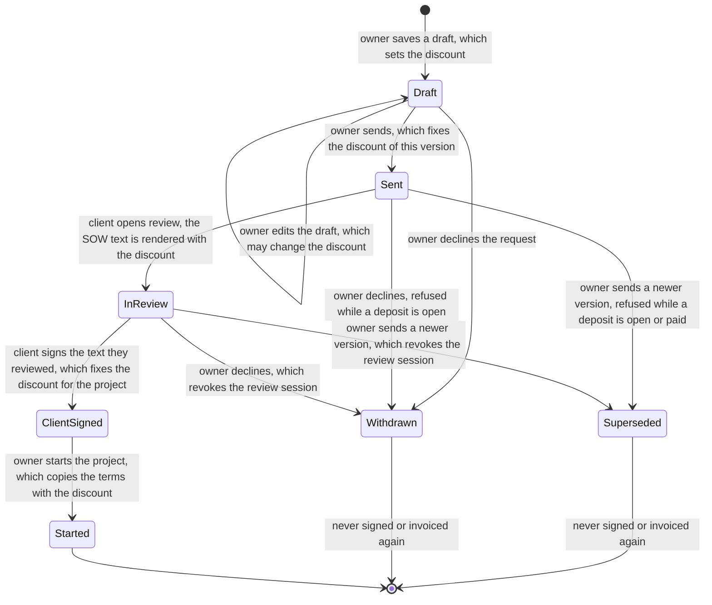
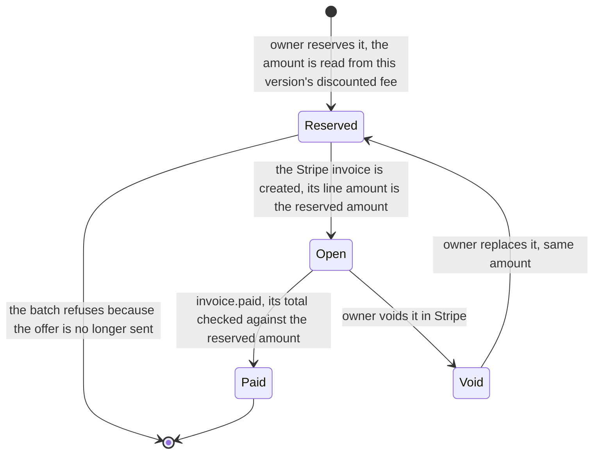

# Discounts on software offers: design

Status: design for owner review (2026-11-13). Nothing under `src/` changes in this PR. It adds this plan, a Quint model
(`verification/discount-offers.qnt`), a reference money rule with LemmaScript contracts
(`tests/fixtures/discount-installments.ts`) and the tests that tie them to today's code.

Every engagement stays fixed price. The amounts in this document ($2,400 usual fee, $400 discount) are made up for the
mock-ups; $2,400 is the public placeholder of the fee field.

## 1. Decisions for you

Each has one recommendation. The rest of the design assumes these answers; "If you answer differently" under each says
what would change.

1. **Fixed amount or percentage?** A fixed dollar amount, typed on each milestone.
   Why: you see the exact price the client pays before you send, and nothing is rounded.
   If different: a percentage becomes form arithmetic (the form turns 15% into dollars per milestone, rounded down to the
   cent, and saves the dollars). Stored data, contract and model stay the same; the client copy would say "15% off".
2. **How does it split across deposit, milestones and balance?** You set the discount per milestone (most website
   projects have one milestone, so it is one number). Each milestone's deposit is half of its lower price, rounded down
   to the cent, and the balance is the rest, as today. On invoice terms each milestone is one invoice of its lower price.
   Why: the parts always add up to the discounted total because nothing is spread by a formula.
   If different: one discount for the whole project split automatically needs a split rule (for example "off the last
   milestone first") with its own contract, and the form shows the result before saving.
3. **Where is it shown, and in what words?** On the offer page, the review and sign page, the agreed terms page, the SOW
   (one line, so also the signed PDF), your offer form and your invoice panel. Not in emails: they carry no amounts today.
   Why: everywhere a price appears, the client can see why it is lower.
4. **Show the usual price beside it?** Yes, once in the fee box: "Usual price $2,400. Friends and family discount: $400."
   Why: the client sees what the discount is worth, without a crossed-out price that reads like a sale.
   If different: drop that sentence and the "usual" notes; the SOW line stays, because the agreement should say it.
5. **Can it change after sending?** Only by sending a new offer version, like any other term. Signing fixes the
   discounted prices for that project; there is no change after signing.
   Why: this is how terms already work, so nothing new can go wrong.
6. **Limits?** Whole dollars, at least $1 off, and the client still pays at least $1 for each milestone (today's minimum
   fee). No 100 percent discount.
   Why: the invoice code refuses any Stripe invoice that does not come back open with a payment link, so a $0
   installment could not be invoiced; with at least $1 per milestone every deposit is at least $0.50.
   If different: free work needs a path with no invoices (start without a deposit, skip $0 installments), which changes
   invoicing, project start, the model and the contract.
7. **A label or reason?** One short label the client sees, up to 60 characters, for example "Friends and family
   discount". Blank shows "Discount". No private reason field; keep private context in the request's owner note.
   Why: the client never sees an unexplained number, and nothing private goes into the agreement.
8. **How does it look in Stripe?** The invoice line is simply the lower amount, with "discounted price" added to its
   description. No Stripe coupon.
   Why: the Stripe total then equals the SOW installment, and the payment check that compares them keeps working as is.
   If different: a coupon means the line shows the usual amount and Stripe subtracts, so invoice creation, recovery and
   the amount check all change.
9. **Found while modelling: a paid deposit on a declined offer does not stop the next offer.** Today you can decline a
   request after the client paid the first deposit, reopen it, and send new terms; the client could then pay a second
   deposit. Recommendation: sending refuses while any earlier version has a paid, unrefunded deposit: "A deposit is paid
   on an earlier offer. Refund it in Stripe before sending new terms."
   Why: one project, one set of terms, one deposit.
   How sure: found by reading the decline, reopen and send guards and confirmed in the model (the mutant
   `discountTodayDepositGuard` is today's guard, and it fails). It has not been reproduced against the real handlers
   yet; PR 2 starts with that test.
   If different (keep today's behaviour): the model keeps today's guard and drops the "never mix versions" property for
   that path; nothing else changes.

Two smaller rules follow from these and need no separate answer: a checkpoint's cancellation amount is a share of the
discounted price (what the client agreed to pay), and the non-binding project estimate must be at least the discounted
total.

## 2. The design in one paragraph

A milestone's `feeCents` keeps its meaning: what the client pays for it. A discounted milestone also records
`discountCents`, the amount taken off its usual fee, so the usual fee is `feeCents + discountCents`. The offer records an
optional `discountLabel`. Because `feeCents` is still the price paid, every amount the site already derives from it
(deposit, balance, milestone invoice, checkpoint amount, SOW payment lines, Stripe line, the payment check) is already
the discounted amount, with no change to the money code. The discount adds words to pages and the SOW, and validation.
An offer without a discount stores exactly what it stores today.

## 3. State diagrams

The offer version, with the moves that set, read or fix the discount. This is the XState machine the offers area gets
when it moves to Effect; the discount adds data to its context, not new states.



Each installment of a sent or started version (standard terms: deposit then balance per milestone; invoice terms: one
invoice per milestone). The first deposit can be invoiced while the offer is sent, before signing.



No Mermaid tooling is installed in the repository and the Mermaid CLI is not in the local npm cache, so both diagrams
were checked by hand against the `stateDiagram-v2` grammar: plain state names, one `-->` per line, label text after a single colon, no
semicolons, braces or nested colons.

Moves that read the discount: review (renders the SOW), reserve (computes the amount), start (copies the terms). Moves
that fix it: send (for the version) and sign (for the project). Only a draft edit changes it.

## 4. Screens and documents

Mock-ups show the changed region only. `+` marks a new line, `~` a changed line.

### 4.1 Your offer form (`SoftwareMilestone.astro`, `SoftwareOfferEditor.astro`, `src/scripts/software-offers.ts`)

The fixed fee field keeps its label and now means the usual fee; the form saves `feeCents = fixed fee - discount` and,
when it loads a draft, shows `feeCents + discountCents` in the fixed fee box.

Before:

```text
Fixed fee (USD)   [ 2400 ]
Whole dollars, $1 to $1,000,000.
```

After:

```text
  Fixed fee (USD)   [ 2400 ]
  Whole dollars, $1 to $1,000,000.
+ Discount (USD)    [  400 ]
+ Optional. Whole dollars off this milestone's fixed fee. The client pays at least $1.
+ The client pays $2,000 for this milestone.                <- live, shown when a discount is typed
```

Once per offer, after the milestones:

```text
+ Discount label    [ Friends and family discount ]
+ Shown to the client beside the discount, up to 60 characters. Leave blank to show “Discount”.
+ The client pays $2,000 in all. Usual total $2,400, discount $400.     <- shown when any milestone has a discount
```

New error sentences:

- "Use a discount of at least $1."
- "The client must pay at least $1 for this milestone. Lower the discount."
- "Add a discount to a milestone, or clear the label."
- "Keep this under 60 characters." and "Use one line." (the existing sentences for short text)

### 4.2 Offer page (`SoftwareOffer.astro`)

Before (fee box):

```text
Fixed project fee
$2,400
Website design and build ...... $2,400
50% of each milestone before it starts, the balance on delivery, due within 15 days.
```

After:

```text
  Fixed project fee
~ $2,000
+ Usual price $2,400. Friends and family discount: $400.
~ Website design and build ...... $2,000 · usual $2,400
  50% of each milestone before it starts, the balance on delivery, due within 15 days.
```

The milestone headings show the price the client pays ($2,000) and nothing else, as today.

### 4.3 Review and sign page (`src/pages/offer/[token]/sign.astro`)

Before:

```text
1 milestone · $2,400 fixed · 50% deposit before each milestone · done by Mar 3
```

After:

```text
~ 1 milestone · $2,000 fixed, after a $400 discount · 50% deposit before each milestone · done by Mar 3
```

### 4.4 Agreed terms (`SoftwareAgreedTerms.astro`, shown while signing and on the project page)

Before:

```text
Website design and build      1 milestone · $2,400 fixed fee
1 · Website design and build   $2,400 fixed fee
Fixed project fee  $2,400
```

After:

```text
~ Website design and build      1 milestone · $2,000 fixed fee, after a $400 discount
~ 1 · Website design and build   $2,000 fixed fee
+                                Usual $2,400, less $400.
~ Fixed project fee  $2,000
+ Usual price $2,400. Friends and family discount: $400.
```

### 4.5 SOW text and the signed PDF (`agreement-fields.ts`, `agreement-templates.ts`)

Two new optional template fields, so existing templates stay valid and render exactly as before:

| Field | Value with a discount | Value without |
|---|---|---|
| `{{sow.discount}}` | `Friends and family discount: $400 off the usual fee of $2,400. The total fee and every milestone fee and payment in this SOW already include it.` | `None` |
| `{{milestone.discount}}` (inside the milestone loop) | `$400 off the usual $2,400` | `None` |

The line to add to your SOW template, after the total fee line (your template text is yours; this is a suggestion):

```text
  Total Fee: ${{sow.total_fee}}
+ Discount: {{sow.discount}}
```

`{{sow.total_fee}}`, `{{milestone.fee}}`, the deposit, balance and invoice amounts and the checkpoint amounts already
print the discounted figures, because they come from `feeCents`. Sending a discounted offer is refused while the
current SOW template has no `{{sow.discount}}`: "The current SOW template has no discount line. Publish a SOW template
with {{sow.discount}} before sending a discounted offer."

The PDF prints the canonical SOW text, so it shows the same line with no PDF code change. The signing certificate does
not change.

### 4.6 Your invoice panel (`SoftwareInvoiceLine.astro`)

The panel shows no amounts today, and the invoice amounts are already the lower ones. One line is added under the
first invoice row of a discounted milestone.

Before:

```text
Deposit · Open · Due Nov 20 · Open invoice
Due in 7 days. Work on this milestone starts after it’s paid.
```

After:

```text
  Deposit · Open · Due Nov 20 · Open invoice
+ Discounted milestone: usual $2,400, client pays $2,000.
  Due in 7 days. Work on this milestone starts after it’s paid.
```

### 4.7 Stripe invoice line (`createSoftwareInvoiceWithClient`)

Before: `Milestone 1 · Website design and build · 50% deposit`

After, for a discounted milestone only: `Milestone 1 · Website design and build · 50% deposit · discounted price`

The amount is the reserved amount, so the invoice total equals the SOW installment and the webhook's amount check
(`invoice.amount_cents !== event.total`) is unchanged.

### 4.8 Not changing

- The offer email and every other email: they state no amounts.
- The client project page's payment lines and "Pay $1,000" buttons: they already read the invoice amount.
- The owner's offer version list and the request rail.

## 5. Data, validation and compatibility

### 5.1 Data

Inside `terms_json` (on `software_offers`, copied to `software_projects.terms_json` at project start):

- `milestones[i].discountCents`: optional whole cents, absent when there is no discount. Never stored as 0.
- `discountLabel`: optional one-line text, at most 60 characters, absent when blank.

No migration and no new column: both live in the JSON that is already versioned with the offer and frozen once it is
sent. Columns were considered and rejected: they would need a migration, a copy into the project row, and a second place
for terms that today live in one JSON document.

### 5.2 Validation (Effect Schema readers, in the style of `src/lib/readers.ts` and `agreement-fields.ts`)

A sketch; the offers conversion fixes the final shape. New fields have no Zod predecessor, so they use the site's own
sentences rather than Zod's.

```ts
/** Whole cents from `least` to `most`, each failed check with its own sentence. */
const cents = (least: number, most: number, says: { whole: string; least: string; most: string }) =>
	leaf(
		Schema.Number.check(
			Schema.makeFilter((n: number) => Number.isInteger(n) || says.whole),
			Schema.makeFilter((n: number) => n >= least || says.least),
			Schema.makeFilter((n: number) => n <= most || says.most),
		),
		(_sentence, raw) => (Predicate.isNumber(raw) ? { value: raw } : undefined),
	);

const discountCents = optional(
	cents(100, 99_999_900, {
		whole: "Use whole cents.",
		least: "Use a discount of at least $1.",
		most: "Use a discount of $999,999 or less.",
	}),
);

const discountLabel = optional(text(oneLineText(60), false));

// Across fields, on the whole terms (refined):
//   feeCents + discountCents <= 100_000_000  -> milestones.N.feeCents: "The amount must be $1,000,000 or less."
//   discountLabel present but no milestone has discountCents -> discountLabel: "Add a discount to a milestone, or clear the label."
//   projectRange.lowCents >= offerTotal(terms) (unchanged; offerTotal is already the discounted total)
```

`feeCents` keeps its rule (whole cents, $1 to $1,000,000), so a discount can never take a milestone below $1. Which
sentence the owner sees when the discount is too large: the form checks first and puts "The client must pay at least $1
for this milestone. Lower the discount." on the discount field, because the form computes `feeCents` from the fixed fee
and the discount. The server's backstop is the fee's own sentence on `feeCents` ("The fee must be at least $1."), which
only a hand-made request can reach. The pure
helpers the pages and the SOW share (`usualFee`, `offerDiscount`, `discountLine`) go in a browser-safe `src/lib` module
with no Effect imports beyond Schema.

### 5.3 Existing offers and agreement hashes

- An offer without a discount has neither key, so its `terms_json` is byte for byte what it is today. The readers keep
  absent keys absent (an `undefined` value is dropped by `JSON.stringify`), and the golden draft corpus pins the stored
  JSON.
- Signed agreements store their `canonical_text` and `text_sha256`; nothing re-renders a stored agreement (the only
  renders are the PDF preflight with sample values and the template preview). Existing hashes cannot change.
- New agreement values gain `sow.discount` and `milestone.discount`. A template without those placeholders never reads
  them, and every existing value keeps its text, so rendering an existing template for an undiscounted offer gives the
  same text and hash as today. The first PR of the build adds an anchor test that renders a fixture SOW template for a
  fixture offer and pins the SHA-256; it must pass unchanged through every later PR.
- Old code reading a discounted offer would ignore the discount fields and still charge the right (discounted) amount,
  because `feeCents` is the price paid. The order of deploys therefore cannot overcharge; it can only hide the words.

## 6. Verification

### 6.1 The money rule (LemmaScript, checked by Dafny)

`tests/fixtures/discount-installments.ts` is the reference rule, listed in `LemmaScript-files.txt` (its `.dfy` pair is in
`.gitignore`, as for `invoice-event-order.ts`). Contracts:

- `installmentOf`: an installment of a fee is between 0 and the fee.
- `discountedInstallment`: for every usual fee up to $1,000,000 and discount that leaves at least $1, the installment
  is whole and non-negative, never more than the same installment without the discount, equal to it when the discount
  is 0, and a deposit is at least 50 cents.
- `milestoneCharged`: a milestone's installments add up to its usual fee less its discount.
- `offerCharged`: every installment of up to three milestones adds up to the usual total less every discount, and is at
  least $1.

`tests/verification/discount-installments.test.ts` anchors the rule to live code: with no discount it equals
`softwareInvoiceTerms` on a table of fees (odd and even cents, minimum, maximum) for every milestone and kind; with a
discount it equals `softwareInvoiceTerms` on the lower fee; and it samples the contract over every usual fee from $1.00
to $4.60 and every allowed discount.

Dafny is not installed on this machine, so `pnpm run verify:dafny` was not run here; CI runs it. `lsc gen --backend=dafny`
translated the file without errors and the generated Dafny was read: the arithmetic is linear apart from division by
the constant 2, which Dafny handles without hints.

### 6.2 The model (Quint)

`verification/discount-offers.qnt`, wired into `pnpm run verify:quint` and `verify:quint:mutants` through the model list
in `scripts/lib/quint-mutants.mjs`. One request, two offer versions, two milestones with odd usual fees (5 and 4 units,
where 1 is the $1 minimum) and any discount on each, either payment mode. The moves: new draft, edit draft, send,
decline, reopen, review, sign, start, invoice reserve (read), invoice batch (write), and Stripe pay or void, in any
order. Review and sign are separate steps, and so are the invoice read and write, so the owner can edit, send or decline
between them.

The module `discount` is the design: today's code plus decision 9 (the send guard counts a paid deposit on any other
version). So the passing run includes a guard the code does not have yet; today's guard is the mutant
`discountTodayDepositGuard`.

| Property | Meaning | Mutant that breaks it |
|---|---|---|
| `invoicedMatchesSigned` | Every open or paid invoice of the signed version is the installment the signed terms give, so the invoices of a signed offer add up to what the client signed for; the project runs on the signed terms | `discountLatestTerms`: the amount is computed from the newest version's terms |
| `sentTermsFrozen` | A version keeps the terms (discount included) it was sent with; the signed terms are that version's | `discountEditSent`: the draft update does not require status draft |
| `oneVersionInvoiced` | All open or paid invoices belong to one version | `discountNoDepositGuard`: send ignores a deposit; `discountTodayDepositGuard`: today's guard, see decision 9 |
| `installmentsSum` | Every version's installments add up to its discounted total | `discountDepositFromUsual`: the deposit is half the usual fee |
| `supersededInert` | No sign or invoice batch writes for an offer that is not sent at that moment, and a signed offer stays the sent one | `discountNoWriteStatusGuard` (the invoice batch trusts a stale read), `discountNoSignGuards` (no live-signing or session check), `discountSendAfterSign` (send after the client signed) |

Each mutant fails its property in CI; the pass run makes 10,000 random executions of up to 20 steps with a fixed seed
(fewer than the invoice-events model's 100,000, because this model's steps are slower to evaluate; the slowest mutant,
`discountTodayDepositGuard`, is found after about 2,200). Two hand runs with negated witnesses show the properties are
checked on full runs, not only on early states: `neverFullyPaidAfterRevision` (20 steps, as CI) reaches a project
started from the second version with a discount and every installment invoiced and paid, on invoice terms; and
`neverStandardPaidAfterSentRevision` (40 steps) reaches the same on standard terms after the first version was sent and
then superseded. Command: `quint run verification/discount-offers.qnt --main discount --invariant <witness>
--max-steps 40 --max-samples 100000 --seed 0x1`; each finds its state in under a second.

Not covered: refunds; the order of milestones and delivery gating (any slot of the plan may be invoiced once the project
starts); a third milestone; retention; Stripe event order (the invoice-events model covers it). The manual Apalache
check (`pnpm run verify:quint:exhaustive`) includes this model's `discount` module; it was not run for this design.

## 7. Build order (stacked PRs, tests first)

Each PR stands alone and keeps every existing golden case and hash. "Effect" means the area named must have moved to
Effect (CLAUDE.md "Back-end rules") first, because the change touches its validator or route.

1. **This PR: design and verification.** Plan, model, contract, tests. No dependency.
2. **Send guard for paid deposits (decision 9), only if you approve it.** Tests first: a golden case that declines with a
   paid deposit, reopens and sends a new version, answered 409 with the new sentence. Then the guard in
   `depositOfferGuard` and `depositOfferBlock`. Can land before the payments conversion; it changes a guard, not a rule.
3. **Read and show the discount.** Tests first: reader tests for every new sentence, golden draft cases with the new
   fields, the agreement hash anchor, page tests for the new lines (with and without a discount). Then the reader fields,
   the shared helpers and the page copy (4.2, 4.3, 4.4). Depends on: **offers to Effect** (the terms validator).
4. **SOW fields and the send check.** Tests first: rendering with and without a discount, the anchor hash unchanged,
   the send refusal. Then `sow.discount` and `milestone.discount` in `agreementValues` and `optionalFields`. Depends on:
   **signing to Effect**. Then your step, not code: publish a SOW template version with the discount line.
5. **Owner form.** Tests first: the form script's save body and error placement. Then 4.1. Depends on: **offers to
   Effect** (the draft route). Lands after 4, so a discount cannot be saved before the SOW can state it.
6. **Stripe line and invoice panel.** Tests first: the invoice line description and the panel note. Then 4.6 and 4.7.
   Depends on: **payments to Effect**.

Before PR 2 and PR 3 change a modelled rule, run `pnpm run verify:quint:exhaustive` and record the bound and result in
the PR.
