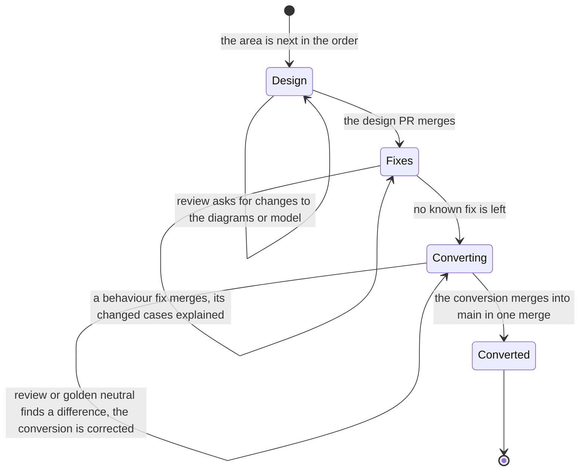

# Moving the rest of the server to Effect: order

Status: proposed, 2026-11-15. The owner asked for the rest of the site to move to XState, Effect and Effect Schema,
and for the friends and family discount to be stated in the agreement. This plan orders the work so the discount
comes as early as the rules allow. Every area follows the Back-end rules in CLAUDE.md; nothing here changes them.

## Decisions

- **No Zod in our code.** Owner, 2026-11-15: "Effect schema as our only validator no zod use from us". The frozen
  reference copies in `tests/fixtures/legacy-validators/` and the tests that compare against them
  (`tests/server/validators-differential.test.ts`, `tests/server/validator-types.test.ts`) import Zod until the last
  step, which deletes them, as the copies' headers say. Astro and the MCP SDK keep their own dependency on Zod, and `zod` stays in
  `package.json` as the MCP SDK's required peer; see "Library boundaries".
- **Stacked branches.** Owner, 2026-11-15: conversion PRs may be stacked so one does not wait for another to merge.

## Proposed, not yet decided

- **Order: the discount first.** Recommended 2026-11-15 (offers, then studio sign-in, then signing, then the discount),
  with the alternative of small areas first named. The owner has not chosen yet; the first steps below are needed in
  either order.

## Where things stand

- Converted: contact and resume (3 routes), the public music routes (2 routes).
- Not converted: 46 route files, 2 `.astro` pages that write (both `verify.astro`), 28 SQL reads in `.astro` pages and
  components (all reads), 34 files under `src/` that import Zod (more under `tests/`, and `scripts/prepare-music.mjs`
  parses with the Zod schemas of `src/lib/music-catalog.ts`). There is no cron or queue handler; retention and Stripe reconciliation are operator scripts.
- Every route but the three media routes has a golden corpus (recorded in PRs 246, 248 and 249).

## Rules this order follows

- A behaviour fix goes in its own PR before the conversion of its area (golden rule 1).
- An area is converted completely and reaches `main` in one merge; no ratchets and no legacy lists. A large area may be
  reviewed as a stack of PRs, but the lower PRs target the stack's top branch, not `main`, so `main` (and production,
  since every merge deploys) never holds a partly converted area.
- An area's design comes before its code: its XState diagrams (the states and moves the area's machine will have), and
  its Quint model where the list below names one, are reviewed in the area's first PR, before any conversion code. For
  offers, the offer version and installment machines are already drawn (docs/plans/2026-11-discount-flow.md, section
  3); its design PR adds the request's moves (fit, question, decline, revoke).
- A converted store may carry statements on another area's tables when an action writes them (as `music-store.ts`
  writes `owner_requests`), but a converted area does not call an unconverted helper that keeps a rule in SQL.
- The discount's PRs 3 to 6 (`docs/plans/2026-11-discount-flow.md`, section 7) wait for the areas they touch.
- A flow where order or timing matters gets a Quint model before its code (`docs/verification.md`, "When to use
  which").

## Order

0. **Prerequisites, each its own PR.**
   - Discount PR 2, the deposit guard of decision 9: merged (#285). The follow-up that names the refund record step
     in the refusals: #287.
   - `offerTermsSchema` from Zod to Effect Schema, the Zod copy frozen in `tests/fixtures/legacy-validators/` with a
     differential block, as was done for the agreement validators. Offers, signing, projects and `sign.astro` all parse
     it, so it moves first and alone.
   - Split the shared helpers that several areas import into modules of their own, with no behaviour change:
     `softwareGuard` and `softwareAudit` (out of `software-projects.ts`, used by six areas); `softwareInvoiceTerms` (out
     of `software-invoices.ts`, so signing stops pulling in Stripe); the pure parts of `audio-client-access.ts`
     (`clientPortalEnabled`, `hashValue`, `keyedHash`); the date helpers of `audio-project-updates.ts`; the two
     middleware helpers of `agreement-access.ts`; and the deposit facts the offers area reads (`depositOfferBlock`,
     `depositOfferGuard`, today in `software-invoices.ts`), so offers stops loading Stripe and converts without
     calling an unconverted payments helper.
1. **Software offers.** `owner/requests/[id]/software.ts`: fit, question, decline, revoke, draft, send. Its store
   carries the signing statements these actions write (`retireRequestSigning`, the attachment delete) and the PDF
   preflight becomes a service.
2. **Studio sign-in.** `studio/code.ts`, `session.ts`, `sign-out.ts` and `audio-client-access.ts`. Small, and signing
   link issuance needs its allowance rule (`reserveStudioAllowance`) converted first. Open PR 268 (sign-in codes tied
   to the browser) is a behaviour fix for this area and lands before it. Codes, attempts and sessions under parallel
   requests get a Quint model.
3. **Signing and agreements.** The client token routes (link, review, draft, sign, agreements link and files), the
   owner agreement actions, templates, settings, retention and attachments, and both `verify.astro` pages (which need a
   golden corpus recorded first). About 1,300 route lines and 4,700 lib lines: a stack of PRs reviewed one by one and
   merged into `main` as one. The
   Quint model covers a resend during review, signing a withdrawn offer and countersign or abandon while offers change,
   extending `verification/discount-offers.qnt` where it already models them.
4. **The discount, PRs 3 to 5.** Read and show the discount, the SOW fields with the send check, then the owner form.
   Between PR 4 and PR 5 the owner publishes a SOW template version with `{{sow.discount}}`. After PR 5 a discounted
   offer can be sent, and the signed agreement states the discount.
5. **Payments.** Audio payments, software invoices and the Stripe webhook together (one webhook serves both;
   `verification/invoice-events.qnt` already models it). Open PRs 278 and 279 (279, a Stripe failure answered by its
   error type, is stacked on 278) land before it. Then discount PR 6 (the Stripe line and the invoice panel note).
6. **Software projects.** Project start, state, money actions, updates, visuals and messages, owner and studio sides.
   Starting a project while invoices and payments change gets a Quint model.
7. **Audio projects.** The owner project routes and the studio project routes.
8. **Software inquiry and brief**, with the owner brief copy route.
9. **Audio intake.** Its store keeps relying on the `audio_project_after_service_request` trigger (issue 242), which
   is named in its rule file until it moves (step 13).
10. **Publication**, with the work feed, `.well-known` and the MCP probe. The MCP tools stop importing Zod (see
    "Library boundaries"). The `publication_outbox_withdraw` trigger stays and is named in its rule file.
11. **Media routes** (`music/file`, `audio/file`, `og/[name].mp4`), after recording a corpus for each.
12. **Owner request status**, last, because its rules read facts from every software area. Today it answers 409 for
    any error (note (e) in `src/server/guarded-save.ts`); the owner's 2026-11-14 decision already says an unexpected
    store failure answers 500, so this is a behaviour fix in its own PR before the conversion (confirm with the owner
    that the decision covers it). The `audio_project_close_declined_request` trigger stays and is named in its rule
    file.
13. **Finish.** The content collections stop importing Zod (see "Library boundaries"); remove the Zod import from
    `src/server/failure.ts`; delete `tests/fixtures/legacy-validators/` and the differential test, as their headers
    say, with `tests/server/validator-types.test.ts`; convert the test helpers and tests that still import Zod
    (`tests/helpers/astro-content.ts`, `tests/security/failure.test.ts`, `tests/lib/software-agreements.test.ts` and
    any others by then) and `scripts/prepare-music.mjs`, which parses with the music Zod schemas; then add the
    architecture test that fails on any Zod import in `src/`, `scripts/` or `tests/` (added only once nothing imports
    it, so it is not a ratchet). `zod` stays in `package.json` as the MCP SDK's required peer.
    Then the five database triggers move into code, one PR each, as issue 242 sets out (after the last conversion
    layer): `audio_project_after_service_request` (intake: the request and the project it creates must be written
    together, so it gets a Quint model), `audio_project_close_declined_request` (owner status),
    `publication_outbox_withdraw` (publication), and the two fired only by retention scripts. Each needs a migration
    applied in the right order relative to the Worker deploy; the order is worked out in its PR before its code, so a
    service request never gets no project or a duplicate one.

Each area goes through the same states. Its design PR (diagrams, and a Quint model where named) merges before its
conversion is written; its behaviour fixes, found while recording or modelling, merge before the conversion; the
conversion PR (rule files, store, services, flows, `golden:neutral` output, the `conversion` label) merges last:

A difference `golden:neutral` finds during a conversion is never recorded over: either the conversion is wrong and is
corrected, or it is a behaviour fix and leaves the conversion for its own PR first.

## Library boundaries

Two libraries take a Zod schema as their interface. Our code passes them no Zod schema of its own:

- **Astro content collections** (`src/content/config.ts`, with the music schemas in `src/lib/music-catalog.ts`). In
  Astro 5 a collection's `schema` must be a Zod type, but it is optional. The collections drop it. Astro checks the
  schema at build time today, while every page that reads a collection is rendered on demand, so decoding where the
  entries are read would move a bad entry's failure from the build to a visitor's request. To keep it at build time, a
  build step decodes every entry with Effect Schema and fails the build with the entry's id and field, and CI runs
  the same check; the accessors that the seven files calling `getCollection` or `getEntry` use instead decode again
  for their types. No collection uses `image()` or `reference()`, which would need Astro's schema. This is for Astro
  5; Dependabot PR 231 (Astro 7) would change how collections are declared, so whichever lands first, the other
  follows it.
- **The MCP SDK** (`src/lib/publication/mcp.ts`, `src/pages/api/mcp-probe.ts`). `registerTool` takes only a Zod 3 or
  Zod 4 `inputSchema`. The tools move to the SDK's lower-level server, which takes JSON Schema as plain data: the
  published schema is written to match what clients see today, and the arguments are checked with Effect Schema. The
  `publication-mcp` and `mcp-probe` golden corpora record `tools/list` and every refusal, so they show whether the
  published schemas and error answers stay identical; anything that changes is a behaviour change, explained in its
  own PR first. Our code no longer imports Zod here, but `zod` stays installed: the SDK declares it a required peer
  dependency, and the lower-level server still validates protocol messages with the SDK's own Zod schemas.
