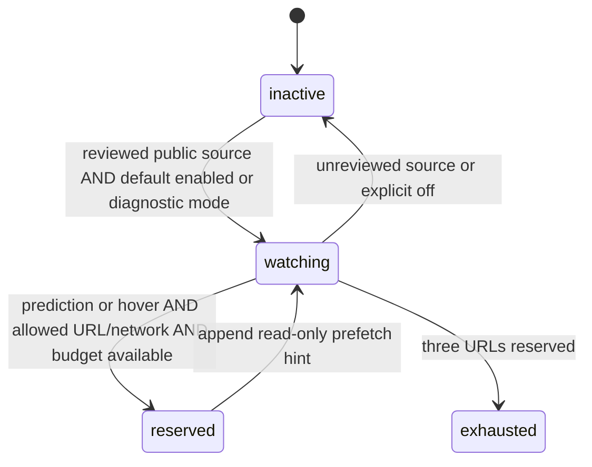

# Bounded public navigation prediction

The owner requested seeing ForesightJS on the personal site. Keep this separate from the living brief (#290) and intake changes (#286).

Prediction now runs by default only on the homepage and the seven reviewed public paths, on the main site (`thesuperhuman.us`, `www.thesuperhuman.us`) or explicit local QA hosts (`localhost`, `127.0.0.1`, `[::1]`). The audio hostname and arbitrary preview/subdomains are excluded because their paths may be rewritten. The package never loads on private, API, intake/form or other unreviewed source pages, including when a diagnostic parameter is supplied. `?prefetch=foresight`, `?prefetch=hover`, and `?prefetch=off` expose the optional diagnostic panel; `off` suppresses requests for that document. Normal visitors see no panel. Closing diagnostics removes the parameter and returns to the normal default behavior.

The comparison uses browser prefetch transport and an 80 ms hover delay (Astro's current hover delay); it is not claimed to be Astro's integration. No router migration. The browser manifest explicitly reviews Core 4.2.1, its dependencies and Vite dynamic-import helper. The small activation script ships to normal pages, and the prediction package loads on reviewed public source pages only. No telemetry or storage.
Only same-origin, exact static paths with no query or fragment are candidates: /work, /building, /writing, /about, /services, /building/tally, /building/kaillera-next. No form, API, intake, account, audio files or arbitrary links. Maximum three distinct requests per document. Save-Data, offline and slow connections suppress requests. Touch uses touch-start, not viewport. Closing the panel reloads without the diagnostic parameter. No session tracking, telemetry or storage.

State diagram (XState-style states and moves):

Reservation is synchronous before inserting the hint, so overlapping predictions cannot exceed the cap. Hints are not proof of completed downloads or cache reuse. Navigation stays native. No new write flow, server state or asynchronous read-then-write operation; ordinary tests cover the pure gate. The UI reports requested hints only. Browser network capture is required to establish actual requests.

## Original opt-in verification record (before default activation)
- Final existing suite: 13,075 passed, 1 skipped; eight new runtime tests passed separately. The first run exposed an aside-markup regression, fixed by using a labeled section; the R2 fixture needed a writable temporary XDG config directory.
- Pure gate, source graph, built bundle, and affected page checks: 213 passed.
- Eight fake-DOM runtime checks cover opt-in/off/close, revalidation, network/visibility constraints, cap/deduplication, hover/focus/touch and credential-free fallback. These do not test real browser prediction, downloads or cache reuse.
- Astro check: 0 errors, 0 warnings (17 existing hints).
- Final build succeeded; built client-manifest/source graph/screenshot configuration checks passed (181 checks). Astro check repeated after loader extraction: 0 errors/warnings, 17 hints. Lint passed.
- No claims of latency improvement or real browser cache reuse yet.
- Browser launch in this executor fails with `socket() failed: Operation not permitted`, including the permitted escalation attempt. The normal Astro development adapter also fails on `uv_interface_addresses`; a temporary local preview config disabling only the development platform proxy started, but did not unblock Chromium. No production/security config was changed.
- Required phone/desktop, prediction-before-hover, keyboard, Back/Forward, close/re-entry and Save-Data browser checks remain UNVERIFIED. CI screenshot scenario added for review, not run here.
- Hallmark read-only source audit: 0 critical, 0 major, 0 minor added-design findings. Existing family preserved, token colours and fonts, 44px controls, normal document flow, no animation. Pixel/layout verification blocked; do not interpret source audit as visual approval.
- No deployment, live inference, external form or AI call performed. Production remains unchanged.

## Current local browser verification (supersedes the earlier browser blocker)

Real Chrome now ran against a prerendered public-source QA copy with canonical links rewritten only to the local origin. Normal diagnostics stayed hidden. Keyboard prediction appended exactly three native hints; the local server recorded `purpose=prefetch` HTTP 200 requests for /work, /building and /writing. A later navigation reused a prefetched response. Explicit off mode suppressed hints after the same keyboard action, and a synthetic private source suppressed diagnostics and hints even with explicit prediction.

An isolated simulated coarse-pointer/touch test, with native link prefetch disabled, fetched a public Tally page with HTTP 200 before navigation and reused the response. This is not an actual iPhone test, a production release verification, or measured evidence of a speed improvement. Final-head CI, independent review, and live verification remain separate release gates.

## Scope-adapted pre-launch checklist

- **Content, design and navigation: PASS within diff scope.** Public page copy/design and link URLs are unchanged; prediction never intercepts navigation. Normal visitors receive no new visible panel. Diagnostics remain optional. No professional claims or resume facts change.
- **Search/sharing: N/A for unchanged metadata and assets.** No new page, canonical, sitemap, robots, OG or favicon change. Production response verification remains UNVERIFIED until release.
- **Accessibility/responsive: PARTIAL.** Keyboard prediction, off, private exclusion, and optional controls were exercised in Chrome. Existing CI captured phone/desktop diagnostics. Real iPhone, cross-browser, 320px/zoom/reduced-motion audits of the final deployed build are UNVERIFIED; no default layout or animation is added.
- **Performance/resilience: PASS for bounded behavior, UNVERIFIED for benefit.** Three-request cap, exact paths, source/host guard, network/visibility suppression and failure-safe ordinary navigation have tests. Local native hints and simulated-touch fallback returned HTTP 200; subsequent cache reuse was observed. No LCP/CLS/INP or production latency advantage is claimed.
- **Forms/sensitive flows: N/A for modifications.** No form, API, payment, signing, private storage or email flow is changed or called by prefetch. Dedicated intake/private pages do not load prediction. Main pages containing existing forms retain those forms untouched.
- **Privacy/legal/measurement: PASS within scope.** No new collection, storage, telemetry, external service, account, consent or paid integration. Speculation targets same-origin public pages only; fallback fetch omits credentials and rejects redirects.
- **Release: PENDING.** Final type/lint/build/runtime/source/bundle checks, exact-head independent review and current-head CI must pass before merge. Record the prior deployed version, use the existing main-branch Cloudflare integration, then verify served revision/default behavior/off/audio/private exclusion live. No binding, secret, migration or security setting changes are needed.
- **Owner center: N/A for flow changes.** Private-source exclusion is tested; no owner authentication, access policy, retention, storage or mutation path changes.

## Release and rollback

The owner requested visitor-facing integration after reviewing the trial. Keep the same seven destinations and three-request cap. Source gating and callback-time source revalidation are covered by regression tests. The branch must pass its latest checks and real-browser QA before release; prior opt-in CI is not a pass for this change.

Release through the existing Git integration by merging the reviewed PR to main; Cloudflare rebuilds and deploys. No bindings, secrets, migrations or paid services change. Before release record the deployed version; after release verify the actual served script and default behavior.

To disable default loading while retaining diagnostics, set `DEFAULT_PREFETCH_ENABLED` in `src/lib/navigation-prefetch.ts` to `false`, run checks, and redeploy. For complete rollback revert this PR or restore the previous verified Worker version through the existing Cloudflare flow. `?prefetch=off` is a per-document comparison control, not a site-wide rollback.

## How to try after deployment
Open `/?prefetch=foresight`, `/?prefetch=hover`, or `/?prefetch=off`. The panel is between the header and content. The diagnostic panel is per-document; normal navigation resumes default prediction on other reviewed public pages and never enables it on private pages. There is no storage or modification of public link URLs. Test with a cold browser cache and network panel; compare fetch count and timing as well as navigation latency. Foresight may offer no benefit on an already fast site. Browser policy may ignore native hints; the non-supporting-browser fallback fetches with credentials omitted and rejects redirects.
