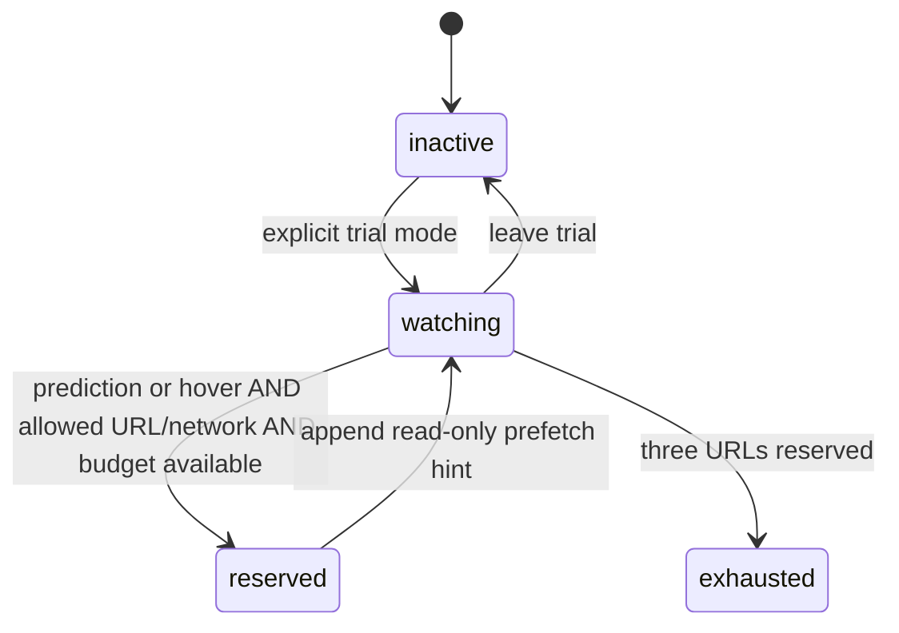

# Opt-in public navigation prediction trial

The owner requested seeing ForesightJS on the personal site. Keep this separate from the living brief (#290) and intake changes (#286).

Only an explicit `?prefetch=foresight`, `?prefetch=hover`, or `?prefetch=off` enables the trial panel. Normal visitors do not load the prediction package or prefetch. The comparison uses the browser prefetch transport and an 80 ms hover delay (Astro's current hover delay); it is not claimed to be Astro's integration. No router migration. Core 4.2.1 avoids a router migration; the browser manifest explicitly reviews its dependencies and Vite dynamic-import helper. The small activation script still ships to normal visitors (1.65 kB gzip in this build); the prediction package is only imported in prediction mode.

Only same-origin, exact static paths with no query or fragment are candidates: /work, /building, /writing, /about, /services, /building/tally, /building/kaillera-next. No form, API, intake, account, audio files or arbitrary links. Maximum three distinct requests per document. Save-Data, offline and slow connections suppress requests. Touch uses touch-start, not viewport. Closing the panel reloads without the trial parameter. No session tracking, telemetry or storage.

State diagram (XState-style states and moves):

Reservation is synchronous before inserting the hint, so overlapping predictions cannot exceed the cap. Hints are not proof of completed downloads or cache reuse. Navigation stays native. No new write flow, server state or asynchronous read-then-write operation; ordinary tests cover the pure gate. The UI reports requested hints only. Browser network capture is required to establish actual requests.

## Verification record
- Final existing suite: 13,075 passed, 1 skipped; eight new runtime tests passed separately. The first run exposed an aside-markup regression, fixed by using a labeled section; the R2 fixture needed a writable temporary XDG config directory.
- Pure gate, source graph, built bundle, and affected page checks: 213 passed.
- Eight fake-DOM runtime checks cover opt-in/off/close, revalidation, network/visibility constraints, cap/deduplication, hover/focus/touch and credential-free fallback. These do not test real browser prediction, downloads or cache reuse.
- Astro check: 0 errors, 0 warnings (17 existing hints).
- Final build succeeded; built client-manifest/source graph/screenshot configuration checks passed (181 checks). Astro check repeated after loader extraction: 0 errors/warnings, 17 hints. Lint passed.
- No claims of latency improvement or real browser cache reuse yet.
- Browser launch in this executor fails with `socket() failed: Operation not permitted`, including the permitted escalation attempt. The normal Astro development adapter also fails on `uv_interface_addresses`; a temporary local preview config disabling only the development platform proxy started, but did not unblock Chromium. No production/security config was changed.
- Required phone/desktop, prediction-before-hover, keyboard, Back/Forward, close/re-entry and Save-Data browser checks remain UNVERIFIED. CI screenshot scenario added for review, not run here.
- Hallmark read-only source audit: 0 critical, 0 major, 0 minor added-design findings. Existing family preserved, token colours and fonts, 44px controls, normal document flow, no animation. Pixel/layout verification blocked; do not interpret source audit as visual approval.
- No deployment, live inference, external form or AI call performed. Production remains unchanged.

## How to try after preview deployment
Open `/?prefetch=foresight`, `/?prefetch=hover`, or `/?prefetch=off`. The panel is between the header and content. Only the current document participates; a navigation exits the experiment unless its destination is opened with the parameter. This deliberately avoids storage, modified public link URLs, and carrying an experiment into private routes. Test with a cold browser cache and network panel; compare fetch count and timing as well as navigation latency. Foresight may offer no benefit on an already fast site. Browser policy may ignore native hints; the non-supporting-browser fallback fetches with credentials omitted and rejects redirects.
