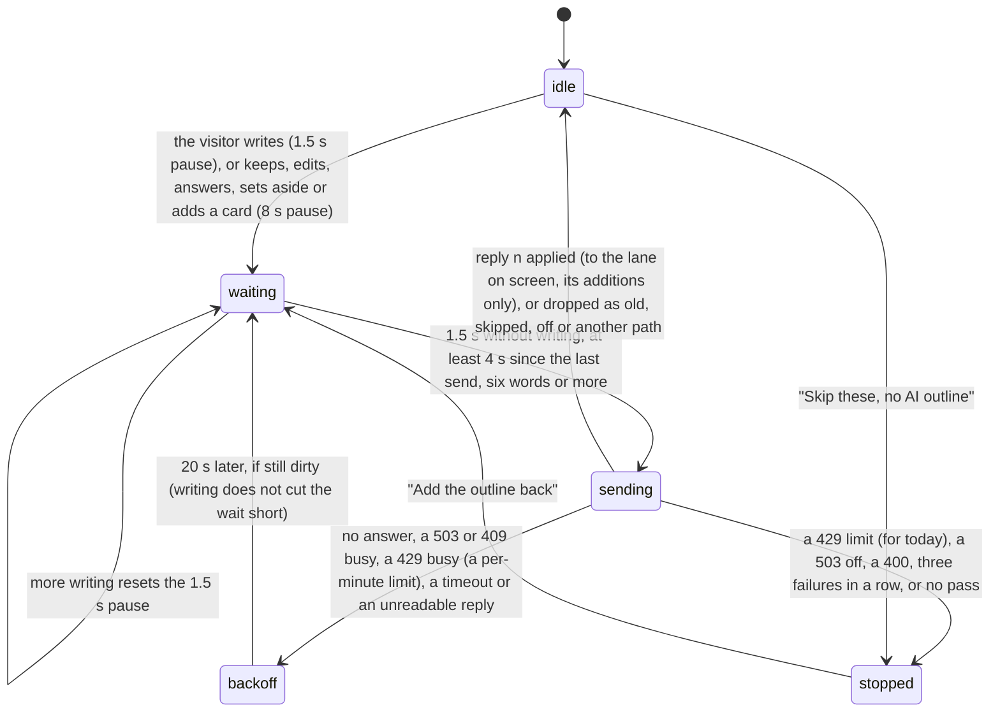

# The living brief: design

Status: on from the merge of PR #362. Live interpretation is behind `SOFTWARE_BOARD_ENABLED`, `"true"` in
`wrangler.jsonc`; `"false"` turns it off. On November 22, 2026 the owner approved moving the board to a faster model and
switching it on; the order and the limits were decided under his delegation (`docs/prelaunch-qa-2026-11-22-board-on.md`).
Built on PR #286 (example answers and the contact confirmation), which it does not change. On November 22, 2026 the
owner approved showing the outline as its own steps (sections 1 and 4, and rule 6 of section 2), replacing the board beside the answer box.

Inspired by "Beyond Taking Turns": instead of a chatbot that waits for its turn, the visitor and the system shape one
shared artifact at the same time. The visitor keeps writing; an outline of the project fills in behind the written
questions and is shown on four screens of its own, one for each lane; the visitor keeps, edits, answers or sets aside
what appears, and their choices always win.

## 1. What the visitor sees

The project brief at `/software/start` is a step-by-step brief. The written questions (and the website's two extra
steps) are one column: the heading, a hint, "See example answers", the answer box, and under it the AI line with Privacy
and "Turn off". While the outline is part of the brief, four screens follow the written questions, one for each lane of
the outline, in lane order. The plans, with the outline in them, are:

- Website: path, purpose, the four lane screens, what you have today, who updates it, timing, budget, contact, review
  (12 dots).
- Web app and workflow: path, two written questions, the four lane screens, timing, budget, contact, review (11 dots).

The lane screens are in the plan whatever the cards are, so the dots never change because an answer changed. The page
calls its AI "the outline", apart from the answer boxes' "suggestions". The review step lists the outline as it will be
sent. The lanes, named for the chosen path:

| Lane | Website | Web app | Workflow |
|---|---|---|---|
| `purpose` | What it’s for | What it’s for | What should change |
| `audience` | Who it’s for | Who uses it | Who does the work |
| `parts` | Pages | What people can do | Steps today |
| `questions` | Open questions | Open questions | Open questions |

A lane screen has the lane's question as its heading (below), a one-line hint, a status line, the lane's cards in a list
that scrolls inside a bounded box, about three fifths of the screen's height and at most 34rem, with one hairline below it
(however many cards arrive, the page does not grow; a card the visitor adds or brings back is scrolled into view), the lane's "Add" control, the
lane's own "Set aside" list, Undo, and one link, "Skip these, no AI outline". The outline does not speak as the owner, so
no heading says "I".

| Lane | Website | Web app | Workflow |
|---|---|---|---|
| `purpose` | Is this what it’s for? | Is this what it’s for? | Is this what should change? |
| `audience` | Who is it for? | Who will use it? | Who does the work? |
| `parts` | Which pages does it need? | What should people be able to do? | What are the steps today? |
| `questions` | What’s still undecided? | What’s still undecided? | What’s still undecided? |

The hint with cards is "From your answers. Keep, change or add your own." and with none "Add your own, or go on." An empty
lane shows its question and Add. The status line (readable by screen readers) says "Reading your answers…" while a
request waits or is in flight; after an answer changed, it says what is different in the lane since the visitor last left
it, for example "1 new, 1 removed since you edited your answer", only the parts that are not zero.

Every item is a card with a visible origin, in words and in outline, never colour alone:

| Origin | Label | Outline | Sent with the brief? |
|---|---|---|---|
| Read from the visitor's answers (the model's short wording of a passage the visitor wrote, with the passage quoted) | “From your answers” and the quoted passage | solid | Yes, unless removed |
| An inference (a page, a question) | “Suggestion” and a short reason | dashed | Only if kept |
| A suggestion the visitor kept | “You kept this” | solid | Yes |
| A suggestion the visitor edited | “Edited by you” | solid | Yes |
| A note the visitor added | “Your note” | solid | Yes |
| A question the visitor answered | the answer under the question | solid | Yes, with the answer |

Actions on a card: Keep, Edit, Not this (sets it aside), and on a question, Answer. Set-aside cards go to the lane's
closed "Set aside" list with Bring back (an edited card comes back as edited). Each lane has "Add" for the visitor's own
note. Add and Bring back are never disabled: on a full list they say why ("“Pages” is full. Use Not this on one of its
cards, or remove a note, then try again.") after the control and to screen readers. Undo's accessible name and tooltip
say what it will undo; Ctrl or Cmd+Z inside a lane screen does the same.

The review step lists the outline as it will be sent and, when a card read from the answers arrived in a lane after the
visitor last left it, a group "New since you last looked" with each such card and a link to its lane screen. Next is
never blocked.

**Without the AI.** "Turn off" under an answer box stops the outline's AI; the four lane screens stay and work by hand.
"Skip these, no AI outline" on a lane screen takes the four screens out of the plan, sends no outline and stops its
requests; the review step then offers "Add the outline back", which restores the four screens and the cards. At a limit,
after three failures or with the switch off on the server, the lane screens work by hand and say so once. With
`SOFTWARE_BOARD_ENABLED` off the page has no lane screens.

**Approaches considered.** The owner's feedback on the first page, with the outline in a board beside the answer box, was
that it was too much at once.

| Approach | Trade-off | Outcome |
|---|---|---|
| Keep the board on the answer screens, under the box (a sideways strip or a short list) | Smallest change, but the outline still competes with the writing | Rejected by the owner |
| One outline screen after the written answers, four lanes side by side | One extra step; sideways scrolling on narrow screens | Not chosen |
| One screen per lane, each phrased as a question | Reads like the rest of the brief; four extra steps | Chosen |

## 2. The rules

1. **The model never puts words in the visitor's mouth.** A card marked as read from the answers must quote a passage
   of at least three whole words that appears in the visitor's current answers, starting and ending on word boundaries
   (ignoring case, spacing, punctuation and quote style), and not negated in its sentence ("we don't really want online
   payments" grounds nothing about online payments; a "No." ending the sentence before does not count). A word keeps its combining marks (Devanagari, Thai); in scripts
   written without spaces each character counts, so a passage needs four Chinese or Japanese characters or eight Thai,
   Lao, Khmer or Myanmar letters. The card shows and stores the passage exactly as the visitor wrote it, never the
   model's copy of it. Ordinary code checks it on the server and again in the browser when the reply is applied. A card
   whose passage is not there is dropped.
2. **Owned cards are the visitor's.** A card is owned once the visitor added, kept, edited, answered or set it aside.
   Replies never change, move or remove an owned card. Only the visitor (or the visitor's Undo) does.
3. **A rejected idea stays rejected.** A reply's new card is dropped when it matches any card already on the board in
   that lane, set-aside cards included (normalised words, plural endings and stop words ignored, or one inside the
   other), and a reply never rewords an open card into the idea of another card (set aside, owned or a duplicate). The
   set-aside list is also sent so the model can avoid paraphrases. Removing one of the visitor's own notes deletes it
   (Undo brings it back); its words are remembered in the page's memory only, never saved or sent, so a reply does not
   offer the idea back in that lane during the visit, as a new card or by rewording another. A saved board keeps the newest 200 set-aside cards.
4. **A reply only changes what it could have seen.** Each card records how many requests had been sent when it last
   became unowned (`since`). A reply may update an unowned card, or withdraw it by leaving it out, only if its request
   was sent after that. A card that became unowned after the request was sent (an Undo) is left alone until a later
   reply. (The first design compared against the ids each request showed; the Quint model found it let an Undo made
   while a request was in flight be reverted, and keeps it as the `SeenOnly` mutant.) A card the reply names but whose
   new version is dropped (a misquoted passage, a commitment) is not left out, so it stays, while it still stands (its
   words commit to nothing and, if read from the answers, its passage is there); the server passes those names on as
   `refs`, and the page adds the cards it drops itself. Cards never move between lanes: a reply card that names a card
   in another lane leaves it where it is (while it still stands) and adds nothing; a card in the reply card's own lane
   that says its idea is still named, and may be reworded. The reply's withdrawals happen before its new cards
   are added, so a reply that rewords a full lane's open cards replaces them rather than emptying the lane, and an Undo
   that brings a kept card back to a lane a reply has since filled withdraws the lane's newest open card (suggestions
   before cards read from the answers) and says so.
5. **Old replies never apply.** Requests are numbered. A reply applies only when its number is higher than the last one
   applied, the outline is not paused (the model's word for skipped or turned off) or off, and the path has not changed since
   it was sent.
6. **Nothing moves under the visitor.** The lane on screen only receives the reply's new cards, at the end of its list;
   the cards already listed there do not change or leave while the visitor looks at them. The rest of that reply (its
   changes to listed cards and its withdrawals) is held, one reply at a time (a newer one replaces it), and applied when
   the visitor leaves the screen, by `leaveLane`, under rules 2, 4 and 5 and against the board as it is at that moment:
   owned cards are left alone, a card made unowned after the reply's request was sent is left alone, a passage is checked
   against the answers as they are then, and a held reply is dropped when the outline is paused or a newer reply has been
   applied. It also adds, to the lane being left only, the new cards the delivery could not add (a full lane, where the
   reply rewords every open card, would otherwise be left empty): leaving a lane gives it what an off-screen delivery of
   the same reply would have. It neither adds an idea that a delivery added to that lane while it was on screen (any reply's,
   including one a newer reply replaced, and however the visitor then edited or set aside the card), nor rewords another
   card into it, so the visitor's edit is never undone by a second card in the original wording. A card the reply adds to the lane on screen is stamped like any other, so the same reply's held changes
   cannot touch it. Every other lane takes a reply in full when it arrives, and so does every lane while a written
   question or the review is showing. Each lane remembers the cards it listed (set-aside ones not counted) when the
   visitor last left it, which is what the status line and "New since you last looked" are read from. The visitor's own
   actions on a lane (Keep, Edit, Answer, Not this, Bring back, Add, Remove, Undo) update that list too, so the status
   line counts only what replies changed. A restored page numbers its next card above every id in the cards and in the
   last-seen lists, and keeps each list up to the lane's limit plus the history's length (Undo can leave a lane over its
   limit for a while), so a new card is never taken for one already seen. Going back to edit
   an answer therefore changes nothing the visitor is looking at: the steps are fixed, a kept, edited, answered or added
   card is never changed, a kept card whose passage was deleted is sent as kept without the passage, and an open card read
   from the answers is withdrawn when its passage goes. The held reply is kept in memory only: a saved draft keeps the
   cards and each lane's last-seen list, and a restored page starts without one.
7. **No commitments.** The model is told, and the server and the browser check, that cards carry no prices, dates,
   durations, promises or links, and never speak for the owner. A card with a currency amount, a spelled-out sum, cost
   words ("costs about", "affordable", "fixed price"), a date or deadline ("by March", "next month", "2027-01-15"), a time
   estimate, a promise, Kazon's name, or a link is dropped; so is an amount after a money word ("budget around 5000"),
   a quarter or a year, "tomorrow", and the common duration and currency forms in Spanish, German, French, Italian,
   Chinese, Japanese and Korean. The filter is the same whatever the answers say: a card repeating the visitor's own
   "classes run for 4 weeks" is dropped too, and the words stay in their answers. (Allowing a phrase the visitor wrote was tried and reviewed twice: every way of matching
   "their phrase" let a different amount or duration through, and an allowance that lapsed when the visitor edited their
   answers left cards on the board the server then refused.) The server checks every item that is the model's words,
   read from the answers or kept; edited and written items are the visitor's. A page named "Pricing" or "Request a
   quote" is the visitor's own business and stays. These checks are a net under the model's instructions, not a proof.

## 3. Card states

```mermaid
stateDiagram-v2
    [*] --> proposed: a reply adds it (said or suggested)
    [*] --> wrote: the visitor adds a note
    proposed --> proposed: a later reply that saw it updates it
    proposed --> [*]: a later reply that saw it leaves it out, or its passage is no longer in the answers
    proposed --> kept: Keep (or Answer, on a question)
    proposed --> edited: Edit
    proposed --> dismissed: Not this
    kept --> edited: Edit
    kept --> dismissed: Not this
    edited --> dismissed: Not this
    dismissed --> kept: Bring back (kept before, or never edited)
    dismissed --> edited: Bring back (edited before it was set aside)
    wrote --> wrote: Edit
    wrote --> [*]: Remove
    note right of kept: kept, edited, dismissed and wrote are owned: no reply changes them
```

Undo restores the card (or cards) exactly as they were before the visitor's last action, including back to `proposed`.

## 4. Requests



Requests follow the writing, not the board. The page asks for the outline while a written question is showing and while
a lane screen is showing (after a card action, 8 seconds); it asks nothing on the other steps, and moving between steps
does not abort a request. A reply is applied when it arrives (rule 6 says how, for the lane on screen), whichever step is
showing, and held changes for a lane are applied when it is left.

One request is in flight at a time, and a page makes at most 24; after the last, the status says the page's limit was
reached. A reply changes only open cards, so applying one never makes the board dirty, and spacing alone does not
either. A request that a skip, a path change or leaving the brief aborts is asked again later. The page fits each request
to the route's 7,000-character limit (a body of up to 32 KB, so a script of three bytes a character fits) by leaving out
set-aside cards, then the visitor's own, never the open ones. The reconciliation does not rely on any of that: the Quint
model lets any number of requests overlap and arrive in any order.

## 5. Interpretation on the server

`POST /api/software/brief/board`, in the Effect form of the back-end rules (CLAUDE.md):

- `src/server/brief-board-input.ts` reads the request with Effect Schema: the path, the written answers for that path,
  the board's cards as context (unowned ones with their id, owned ones as text only, set-aside ones as text to avoid).
  It sends no name, email, company, budget or timing.
- `src/server/flows/brief-board.ts`: the Turnstile pass the autocomplete already mints (same cookie, same path), the
  two Cloudflare rate limits under their own `board:` keys, then a daily reservation in `brief_suggestion_budget` under
  the scopes `board:<visitor hash>` and `board:site`, decided by `src/server/rules/brief-board.ts` and guarded in SQL
  (`count < cap`), then the model.
- `BoardModel` (`src/server/services.ts`, live in `src/server/brief-board-model.ts`) calls `@cf/zai-org/glm-4.7-flash`
  with its thinking off, in JSON Mode (`response_format: json_schema`, the schema named `board_reply`), temperature 0.2,
  at most 700 output tokens and a 30 second timeout; the page waits 35 seconds. Before PR #362 it was set to call
  `@cf/meta/llama-3.3-70b-instruct-fp8-fast` with an 8 second timeout, which most measured replies overran
  (`docs/prelaunch-qa-2026-11-22-board-on.md`). Its failures are `BoardModelFailed` and `BoardModelTimedOut`.
- `src/lib/brief-board.ts` holds the reply reader, the lane limits and the checks in section 2, shared by the server and
  the browser. It is pure and reads every object field by field with `src/lib/fields.ts`: a `Schema.Struct`, `Array`
  or `Record` decoder brings Effect's concurrent parser into the browser bundle, which the client bundle check refuses.
  The request schema, which needs them, is server only.
- Answers: 200 with cards; 400 for a request the page never sends; 403 `pass` (the browser renews the pass once); 409
  `busy` (the day's count kept changing under three tries); 429 `limit` (today's limit) or `busy` (a per-minute limit);
  503 `off` (switch off, a missing binding or secret, a local preview) or `busy` (a rate limit binding failing, the model
  failing or timing out, an unreadable reply); 500 for a store failure or a defect, with a fixed sentence.

## 6. Cost and limits

Prices from Cloudflare's model catalogue (read through its API on 2026-11-22): the board's `glm-4.7-flash` is $0.0605
per million input tokens and $0.40 per million output tokens; the autocomplete's `gemma-4-26b-a4b-it` is $0.10 and
$0.30. Workers AI gives 10,000 neurons a day free across the account (pricing page, read 2026-11-15).

| Call | Input | Output | Cost |
|---|---|---|---|
| Autocomplete | about 600 tokens | at most 12 | about $0.00006 |
| Board, a short brief (measured) | about 475 tokens | about 314 | about $0.00015 |
| Board, a long brief (measured) | 1,262 tokens | about 561 | about $0.00030 |
| Board, largest allowed | 7,000 characters of answers and board, about 3,300 tokens | 700 (the cap) | about $0.00048 |

A board call costs up to about eight autocomplete calls, so the autocomplete's limits (300 per visitor and 10,000 for the
site each day) would allow up to about $4.80 a day. The board therefore has its own limits:

- per page: at most 24 requests; at least 4 seconds apart, after 1.5 seconds without typing;
- per visitor (the same daily IP hash as the autocomplete): 40 a day;
- per site: 150 a day.

At the site limit, every call at its largest: 150 × $0.00048, about $0.07 a day before the free allocation, at most
about $2.20 a month. The character limit is not a token limit: text in scripts that take more tokens per character could
roughly double the input, about $0.10 a day and $3 a month at most. A typical brief takes 8 to 15 calls, so 150 a day
is 10 to 18 briefs. When a limit is reached the board says so and keeps working by hand; the brief is never affected.

The envelope first put to the owner (`docs/prelaunch-qa-2026-11-15-living-brief.md`) priced the first model,
`llama-3.3-70b-instruct-fp8-fast`, at 26,668 and 204,805 neurons per million input and output tokens ($0.011 per 1,000
neurons): about $0.0025 for the largest call, at most about $0.38 a day and $12 a month, or $16 in scripts that double
the input.

## 7. Privacy

The privacy notice's brief paragraph is extended: the outline sends the written answers and its cards (its earlier
suggestions, the ones kept or edited, the visitor's notes and answers, and set-aside ideas; never the name, email,
company, timing, budget, link or notes on what they already have) to Workers AI; it is saved in the browser's
localStorage with the draft; it is stored on the server only when the visitor sends the brief, as part of it, and
suggestions not kept are not sent with the brief; the same IP-derived daily counters apply.

## 8. What is sent with the brief

`outline` (optional) beside today's fields, read by `readBriefOutline` in the inquiry route, and only while
`SOFTWARE_BOARD_ENABLED` is on: at most 17 items (every lane at its limit; the page leaves out cards read from the
answers before the visitor's own when Undo has filled a lane past it), each with its lane, text, origin (`answers`, `kept`, `edited`, `wrote`), the quoted passage for `answers`
(checked again against the submitted answers; a mismatch is refused with a sentence asking the visitor to review), and
an answer for a question. It is stored in the request's details, shown in the review step before sending, in the
owner's request page and notice, and in the visitor's copy. Without an outline, the route answers exactly as before.

## 9. Verification

- `verification/brief-board.qnt`: the reconciliation in section 2 with an adversarial model (any reply, any order, any
  overlap), visitor actions including Undo, pausing and moving between the lane screens and a written question, and nine
  properties, each with a mutant that breaks it. The eighth, `onScreenStable`, says no card listed on the lane on screen
  is changed or withdrawn by a delivery; its mutant applies the whole reply to that lane. The ninth, `leaveKeepsReply`,
  says leaving a lane gives it every idea the held reply names that the answers support, as an off-screen delivery of the
  same reply would have; its mutant applies only the held changes and withdrawals. The held reply is a single
  slot, `deferred`, that `deliver` fills for the lane on screen and `moveScreen` applies to the lane being left.
- Unit tests for the shared module (including `applyReply` with the lane on screen, `leaveLane`, the last-seen lists and
  the saved board), a seeded random walk of its properties on the real code (`tests/lib/brief-board-walk.test.ts`), route
  tests on the golden harness's fakes (D1, rate limits, AI), the inquiry route with and without an outline, the
  brief-flow tests, and Playwright runs of the page with a scripted model (`scripts/screenshots/brief-board-script.mjs`)
  that answers late and out of order.
