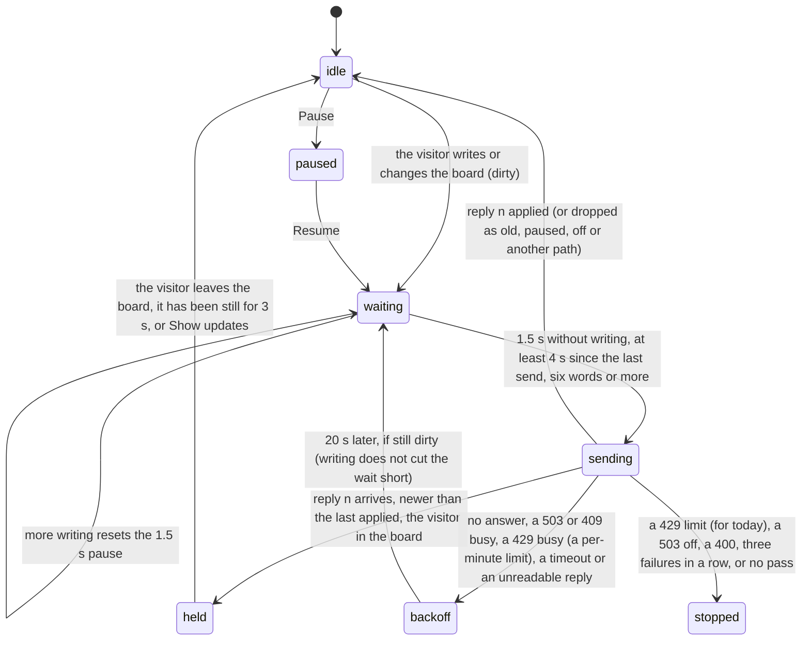

# The living brief: design

Status: built for review. Live interpretation is behind `SOFTWARE_BOARD_ENABLED`, which is `"false"` in
`wrangler.jsonc` until the owner approves the spending envelope in section 6. Stacked on PR #286 (example answers and
the contact confirmation), which it builds on and does not change.

Inspired by "Beyond Taking Turns": instead of a chatbot that waits for its turn, the visitor and the system shape one
shared artifact at the same time. The visitor keeps writing; a board beside the answer boxes fills in an outline of the
project; the visitor keeps, edits, answers or sets aside what appears, and their choices always win.

## 1. What the visitor sees

The project brief at `/software/start` keeps every step it has today. On the written questions (and the website's two
extra steps) a board titled "Your brief so far" sits beside the answer box on a computer and below the step's buttons
on a phone; the page calls its AI "the outline", apart from the answer boxes' "suggestions". The review step lists the
outline as it will be sent. The board's height is bounded: on a computer it is a sticky panel no taller than the
screen, with its heading, status and controls fixed and the cards scrolling inside; on a phone the cards scroll in a box
about three fifths of the screen tall. However many cards arrive, the page does not grow. It has four lanes, named for
the chosen path:

| Lane | Website | Web app | Workflow |
|---|---|---|---|
| `purpose` | What it’s for | What it’s for | What should change |
| `audience` | Who it’s for | Who uses it | Who does the work |
| `parts` | Pages | What people can do | Steps today |
| `questions` | Open questions | Open questions | Open questions |

Every item on the board is a card with a visible origin, in words and in outline, never colour alone:

| Origin | Label | Outline | Sent with the brief? |
|---|---|---|---|
| Read from the visitor's answers (the model's short wording of a passage the visitor wrote, with the passage quoted) | “From your answers” and the quoted passage | solid | Yes, unless removed |
| An inference (a page, a question) | “Suggestion” and a short reason | dashed | Only if kept |
| A suggestion the visitor kept | “You kept this” | solid | Yes |
| A suggestion the visitor edited | “Edited by you” | solid | Yes |
| A note the visitor added | “Your note” | solid | Yes |
| A question the visitor answered | the answer under the question | solid | Yes, with the answer |

Actions on a card: Keep, Edit, Not this (sets it aside), and on a question, Answer. Set-aside cards go to a closed
"Set aside" list with Bring back (an edited card comes back as edited). Each lane has "Add" for the visitor's own note.
The board header holds a status line (readable by screen readers; changes that matter are also announced), "Pause the
outline" (one toggle, `aria-pressed`), and Undo, whose accessible name and tooltip say what it will undo; Ctrl or Cmd+Z
inside the board does the same. "Use the plain form" hides the board and sends no outline; "Show the outline" on each
step with the board brings it back. The existing "Turn off" for AI suggestions also stops the outline's AI; the board
then works by hand.

## 2. The rules

1. **The model never puts words in the visitor's mouth.** A card marked as read from the answers must quote a passage
   of at least three whole words that appears in the visitor's current answers, starting and ending on word boundaries
   (ignoring case, spacing, punctuation and quote style). Ordinary code checks it on the server and again in the
   browser when the reply is applied. A card whose passage is not there is dropped.
2. **Owned cards are the visitor's.** A card is owned once the visitor added, kept, edited, answered or set it aside.
   Replies never change, move or remove an owned card. Only the visitor (or the visitor's Undo) does.
3. **A rejected idea stays rejected.** A reply's new card is dropped when it matches any card already on the board in
   that lane, set-aside cards included (normalised words, plural endings and stop words ignored, or one inside the
   other), and a reply never rewords an open card into the idea of another card (set aside, owned or a duplicate). The
   set-aside list is also sent so the model can avoid paraphrases.
4. **A reply only changes what it could have seen.** Each card records how many requests had been sent when it last
   became unowned (`since`). A reply may update an unowned card, or withdraw it by leaving it out, only if its request
   was sent after that. A card that became unowned after the request was sent (an Undo) is left alone until a later
   reply. (The first design compared against the ids each request showed; the Quint model found it let an Undo made
   while a request was in flight be reverted, and keeps it as the `SeenOnly` mutant.)
5. **Old replies never apply.** Requests are numbered. A reply applies only when its number is higher than the last one
   applied, the board is not paused or off, and the path has not changed since it was sent.
6. **Nothing moves under the visitor.** While focus is inside the board, a fine pointer is over it, or a finger has
   touched or scrolled it in the last three seconds, replies are held and a "Show 2 updates" button appears at the end
   of the board; they apply when the visitor leaves the board, the board has been still, or the visitor asks. New cards
   are added at the end of their lane. The board is never above the answer box, so the box never moves.
7. **No commitments.** The model is told, and the server and the browser check, that cards carry no prices, dates,
   durations, promises or links, and never speak for the owner. A card with a currency amount, a spelled-out sum, cost
   words ("costs about", "affordable", "fixed price"), a date or deadline ("by March", "next month", "2027-01-15"), a time
   estimate, a promise, Kazon's name, or a link is dropped. A page named "Pricing" or "Request a quote" is the visitor's
   own business and stays.

## 3. Card states

```mermaid
stateDiagram-v2
    [*] --> proposed: a reply adds it (said or suggested)
    [*] --> wrote: the visitor adds a note
    proposed --> proposed: a later reply that saw it updates it
    proposed --> [*]: a later reply that saw it leaves it out, or its passage is no longer in the answers
    proposed --> kept: Keep (or Answer, on a question)
    proposed --> edited: Edit
    proposed --> dismissed: Not this
    kept --> edited: Edit
    kept --> dismissed: Not this
    edited --> dismissed: Not this
    dismissed --> kept: Bring back (kept before, or never edited)
    dismissed --> edited: Bring back (edited before it was set aside)
    wrote --> wrote: Edit
    wrote --> [*]: Remove
    note right of kept: kept, edited, dismissed and wrote are owned: no reply changes them
```

Undo restores the card (or cards) exactly as they were before the visitor's last action, including back to `proposed`.

## 4. Requests



One request is in flight at a time, and a page makes at most 24. A request that Pause, the plain form or a path change
aborts is asked again later. The page fits each request to the route's 7,000-character limit by leaving out set-aside
cards, then the visitor's own, never the open ones. The reconciliation does not rely on any of that: the Quint model lets
any number of requests overlap and arrive in any order.

## 5. Interpretation on the server

`POST /api/software/brief/board`, in the Effect form of the back-end rules (CLAUDE.md):

- `src/server/brief-board-input.ts` reads the request with Effect Schema: the path, the written answers for that path,
  the board's cards as context (unowned ones with their id, owned ones as text only, set-aside ones as text to avoid).
  It sends no name, email, company, budget or timing.
- `src/server/flows/brief-board.ts`: the Turnstile pass the autocomplete already mints (same cookie, same path), the
  two Cloudflare rate limits under their own `board:` keys, then a daily reservation in `brief_suggestion_budget` under
  the scopes `board:<visitor hash>` and `board:site`, decided by `src/server/rules/brief-board.ts` and guarded in SQL
  (`count < cap`), then the model.
- `BoardModel` (`src/server/services.ts`) calls `@cf/meta/llama-3.3-70b-instruct-fp8-fast` with JSON Mode
  (`response_format: json_schema`), temperature 0.2, at most 700 output tokens and an 8 second timeout. Its failures are
  `BoardModelFailed` and `BoardModelTimedOut`.
- `src/lib/brief-board.ts` holds the reply reader, the lane limits and the checks in section 2, shared by the server and
  the browser. It is pure and reads every object field by field with `src/lib/fields.ts`: a `Schema.Struct`, `Array`
  or `Record` decoder brings Effect's concurrent parser into the browser bundle, which the client bundle check refuses.
  The request schema, which needs them, is server only.
- Answers: 200 with cards; 400 for a request the page never sends; 403 `pass` (the browser renews the pass once); 409
  `busy` (the day's count kept changing under three tries); 429 `limit` (today's limit) or `busy` (a per-minute limit);
  503 `off` (switch off, a missing binding or secret, a local preview) or `busy` (a rate limit binding failing, the model
  failing or timing out, an unreadable reply); 500 for a store failure or a defect, with a fixed sentence.

## 6. Cost and limits

Prices from Cloudflare's pricing page (read 2026-11-15): $0.011 per 1,000 neurons, 10,000 neurons a day free across the
account. `llama-3.3-70b-instruct-fp8-fast` is 26,668 neurons per million input tokens and 204,805 per million output
tokens. The autocomplete's `llama-3.2-1b-instruct` is 2,457 and 18,252.

| Call | Input | Output | Neurons | Cost |
|---|---|---|---|---|
| Autocomplete (today) | about 600 tokens | at most 12 | about 1.7 | about $0.00002 |
| Board, typical | about 1,800 tokens | about 350 | about 120 | about $0.0013 |
| Board, largest allowed | 7,000 characters of answers and board, about 3,300 tokens | 700 (the cap) | about 231 | about $0.0025 |

A board call costs 70 to 130 autocomplete calls, so the autocomplete's limits (300 per visitor and 10,000 for the site
each day) would allow up to about $25 a day. The board therefore has its own limits:

- per page: at most 24 requests; at least 4 seconds apart, after 1.5 seconds without typing;
- per visitor (the same daily IP hash as the autocomplete): 40 a day;
- per site: 150 a day.

At the site limit, every call at its largest: 150 × 231 = 34,650 neurons, about $0.38 a day before the free allocation,
at most about $12 a month. The character limit is not a token limit: text in scripts that take more tokens per
character could roughly double the input, about $0.53 a day and $16 a month at most. A typical brief takes 8 to 15
calls, so 150 a day is 10 to 18 briefs. When a limit is reached the board says so and keeps working by hand; the brief
is never affected.

## 7. Privacy

The privacy notice's brief paragraph is extended: the outline sends the written answers and its cards (its earlier
suggestions, the ones kept or edited, the visitor's notes and answers, and set-aside ideas; never the name, email,
company, timing, budget, link or notes on what they already have) to Workers AI; it is saved in the browser's
localStorage with the draft; it is stored on the server only when the visitor sends the brief, as part of it, and
suggestions not kept are not sent with the brief; the same IP-derived daily counters apply.

## 8. What is sent with the brief

`outline` (optional) beside today's fields, read by `readBriefOutline` in the inquiry route, and only while
`SOFTWARE_BOARD_ENABLED` is on: at most 17 items (every lane at its limit; the page leaves out cards read from the
answers before the visitor's own when Undo has filled a lane past it), each with its lane, text, origin (`answers`, `kept`, `edited`, `wrote`), the quoted passage for `answers`
(checked again against the submitted answers; a mismatch is refused with a sentence asking the visitor to review), and
an answer for a question. It is stored in the request's details, shown in the review step before sending, in the
owner's request page and notice, and in the visitor's copy. Without an outline, the route answers exactly as before.

## 9. Verification

- `verification/brief-board.qnt`: the reconciliation in section 2 with an adversarial model (any reply, any order, any
  overlap), visitor actions including Undo and Pause, and seven properties, each with a mutant that breaks it.
- Unit tests for the shared module, route tests on the golden harness's fakes (D1, rate limits, AI), the inquiry route
  with and without an outline, the existing brief-flow tests unchanged, and Playwright runs of the page with a scripted
  model (`scripts/screenshots/brief-board-script.mjs`) that answers late and out of order.
