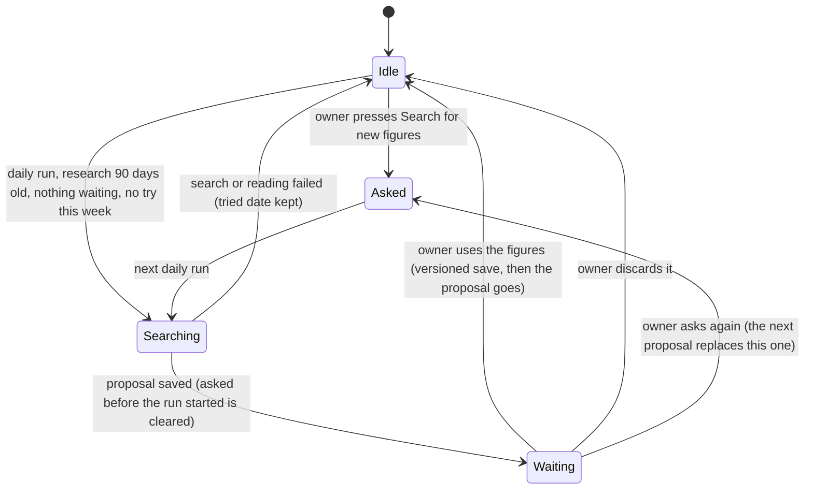

# Refreshing the market research: design

Status: written before the code, for its own pull request after the offer board (#308). Owner request (2026-11-23):
the market research the offer board's third price row reads was a one-off import, researched on 2026-11-15. Asked how it
should be kept current, the owner chose "in the site, you approve": the site searches the web with the owner's Tavily
account on a schedule, and nothing changes until the owner accepts the new figures.

## 1. What the owner sees

On `/owner/pricing`, under "Market research":

- **A proposed update.** After a search, a section "Proposed figures" shows, for each kind of work and size, the current
  range beside the proposed one, the sources each proposed figure came from (with links), and a caption saying when the
  search ran. A size the search found no checked figure for says "No new figure; stays as it is".
- **Use these figures** replaces the research with the proposal, through the same versioned save the research box uses,
  so a save from another tab since the page loaded is refused as today. The proposal then goes.
- **Discard** removes the proposal and changes nothing else.
- **Search for new figures** asks for a search at the next daily run (within a day). Without the Tavily key, the page
  says the key is not set and the button is not offered.

The offer board itself does not change: its market row keeps reading the accepted research and saying its date.

## 2. When a search runs

A cron trigger runs the site's `scheduled` handler once a day. The run decides, from facts it reads first, whether to
search (a pure rule, `src/server/rules/market-refresh.ts`):

- never without the Tavily key (`TAVILY_API_KEY`, a Worker secret the owner adds);
- always when the owner asked since the last run started;
- otherwise only when no proposal is waiting for the owner, the accepted research is 90 days old or more (or there is
  none), and no run has been tried in the last 7 days (so a failing search spends credits at most once a week).

A run with nothing to do reads two KV keys and stops.

## 3. What a search does

For each of the nine cells (website, web app, workflow; small, medium, large) and the senior day rate, the run:

1. **Searches** Tavily once (`POST https://api.tavily.com/search`, `search_depth: "advanced"`, `topic: "general"`,
   `time_range: "year"`, `max_results: 6`, `include_published_date: true`, the key as `Authorization: Bearer`). The
   query names only the kind of work and its size; nothing about any client is ever sent.
2. **Reads** the results with Workers AI (the offer board's model, JSON mode): the low and high figure, in whole US
   dollars, that the results give for this kind and size, and which results state them; or none.
3. **Checks** the reading in ordinary code: a figure stands only when both ends appear as dollar amounts in the text of
   a result it cites, and the low end is not above the high end. A cell that fails keeps its current figures and is
   marked as kept. This is the automated form of the November research's rule that each figure is re-read in its
   source.

The proposal is a whole research record (the same shape `/owner/pricing` imports): the new or kept ranges, the day
rate, the cited sources (https only, with their dates when Tavily gives one) and a caveat saying it came from an
automatic search, how it was checked, and which cells were kept. It is stored under its own KV key,
`pricing:proposal:<id>`, written once and never changed; a new proposal replaces older ones.

Cost per search: ten advanced Tavily searches (20 credits; the free plan has 1,000 a month) and ten Workers AI calls
(about 4,000 tokens in and 200 out each). On the schedule that is about four searches a year, plus any the owner asks
for.

## 4. States

## 5. Rules kept

- **The owner decides every figure.** A search writes only a proposal; the research changes only through the owner's
  press, through the existing versioned save (its Quint model, `verification/pricing-save.qnt`, already covers it).
- **Nothing private leaves the site.** The queries are fixed text about kinds of work. No client detail, day value,
  contingency or past offer is sent to Tavily or the model.
- **Effect form.** The decision is a pure rule; the run is a flow (`src/server/flows/market-refresh.ts`) that calls a
  `MarketSearch` service (Tavily) and a `MarketReader` service (Workers AI), each failing with a named error; proposals
  and markers live in their own store file. The scheduled handler is a new custom Worker entry (`src/worker.ts`) whose
  `fetch` is Astro's own handler, unchanged.
- **Timing.** The new read-then-write steps (the run reads the ask and clears it; accept and discard act on one
  proposal) are modelled in `verification/market-refresh.qnt`: an ask made while a run is going is never lost, a
  discard or an accept never removes a newer proposal, and accepted figures are always a proposal the owner was shown.

## 6. Not covered

- KV is eventually consistent, as for the pricing record: a run can read an ask a few seconds late and act on the next
  day's run instead.
- The search's quality is not the November research's: there is no second reader, and Tavily's snippets favour vendor
  and agency pages. The check only proves each figure is in its source, not that the source is right; the owner's
  review is the judgement.
- No real Tavily call is made in tests; the first real search runs once the owner adds the key.
