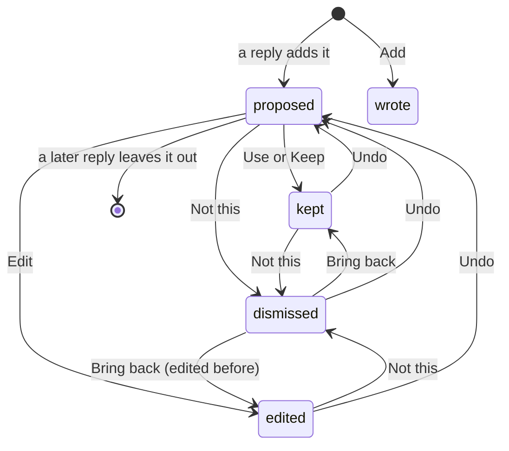

# The offer board: design

Status: built for review, as its own pull request stacked on the living brief (PR #290). Written before the code; the
sections below say where the build differs from the first draft. Owner request (2026-11-15): "The owner page could benefit from this AI workflow
as well. I hardly know how much to charge or what the outcome should be." Owner decisions the same day: show all three
ways to price (the AI's day estimates times the owner's own day value, the owner's past offers, and a market range
grounded in cited research); the AI may read the written answers, outline, timing, budget note and existing-site notes,
never the client's name, email or company; build it as its own pull request stacked on the living brief (PR #290),
whose reconciliation rules it shares.

The living brief lets a visitor and Workers AI shape a project brief at the same time. The offer board does the same
for the owner and an offer: while the owner reads the brief and writes the offer, a board beside the offer editor
suggests an outcome, milestones, what the client must provide, what is outside the offer, timing, questions to ask and
what drives the cost, and puts three prices side by side. The owner uses, edits or sets aside each suggestion. Nothing
is saved or sent until the owner presses the offer editor's own Save draft or Send offer.

## 1. What the owner sees

On `/owner/requests/<id>` for a software request with a brief, while an offer can still be drafted (not resolved,
withdrawn or started), a section titled "Shape the offer" sits above the offer editor. It starts with one button,
"Suggest an offer with AI", so opening a request never calls the model. Once started, the board keeps up with the owner:
after the owner pauses editing the offer for three seconds, it asks again with the current draft, one request at a
time, at least ten seconds apart, at most 12 a page. "Suggest again" asks at once. A failed request (the model busy,
the day's limit, a network error) is shown in the status line and stops the board asking on its own until the owner
presses Suggest again, so a failure never spends the day's allowance by itself.

The board's height is bounded (the page never grows with it): the heading, the status line and the controls stay put,
and the lanes scroll inside a box no taller than about two thirds of the screen. The pricing panel sits below that box,
so prices that fill in never move a card under the pointer, and a price row is redrawn only when what it says changes,
so a focused button in it stays. A reply waits only while the owner's pointer or focus is among the cards, where it
would move something; a press of Suggest is not that. Its button ("Show N updates") sits beside Undo in the header, so
it moves nothing either, focusing it does not apply the reply, and its arrival is announced once. The board is not
saved across a reload: the offer editor's own draft is, and Suggest asks again.

### What to charge

Three rows, each with the reasoning behind it:

| Row | How it is worked out | When it is missing |
|---|---|---|
| From your day value | The AI estimates each milestone's working days as a low and a high. Ordinary code multiplies them by the owner's private day value and adds the owner's contingency, rounded up to whole $50. | "Set your day value on the pricing page." |
| From your past offers | Ordinary code reads the owner's sent offers on the same path (website, web app or workflow), each the version the client last received (never a superseded or withdrawn one): each one's total (the sum of its milestone fees), outcome and date, the five most recent, with the lowest, middle and highest. | "No sent offers on this path yet." |
| From the market | The researched range for this path and the size the AI chose (small, medium or large), with the date it was researched and its sources. The AI also names a figure in that range with a reason; ordinary code moves a figure outside the range to the nearer end and says so. | "Add the market research on the pricing page." |

Each row can fill the offer's whole-project range ("Use as the estimate range", which also ticks "Whole-project
range"), and each milestone card can fill its milestone's fee ("Use $N as the fee"). These are the only ways money
reaches the offer, and only by the owner's press. The panel says: "Estimates to help you decide. The fee is yours, and
nothing is sent until you send the offer."

### Lanes

| Lane | Fills | Limit on the board | Text limit (the offer editor's) |
|---|---|---|---|
| Outcome | the Outcome field (replaces it) | 3 | 120 |
| Summary | the Summary field (replaces it) | 2 | 300 |
| Milestones | a new milestone (name, deliverables, acceptance examples), or the first empty one | 4 | name 80; 1 to 8 deliverables and 1 to 5 acceptance examples of up to 200 each |
| What you need from them | a line added to "What you need from them" | 6 | 120 |
| Outside this offer | a line added to "Outside this offer" | 6 | 120 |
| Timing | the Timing field (replaces it) | 2 | 200 |
| Questions to ask | the "Ask a question" form (copied, never sent) | 4 | 200 |
| What drives the cost | nothing; a note for the owner, and context for the next suggestion | 4 | 120 |

Card actions: Use (Keep, for cost drivers), Edit, Not this (to a closed "Set aside" list with Bring back), Undo for the
board. An edited card and a card brought back can be used too. A used milestone offers only its fee ("Set its fee to
$N", which fills the fee and nothing else) and Not this; any used card can be set aside. The owner writes their own
words in the offer editor itself, so the lanes have no Add. Every card says where it came from ("Suggestion", "You used
this", "You kept this", "Edited by you"). The lanes hold 30 cards in all, within the 60 a request may show the model,
and the page fits a request to the route's 24,000-character limit by leaving out set-aside cards, then the owner's,
never open ones.

## 2. The rules

The living brief's rules 2 to 5 hold unchanged, because the offer board runs the same reconciliation code:

1. **Owned cards are the owner's.** Used, kept, edited, set-aside and written cards never change from a reply.
2. **A rejected idea stays rejected,** paraphrases included.
3. **A reply only changes what it could have seen** (the `since` stamp), so an Undo made while a request is in flight is
   not reverted.
4. **Older replies never apply;** nothing applies while paused.

And for money and privacy:

5. **The model never sets a price.** It estimates days and names a market figure. Ordinary code turns days into money
   with the owner's numbers and holds the market figure inside the researched range. A card whose text contains a price
   is dropped (money belongs in the pricing panel). Fee and range fields change only when the owner presses Use.
6. **Nothing is sent or saved by the board.** Use fills the draft form in the page; the offer editor's Save draft and
   Send offer stay the only ways an offer is stored or sent.
7. **Private numbers stay private.** The day value, the contingency and the market research live in the private KV
   store, set from an owner page, and past offers in the database; none of them is in the repository (it is public), shown to a client, or sent to the
   model, except the market ranges for this path, which ground the model's figure. Other clients' offers never reach
   the model.
8. **No links or markup in model text.** Cards with a link are dropped; every text is rendered as text.

## 3. Card states

The same as the living brief, with Use as the owner's Keep:

Use has a second effect outside the board (the form field), and Undo reverses both together. The page keys what Use
changed by the board's history step itself, so a step that falls off the 40-step history takes its entry with it. Undo
puts a field back only while it still holds what Use put there, removes only the line Use added to a one-per-line
field, and removes a milestone row Use added once that row's fields are empty again: anything the owner typed since
stays.

## 4. The pricing reference (private)

A new owner page, `/owner/pricing`, reached from the board and the owner home:

- **Day value** (whole dollars): what a working day is worth to the owner, used only to turn the AI's day estimates
  into a range. It is never shown to clients; offers stay fixed-price per milestone.
- **Contingency** (0 to 100 %): added to the high end.
- **Market research:** for each path (website, web app, workflow) and size (small, medium, large), a low and high in
  whole dollars and what the size means; the sources (title, link, date); the date researched. "Import research" reads
  the file the research workflow produces; every field can also be edited by hand.

Stored as one record (`owner:pricing`) in the RESUME_STORE KV namespace, which already holds the owner's private records,
saved with the version the owner last read (a stale save is refused with 409 and the page says to reload; KV has no
compare-and-set, and one owner writes this record). A MUSIC_DB table was the first plan: it would have changed the
database digest every golden case records, so the corpus would have needed a re-record its rules do not allow. The research itself is produced outside the site
by a workflow that searches, reads and cross-checks sources and is rerun when the owner wants it refreshed; a live
search on every request would need a new paid service, which the owner has not approved.

## 5. Server

`POST /api/owner/requests/<id>/offer-board`, owner only (the Access check every `/api/owner/` route has), in the
back-end rules' Effect form, like the living brief's route:

1. Read the input with Effect Schema: the board context (cards and their states), the current draft (outcome, summary,
   milestone names, deliverables and acceptance, client inputs, exclusions, timing; never fees) and the request number.
2. Read the request from the database (so the page cannot change what the model sees): it must be a software request
   with a brief on the website, web app or workflow path.
3. Reserve one call in the owner's daily count (`offer-board:owner` in `brief_suggestion_budget`, 40 a day), with the
   same guarded batch as the living brief.
4. Ask `@cf/meta/llama-3.3-70b-instruct-fp8-fast` in JSON Mode with a JSON schema, 1,200 output tokens, 30 seconds.
5. Read the reply card by card as untrusted data: lanes, limits, text limits, no prices or links in text, days between
   0.5 and 60 per milestone, size one of three, the market figure a whole number.
6. Answer the cards, the size, the AI's day estimates and its market figure. The pricing panel's arithmetic runs in the
   browser from numbers the owner page already holds (the day value, contingency, research for this path, past offer
   totals), rendered into the page for the owner only.

The model sees: the path; the written answers; the brief's outline; the existing-content note and who updates the site;
the timing and its date; the budget note; the owner's fit label and private fit note; the draft without fees; the
board's cards; the researched ranges for this path. Never the name, email, company, the current site's address, the
day value, the contingency or any past offer.

## 6. Cost

A call reads about 3,500 tokens and writes up to 1,200: about 93 + 246 = 340 neurons, about $0.004. At the owner's cap
of 40 a day, at most about $0.15 a day, inside the 10,000 free daily neurons on most days. The owner asked for this
feature, and this is far below the living brief's envelope; the living brief's own switch is unaffected.

## 7. Privacy

The privacy page's software brief section gains: when the owner prepares an offer, Cloudflare's AI may help draft it
from the brief (the written answers, the outline, the timing and the budget note, never the name, email or company),
and nothing it suggests reaches the client unless the owner puts it in an offer.

## 8. Verification

- The reconciliation is the living brief's `applyReply`, generalised over its lanes with no change in behaviour: the
  `brief-board.qnt` model, its mutants and the seeded walks cover it, and `tests/lib/offer-board-walk.test.ts` runs the
  same kind of walk with the offer board's lanes and limits (small, so full lanes are reached often) and the page's own
  reply reader.
- Added after the owner asked (2026-11-15) for the risky areas to be checked by search: `verification/offer-board.qnt`
  (Use and Undo with the offer editor's fields, Set its fee, late replies, failures; eleven mutants, eight of them
  bugs the first review or the model found in the code; `tests/browser/offer-board.cjs` tries each on the real page in the
  Screenshots workflow), `verification/daily-allowance.qnt` (both boards' daily reservation under concurrent requests)
  and `verification/pricing-save.qnt` (the pricing page's saves; its intended design is a compare-and-set, and today's
  KV code is the `TodayKv` mutant, which shows a lost save between two tabs: the owner's decision is whether to move the
  record to D1). See docs/verification.md.
- `src/lib/offer-pricing.ts` is a pure money rule, so it carries LemmaScript contracts checked by Dafny in CI: each end
  of the day value range is a whole $50 amount, at least the exact amount and less than $50 above it (the high end with
  the contingency, a half cent rounded up); the market figure always lies in the researched range, equals the AI's
  figure when that is inside, and is the nearer end otherwise. Planted bugs (rounding down, the wrong end) fail. An
  offer's total and the spread of past totals are unit tested.
- Route tests against real SQL: owner only, a missing or closed request, the daily cap, a malformed or hostile reply,
  that the model never receives the fields it must not see.
- Browser checks and a screenshot scenario: start, Use on each lane, Undo of a Use, a stale reply after a Use, the three
  prices, the bounded height at both widths, keyboard and axe.
