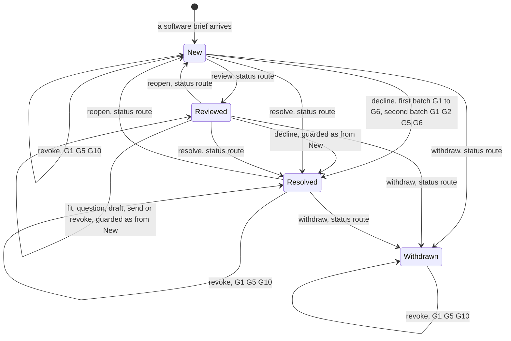
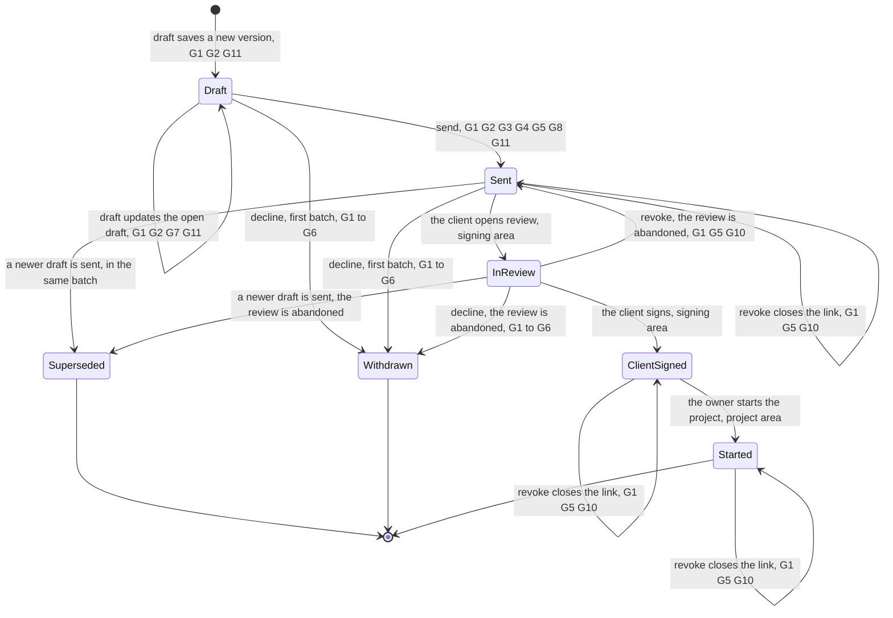

# Software offers: conversion design

Status: proposed, 2026-11-15. This is the design PR for step 1 of `docs/plans/2026-11-effect-conversion.md`, reviewed
before any conversion code. It changes nothing under `src/`. Every claim about today's code cites a file and line on
`origin/main` at `399406ed`; `software.ts` below means `src/pages/api/owner/requests/[id]/software.ts`.

It assumes `claude/offers-prep-split` lands first (it moves `softwareGuard`, `softwareAudit`, `softwareInvoiceTerms` and
the deposit facts into modules of their own, with no behaviour change).

## What the owner is asked

1. Each candidate behaviour fix in section 5: yes, no, or a different answer. None is decided here.
2. Whether to extend the Quint model before the conversion (section 7).
3. Two design choices, each with a recommendation: name as refusals the conditions that only a batch guard checks today
   (section 2, "Conditions only a guard checks today"), and write decline as a plain flow rather than through the
   `@xstate/effect` bridge (section 3).

## The area today

One route, `POST /api/owner/requests/[id]/software`, with six actions. Before any action it checks, in this order:

| Check | Answer | Code |
|---|---|---|
| Not the owner | 403 `{ok:false}` | software.ts:90 |
| No `MUSIC_DB`, or no `id` | 503 `{ok:false}` | software.ts:92-95 |
| The body (80 KiB, JSON, same origin) | `musicRequest`'s own answers | software.ts:97-99 |
| The command's shape (Zod) | 400 "Check the required fields and their limits." | software.ts:31-63, 100-106 |
| The request, of kind software | 404 `{ok:false}` | software.ts:108-110 |
| A started project (draft, send, question, decline only) | 409 ProjectStarted | software.ts:112-125 |
| Withdrawn (any action but revoke), or no email (any action) | 409 RequestClosed | software.ts:127-131 |
| Resolved (draft, send, fit, question) | 409 RequestResolved | software.ts:133-143 |

Then the action runs inside one `try`; its `catch` (software.ts:856-920) answers every throw, of any kind, with a 409
chosen by fresh lookups. Every answer the route builds carries `cache-control: private, no-store` (software.ts:65, 86-87);
`musicRequest`'s answers do not. Nothing runs after the response (no `waitUntil`).

## 1. The machines

Two machines, in `src/server/machines/`, asked through `next()` and `sourcesOf()` (`src/server/machines/next.ts`).

**The guards.** Each move is re-checked at write time by compare-and-set statements in its batch. The IDs below are used
in the diagrams.

| ID | Re-checks at write time | Code |
|---|---|---|
| G1 | The request row still has the `updated_at`, `status` and `email` that were read (the decline's second batch and the question's record: the `updated_at` its own first batch wrote) | software.ts:211-215 |
| G2 | No `software_projects` row | software.ts:279-282, 302-305, 353-356, 476-479, 769-772 |
| G3 | No agreement that is `client_signed` or `executed` | software.ts:290-294, 739-743 |
| G4 | No first-milestone deposit invoice that blocks: open for a decline; open or paid when a draft is sent | software-invoices.ts:400-412; software.ts:297, 768 |
| G5 | No live offer link made in the last 20 seconds | software-offers.ts:467-476 |
| G6 | No `audio_projects` row | software.ts:298-301, 360-363 |
| G7 | The open draft still has status draft and the `updated_at` the page sent | software.ts:480-487, and the update's own `status='draft'` (491) |
| G8 | The offer being sent still has the status and `updated_at` read | software.ts:773-776 |
| G9 | A reissue: the request's link is revoked | software.ts:777-784 |
| G10 | Revoke: the link with the `created_at` the page showed is still live | software.ts:412-415, and the update's own `revoked_at IS NULL` (417-420) |
| G11 | Each attachment named in the details has its metadata row, unchanged, in no closed archive | software.ts:194-209; draft 506-508, send 767 |

The database adds three: `UNIQUE(request_id,version)`, one draft per request and one sent offer per request
(migrations/music/0020_software_offers.sql:40-43). Statements that filter rows without failing the batch (the withdraw's
`status IN ('sent','draft')`, the supersede's `status='sent'`, the attachment delete's `NOT EXISTS`) are listed in
section 4.

### The owner request

The request's `status` column holds `new`, `reviewed`, `resolved` or `withdrawn` (src/lib/owner-model.ts:12-17). Only
decline changes it; the other five actions leave it as it is. The status route's moves (src/lib/owner-requests.ts:236-245)
are drawn for context; they join the machine when that route converts (step 12).



What each state refuses:

| Action | Resolved | Withdrawn | Any state |
|---|---|---|---|
| fit | RequestResolved | RequestClosed | RequestClosed when the email is empty |
| question, draft, send | RequestResolved | RequestClosed | ProjectStarted first, then RequestClosed when the email is empty |
| decline | AlreadyResolved, after the deposit check | RequestClosed | ProjectStarted first, then RequestClosed when the email is empty |
| revoke | allowed | allowed | RequestClosed when the email is empty |

In code: `softwareRequest` with the four stored states and the events FIT, QUESTION, DRAFT, SEND (from new and reviewed, to
the same state), DECLINE (from new and reviewed, to resolved) and REVOKE (from all four). The empty email and the started
project are not states; they are terms of the rules (section 2).

### The offer version

This extends the machine in `docs/plans/2026-11-discount-flow.md`, section 3. ClientSigned covers `client_signed` and
`executed` agreements.



Refused moves: send from ClientSigned (G3) and decline from ClientSigned (G3); draft, send and decline once Started
(ProjectStarted, G2); sending a draft while any version's first deposit is open or paid (G4); a reissue while the link is
live (G9); any send, decline or revoke within 20 seconds of a live link (G5). Superseded and Withdrawn have no moves (send
answers NoOfferToSend).

Where this differs from the discount plan's diagram (no contradiction; it adds what that plan left out):

- **The link.** The discount plan has no link. Here a revoke closes it (Sent, InReview, ClientSigned and Started all keep
  or return to their state, and InReview's review is abandoned, src/lib/software-agreements.ts:37-77), and a send of the
  sent version issues a new one (software.ts:593-594, 777-784).
- **Stored states.** InReview, ClientSigned and Started are not values of `software_offers.status`
  (src/lib/software-offers.ts:379); they are `software_agreements` rows (`review`, `client_signed`, `executed`) and a
  `software_projects` row. The XState machine `offerVersion` therefore has the four stored states (draft, sent, superseded,
  withdrawn) and the events SAVE, SEND, SUPERSEDE, REISSUE and WITHDRAW. The other three are facts the rules read, drawn
  here for people, as the discount plan draws them.
- **Decline is two batches.** The offers are withdrawn in the first batch and the request resolved in the second, after
  the email (software.ts:288-324, 350-372). The discount model does both in one step.

The store builds its status lists from the machine: `sourcesOf(offerVersion, "WITHDRAW")` gives draft and sent
(software.ts:308), SUPERSEDE gives sent (789), SAVE gives draft (491). A test holds each list to the machine.

## 2. The rules

Every rule is a pure Effect rule in `src/server/rules/`, in the CLAUDE.md shape. None has a `nothingToDoIf`: every action
writes even when repeated (a second fit or revoke writes or refuses; nothing answers "already done"), so each is
`alwaysWrites({ name, given, refusals, writes, writesText })`. A rule reads no clock and makes no id: the flow passes the
time it read where the code reads it today (software.ts:145, and each sending check, software-offers.ts:475, 482), the new
draft id (software.ts:450) and the new link token (745).

**XState and Effect.** `next()` answers whether the request's status allows the action and, for decline, its target; it
also gives the offer version's moves. Everything that reads another row or the page's expectations is an Effect rule term:
the started project, the empty email, the sending window, deposits, signed agreements, the audio project, every expected
version, version numbering, the write time, the email texts, and which 409 to give after a refused batch.

**Write time.** `now`, or one millisecond after the version read when that is not earlier than `now`: the request's
`updated_at` for fit, question and decline (software.ts:232-233, 273-274), the open draft's `updated_at` for draft and send
(430-431). Revoke uses `now` as read.

### The refusals

Each is a `Data.TaggedError` with a `say` sentence (no field named `message`, `name`, `stack` or `cause`).

| Tag | Status | Sentence, exactly as today | Code |
|---|---|---|---|
| RequestNotFound | 404 | none: `{ok:false}` | software.ts:108-110 |
| ProjectStarted | 409 | This project has started. Use the project messages. | software.ts:112-125, 376-386, 881-894 |
| RequestClosed | 409 | This request is closed. | software.ts:127-131 |
| RequestResolved | 409 | This request is resolved. Reopen it to make a new offer. | software.ts:133-143 |
| AlreadyResolved | 409 | This request is already resolved. | software.ts:264-268 |
| RequestChanged | 409 | The request changed or could not be saved. Reload and try again. | software.ts:219-230, 912-919 |
| OfferStillSending | 409 | An offer is still being sent. Try again in a moment. | software-offers.ts:464-465 |
| DepositOpenOnDecline | 409 | Void the open deposit invoice in Stripe before declining this request. | software.ts:250-262 |
| DepositOpen | 409 | Void the open deposit invoice in Stripe first, then send the new offer. | software-invoices.ts:384 |
| DepositPaidOnSentOffer | 409 | A deposit is already paid for this offer. Start the project, or refund it in Stripe and record the refund with owner:stripe:reconcile --software-deposit-refunded. New terms can't be sent while an agreement is signed. | software-invoices.ts:391 |
| DepositPaidEarlier | 409 | A deposit is paid on an earlier offer. Refund it in Stripe and record the refund with owner:stripe:reconcile --software-deposit-refunded before sending new terms. | software-invoices.ts:394 |
| EmailSentButChanged | 409 | The client email was sent, but the request changed before it could be recorded. Reload before taking another action. | software.ts:394-401 |
| LinkChanged | 409 | The client link changed since this page loaded. Reload to see the current link. | software.ts:857-873 |
| TermsInvalid | 400 | none: `{ok:false,errors}` from `validateOfferTerms` | software.ts:434-436 |
| DraftChanged | 409 | The saved draft changed since this page loaded. Save again to keep what’s on screen, or reload to see the saved version. Carries `updatedAt`. | software.ts:438-447, 896-910 |
| NoOfferToSend | 409 | Save a valid draft before sending. | software.ts:596-604 |
| StoredTermsInvalid | 400 | none: `{ok:false,errors}` | software.ts:605-607 |
| DetailsIncomplete | 400 | Complete and validate Agreement details before sending. Carries `errors`, keyed `agreement.<path>`, only when a reader refused. | software.ts:720-736 |
| TemplatesMissing | 400 | Publish both templates and complete contractor details before sending. | software.ts:641-649 |
| MsaUnavailable | 409 | The confirmed MSA is unavailable for this recipient. | software.ts:653-668 |
| LinkNotBuilt | 500 | The offer link couldn’t be built. Check SITE_ORIGIN. Nothing was sent. | software.ts:748-761 |
| LinkClosedWhileSending | 409 | The email went out, but the link was closed while it was sending. Send the offer again for a working link. | software.ts:835-843 |

The client email's failures are service failures, not refusals (section 3); their 502 sentences are in section 5.

**Conditions only a guard checks today.** Three conditions are never read before the batch: a signed agreement (G3, decline
and send), an audio project (G6, decline) and a link that is not revoked on a reissue (G9). A refused batch answers
RequestChanged for them (golden: decline "a client-signed agreement blocks the decline", "an audio project for the request
blocks the decline"; send "a signed agreement stops the send", "a sent offer whose link is live is not reissued").
Recommended: the rule reads each fact first and refuses AgreementSigned, AudioProjectExists or LinkNotRevoked, each with
RequestChanged's sentence and status, placed last so the order of answers is unchanged. Then no business condition lives
only in SQL, and the guard stays as the write-time re-check. The new reads must not match any golden hook pattern (they
count by `nth`). The alternative is to leave them to the guards alone, which is safe here because no action retries.

### Per action

The front refusals come first in every rule, from `rules/software-request.ts`, in the order of the table in "The area
today": ProjectStarted (draft, send, question, decline), RequestClosed, RequestResolved (draft, send, fit, question).

**fit**, `reviewFit` in `rules/offer-fit.ts`.
Facts: the request. Move: FIT. Refusals: RequestClosed, RequestResolved, then RequestChanged when
`expectedRequestUpdatedAt` is given and is not the stored `updated_at` (software.ts:219-230). Writes, one batch: the fit
review upserted (label, trimmed note, write time, owner), the request's `updated_at`, the audit `fit-reviewed`
(software.ts:234-244). Re-checked by G1. A started project does not refuse it.

**question**, `askQuestion` in `rules/offer-question.ts`.
Facts: the request, a started project. Move: QUESTION. Refusals: the front three. Writes: first the reservation, the
request's `updated_at` (software.ts:276-286, G1 G2); after the client email, the audit `question-sent` (350-372, G1 at the
write time, G2). Emails: subject "A question about your project brief", text `<text>\n\nKazon` (326-331).

**decline**, `declineRequest` in `rules/offer-decline.ts`, with the deposit terms in `rules/offer-deposit.ts`.
Facts: the request, a started project, the first-milestone deposit invoices of every version
(src/lib/software-invoices.ts:370-375), the live link made in the last 20 seconds (src/lib/software-offers.ts:478-485).
Moves: DECLINE to resolved; WITHDRAW for the draft and the sent version. Refusals, in order: ProjectStarted,
RequestClosed, DepositOpenOnDecline (open, creating, payment_failed or uncollectible, not refunded), AlreadyResolved,
OfferStillSending (software.ts:250-271). Writes, first batch (288-324, G3 G1 G5 G4 G6 G2): draft and sent offers withdrawn,
signing retired (four statements), live links revoked, the request's `updated_at`, the audit `offer-link-revoked` with the
note "Offer withdrawn and link closed to decline the request". Second batch, after the client email (350-372, G1 at the
write time, G2 G5 G6): status resolved with `resolved_at`, the audit `declined`. Emails: subject "About your project
brief", text `<text>\n\nKazon`.

**revoke**, `revokeLink` in `rules/offer-revoke.ts`.
Facts today: the request only. Move: REVOKE from every status. Refusals: RequestClosed (empty email only), then, as the
catch orders them today (software.ts:857-879), LinkChanged and OfferStillSending. Today both are found only after the batch
fails; reading the link before it (one more read) lets the rule name them. Writes, one batch (408-422, G1 G5 G10): signing
retired, the link with that `created_at` revoked, the audit `offer-link-revoked` with no note.

**draft**, `saveDraft` in `rules/offer-draft.ts`.
Facts: the request, a started project, every offer version (src/lib/software-offers.ts:387-396), the metadata rows of the
removed attachments (software.ts:452-472). Input read in the flow at today's point, after the front refusals and the offers
read: the terms with `validateOfferTerms` (434-436) and the attachments named in `agreementDetails` with
`parseAgreementAttachments` (194-195, read while the batch is built today). Moves: a new version (`[*]` to draft, numbered
newest plus one, 449) or SAVE. Refusals: the front three, TermsInvalid, DraftChanged when `expectedUpdatedAt` is not the open
draft's (or not null when there is none, 438-447), and DraftChanged again when the attachments do not read (today a throw
answered by the catch, 896-910). Writes, one batch (474-545, G1 G2, G7 when a draft is open, G11 per attachment when details
are given and not null): the draft inserted or its terms updated, the details set (or cleared by null), the reused MSA set
(or cleared) when `confirmMsaReuse` is given, the audit `offer-draft-saved`, and each removed attachment's metadata row
deleted when nothing names it. After the batch: the R2 delete of each deleted row, and when one fails, its metadata row put
back and `attachmentCleanupPending` set (547-579).

**send**, `sendOffer` in `rules/offer-send.ts`, with `rules/offer-deposit.ts` and the pin rule `pinAgreement`.
Facts, in today's order: the request, a started project, every offer version (427), the live link made in the last 20
seconds (591), the stored terms (605), the first deposits when a draft is sent (610), the signing setting (615). Moves: SEND
and SUPERSEDE for a draft, REISSUE for the sent version. Refusals, in order: the front three, OfferStillSending,
NoOfferToSend (the offer is the open draft, else the sent version; refused when there is neither, or when its version or
`updated_at` is not the one the page sent, 594-604), StoredTermsInvalid, then for a draft DepositOpen,
DepositPaidOnSentOffer, DepositPaidEarlier (src/lib/software-invoices.ts:377-397). With signing on and a draft,
`pinAgreement` decides, in today's order: DetailsIncomplete with errors (the details, 627-630), TemplatesMissing (632-649),
DetailsIncomplete with errors (the contractor, 651), MsaUnavailable (653-668), DetailsIncomplete (each attachment's row and
bytes, 670-696; the preflight, 698-709). Then LinkNotBuilt (750-761). Writes, one batch (763-821; G1 G5 G3 G11 G4 G2 G8,
and G9 for a reissue): for a draft, the sent offer superseded and the draft marked sent (785-798); the link written (a new
token hash, replacing any old one); the pin (details, template ids, contractor snapshot, lower-cased email); signing
retired; the audit `offer-sent` with the note `Offer v<n> sent`. Email: subject `Your project offer: <outcome>` and the
text at 825, which says to sign on the website when signing is on and the offer has a pinned MSA template. After the
email: LinkClosedWhileSending when the client email was accepted and the link is no longer live (828-843).

**After a refused batch**, `rules/offer-refused-batch.ts`. Today's catch reads fresh facts and picks the 409; the rule does
the same over the same reads, in the same order:

| Action | Order of refusals |
|---|---|
| fit | RequestChanged |
| question, first batch | ProjectStarted, RequestChanged |
| question or decline, second batch | ProjectStarted, OfferStillSending (decline only), EmailSentButChanged (software.ts:373-402) |
| decline, first batch; send | OfferStillSending, ProjectStarted, RequestChanged (875-919) |
| revoke | LinkChanged, OfferStillSending, RequestChanged (857-879) |
| draft | ProjectStarted, DraftChanged with the open draft's `updated_at` read again (881-910) |

No action retries (`decideAndSave` is not used): today every lost race answers at once, and a retry on fresh facts would
pass a check the owner's page failed (src/server/guarded-save.ts:15-16, 27-29).

**Signing retired** (`retireSigning`, a rule the decline, revoke and send share): the abandoned reviews' `retain_until` is
the write time plus 90 days, today computed inside the statement builder (src/lib/software-agreements.ts:49).

## 3. The flows

`src/server/flows/software-offers.ts`, one program per action. Each keeps today's order of reads, decisions and outside
effects; no read moves ahead of a decision that comes before it today. Each builds no response text.

**Services.**

- **Mail** (the existing `Mail` in src/server/services.ts:164-171). The client email, then the owner's copy only when the
  client's was accepted (software.ts:154-183). A send needs `RESEND_API_KEY`, `CONTACT_FROM_EMAIL` and `OWNER_EMAIL`;
  without one no request is made (155-156), which the flow treats as MailNotConfigured. The live implementation for this
  route must send the bytes `sendAudioMessage` sends (src/lib/audio-resend.ts:32-69): its JSON keys come in the order
  from, reply_to, subject, text, to (16-30, and software.ts:158-167), while `liveMail`'s `sendMail` writes from, to, subject,
  text, reply_to (src/lib/resend.ts:37-55). The golden harness records the body as text, so `liveMail` as it is would not
  be neutral. Recommended: a live Mail that wraps `sendAudioMessage` (refused for a 4xx, uncertain for a 5xx or no answer).
- **AttachmentStore** (R2, `env.AUDIO`): `remove(key)` for the draft and `read(key)` (size and SHA-256) for the send. The
  binding may be missing and the route must not answer 503 for it: a draft then reports cleanup pending (golden "a removed
  attachment with no R2 binding") and a send refuses DetailsIncomplete ("an attachment with no R2 binding"). So it is built
  from `env.AUDIO` when set and fails every call when not, rather than through `bindingsOrUnavailable`.
- **AgreementPreflight**: wraps `preflightAgreementPacket` (src/lib/agreement-pdf.ts:379-464), loaded with the same
  dynamic import (software.ts:698-700). It reads D1 and R2 itself (agreement-pdf.ts:147-161, 344-350, 431-438), so its live
  implementation takes `env`; converting its insides is the signing area's work. Any rejection is PacketNotReady, which
  the send answers as DetailsIncomplete with no errors, as today.
- The store (section 4), and the time, ids and token as inputs.

**fit, revoke, draft.** Read, decide, one batch, answer. Draft then runs `AttachmentStore.remove` for each row the delete
returned, and `restoreAttachment` after a failed one.

**question.** Read; decide; reservation batch; Mail to the client (MailRefused, MailUncertain or MailNotConfigured fail the
program here); Mail copy (a failure only sets `copySent` false); record batch; on ChangedSinceRead, the after-refusal reads.

**decline.** Read (request, project, deposits, sending window); decide; first batch; Mail to the client, then the copy, as
for question; second batch; on ChangedSinceRead in either batch, the after-refusal reads. The resolve waits on the email, so
the `@xstate/effect` bridge would fit; recommended instead is a plain flow, as the music area has, because no state is saved
while the email is in flight (the request stays new or reviewed with its offers withdrawn, and a retry repeats both
batches, golden "a decline whose email is refused, then the same decline").

**send.** A sketch:

```ts
export const sendOffer = (command: SendCommand) =>
	Effect.gen(function* () {
		// Reads in today's order: request, project, offers, sending window, stored terms, deposits, signing setting.
		const facts = yield* readSendFacts(command);
		const send = yield* sendRule.decide(command, facts);
		// Signing on and a draft: templates, contractor, reused MSA, each attachment's row and bytes, then the preflight.
		const pin = send.pinNeeded ? yield* pinAgreement(send) : null;
		const link = yield* buildLink(command.origin, command.newToken());
		yield* saveSend(send, pin, link).pipe(
			Effect.catchTag("ChangedSinceRead", () => refusedSend(command)),
		);
		// Never fails: a refused, uncertain or unconfigured email is part of the outcome, as today.
		const mail = yield* emailOffer(send, link);
		const live = yield* readLinkStillLive(command.requestId, link.tokenHash, send.offerId);
		return yield* afterSendEmail.decide({ mail, live }, { send, link });
	});
```

Steps: the batch, then the email, then the live-link check (software.ts:763-843). The check refuses only when the client
email was accepted (835).

## 4. The store

`src/server/offers-store.ts`, over the `MusicDb` service, one function per statement, plain SQL that decides nothing
beyond its compare-and-set. A read that rejects is `OffersStoreFailed` (no fields). A batch that rejects is
`ChangedSinceRead` when its message is the JSON guard's or a UNIQUE violation (`raisedByJsonGuard`, `isUniqueViolation`),
otherwise `OffersStoreFailed`. Stored JSON that is not JSON, read through `json_each` in a batch, raises the guard's
message too (src/server/guarded-save.ts:59-71), so those cases stay 409 as today (golden draft "a malformed agreement
manifest breaks the removed attachment delete", "another offer's saved details are not JSON when an attachment is
removed").

The statements keep today's SQL where a golden hook matches it (`failures` and `interleave` patterns count matches by
`nth`); where one must change, its pattern changes in the re-record commit and the `trigger-hit` marker (operation, table,
access) stays the same. A new read must match no pattern: for example a read of the link for revoke must not start
`SELECT 1 FROM software_offer_links`, which revoke, decline and send cases count.

**Shared reads.** `readRequest` (src/lib/owner-requests.ts:121-131, which also parses `details_json`,
src/lib/owner-model.ts:74), `readProjectStarted` (software.ts:114-117), `readOffers` (software-offers.ts:387-396),
`readFreshLiveLink(requestId, since)` (software-offers.ts:467-468, 478-485), `readFirstDeposits` (software-invoices.ts:370-375).

**Shared statements for a batch.** `requestUnchanged` G1, `noProject` G2, `noSignedAgreement` G3, `noBlockingDeposit` G4,
`notSending(requestId, since)` G5, `noAudioProject` G6, `attachmentUnchanged` G11, `touchRequest` (`updated_at`),
`audit` (software.ts:147-152), and `retireSigning`: four statements on the signing tables (software-agreements.ts:37-77):
review agreements abandoned (only `status='review'`), saved agreement drafts deleted, sessions revoked, sign-in links used.

| Action | Functions |
|---|---|
| fit | `saveFit`: G1, the fit review upsert (software.ts:237-239), `touchRequest`, `audit` |
| question | `reserveQuestion`: G1, G2, `touchRequest`. `recordQuestion`: G1 at the write time, G2, `audit` |
| decline | `withdrawForDecline`: G3, G1, G5, G4 (open), G6, G2, offers withdrawn (status list from WITHDRAW), `retireSigning`, live links revoked (313-316), `touchRequest`, `audit`. `resolveDeclined`: G1 at the write time, G2, G5, G6, the resolve (365-368), `audit` |
| revoke | `revokeOfferLink`: G1, `retireSigning`, G5, G10, the revoke (417-420), `audit`. After a refused batch: `readLinkLive` (859-864) |
| draft | `readRemovedAttachments` (453-471). `saveDraftBatch`: G1, G2, G7, the insert (495-505) or the update (489-493), G11 per attachment, details (509-522), reused MSA (523-536), `audit`, and per removed attachment the delete `... WHERE NOT EXISTS (offer details or agreement manifests name it) RETURNING object_key` (538-544). `restoreAttachment`, `INSERT OR IGNORE` (560-576) |
| send | `readSigningEnabled` (src/lib/agreement-access.ts:62-72), `readCurrentTemplate` x2 (src/lib/agreement-templates.ts:266-273), `readContractorConfig` (software.ts:635-639), `readReusableMsa` (655-660), `readAttachmentRow` (672-685). `saveSend`: G1, G5, G3, G11, G4 (open or paid, a draft only), G2, G8, G9 (a reissue only), supersede and mark sent (a draft only, status lists from SUPERSEDE and SEND, 785-798), the link upsert (800-802), the pin (803-818), `retireSigning`, `audit`. `readLinkStillLive` (828-833) |

The attachment delete's `NOT EXISTS` stays a write-time check, not a rule over facts read first: reading the references
first would run `json_each` over stored manifests in a read, moving the malformed-manifest failure from the batch to a read.

None of the five writing triggers of issue 242 fires on these writes: the decline resolves a software request, and
`audio_project_close_declined_request` fires only for kind `service` (migrations/music/0019_software_requests.sql:62-64).

## 5. The answers

They must not change in the conversion. Before the program, in the route: 403, 503 (`bindingsOrUnavailable(env,
["MUSIC_DB"])` plus the `id` check, answered as today with `{ok:false}` and the private header), `musicRequest`'s answers,
the command reader's 400. Every refusal answers its status from the table in section 2 with `{ok:false,message:<say>}`,
except: RequestNotFound `{ok:false}`; TermsInvalid and StoredTermsInvalid `{ok:false,errors}`; DraftChanged
`{ok:false,updatedAt,message}`; DetailsIncomplete `{ok:false,message}` plus `errors` when present.

| Action | Success | Mail failures |
|---|---|---|
| fit | 200 `{ok:true,updatedAt}` (software.ts:246) | none |
| question | 200 `{ok:true,copySent}` (404) | 502 `{ok:false,uncertain,message}`; uncertain (5xx or no answer): "The email service didn’t confirm. Check Resend before retrying. The question was reserved, but delivery was not recorded."; refused (4xx, `uncertain:false`) or not configured (no `uncertain` key): "The email didn’t send. The question was reserved. Reload before retrying." (333-348) |
| decline | 200 `{ok:true,copySent}` | 502 as for question, with "The email service didn’t confirm. The offer is withdrawn and its link is closed. Check Resend before retrying." and "The email didn’t send. The offer is withdrawn and its link is closed; nothing else changed. Try again." |
| revoke | 200 `{ok:true}` (424) | none |
| draft | 200 `{ok:true,version,updatedAt,attachmentCleanupPending}` (581-586) | none |
| send | 200 `{ok:true,version,link,linkCreatedAt,sentAt,updatedAt,emailSent,uncertain,copySent}`; a reissue keeps the offer's `sent_at` and `updated_at` (845-855) | none: a failed email still answers 200 with `emailSent:false` |

Each tag maps with `Effect.catchTags` in the route; MailRefused, MailUncertain and MailNotConfigured map to the 502s above
for question and decline. `OffersStoreFailed` and a defect have no answer today that the owner's decision allows; see the
fixes below.

### Candidate behaviour fixes

The owner's decision of 2026-11-14: an unexpected store failure answers 500 with a fixed sentence, a lost race or a stale
version 409, and 503 only for a missing binding or a known unavailable dependency. These cases answer otherwise today,
through the catch-all (software.ts:856-920) or a read outside it. Each would be its own PR before the conversion, with its
changed cases explained. None is decided here.

| # | What happens today | Golden cases that pin it |
|---|---|---|
| F1 | A store failure answers 409 RequestChanged or DraftChanged, as if the request had changed | fit: "the fit batch fails", "the fit batch fails after an earlier fit". question: "the reservation batch fails". decline: "the deposit read fails", "the sending read fails", "the first batch fails". revoke: "the batch fails". offer-draft: "the offers read fails", "the removed attachment lookup fails", "the draft batch fails on a new draft", "the draft batch fails on an update". offer-send: "the offers read fails", "the sending read fails", "the deposit read fails", "the signing setting read fails", "the send batch fails". offer-signing: "the signing setting read fails", "the send batch fails" |
| F2 | A store failure rejects (a bare 500 from Astro, no body): a read outside the `try`, or a lookup inside the catch | fit, question, decline, revoke, offer-draft, offer-send: "the first read fails"; question, decline, offer-draft, offer-send: "the project pre-check fails"; fit: "a request whose stored details are not JSON" (the route never uses the details, owner-model.ts:74); question: "the reservation batch fails and the project lookup after it also fails"; decline: "the first batch fails and the lookups after it also fail"; revoke: "the batch fails and the link lookup after it also fails", "a link made 10 seconds ago and the lookups after the batch fail"; offer-draft: "the offers read fails twice", "the draft batch fails and the offers read after it fails too"; offer-send: "the send batch fails and the sending lookup after it fails" |
| F3 | After the email went out, a store failure is answered as a change, or with a sentence that hides the email | question: "the recording batch fails" (EmailSentButChanged), "the recording batch fails and so does the project lookup after it" (RequestChanged). decline: "the second batch fails", "the second batch fails and so does the project lookup after it". offer-send: "the check after the email fails", "the check after the email fails when the email failed too" (both OfferStillSending, though the offer was sent) |
| F4 | A store or R2 failure while preparing the agreement answers 400 DetailsIncomplete | offer-signing: "the template read fails", "the second template read fails", "the contractor read fails", "the reused MSA read fails", "the attachment metadata read fails", "the original MSA read fails in the preflight", "an attachment whose R2 read throws"; and a missing binding, "an attachment with no R2 binding" (a known unavailable dependency) |
| F5 | Bad input or bad stored data answers 409 as a race | offer-draft: "agreement details with attachments that are not a list", "agreement details with a malformed attachment", "agreement details with six attachments" (DraftChanged); "an MSA reuse confirmed with an MSA that does not exist" and the race "an MSA that a draft reuses is deleted before the batch" (a FOREIGN KEY failure: neither a guard nor UNIQUE, so the converted store would call it OffersStoreFailed unless it is read first or recognised as `LostRace` on evidence); "a failed R2 delete and the metadata put back also fails" (DraftChanged after the draft was saved). offer-send: "stored terms that are not JSON", "stored terms that are empty text" (RequestChanged, where other bad stored terms answer 400 with errors) |
| F6 | A missing or empty `id` answers 503, which the decision keeps for a missing binding | fit: "no id param", "an empty id param" |

F1 to F4 are store failures (D1 or R2). CLAUDE.md has a converted route map its store failure tag to 500 with a fixed
sentence, so converting them as they are changes their answers, and keeping today's answers would mean mapping that tag
to 409 or 400 against the rule. Each needs the owner's answer before the conversion: the fix, or an exception the
conversion then reproduces. The one exception inside F4 is the missing R2 binding, which the conversion can keep as it is.
F5 and F6 are not store failures: the conversion can keep them through named refusals (the FOREIGN KEY race needs a read
first and a `LostRace` recogniser that looks for evidence, as the agreement review has, src/server/failure.ts:10, 16), so
they are listed because they look wrong, not because they block. A fix PR proposes the fixed 500 sentence; the helpers
`offersUnavailable` and `offersFailed` then sit next to `offerSendingMessage` in `src/lib/software-offers.ts`, as
`musicUnavailable` and `musicFailed` sit next to `musicRequest`.

## 6. What depends on what

| Import (software.ts) | From | In the conversion | Prerequisite |
|---|---|---|---|
| `softwareGuard` (14) | software-projects.ts:556-565 | the guard form G3 uses | prep split |
| `depositOfferBlock`, `depositOfferGuard` (15) | software-invoices.ts:365-412 | the read, the pure terms in `rules/offer-deposit.ts`, the guard G4 | prep split, so offers stops loading Stripe (software-invoices.ts:11). The split module stays for `changeOwnerRequest` (owner-requests.ts:3) until step 12; a test holds it and the rule to the same answers until then |
| `retireRequestSigning` (2) | software-agreements.ts:37-77 | the store's own `retireSigning`; the 90-day rule in a rule | none. It stays in lib for owner-requests.ts (withdraw) and `[id]/project.ts` until their areas convert |
| `getOwnerRequest` (17) | owner-requests.ts:121-131 | `readRequest` | none (the module pulls in software-invoices; the store does not) |
| `listSoftwareOffers`, `offerSendingGuard`, `offerIsSending` (19-25) | software-offers.ts:387-396, 467-485 | `readOffers`, `notSending`, `readFreshLiveLink` | none. The lib versions stay for three pages and owner-requests.ts |
| `offerSendingMessage` (25) | software-offers.ts:464-465 | the `say` of OfferStillSending, imported so the sentence lives once | none |
| `validateOfferTerms`, `hashOfferToken`, `newOfferToken` (20-22) | software-offers.ts | used as they are: Effect Schema since #289, and pure | none |
| `signingEnabled` (5), `currentTemplate` (6) | agreement-access.ts:62-72, agreement-templates.ts:266-273 | store reads | none |
| `validateAgreementDetails`, `parseAgreementAttachments`, `parseContractor` (8-10) | agreement-fields.ts | used as they are (Effect Schema readers that throw `FieldsRefused` or `ReaderMessage`) | none |
| `hashBytes` (4) | agreement-artifacts.ts:10-17 | used as it is (pure), inside AttachmentStore | none |
| `preflightAgreementPacket` (698) | agreement-pdf.ts:379-464 | AgreementPreflight | none; its insides convert with signing (step 3) |
| `sendAudioMessage` (27) | audio-resend.ts:32-69 | the live Mail for this route | none |
| `musicRequest` (13), `siteOrigin` (1), `FieldsRefused` (12) | | used as they are | none |
| `z` (16) | astro/zod | an Effect Schema command reader, `src/server/software-offer-input.ts`, giving the same 400 for anything the Zod union refused, with `trim`, the default empty list and Zod 3's UUID rule | freeze the Zod union as `tests/fixtures/legacy-validators/owner-software-command.ts`, add it to `tests/architecture/legacy-validators.test.ts`, and a differential block in `tests/server/validators-differential.test.ts` |

## 7. Verification

`verification/discount-offers.qnt` covers the offer version's rules as single steps: send (supersede, refused after
signing and while any version has an open or paid first deposit) and decline (refused while a deposit is open), with
reopen, review, sign, start and invoices around them (verification/discount-offers.qnt:165-195). It has no link, no
20-second window, no email, no live-link check, and decline is one step.

The conversion itself needs no new model: it changes no order, and `golden:neutral` checks every effect's order and the
state at each. But the timing of these flows has never been modelled, and the decline's is worth it: its second batch does
not look at offers, so a draft saved and sent while the decline's email is in flight is noticed only by G5's 20-second
window (software.ts:359), while the client email and the copy may each take up to 10 seconds (audio-resend.ts:61). Found by
reading; not reproduced, and probably out of a person's reach.

Recommended: extend `discount-offers.qnt`, in its own PR before the behaviour fixes, with send as batch, email, check;
decline as first batch, email, second batch; revoke and reissue; and a clock for the window. Properties: a 200 send's link
was live at its check unless the email failed; a resolved request has no offer sent after its decline began; the owner is
told whenever an accepted email's link was closed. Mutants: G5 left out of the second batch; the live-link check left out.

## 8. The PR stack

Before the stack, each its own PR to `main`: this design; `claude/offers-prep-split`; the model, if the owner agrees; then
each behaviour fix the owner accepts (no `conversion` label; each re-records its corpora and explains every changed case,
as the music area's branch A did, docs/prelaunch-qa-2026-11-14-music-area.md:87-100).

The conversion, one merge to `main`:

1. **Bottom PR, targets `main`, label `conversion`:** the command reader (Zod frozen, differential block), the two
   machines and the rule files, with their tests (each rule's refusals and order; `sourcesOf` against the store's status
   lists).
2. **Targets 1:** the store, the services (the live Mail, AttachmentStore, AgreementPreflight) and the answer helpers, with
   store and service tests.
3. **Targets 2:** the flows; the route as `bindingsOrUnavailable` plus `runRoute`, every tag mapped, no Zod import; route
   tests for each outage; the fixtures re-recorded in a commit of their own; the `golden:neutral` output; a release record
   `docs/prelaunch-qa-<date>-offers-area.md`.

3 merges into 2, then 2 into 1 (retargeted by hand after each merge), then 1 into `main`.

**Golden neutrality.** `pnpm run golden:neutral --all <base> <head>` on the bottom PR must print NEUTRAL: the seven
`owner-request-software-*` corpora each "identical" or "neutral with D1 changes", every other corpus identical, and no case
added, removed or renamed. Allowed to differ: the D1 statements (SQL text, binds, count, batches), from the new reads, the
guards' wording and the status lists. Not allowed to differ: any response (status, headers, body), a Resend request body
(byte for byte, hence the live Mail above), an R2 operation, a `trigger-hit` marker, any digest or table set. The CI
`Golden neutrality` workflow checks the labelled PR.

## Open questions from reading the code

- `if (command.action !== "send") return json({ ok: false }, 400);` (software.ts:589) cannot be reached: the schema allows
  six actions and every other branch returns. The conversion drops it.
- The `error instanceof z.ZodError` branch (software.ts:726) looks unreachable: the agreement readers throw `FieldsRefused`
  or `ReaderMessage` since they moved to Effect Schema.
- A send whose client email failed answers 200 with the link even when the live-link check found it closed, because the
  check only counts when the email was accepted (software.ts:835; golden "the link is revoked while an email that fails is
  sent"). Nothing I found says whether this is meant.
- `offerSendingGuard` and `offerIsSending` read `Date.now()` themselves (software-offers.ts:475, 482), apart from the
  route's `now`, which may have been moved one millisecond past a stored time. The flow keeps reading the clock at those
  points rather than reusing the write time, so a boundary case cannot move.
