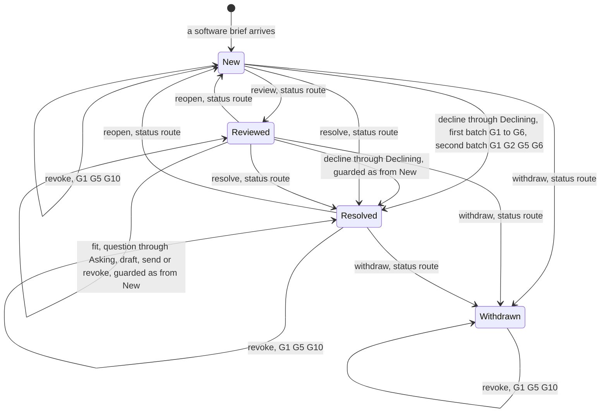
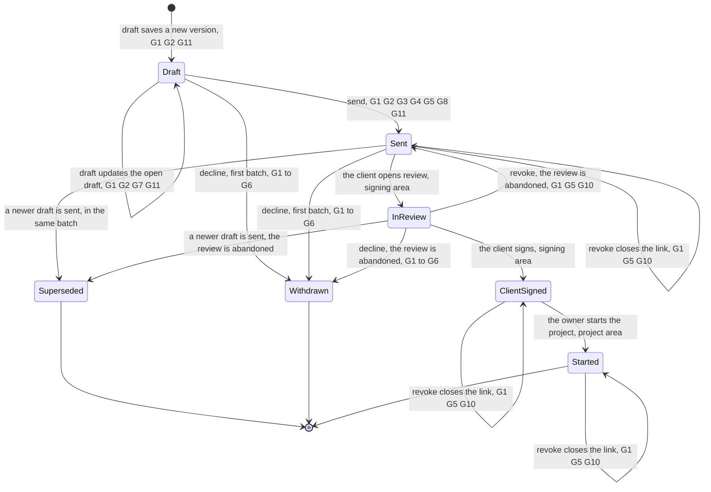
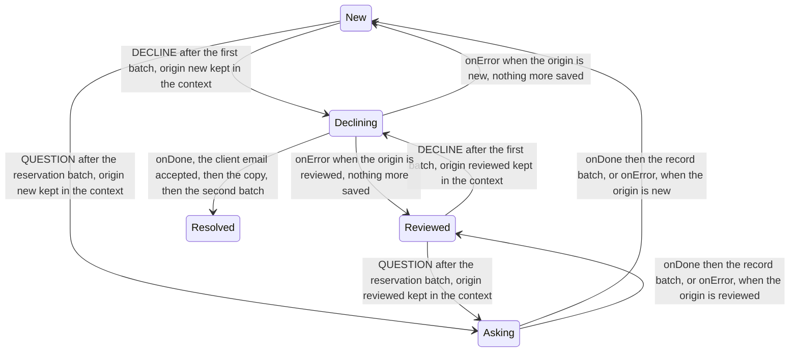

# Software offers: conversion design

Status: proposed, 2026-11-15, revised the same day after the review of #306. This is the design PR for step 1 of
`docs/plans/2026-11-effect-conversion.md`, reviewed before any conversion code. It changes nothing under `src/`. Every
claim about today's code cites a file and line on `origin/main` at `68ce7822`; `software.ts` below means
`src/pages/api/owner/requests/[id]/software.ts`.

It assumes `claude/offers-prep-split` (#305) lands first (it moves `softwareGuard`, `softwareAudit`,
`softwareInvoiceTerms` and the deposit facts into modules of their own, with no behaviour change). The deposit facts are
today `src/lib/software-invoices.ts:365-412`; after the split they are `src/lib/software-offer-deposit.ts`
(`depositOfferBlock` 12-44, `depositOfferGuard` 47-58, at `aeb390fa` on that branch).

## What the owner is asked

1. Each candidate behaviour fix in section 5 (F1, F3 to F5, F8, F9, F10): yes, no, or a different answer. F2, F6 and
   F7 are decided. F5's stored-details case (StoredRequestInvalid) needs an answer either way, because a converted route
   cannot reject: recommended, 500 with the fixed sentence, in the F2 PR.
2. The sentences proposed for F3: "The email was sent, but saving failed. Reload before you try again." and, for the
   draft's failed restore, "The draft was saved, but an attachment could not be cleaned up. Reload before you try
   again."

Decided in the review of #306, and not asked again: the Quint extension is a prerequisite (section 7); every condition
that only a guard checks today is read first and refused by name (section 2; the four conditions there, before the
batch that checks them today. The decline's second batch keeps G5 and G6 as guard-only conditions, answered by the reads
after a refused batch, as today); a refused guard is not retried, and a UNIQUE failure that backs a rule's fact is
(section 2); question and decline save their after-email moves through the `@xstate/effect` bridge (section 3); the
deposit decision gets a LemmaScript contract (section 7). F2 follows from the owner's decision of 2026-11-14 and from
`runRoute` (section 5).

## The area today

One route, `POST /api/owner/requests/[id]/software`, with six actions. Before any action it checks, in this order:

| Check | Answer | Code |
|---|---|---|
| Not the owner | 403 `{ok:false}` | software.ts:90 |
| No `MUSIC_DB`, or no `id` | 503 `{ok:false}` | software.ts:92-95 |
| The body (80 KiB, JSON, same origin) | `musicRequest`'s own answers | software.ts:97-99 |
| The command's shape (Zod) | 400 "Check the required fields and their limits." | software.ts:31-63, 100-106 |
| The request, of kind software | 404 `{ok:false}` | software.ts:108-110 |
| A started project (draft, send, question, decline only) | 409 ProjectStarted | software.ts:112-125 |
| Withdrawn (any action but revoke), or no email (any action) | 409 RequestClosed | software.ts:127-131 |
| Resolved (draft, send, fit, question) | 409 RequestResolved | software.ts:133-143 |

Then the action runs inside one `try`; its `catch` (software.ts:856-920) answers every throw, of any kind, with a 409
chosen by fresh lookups. Every answer the route builds carries `cache-control: private, no-store` (software.ts:65, 86-87);
`musicRequest`'s answers do not. Nothing runs after the response (no `waitUntil`).

## 1. The machines

Two machines, in `src/server/machines/`, asked through `next()` and `sourcesOf()` (`src/server/machines/next.ts`).

**The guards.** Each move is re-checked at write time by compare-and-set statements in its batch. The IDs below are used
in the diagrams.

| ID | Re-checks at write time | Code |
|---|---|---|
| G1 | The request row still has the `updated_at`, `status` and `email` that were read (the decline's second batch and the question's record: the `updated_at` its own first batch wrote) | software.ts:211-215 |
| G2 | No `software_projects` row | software.ts:279-282, 302-305, 353-356, 476-479, 769-772 |
| G3 | No agreement that is `client_signed` or `executed` | software.ts:290-294, 739-743 |
| G4 | No first-milestone deposit invoice that blocks: open for a decline; open or paid when a draft is sent | software-invoices.ts:400-412; software.ts:297, 768 |
| G5 | No live offer link made in the last 20 seconds | software-offers.ts:465-474 |
| G6 | No `audio_projects` row | software.ts:298-301, 360-363 |
| G7 | The open draft still has status draft and the `updated_at` the page sent | software.ts:480-487, and the update's own `status='draft'` (491) |
| G8 | The offer being sent still has the status and `updated_at` read | software.ts:773-776 |
| G9 | A reissue: the request's link is revoked | software.ts:777-784 |
| G10 | Revoke: the link with the `created_at` the page showed is still live | software.ts:412-415, and the update's own `revoked_at IS NULL` (417-420) |
| G11 | Each attachment named in the details has its metadata row, unchanged, in no closed archive | software.ts:194-209; draft 506-508, send 767 |

The database adds three: `UNIQUE(request_id,version)`, one draft per request and one sent offer per request
(migrations/music/0020_software_offers.sql:40-43). The first two back facts the draft rule decides (the new version's
number, and that no draft is open), so their violation is read and decided again (section 2, "Guard failures and
retries"). Statements that filter rows without failing the batch (the withdraw's `status IN ('sent','draft')`, the
supersede's `status='sent'`, the attachment delete's `NOT EXISTS`) are listed in section 4.

### The owner request

The request's `status` column holds `new`, `reviewed`, `resolved` or `withdrawn` (src/lib/owner-model.ts:12-17). Only
decline changes it; the other five actions leave it as it is. The status route's moves (src/lib/owner-requests.ts:236-245)
are drawn for context; they join the machine when that route converts (step 12).



What each state refuses:

| Action | Resolved | Withdrawn | Any state |
|---|---|---|---|
| fit | RequestResolved | RequestClosed | RequestClosed when the email is empty |
| question, draft, send | RequestResolved | RequestClosed | ProjectStarted first, then RequestClosed when the email is empty |
| decline | AlreadyResolved, after the deposit check | RequestClosed | ProjectStarted first, then RequestClosed when the email is empty |
| revoke | allowed | allowed | RequestClosed when the email is empty |

The diagram draws the moves a row is saved with. In code: `softwareRequest` with the four stored states, two states that
invoke the client email and are never saved, `asking` and `declining` (section 3), and the events FIT, DRAFT, SEND (from
new and reviewed, to the same state), QUESTION (from new and reviewed, to `asking`), DECLINE (from new and reviewed, to
`declining`) and REVOKE (from all four). So `next()` answers `asking` or `declining` for QUESTION or DECLINE, never the
state the row is saved with. That state is where the invoked work lands: `declining`'s onDone is resolved, `asking`'s
onDone is the state it came from, and both onError targets are the state it came from. One invoking state serves both
new and reviewed, so the QUESTION and DECLINE transitions keep the origin (new or reviewed) in the machine's context, and
each landing on the origin is a pair of guarded targets that read it (new when the origin is new, otherwise reviewed).
The empty email and the started project are not states; they are terms of the rules (section 2).

### The offer version

This extends the machine in `docs/plans/2026-11-discount-flow.md`, section 3. ClientSigned covers `client_signed` and
`executed` agreements.



Refused moves: send from ClientSigned (G3) and decline from ClientSigned (G3); draft, send and decline once Started
(ProjectStarted, G2); sending a draft while any version's first deposit is open or paid (G4); a reissue while the link is
live (G9); any send, decline or revoke within 20 seconds of a live link (G5). Superseded and Withdrawn have no moves (send
answers NoOfferToSend).

Where this differs from the discount plan's diagram (this PR amends that plan's section 3 to match: its diagram is the
picture of the whole life, and the stored machine is the one described here):

- **The link.** The discount plan has no link. Here a revoke closes it (Sent, InReview, ClientSigned and Started all keep
  or return to their state, and InReview's review is abandoned, src/lib/software-agreements.ts:37-77), and a send of the
  sent version issues a new one (software.ts:593-594, 777-784).
- **Stored states.** InReview, ClientSigned and Started are not values of `software_offers.status`
  (src/lib/software-offers.ts:377); they are `software_agreements` rows (`review`, `client_signed`, `executed`) and a
  `software_projects` row. The XState machine `offerVersion` therefore has the four stored states (draft, sent, superseded,
  withdrawn) and the events SAVE, SEND, SUPERSEDE, REISSUE and WITHDRAW. The other three are facts the rules read, drawn
  here for people, as the discount plan draws them.
- **Decline is two batches.** The offers are withdrawn in the first batch and the request resolved in the second, after
  the email (software.ts:288-324, 350-372). The discount model does both in one step.

The store builds its status lists from the machine: `sourcesOf(offerVersion, "WITHDRAW")` gives draft and sent
(software.ts:308), SUPERSEDE gives sent (789), SAVE gives draft (491), SEND gives draft. The mark-sent UPDATE has no
status filter today (794) and gains one from SEND: new SQL, which D1 neutrality allows, and which changes no row, since G8
holds the offer at draft in the same batch. A test holds each list to the machine.

## 2. The rules

Every rule is a pure Effect rule in `src/server/rules/`, in the CLAUDE.md shape. None has a `nothingToDoIf`: every action
writes even when repeated (a second fit or revoke writes or refuses; nothing answers "already done"), so each is
`alwaysWrites({ name, given, refusals, writes, writesText })`. A rule reads no clock and makes no id: the flow passes the
time it read where the code reads it today (software.ts:145, and each sending check, software-offers.ts:473, 480), the new
draft id (software.ts:450) and the new link token (745).

**XState and Effect.** `next()` answers whether the request's status allows the action and, for question and decline,
the invoking state it moves to (`asking`, `declining`); the state then saved (resolved, or the origin) is the invoked
work's landing, read from the settled actor (section 3), not from `next()`. It also gives the offer version's moves.
Everything that reads another row or the page's expectations is an Effect rule term: the started project, the empty
email, the sending window, deposits, signed agreements, the audio project, the link, attachments, every expected version,
version numbering, the write time, the email texts, and which 409 to give after a refused batch.

**Write time.** `now`, or one millisecond after the version read when that is not earlier than `now`: the request's
`updated_at` for fit, question and decline (software.ts:232-233, 273-274), the open draft's `updated_at` for draft and send
(430-431). Revoke uses `now` as read.

### The refusals

Each is a `Data.TaggedError` with a `say` sentence (no field named `message`, `name`, `stack` or `cause`).

| Tag | Status | Sentence, exactly as today | Code |
|---|---|---|---|
| RequestNotFound | 404 | none: `{ok:false}` | software.ts:108-110 |
| ProjectStarted | 409 | This project has started. Use the project messages. | software.ts:112-125, 376-386, 881-894 |
| RequestClosed | 409 | This request is closed. | software.ts:127-131 |
| RequestResolved | 409 | This request is resolved. Reopen it to make a new offer. | software.ts:133-143 |
| AlreadyResolved | 409 | This request is already resolved. | software.ts:264-268 |
| RequestChanged | 409 | The request changed or could not be saved. Reload and try again. | software.ts:219-230, 912-919 |
| OfferStillSending | 409 | An offer is still being sent. Try again in a moment. | software-offers.ts:462-463 |
| DepositOpenOnDecline | 409 | Void the open deposit invoice in Stripe before declining this request. | software.ts:250-262 |
| DepositOpen | 409 | Void the open deposit invoice in Stripe first, then send the new offer. | software-invoices.ts:384 |
| DepositPaidOnSentOffer | 409 | A deposit is already paid for this offer. Start the project, or refund it in Stripe and record the refund with owner:stripe:reconcile --software-deposit-refunded. New terms can't be sent while an agreement is signed. | software-invoices.ts:391 |
| DepositPaidEarlier | 409 | A deposit is paid on an earlier offer. Refund it in Stripe and record the refund with owner:stripe:reconcile --software-deposit-refunded before sending new terms. | software-invoices.ts:394 |
| EmailSentButChanged | 409 | The client email was sent, but the request changed before it could be recorded. Reload before taking another action. | software.ts:394-401 |
| LinkChanged | 409 | The client link changed since this page loaded. Reload to see the current link. | software.ts:857-873 |
| TermsInvalid | 400 | none: `{ok:false,errors}` from `validateOfferTerms` | software.ts:434-436 |
| DraftChanged | 409 | The saved draft changed since this page loaded. Save again to keep what’s on screen, or reload to see the saved version. Carries `updatedAt`. | software.ts:438-447, 896-910 |
| NoOfferToSend | 409 | Save a valid draft before sending. | software.ts:596-604 |
| StoredTermsInvalid | 400 | none: `{ok:false,errors}` | software.ts:605-607 |
| DetailsIncomplete | 400 | Complete and validate Agreement details before sending. Carries `errors`, keyed `agreement.<path>`, only when a reader refused. | software.ts:720-736 |
| TemplatesMissing | 400 | Publish both templates and complete contractor details before sending. | software.ts:641-649 |
| MsaUnavailable | 409 | The confirmed MSA is unavailable for this recipient. | software.ts:653-668 |
| LinkNotBuilt | 500 | The offer link couldn’t be built. Check SITE_ORIGIN. Nothing was sent. | software.ts:748-761 |
| LinkClosedWhileSending | 409 | The email went out, but the link was closed while it was sending. Send the offer again for a working link. | software.ts:835-843 |

The refusals this design adds name conditions that a guard or a throw decides today. Each answers exactly what that path
answers today, so no recorded answer changes except those listed under F7 and F5's stored-details case: today
StoredRequestInvalid's path rejects (fit "a request whose stored details are not JSON"), which a converted route cannot
do, so it needs a decided answer before the conversion (recommended: 500 with the fixed sentence, in the F2 PR, section
5):

| Tag | Actions | Answers as | Today |
|---|---|---|---|
| AgreementSigned | decline, send | RequestChanged | G3 fails, the catch answers (software.ts:912-919) |
| AudioProjectExists | decline | RequestChanged | G6 fails (298-301) |
| LinkNotRevoked | send, a reissue | RequestChanged | G9 fails (777-784) |
| AttachmentNotUsable | draft, send | draft: DraftChanged with the open draft's `updatedAt`; send: RequestChanged | G11 fails (194-209), the catch answers (896-919) |
| AttachmentsUnreadable | draft | DraftChanged with `updatedAt` | `parseAgreementAttachments` throws while the batch is built (194-195), F5 |
| MsaNotFound | draft | DraftChanged with `updatedAt` | the reused MSA's FOREIGN KEY fails in the batch (523-536), F5 |
| StoredTermsUnreadable | send | RequestChanged | `JSON.parse` of the stored terms throws (605), F5 |
| StoredRequestInvalid | every action | see F5 | `getOwnerRequest` parses `details_json` and rejects (src/lib/owner-model.ts:73), F5 |

The client email's failures are service failures, not refusals (section 3); their 502 sentences are in section 5.

**Conditions only a guard checks today (decided).** Four conditions are never read before the batch: a signed agreement
(G3, decline and send), an audio project (G6, decline), a revoked link on a reissue (G9, send), and each named
attachment's metadata row, unchanged and in no closed archive (G11, draft and send; send's pin reads the row,
software.ts:670-687, but not the archives). Each becomes a fact the flow reads before the batch and a named refusal in the
rule: AgreementSigned, AudioProjectExists, LinkNotRevoked, AttachmentNotUsable. The guard stays as the compare-and-set
re-check. The decision covers these four before the batch that checks them today, not the decline's second batch: there
G5 and G6 stay guard-only conditions, not read after the email, and a refusal is answered by the reads after a refused
batch (ProjectStarted, OfferStillSending, EmailSentButChanged; software.ts:359-363, 373-402), as today. Each refusal is
decided where the batch decides it today, so the order of answers does not move: last in decline; last in the draft,
after DraftChanged; in send, after `pinAgreement` and the link (see "send" below). Golden
cases these refusals answer, each with today's answer: decline "a client-signed agreement blocks the decline", "an
executed agreement blocks the decline", "an audio project for the request blocks the decline"; send "a signed agreement
stops the send", "an executed agreement stops the send", "a client-signed agreement stops the reissue of the sent offer",
"a sent offer whose link is live is not reissued", "a sent offer with no link is not reissued", "send, then send again
after the window", "send with the email refused, then send again after the window"; draft "an attachment with no metadata
row", "an attachment whose hash differs from the metadata row", "an attachment whose size differs from the metadata row",
"an attachment whose filename differs from the metadata row", "an attachment of another request", "an attachment already
in a closed archive", "two attachments, one with a metadata row and one without". The races change the row in an
`interleave` hook, which runs just before the matching batch (tests/golden/README.md:423-424), so the new read sees the
old row and the guard still refuses, as today: signing "the attachment's metadata row is deleted before the batch", "the
attachment is named in a closed archive before the batch" (tests/golden/owner-request-software-offer-signing.test.ts:854,
869); send "a client signs before the batch"; decline "a signed agreement
appears before the first batch", "an audio project appears before the first batch"; draft "the metadata row is removed
before an attachment is pinned". The closed-archive read uses the guard's own predicate (software.ts:197-198), so an
agreement whose archive is open is never parsed (draft "an agreement with a malformed manifest does not break the
attachment guard" stays 200); a closed archive whose manifest is not JSON would then fail as a read, where today the
batch's guard message answers 409. No golden case has one. Every new read must match no golden hook pattern (they count
by `nth`; section 4).

Where reading a condition first changes a recorded answer, the case is F7 (section 5): revoke's link read, in "a link made
10 seconds ago and the lookups after the batch fail".

### Per action

The front refusals come first in every rule, from `rules/software-request.ts`, in the order of the table in "The area
today": ProjectStarted (draft, send, question, decline), RequestClosed, RequestResolved (draft, send, fit, question).

**fit**, `reviewFit` in `rules/offer-fit.ts`.
Facts: the request. Move: FIT. Refusals: RequestClosed, RequestResolved, then RequestChanged when
`expectedRequestUpdatedAt` is given and is not the stored `updated_at` (software.ts:219-230). Writes, one batch: the fit
review upserted (label, trimmed note, write time, owner), the request's `updated_at`, the audit `fit-reviewed`
(software.ts:234-244). Re-checked by G1. A started project does not refuse it.

**question**, `askQuestion` in `rules/offer-question.ts`.
Facts: the request, a started project. Move: QUESTION, through `asking` (section 3). Refusals: the front three. Writes:
first the reservation, the request's `updated_at` (software.ts:276-286, G1 G2); after the client email, the audit
`question-sent` (350-372, G1 at the write time, G2). Emails: subject "A question about your project brief", text
`<text>\n\nKazon` (326-331).

**decline**, `declineRequest` in `rules/offer-decline.ts`, with the deposit terms in `rules/offer-deposit.ts`.
Facts: the request, a started project, the first-milestone deposit invoices of every version
(src/lib/software-invoices.ts:370-375), the live link made in the last 20 seconds (src/lib/software-offers.ts:476-483),
and, new, a signed agreement and an audio project, read after OfferStillSending is decided, just before the first batch.
Moves: DECLINE to resolved, through `declining` (section 3); WITHDRAW for the
draft and the sent version. Refusals, in order: ProjectStarted, RequestClosed, DepositOpenOnDecline (open, creating,
payment_failed or uncollectible, not refunded), AlreadyResolved, OfferStillSending (software.ts:250-271), then
AgreementSigned and AudioProjectExists. Writes, first batch (288-324, G3 G1 G5 G4 G6 G2): draft and sent offers withdrawn,
signing retired (four statements), live links revoked, the request's `updated_at`, the audit `offer-link-revoked` with the
note "Offer withdrawn and link closed to decline the request". Second batch, after the client email (350-372, G1 at the
write time, G2 G5 G6): status resolved with `resolved_at`, the audit `declined`. Emails: subject "About your project
brief", text `<text>\n\nKazon`.

**revoke**, `revokeLink` in `rules/offer-revoke.ts`.
Facts: the request and, new, the request's link row (its `created_at` and `revoked_at`), read before the batch. Move:
REVOKE from every status. Refusals: RequestClosed (empty email only), then LinkChanged and OfferStillSending, in the order
the catch gives them today (software.ts:857-879). Today both are found only after the batch fails. Writes, one batch
(408-422, G1 G5 G10): signing retired, the link with that `created_at` revoked, the audit `offer-link-revoked` with no
note.

**draft**, `saveDraft` in `rules/offer-draft.ts`, saved through `decideAndSave` ("Guard failures and retries" below).
Facts: the request, a started project, every offer version (src/lib/software-offers.ts:385-394), the metadata rows of the
removed attachments (software.ts:452-472), and, new, the metadata rows and closed archives of the attachments the details
name and the reused MSA's row when `confirmMsaReuse` names one, read after the removed attachments, just before the batch.
Input read in the flow at today's point, after the front
refusals and the offers read: the terms with `validateOfferTerms` (434-436) and the attachments named in
`agreementDetails` with `parseAgreementAttachments` (194-195, read while the batch is built today). Moves: a new version
(`[*]` to draft, numbered newest plus one, 449) or SAVE. Refusals: the front three, TermsInvalid, DraftChanged when
`expectedUpdatedAt` is not the open draft's (or not null when there is none, 438-447), AttachmentsUnreadable, then
AttachmentNotUsable and MsaNotFound as the batch meets them today (506-508 before 523-536). Writes, one batch (474-545, G1
G2, G7 when a draft is open, G11 per attachment when details are given and not null): the draft inserted or its terms
updated, the details set (or cleared by null), the reused MSA set (or cleared) when `confirmMsaReuse` is given, the audit
`offer-draft-saved`, and each removed attachment's metadata row deleted when nothing names it. After the batch: the R2
delete of each deleted row, and when one fails, its metadata row put back and `attachmentCleanupPending` set (547-579).

**send**, in `rules/offer-send.ts`, with `rules/offer-deposit.ts`. Send makes its reads between its decisions, so its
rule is staged: each stage decides on the facts read so far, in today's order (the sketch in section 3). Facts and
refusals, in that order: the request and a started project (the front three); every offer version (427) and the live
link made in the last 20 seconds (591): OfferStillSending, then NoOfferToSend (the offer is the open draft, else the sent
version; refused when there is neither, or when its version or `updated_at` is not the one the page sent, 594-604), then
StoredTermsUnreadable and StoredTermsInvalid (605-607); for a draft, the first deposits (610): DepositOpen,
DepositPaidOnSentOffer, DepositPaidEarlier (src/lib/software-invoices.ts:377-397); the signing setting (615). With signing
on and a draft, `pinAgreement` runs: a flow step, not a rule, because it reads D1 and R2. It reads in today's order and
calls a pure rule (`rules/offer-pin.ts`) between its reads: DetailsIncomplete with errors (the details, 627-630),
TemplatesMissing (632-649), DetailsIncomplete with errors (the contractor, 651), MsaUnavailable (653-668),
DetailsIncomplete (each attachment's row and bytes, 670-696; the preflight, 698-709). Then LinkNotBuilt (750-761). Then,
new, the facts the batch alone checks today: a signed agreement, the reissue's revoked link and the pinned attachments'
archives: AgreementSigned, LinkNotRevoked, AttachmentNotUsable. These come after the pin and the link because they do
today: a draft can be saved while an agreement is client-signed (golden draft "a draft saved while an agreement is
client_signed", 200), and sending it with signing on runs the R2 gets and the preflight first, so it can answer
TemplatesMissing, DetailsIncomplete, MsaUnavailable or LinkNotBuilt before G3 is ever reached. Moves: SEND and
SUPERSEDE for a draft, REISSUE for the sent version. Writes, one batch (763-821; G1 G5 G3 G11 G4 G2 G8, and G9 for a
reissue): for a draft, the sent offer superseded and the draft marked sent (785-798); the link written (a new token hash,
replacing any old one); the pin (details, template ids, contractor snapshot, lower-cased email); signing retired; the
audit `offer-sent` with the note `Offer v<n> sent`. Email: subject `Your project offer: <outcome>` and the text at 825,
which says to sign on the website when signing is on and the offer has a pinned MSA template. After the email:
LinkClosedWhileSending when the client email was accepted and the link is no longer live (828-843).

**After a refused batch**, `rules/offer-refused-batch.ts`. Today's catch reads fresh facts and picks the 409; the rule does
the same over the same reads, in the same order:

| Action | Order of refusals |
|---|---|
| fit | RequestChanged |
| question, first batch | ProjectStarted, RequestChanged |
| question or decline, second batch | ProjectStarted, OfferStillSending (decline only), EmailSentButChanged (software.ts:373-402) |
| decline, first batch; send | OfferStillSending, ProjectStarted, RequestChanged (875-919) |
| revoke | LinkChanged, OfferStillSending, RequestChanged (857-879) |
| draft | ProjectStarted, DraftChanged with the open draft's `updated_at` read again (881-910) |

**Guard failures and retries (decided).** A refused compare-and-set guard (on `updated_at`, a status, the link or any
fact above) is not retried. The owner's decision of 2026-11-14 answers a stale version or a lost race with 409, and a
retry on fresh facts could pass a check the owner's page failed (src/server/guarded-save.ts:15-16, 27-29). The store fails
such a batch with `GuardRefused`, and the flow answers it with the reads in the table above.

A UNIQUE constraint that backs a rule's fact is different, as CLAUDE.md sets out. The draft's insert re-checks, through
`UNIQUE(request_id,version)` and one draft per request (migrations/music/0020_software_offers.sql:40-42), the version
number and the absence of an open draft that the rule decided from the offers it read. Its violation is
`ChangedSinceRead`, so `saveDraft` runs through `decideAndSave` (src/server/guarded-save.ts:109-128; the rule's answer is
wrapped in `Option.some`), which reads and decides again, three tries in all. `SaveKeptChanging` answers as the draft row
of the table above. What the re-decision answers, per golden case:

- draft "another draft is saved before the batch inserts one": the second try reads the other tab's open draft and
  refuses DraftChanged with its `updated_at` (11:45). Today's answer is the same.
- draft "another writer takes the version before the batch inserts it": the second try finds no open draft, numbers the
  new draft 2 and saves it (200). Today answers 409 DraftChanged with `updatedAt` null. This is a behaviour fix, F7.

No other batch has a UNIQUE constraint that backs a fact: the link and fit upserts name their conflict target
(software.ts:237-238, 800-801), the one-sent index cannot fire after the supersede in the same batch (785-798), the
restore is `INSERT OR IGNORE` (562), and the link's token is random (745).

**Signing retired** (`retireSigning`, a rule the decline, revoke and send share): the abandoned reviews' `retain_until` is
the write time plus 90 days, today computed inside the statement builder (src/lib/software-agreements.ts:49).

## 3. The flows

`src/server/flows/software-offers.ts`, one program per action. Each keeps today's order of reads, decisions and outside
effects; no read moves ahead of a decision that comes before it today. Each builds no response text.

**Services.**

- **Mail**, the existing `Mail` (src/server/services.ts:164-171), whose errors are MailRefused and MailUncertain. The
  client email, then the owner's copy only when the client's was accepted (software.ts:154-183). The live implementation
  for this route wraps `sendAudioMessage` (src/lib/audio-resend.ts:32-69): refused for a 4xx, uncertain for a 5xx or no
  answer (64-67). It builds the payload object itself, with the keys in today's order: from, reply_to, subject, text, to
  (software.ts:158-167; the copy keeps that order, because its spread overwrites `subject` in place and adds `to` last,
  173-180). It does not spread a `MailMessage`. `sendAudioMessage` keeps the caller's key order (its `cleanHeaders`
  spreads the payload and overwrites in place, audio-resend.ts:16-30), and the golden harness records the request body as
  text, so the order is part of the recorded bytes; `liveMail`'s `sendMail` writes from, to, subject, text, reply_to
  (src/lib/resend.ts:37-54) and would not be neutral.
- **The mail settings.** A send needs `RESEND_API_KEY`, `CONTACT_FROM_EMAIL` and `OWNER_EMAIL`; without one, no request is
  made (software.ts:155-156). MailNotConfigured is not in `Mail`'s error type. The route passes the settings to the flow
  as one input (none when any of the three is empty), and the flow checks it at the email step, where `email` checks it
  today: after the batch (question's reservation, decline's first batch, send's batch) and before the client email. With
  none, the step fails with MailNotConfigured, the flow's own tagged error, without calling Mail. Question and decline map
  it to their 502 (F8 proposes to move the check before any write); send records it in the outcome (`emailSent` false).
- **AttachmentStore**, R2 through the existing `AudioBucket` service (src/server/services.ts:43-46): `remove(key)` for the
  draft and `read(key)` (size and SHA-256, with `hashBytes`) for the send. The route asks `bindingsOrUnavailable` only for
  `MUSIC_DB`, and `boundServices` adds `AudioBucket` only when `env.AUDIO` is set (services.ts:105-125), so a missing
  binding is an absent service. The store reads it with `Effect.serviceOption(AudioBucket)`: with none, `remove` fails as
  a failed delete does today (golden draft "a removed attachment with no R2 binding": cleanup pending). `read` with none
  is a known unavailable dependency: if the owner accepts F4's case for it, `read` fails with the store's own named error
  and the send answers 503 at the point where the first attachment is read today; if not, `read` answers that there is no
  object, and the send answers DetailsIncomplete as today (golden signing "an attachment with no R2 binding").
- **AgreementPreflight** wraps `preflightAgreementPacket` (src/lib/agreement-pdf.ts:379-464), loaded with the same dynamic
  import (software.ts:698-700). It reads D1 and R2 itself (agreement-pdf.ts:147-161, 344-350, 431-438), so its live
  implementation takes `env`; converting its insides is the signing area's work. Any rejection is PacketNotReady, which
  the send answers as DetailsIncomplete with no errors, as today.
- The store (section 4), and the time, ids and token as inputs.

**fit and revoke.** Read, decide, one batch, answer. Revoke reads its link row before it decides.

**draft.** `decideAndSave` over read, decide and the batch (section 2). Its `facts` step reads in today's order and
fails with the first refusal it meets (a `facts` step may fail with a named error), so on every try the refusals come in
the order of section 2 and no read runs ahead of one. Then `AttachmentStore.remove` for each row the delete returned, and
`restoreAttachment` after a failed one. A failed restore is `OffersStoreFailed` from the store, which the flow turns into
a tag of its own (the draft is already saved), so that the route can answer it with its own proposed sentence (F3).

**question and decline: the `@xstate/effect` bridge (decided).** Each saves a move only after the client email: decline's
resolve in its second batch (software.ts:350-372) and question's record of `question-sent` (the same batch, 371). A move
that waits on outside work goes through the bridge (CLAUDE.md, Back-end rules), so `softwareRequest` gets two states that
invoke the email, `declining` and `asking`, built with `createEffectLogic` as in
tests/server/effect-bridge-proof.test.ts:31-61. The flow reads, decides and writes the first batch (decline's withdraw,
question's reservation); restores the machine at the stored status and sends DECLINE or QUESTION, which moves it to
`declining` or `asking` (the state `next()` answers for the event) and keeps the origin, new or reviewed, in the context.
The invoked work sends the client email, then the copy (a copy failure only sets `copySent` false). Its onDone lands on
resolved from `declining` and on the origin from `asking`; its onError reads MailRefused, MailUncertain or
MailNotConfigured with `failureOf` (src/server/machines/failure.ts:32) and lands on the origin, with the failure in the
context. Every landing on the origin is a pair of guarded targets that read the origin from the context (section 1).

The program waits with `settled` (src/server/machines/settled.ts:21-35), whose options carry a timeout: 30 seconds,
longer than the two emails in a row at their own 10-second timeouts (the client email, then the copy, each with
`AbortSignal.timeout(10_000)`, src/lib/audio-resend.ts:61). `settled` fails with the typed `TimeoutError` when the
timeout passes first, and with the typed `ActorStoppedError` when the actor stops without erroring (an errored actor dies
with its original error instead, settled.ts:26-35). The route maps both tags with `catchTags` to its fixed 500 sentence,
the one it answers a defect with (F2).

Only then is the landing state saved: resolved by the second batch, the question's record by its batch, each guarded as
today; on GuardRefused, the after-refusal reads. After an email failure nothing more is saved, and the route answers
502. An invoking state is never saved (src/server/machines/next.ts:22-26): while the email is in flight the stored
status stays new or reviewed, with the decline's offers already withdrawn, as today, so a retry repeats both batches
(golden "a decline whose email is refused, then the same decline").



**send.** A sketch, in today's order exactly (software.ts:427-843):

```ts
export const sendOffer = (command: SendCommand) =>
	Effect.gen(function* () {
		// The front: the request, the project pre-check, then ProjectStarted, RequestClosed, RequestResolved.
		const request = yield* readFront(command);
		const offers = yield* readOffers(command.requestId);
		const sending = yield* readFreshLiveLink(command.requestId, command.since());
		// OfferStillSending, NoOfferToSend, StoredTermsUnreadable, StoredTermsInvalid.
		const chosen = yield* chooseOffer.decide(command, { request, offers, sending });
		const deposits = chosen.isDraft ? yield* readDepositInvoices(command.requestId) : [];
		yield* depositBlock.decide(chosen, deposits);
		const signing = yield* readSigningEnabled();
		// A flow step, not a rule (it reads D1 and R2): details, templates, contractor, reused MSA, each attachment's
		// row and bytes, then the preflight, with the pin rule called between the reads.
		const pin = signing && chosen.isDraft ? yield* pinAgreement(chosen) : null;
		const link = yield* buildLink(command.origin, command.newToken()); // LinkNotBuilt
		// New reads, after everything that answers before the batch today: G3, G9 for a reissue, G11's archives.
		const atWrite = yield* readSendWriteFacts(chosen, pin);
		// AgreementSigned, LinkNotRevoked, AttachmentNotUsable.
		const write = yield* sendWrite.decide({ chosen, pin, link }, atWrite);
		yield* saveSend(write).pipe(
			Effect.catchTag("GuardRefused", () => refusedSend(command)),
		);
		// Never fails: a refused, uncertain or unconfigured email is part of the outcome, as today.
		const mail = yield* emailOffer(write, link);
		const live = yield* readLinkStillLive(write);
		return yield* afterSendEmail.decide({ mail, live }, write);
	});
```

Steps after the link: the batch, then the email, then the live-link check (software.ts:763-843). The check refuses only
when the client email was accepted (835; F9 asks about the other case).

## 4. The store

`src/server/offers-store.ts`, over the `MusicDb` service, one function per statement, plain SQL that decides nothing
beyond its compare-and-set. A read that rejects is `OffersStoreFailed` (no fields). A batch that rejects is:

- `GuardRefused` when its message is the JSON guard's (`raisedByJsonGuard`), and for the draft's reused MSA a FOREIGN KEY
  failure with evidence of the race read afterwards (the MSA row gone), as the agreement review recognises `LostRace`
  (src/server/failure.ts:9-19). Not retried (section 2).
- `ChangedSinceRead` for a UNIQUE violation in the draft batch (`isUniqueViolation`), retried by `decideAndSave`.
- `OffersStoreFailed` otherwise, including a UNIQUE violation in any other batch (none is expected, section 2).

Stored JSON that is not JSON, read through `json_each` in a batch, raises the guard's message too
(src/server/guarded-save.ts:59-71), so those cases stay 409 as today (golden draft "a malformed agreement manifest breaks
the removed attachment delete", "another offer's saved details are not JSON when an attachment is removed").

The statements keep today's SQL where a golden hook matches it (`failures` and `interleave` patterns count matches by
`nth`); where one must change, its pattern changes in the re-record commit and the `trigger-hit` marker (operation, table,
access) stays the same. A new read must match no pattern. For example, revoke's link read must not start
`SELECT 1 FROM software_offer_links` (revoke, decline and send cases count that pattern), so it reads
`SELECT created_at,revoked_at FROM software_offer_links WHERE request_id=?`; the draft's read of named attachments must
not contain `SELECT * FROM software_agreement_attachments` (draft "the removed attachment lookup fails"); send's
archive read must not start `SELECT 1 FROM software_agreement_attachments` (signing "the attachment metadata read
fails").

**Shared reads.** `readRequest` (src/lib/owner-requests.ts:121-131, which also parses `details_json`,
src/lib/owner-model.ts:73), `readProjectStarted` (software.ts:114-117), `readOffers` (software-offers.ts:385-394),
`readFreshLiveLink(requestId, since)` (software-offers.ts:465-466, 476-483), `readDepositInvoices`
(software-invoices.ts:370-375, widened as section 7 says), and the new `readSignedAgreement` (G3), `readAudioProject`
(G6), `readLinkRow` (revoke, and G9 for a reissue), `readAttachmentRows` and `readClosedArchives` (G11, the latter with
the guard's predicate, software.ts:197-198).

**Shared statements for a batch.** `requestUnchanged` G1, `noProject` G2, `noSignedAgreement` G3, `noBlockingDeposit` G4,
`notSending(requestId, since)` G5, `noAudioProject` G6, `attachmentUnchanged` G11, `touchRequest` (`updated_at`),
`audit` (software.ts:147-152), and `retireSigning`: four statements on the signing tables (software-agreements.ts:37-77):
review agreements abandoned (only `status='review'`), saved agreement drafts deleted, sessions revoked, sign-in links used.

| Action | Functions |
|---|---|
| fit | `saveFit`: G1, the fit review upsert (software.ts:237-239), `touchRequest`, `audit` |
| question | `reserveQuestion`: G1, G2, `touchRequest`. `recordQuestion`: G1 at the write time, G2, `audit` |
| decline | `readSignedAgreement`, `readAudioProject`. `withdrawForDecline`: G3, G1, G5, G4 (open), G6, G2, offers withdrawn (status list from WITHDRAW), `retireSigning`, live links revoked (313-316), `touchRequest`, `audit`. `resolveDeclined`: G1 at the write time, G2, G5, G6, the resolve (365-368), `audit` |
| revoke | `readLinkRow`. `revokeOfferLink`: G1, `retireSigning`, G5, G10, the revoke (417-420), `audit`. After a refused batch: `readLinkLive` (859-864) |
| draft | `readRemovedAttachments` (453-471), `readAttachmentRows`, `readClosedArchives`, `readReusedMsa`. `saveDraftBatch`: G1, G2, G7, the insert (495-505) or the update (489-493), G11 per attachment, details (509-522), reused MSA (523-536), `audit`, and per removed attachment the delete `... WHERE NOT EXISTS (offer details or agreement manifests name it) RETURNING object_key` (538-544). `restoreAttachment`, `INSERT OR IGNORE` (560-576), whose failure is `OffersStoreFailed` |
| send | `readSigningEnabled` (src/lib/agreement-access.ts:62-72), `readCurrentTemplate` x2 (src/lib/agreement-templates.ts:266-273), `readContractorConfig` (software.ts:635-639), `readReusableMsa` (655-660), `readAttachmentRow` (672-685), then `readSignedAgreement`, `readLinkRow` (a reissue), `readClosedArchives` (a pin with attachments). `saveSend`: G1, G5, G3, G11, G4 (open or paid, a draft only), G2, G8, G9 (a reissue only), supersede and mark sent (a draft only, status lists from SUPERSEDE and SEND; mark sent gains its status filter, section 1), the link upsert (800-802), the pin (803-818), `retireSigning`, `audit`. `readLinkStillLive` (828-833) |

The attachment delete's `NOT EXISTS` is not one of the conditions of section 2: it refuses nothing, it decides which
removed rows the batch deletes. It stays a write-time filter, because reading the references first would run `json_each`
over stored manifests and offer details in a read, moving the malformed-JSON failures above from the batch (409) to a read.

None of the five writing triggers of issue 242 fires on these writes: the decline resolves a software request, and
`audio_project_close_declined_request` fires only for kind `service` (migrations/music/0019_software_requests.sql:62-64).

## 5. The answers

They must not change in the conversion. Before the program, in the route: 403, 503 (`bindingsOrUnavailable(env,
["MUSIC_DB"])`, answered as today with `{ok:false}` and the private header), `musicRequest`'s answers, the command reader's
400, then 404 `{ok:false}` for an unknown id and, after F6, for a missing or empty one. Every refusal answers its status
from the tables in section 2 with `{ok:false,message:<say>}`, except: RequestNotFound `{ok:false}`; TermsInvalid and
StoredTermsInvalid `{ok:false,errors}`; DraftChanged and the refusals that answer as it does `{ok:false,updatedAt,message}`;
DetailsIncomplete `{ok:false,message}` plus `errors` when present.

| Action | Success | Mail failures |
|---|---|---|
| fit | 200 `{ok:true,updatedAt}` (software.ts:246) | none |
| question | 200 `{ok:true,copySent}` (404) | 502 `{ok:false,uncertain,message}`; uncertain (5xx or no answer): "The email service didn’t confirm. Check Resend before retrying. The question was reserved, but delivery was not recorded."; refused (4xx, `uncertain:false`) or not configured (no `uncertain` key): "The email didn’t send. The question was reserved. Reload before retrying." (333-348) |
| decline | 200 `{ok:true,copySent}` | 502 as for question, with "The email service didn’t confirm. The offer is withdrawn and its link is closed. Check Resend before retrying." and "The email didn’t send. The offer is withdrawn and its link is closed; nothing else changed. Try again." |
| revoke | 200 `{ok:true}` (424) | none |
| draft | 200 `{ok:true,version,updatedAt,attachmentCleanupPending}` (581-586) | none |
| send | 200 `{ok:true,version,link,linkCreatedAt,sentAt,updatedAt,emailSent,uncertain,copySent}`; a reissue keeps the offer's `sent_at` and `updated_at` (845-855). `uncertain` is absent when the client email was accepted or mail is not configured (`email` returns no such key then, 155-156, 182), and present, true or false, when it failed (171) | none: a failed email still answers 200 with `emailSent:false` |

Each tag maps with `Effect.catchTags` in the route; MailRefused, MailUncertain and MailNotConfigured map to the 502s above
for question and decline; `SaveKeptChanging` (draft) maps to the after-refusal answer; `settled`'s `TimeoutError` and
`ActorStoppedError` (question and decline, section 3) map to the fixed 500 sentence. A defect answers the same fixed 500
sentence through the `DefectAnswer` the route passes to `runRoute` (src/server/run.ts:28-46). `OffersStoreFailed` maps to
the fixed 500 sentence where today's code rejects (F2, decided); where today answers 409 or 400 instead, its answer waits
on F1, F3 and F4 below.

### Behaviour fixes

The owner's decision of 2026-11-14: an unexpected store failure answers 500 with a fixed sentence, a lost race or a stale
version 409, and 503 only for a missing binding or a known unavailable dependency. Each fix below is its own PR before the
conversion, with no `conversion` label, re-recording its corpora and explaining every changed case. F2, F6 and F7 are
decided; the others are candidates for the owner.

| # | What happens today | Golden cases that pin it | Count |
|---|---|---|---|
| F1 | A store failure answers 409 RequestChanged or DraftChanged, as if the request had changed | fit: "the fit batch fails", "the fit batch fails after an earlier fit". question: "the reservation batch fails". decline: "the deposit read fails", "the sending read fails", "the first batch fails". revoke: "the batch fails". offer-draft: "the offers read fails", "the removed attachment lookup fails", "the draft batch fails on a new draft", "the draft batch fails on an update". offer-send: "the offers read fails", "the sending read fails", "the deposit read fails", "the signing setting read fails", "the send batch fails". offer-signing: "the signing setting read fails", "the send batch fails" | 18 |
| F2 | A store failure rejects (a bare 500 from Astro, no body): a read outside the `try`, or a lookup inside the catch | fit, question, decline, revoke, offer-draft, offer-send: "the first read fails"; question, decline, offer-draft, offer-send: "the project pre-check fails"; question: "the reservation batch fails and the project lookup after it also fails"; decline: "the first batch fails and the lookups after it also fail"; revoke: "the batch fails and the link lookup after it also fails"; offer-draft: "the offers read fails twice", "the draft batch fails and the offers read after it fails too"; offer-send: "the send batch fails and the sending lookup after it fails" | 16 |
| F3 | After an outside effect, a store failure is answered as a change, or with a sentence that hides what happened | question: "the recording batch fails" (EmailSentButChanged), "the recording batch fails and so does the project lookup after it" (RequestChanged). decline: "the second batch fails", "the second batch fails and so does the project lookup after it". offer-send: "the check after the email fails", "the check after the email fails when the email failed too" (both OfferStillSending, though the offer was sent). offer-draft: "a failed R2 delete and the metadata put back also fails" (DraftChanged, after the draft was saved) | 7 |
| F4 | A store or R2 failure while preparing the agreement, or a missing R2 binding, answers 400 DetailsIncomplete | offer-signing: "the template read fails", "the second template read fails", "the contractor read fails", "the reused MSA read fails", "the attachment metadata read fails", "the original MSA read fails in the preflight", "an attachment whose R2 read throws", "an attachment with no R2 binding" | 8 |
| F5 | Bad input or bad stored data answers 409 as a race, or rejects | offer-draft: "agreement details with attachments that are not a list", "agreement details with a malformed attachment", "agreement details with six attachments", "an MSA reuse confirmed with an MSA that does not exist" (DraftChanged). offer-send: "stored terms that are not JSON", "stored terms that are empty text" (RequestChanged, where other bad stored terms answer 400 with errors). fit: "a request whose stored details are not JSON" (rejected) | 7 |
| F6 | A missing or empty `id` answers 503, which the decision keeps for a missing binding | fit: "no id param", "an empty id param" | 2 |
| F7 | A decision that SQL makes today, moved into the rule, answers otherwise | revoke: "a link made 10 seconds ago and the lookups after the batch fail" (rejected today). offer-draft: "another writer takes the version before the batch inserts it" (409 today) | 2 |
| F8 | With no mail configured, question and decline write first (decline withdraws the offers and closes the link) and only then answer 502 | question: "no Resend key", "an empty Resend key", "no sender address", "no owner address". decline: "no Resend key", "no sender address", "no owner address" | 7 |
| F9 | A send whose client email failed answers 200 with the link even when the live-link check found the link closed | offer-send: "the link is revoked while an email that fails is sent" | 1 |
| F10 | A draft saved during a decline's email survives the decline: the request is resolved with a draft | none: found by reading, to be reproduced by the model first (section 7) | 0 |

**F2, a store failure that rejects (decided).** A converted route passes `{ route, answer }` to `runRoute`
(src/server/run.ts:28-46), so every defect is logged once and answered 500 with the route's fixed sentence, and the route
maps `OffersStoreFailed` to a Response too (its program's error type is `never`, run.ts:9-10): a converted route cannot
answer a bare 500 with no body. Under the owner's decision of 2026-11-14 an unexpected store failure answers 500 with a
fixed sentence, so that is F2's answer, and keeping today's answer is not an option: its 16 cases change from a bare 500
to 500 with the fixed sentence. Its own PR changes the old route to answer so, which keeps the conversion neutral for
them. That PR proposes the fixed sentence, and adds the helpers `offersUnavailable` and `offersFailed` next to
`offerSendingMessage` in `src/lib/software-offers.ts`, as `musicUnavailable` and `musicFailed` sit next to
`musicRequest`. It also carries F5's stored-details case if the owner takes the recommendation there.

**F1, F3 and F4, store failures (candidates).** CLAUDE.md has a converted route map its store failure tag to 500 with a
fixed sentence, so converting these as they are changes their answers, and keeping today's answers would mean mapping
that tag to 409 or 400 against the rule. Each needs the owner's answer before the conversion: the fix, or an exception
the conversion then reproduces. F1 and F4 answer with `offersFailed`, F2's sentence. For F3, the email (or, for the
draft, the save) has already happened, so the sentence says so. Proposed, awaiting the owner: "The email was sent, but
saving failed. Reload before you try again." The draft's failed restore comes after the draft was saved, so "saving
failed" would be wrong there; it gets its own sentence, also proposed and awaiting the owner: "The draft was saved, but
an attachment could not be cleaned up. Reload before you try again." F4 also covers a missing R2 binding in a send
(golden signing "an attachment with no R2 binding", 400 DetailsIncomplete today, software.ts:688-695): it is a known
unavailable dependency, which the owner's decision answers 503. Recommended: 503 with `offersUnavailable`'s sentence, at
the point where the first attachment is read today, with nothing written. F4's preflight case needs the signing area's
help: `preflightAgreementPacket` throws a plain `Error` for missing data (src/lib/agreement-pdf.ts:102, 154, 157, 161,
346, 350, 438, 463; 102 is "Unsupported character", thrown while the preflight renders its sample packet, 443-460) and
lets a D1 or R2 rejection through as it comes (148-152, 155, 344, 432-437), so its caller cannot tell an outage from
missing data. Fixing that case means the preflight raising a named error for one of them, which is signing's code.

**F5, bad input and bad stored data (candidates).** Not store failures: the conversion keeps them through the named
refusals of section 2 (AttachmentsUnreadable, MsaNotFound, StoredTermsUnreadable), so they are listed because they look
wrong, not because they block. MsaNotFound needs the reused MSA read before the batch, which answers as the FOREIGN KEY
failure does today. One case cannot be kept: fit "a request whose stored details are not JSON" rejects today, and a
refusal answers a Response, never a rejection (a converted route passes a `DefectAnswer`, so even a defect is answered,
src/server/run.ts:28-46). It goes through StoredRequestInvalid, and its answer has to be decided in a fix PR before the
conversion, since it cannot stay a rejection. Recommended: 500 with the fixed sentence, in the F2 PR.

**F6, a missing id (decided).** It answers what an unknown id answers today: 404 `{ok:false}` with the private header
(software.ts:108-110; golden fit "an unknown request id"). A missing or empty id is treated as an id that matches no
request, at the same point, after the body and the command are read, so a bad body still gets the same answer it gets
with an unknown id.

**F7, decisions moved out of SQL (decided).** Its own PR changes the old route so the conversion is neutral. Revoke reads
its link row before the batch (with SQL that does not match `^SELECT 1 FROM software_offer_links`, section 4) and refuses
LinkChanged or OfferStillSending there. "A link made 10 seconds ago and the lookups after the batch fail" is a rejection
today, F2's kind, and is listed here only: it then answers 409 OfferStillSending, and the injected failure on the second
link lookup (tests/golden/owner-request-software-revoke.test.ts:371-383) never fires, so that PR re-points the case or
lists the trigger as must-not-fire with its reason. The draft insert reads
and decides again after a UNIQUE violation, up to three tries in all, so "another writer takes the version before the
batch inserts it" saves version 2 and answers 200 (section 2). Every other read this design adds answers as today
(section 2, "Conditions only a guard checks today").

**Second triggers that stop firing (F1 to F3).** A declared trigger that never fires fails its case, unless the case
lists it as optional or must-not-fire with a reason (tests/golden/README.md:429-438). This hits the F1 to F3 fix PRs as it
hits F7's revoke case: once a store failure answers directly, the lookups after it never run, so a second failure
injected on one of them never fires. The known cases, each declaring its second failure with `nth: 2` on the lookup
(except revoke's, the first match of its pattern): draft "the offers read fails twice", "the draft batch fails and the
offers read after it fails too" (tests/golden/owner-request-software-offer-draft.test.ts:962-974, 1003-1017); question
"the reservation batch fails and the project lookup after it also fails" (owner-request-software-question.test.ts:298-311);
decline "the first batch fails and the lookups after it also fail" (owner-request-software-decline.test.ts:513-529);
revoke "the batch fails and the link lookup after it also fails" (owner-request-software-revoke.test.ts:357-369); send
"the send batch fails and the sending lookup after it fails" (owner-request-software-offer-send.test.ts:810-823). Today
these reject on the second failure (F2's list); the first failure answering directly is F1's fix. The same holds for two
F3 cases, whose first failure comes after the email: question "the recording batch fails and so does the project lookup
after it" (owner-request-software-question.test.ts:284-297) and decline "the second batch fails and so does the project
lookup after it" (owner-request-software-decline.test.ts:496-512). The fix PR that makes the first failure answer directly
rewrites each of these cases, its second trigger marked optional or removed, with the reason.

**F8, mail not configured (candidate).** The check runs inside `email`, after the batches (software.ts:155-156, called at
326 after 276-324). Recommended: check the three settings before any write and answer 503, a known unavailable
dependency in the owner's decision, with nothing written, and a sentence the fix PR proposes.

**F9, a closed link after a failed email (candidate).** The check counts only when the email was accepted
(software.ts:835), and the golden header says such a link is live
(tests/golden/owner-request-software-offer-send.test.ts:67-68), which that case shows is not so. Recommended: answer as
the accepted-email case does when the link closed, 409, with a sentence that does not say the email went out (today's
says it did), proposed in the fix PR.

**F10, a draft saved during a decline's email (candidate).** The draft and send batches never touch
`owner_requests.updated_at` (software.ts:474-545, 763-821), so a draft saved while the decline's email is in flight passes
its own G1, and the decline's second batch (G1 at the write time, 351-352) passes too: the request is resolved with a
draft. A send of that draft is caught only by G5 in the second batch (359), and only within its 20 seconds. Recommended,
if the model confirms it: the second batch also requires that no offer of the request is draft or sent, read after the
email and refused by name (section 2), with the guard as its re-check; refused, it answers EmailSentButChanged as the
second batch does today (373-402).

**Kept as they are.** LinkNotBuilt is a configuration error, not a store failure or a missing binding: 500 with its own
sentence, nothing written (golden send "SITE_ORIGIN that is not a URL", "an empty SITE_ORIGIN"). A draft's removed
attachment with no R2 binding keeps today's cleanup-pending 200 (golden draft "a removed attachment with no R2 binding");
the send's missing binding is F4's case. Draft "an MSA that a draft reuses is deleted before the batch" is a lost race:
409 is the decided answer, and the store recognises it on evidence (section 4) rather than needing a fix.

## 6. What depends on what

| Import (software.ts) | From | In the conversion | Prerequisite |
|---|---|---|---|
| `softwareGuard` (14) | software-projects.ts:556-565 | the guard form G3 uses | prep split |
| `depositOfferBlock`, `depositOfferGuard` (15) | software-invoices.ts:365-412 (after the split, software-offer-deposit.ts) | the read, the pure decision with its contract (section 7) in `rules/offer-deposit.ts`, the guard G4 | prep split, so offers stops loading Stripe (software-invoices.ts:11). The split module stays for `changeOwnerRequest` (owner-requests.ts:3) until step 12; a test holds it and the rule to the same answers until then |
| `retireRequestSigning` (2) | software-agreements.ts:37-77 | the store's own `retireSigning`; the 90-day rule in a rule | none. It stays in lib for owner-requests.ts (withdraw) and `[id]/project.ts` until their areas convert |
| `getOwnerRequest` (17) | owner-requests.ts:121-131 | `readRequest` | none (the module pulls in software-invoices; the store does not) |
| `listSoftwareOffers`, `offerSendingGuard`, `offerIsSending` (19-25) | software-offers.ts:385-394, 465-483 | `readOffers`, `notSending`, `readFreshLiveLink` | none. The lib versions stay for three pages and owner-requests.ts |
| `offerSendingMessage` (25) | software-offers.ts:462-463 | the `say` of OfferStillSending, imported so the sentence lives once | none |
| `validateOfferTerms`, `hashOfferToken`, `newOfferToken` (20-22) | software-offers.ts | used as they are: Effect Schema since #289, and pure | none |
| `signingEnabled` (5), `currentTemplate` (6) | agreement-access.ts:62-72, agreement-templates.ts:266-273 | store reads | none |
| `validateAgreementDetails`, `parseAgreementAttachments`, `parseContractor` (8-10) | agreement-fields.ts | used as they are (Effect Schema readers that throw `FieldsRefused` or `ReaderMessage`) | none |
| `hashBytes` (4) | agreement-artifacts.ts:10-17 | used as it is (pure), inside AttachmentStore | none |
| `preflightAgreementPacket` (698) | agreement-pdf.ts:379-464 | AgreementPreflight | none; its insides convert with signing (step 3) |
| `sendAudioMessage` (27) | audio-resend.ts:32-69 | the live Mail for this route | none |
| `musicRequest` (13), `siteOrigin` (1), `FieldsRefused` (12) | | used as they are | none |
| `z` (16) | astro/zod | an Effect Schema command reader, `src/server/software-offer-input.ts`, giving the same 400 for anything the Zod union refused, with `trim`, the default empty list and Zod 3's UUID rule | freeze the Zod union as `tests/fixtures/legacy-validators/owner-software-command.ts`, add it to `tests/architecture/legacy-validators.test.ts`, and a differential block in `tests/server/validators-differential.test.ts` |

## 7. Verification

**The Quint model, a prerequisite (decided).** `verification/discount-offers.qnt` covers the offer version's rules as
single steps: send (supersede, refused after signing and while any version has an open or paid first deposit) and decline
(refused while a deposit is open), with reopen, review, sign, start and invoices around them
(verification/discount-offers.qnt:165-195). It has no link, no 20-second window, no email, no live-link check, and decline
is one step. Its extension lands in its own PR before the behaviour fixes and before any conversion code, with each new
mutant failing in CI (`pnpm run verify:quint:all`) and the manual Apalache run (`pnpm run verify:quint:exhaustive`), its
bound and its result recorded in that PR and in docs/verification.md, "The discount-offers model". It covers:

- send as three steps: the batch, the client email, the live-link check (software.ts:763-843);
- decline as three: the first batch, the client email and its copy, the second batch (288-372);
- drafts saved, and drafts saved and sent, while a decline's email is in flight (F10);
- revoke and reissue, and a clock for the 20-second window and the email timeouts (10 seconds each, and the decline's
  client email and copy can take both in a row, src/lib/audio-resend.ts:61).

Properties, each with a mutant that breaks it (the driver fails a property without one):

- `declinedHasNoOffer`: a request a decline resolved has no draft or sent offer and no live link. Today's code breaks it
  by reading (F10). If the owner accepts F10, the model carries the fix and today's second batch is the mutant, as
  `discountTodayDepositGuard` keeps the old deposit guard. If not, the finding is recorded in docs/verification.md and the
  property allows what today's second batch lets through: a draft saved during the decline's email, or a sent offer and
  its live link made during the decline's email at least 20 seconds before the second batch. The second is reachable
  today: G5 refuses only a link whose `created_at` is later than the second batch's time less 20 seconds, compared
  strictly (`created_at>?`, src/lib/software-offers.ts:466, 473), and the email step can run its two 10-second timeouts in
  a row (the client email, then the copy, src/lib/audio-resend.ts:61; software.ts:165-180), so a link made as the email
  starts can be 20 seconds old when the second batch runs, and passes. Its mutant stays G5 left out of the second batch:
  a link made less than 20 seconds before the second batch then passes too, which breaks the weakened property.
- `acceptedSendLinkLive`: a send that answers 200 with its client email accepted had its link live at the check. Mutant:
  the check left out. If the owner accepts F9, the property drops "with its client email accepted", and today's condition
  (835) is a second mutant.

**The deposit decision, a LemmaScript contract (decided).** `depositOfferBlock`'s decision (software-invoices.ts:365-397)
becomes a pure function with no imports, in its own module listed in `LemmaScript-files.txt`, in the style of
`tests/fixtures/discount-installments.ts` (the rule in `rules/offer-deposit.ts` calls it and wraps its answer in a refusal;
LemmaScript reads plain TypeScript, not Effect). It takes the request's invoices (milestone index, kind, status, refunded
or not, and the status of the invoice's offer) and the mode, and answers which sentence, or none. Contracts:

- send mode: it blocks if and only if some invoice of the request with milestone index 0 and kind deposit is not refunded
  and is creating, open, payment_failed, uncollectible or paid, on any offer version (decision 9 of the discount plan);
- decline mode: it blocks if and only if some such invoice is creating, open, payment_failed or uncollectible; a paid one
  does not block, and decline answers DepositOpenOnDecline's own sentence (software.ts:250-262);
- the sentence: DepositOpen when an open, creating, payment_failed or uncollectible one exists; otherwise
  DepositPaidOnSentOffer when a paid one's offer is sent; otherwise DepositPaidEarlier (software-invoices.ts:377-394).

So that the whole rule is in the contract, `readDepositInvoices` gives the function the request's invoices rather than
filtering by milestone, kind, refund and status in SQL, keeping a text that the golden pattern
`SELECT i.status,o.status AS offer_status FROM software_invoices` matches, or changing that pattern in the re-record commit
(section 4). A test runs G4's SQL (software-invoices.ts:400-412) on sqlite against the function for every status, kind,
milestone, refund and offer status, as tests/lib/invoice-rank-sql.test.ts holds `rankOf` to its SQL copy. It lands in the
conversion's bottom PR, with the rules.

**The conversion itself.** It changes no order, and `golden:neutral` checks every effect's order and the state at each
(section 8).

## 8. The PR stack

Before the stack, each its own PR to `main`, in this order: this design; `claude/offers-prep-split` (#305); the Quint
extension (section 7); then F2, F6, F7 and each candidate fix the owner accepts (each re-records its corpora and explains
every changed case, as the music area's branch A did, docs/prelaunch-qa-2026-11-14-music-area.md:87-100; a fix that makes
a store failure answer directly also rewrites the cases whose second trigger then never fires, section 5, "Second
triggers that stop firing"). A small
test-comment PR, also to do and not part of this one, corrects the stale golden header comments found while reading:
tests/golden/owner-request-software-offer-send.test.ts:67-68 (a failed email's link is not always live, F9) and 74-75
(the check after the email throws answers OfferStillSending, not the generic 409), and
tests/golden/owner-request-software-offer-signing.test.ts:71 ("ZodError failures carry errors": the readers throw
`FieldsRefused` since they moved to Effect Schema).

The conversion, one merge to `main`:

1. **Bottom PR, targets `main`, label `conversion`:** the command reader (Zod frozen, differential block), the two
   machines and the rule files, with their tests (each rule's refusals and order; `sourcesOf` against the store's status
   lists), and the deposit decision with its LemmaScript contract and its SQL test. Before it changes the modelled send
   and decline deposit rules, the Apalache run (`pnpm run verify:quint:exhaustive`) is run again and its bound and result
   are recorded in the PR, as docs/verification.md asks before changing a modelled rule of the offer flow.
2. **Targets 1:** the store, the services (the live Mail, AttachmentStore, AgreementPreflight) and the answer helpers, with
   store and service tests.
3. **Targets 2:** the flows (the bridge for question and decline); the route as `bindingsOrUnavailable` plus `runRoute`,
   every tag mapped, no Zod import; route tests for each outage; the fixtures re-recorded in a commit of their own; the
   `golden:neutral` output; a release record `docs/prelaunch-qa-<date>-offers-area.md`.

3 merges into 2, then 2 into 1 (retargeted by hand after each merge), then 1 into `main`.

**Golden neutrality.** `pnpm run golden:neutral --all <base> <head>` on the bottom PR must print NEUTRAL: the seven
`owner-request-software-*` corpora each "identical" or "neutral with D1 changes", every other corpus identical, and no case
added, removed or renamed. Allowed to differ: the D1 statements (SQL text, binds, count, batches), from the new reads, the
retried draft reads, the guards' wording and the status lists. Not allowed to differ: any response (status, headers,
body), a Resend request body (byte for byte, hence the live Mail above), an R2 operation, a `console.error` or
`console.warn` line (the harness records each as an effect, tests/golden/README.md:63-65), a `trigger-hit` marker, any
digest or table set. The CI `Golden neutrality` workflow checks the labelled PR.

## Open questions from reading the code

- `if (command.action !== "send") return json({ ok: false }, 400);` (software.ts:589) cannot be reached: the schema allows
  six actions and every other branch returns. The conversion drops it.
- The `error instanceof z.ZodError` branch (software.ts:726) looks unreachable: the agreement readers throw `FieldsRefused`
  or `ReaderMessage` since they moved to Effect Schema.
- `offerSendingGuard` and `offerIsSending` read `Date.now()` themselves (software-offers.ts:473, 480), apart from the
  route's `now`, which may have been moved one millisecond past a stored time. The flow keeps reading the clock at those
  points rather than reusing the write time, so a boundary case cannot move.
