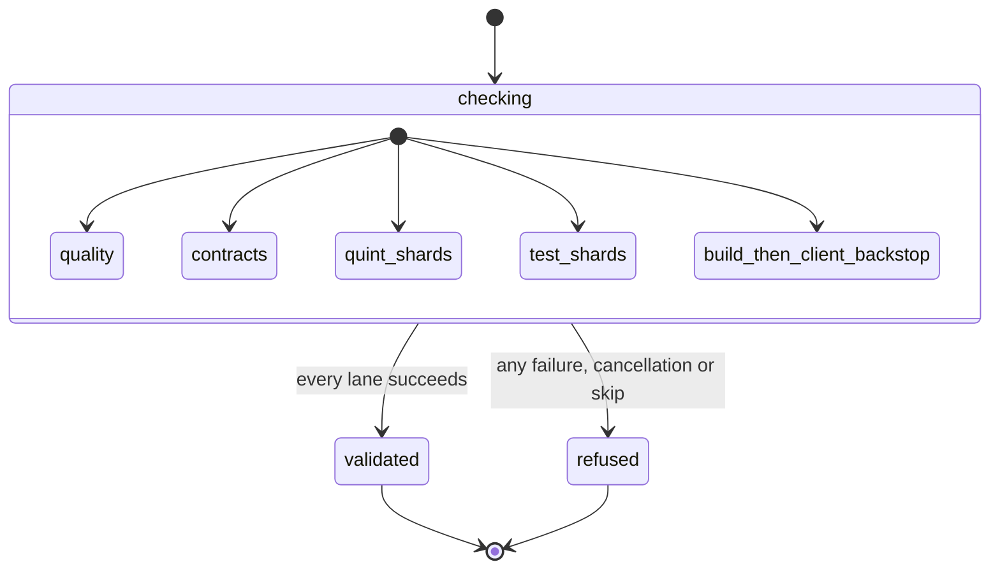

# Parallel validation without weaker gates

## Baseline and target

Passing Validate run [43776550129](https://github.com/kwilson21/thesuperhuman.us/actions/runs/43776550129), job 133004019841, provided this timestamped baseline on November 15:

| Sequential stage | Elapsed |
| --- | ---: |
| Checkout, Node/pnpm setup and install | about 23 s |
| Lint | 1.8 s |
| Dafny install and proof | 19.5 s |
| Quint properties and mutants | 282.1 s |
| Astro check | 29.5 s |
| Vitest | 416.3 s |
| Build | 22.2 s |
| Built-client backstop | 0.6 s |

The job took about 13 minutes 16 seconds. It passed 350 files / 14,003 tests
(with three existing skips). The longest single Quint check took 107.6 seconds.
These are observed timings, not guarantees about another hosted runner.

The aim is to approach two minutes by removing serialization, not by reducing
verification. Setup, the longest indivisible check, runner queues and concurrent
Screenshot/Golden-neutrality workflows impose limits. Two minutes is UNVERIFIED;
compare final-head hosted elapsed time and aggregate runner-minutes before making
a claim. More parallel jobs may use more runner-minutes even when feedback is faster.

## Job graph and unchanged invariants

Independent lanes start from the same checkout:

The job named `validate` remains the required aggregate identity. It runs even
when a dependency fails or is skipped, and accepts only success from all five
lane groups. Matrix fail-fast is disabled so remaining checks finish and report.
No path filter, continue-on-error, timeout suppression or conditional check bypass
is introduced. The aggregate fixture executes the actual jq predicate, including
failure/cancelled/skipped/missing-result cases. Local tests now require `jq` on
PATH (already supplied by the Ubuntu CI image); missing jq is a failure, not a
silently skipped guard. See [GitHub job dependencies](https://docs.github.com/en/actions/how-tos/write-workflows/choose-what-workflows-do/use-jobs)
for the `always()` dependency behavior and [Vitest sharding](https://vitest.dev/guide/improving-performance#sharding)
for the native test partition.

- Quality: lint, format check and Astro check. The format check adopts the single
  workflow step proposed in PR #277; that PR's other documentation is not merged
  or represented as approved here.
- Contracts: the same checksum-verified Dafny 4.9.0 and LemmaScript proof.
- Quint: eight balanced shards of complete checks. Every property, mutant and
  equivalent check runs once across the union; global property-to-mutant coverage
  is checked before selecting each shard. Model files, seed, sample counts,
  step limits, evaluator pin/checksum and outcome classification are unchanged.
- Tests: six native Vitest shards, with both golden digest/count verification
  flags on every shard. No tests or suites are removed. The pinned evaluator is
  installed in test workers too, preserving the scripted model-trace test.
- Build: unchanged prebuild gates and private-token step scope, followed by the
  built-client test with `REQUIRE_CLIENT_BUNDLE=1` in the same job/workspace.

The Quint timing hints come from the baseline's individual pass checks.
They are scheduling hints only, not a check allowlist. The hint table includes all
fourteen passing modules; unknown future modules get a default weight and remain
in the partition. Mutants get a small default weight. Greedy scheduling balances
estimated work, preserves deterministic membership and never splits or weakens a
single seeded simulation. Bad shard arguments and empty partitions fail closed.
Local `pnpm run verify:quint:all` still runs everything with no shard variable.

Pinned actions, Node version file, pnpm lockfile installation, read-only token
permissions, credential-free checkout and concurrency cancellation remain as
before. No new paid runner, credential, security setting or artifact trust path.
Screenshot and Golden-neutrality workflows are untouched, including PR #280's
separate pending screenshot-race work. The sign-in clock scheduling fix already
merged in PR #333 remains untouched.

## Verification and rollout

Implementation rebased without conflicts onto `5f66acfd` (PR #322), including its
new brief-copy model. That model and every mutant are included automatically; the
historical runtime comparison is not claimed to cover this newer main revision.

PASS locally on `5f66acfd`: 71 focused tests covering partition completeness, malformed shards,
actual aggregate predicate outcomes, existing Quint classifiers and package-manager
workflow guards. Astro check: zero errors/warnings, 16 existing hints. Full lint
passed; formatting checked 919 files without changes. YAML parsing and diff
whitespace checks passed.

UNVERIFIED: independent exact-head review, all hosted matrix checks and measured
hosted speed until results are recorded. The complete suite, model simulations
and build must pass on the new hosted matrix before acceptance.
No merge is authorized by this document. Runtime choice is separate: retain Node
unless the fair Bun comparison proves compatibility and benefit across the same
checks; a faster install or an incomplete test run is not equivalent evidence.

Rollback by reverting this isolated CI change; no website runtime or database
migration changes. UI, content, SEO, accessibility, payment and owner-center
release checks are N/A because their implementations are unchanged. Existing
release gates remain required for later site deployments.

## Runtime comparison: keep Node

One completed controlled pair used Node 26.13.1 and Bun 1.4.4 with Vitest 5.0.3,
the same installed dependency graph from baseline `b6046837` and `--maxWorkers=2`, both golden digest/count
flags enabled. Fixed files: SQLite D1, studio sign-in non-interference, agreement
PDF, golden resume-request and golden publication-OAuth.

- Node: 203.219 seconds; 268 passed, one existing skip.
- Bun: 137.382 seconds; 104 passed, 164 failed, one existing skip. Both golden
  files failed, including response serialization differences such as charset.

This is not an equivalent speedup: Bun did not preserve the assertions. Keep Node
in CI. The repeated benchmark loop stopped after this compatibility blocker;
incomplete repeat timings are omitted. The frozen install attempt was blocked by
a dependency-store operation lock, so the comparison used copied dependencies
whose installed lock was semantically verified identical to `b6046837`. Cold package
installation was not benchmarked. One completed pair is compatibility evidence,
not a statistically stable runtime ranking.

A separate direct reproduction isolates one mismatch:
`Response.json({ok:true}).headers.get("content-type")` returns `application/json`
in Node and `application/json;charset=utf-8` in Bun. The golden checks compare
response bytes and headers intentionally; this difference is not suppressed.

An isolated package-manager compatibility check copied only `package.json` and
`pnpm-lock.yaml` to a temporary directory. Bun 1.4.4 `install --frozen-lockfile`
refused migration with `lockfile had changes, but lockfile is frozen`, noting that
package overrides changed since the pnpm lock was saved. The repository lockfile
was not unfrozen or migrated. This is a compatibility failure, not a cold-install
speed comparison: the pnpm control was blocked by the store lock.
