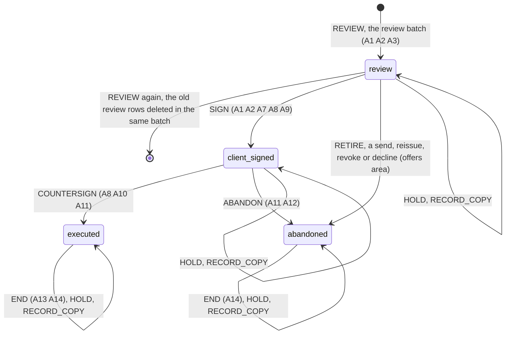
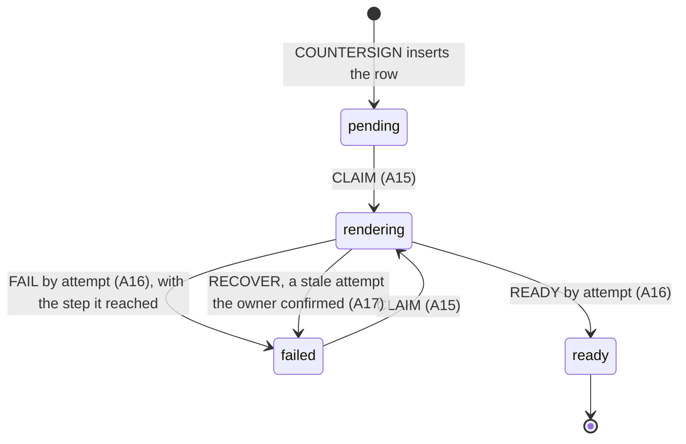
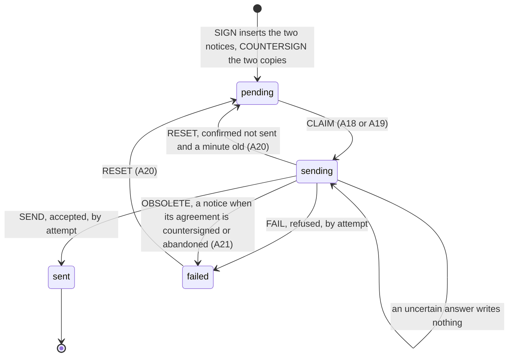
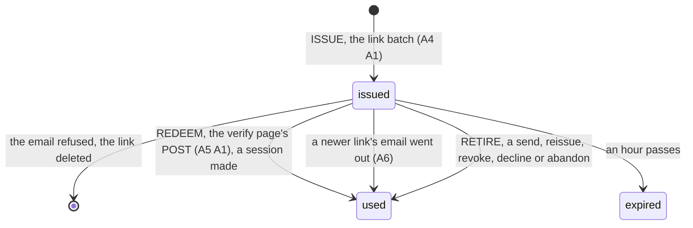
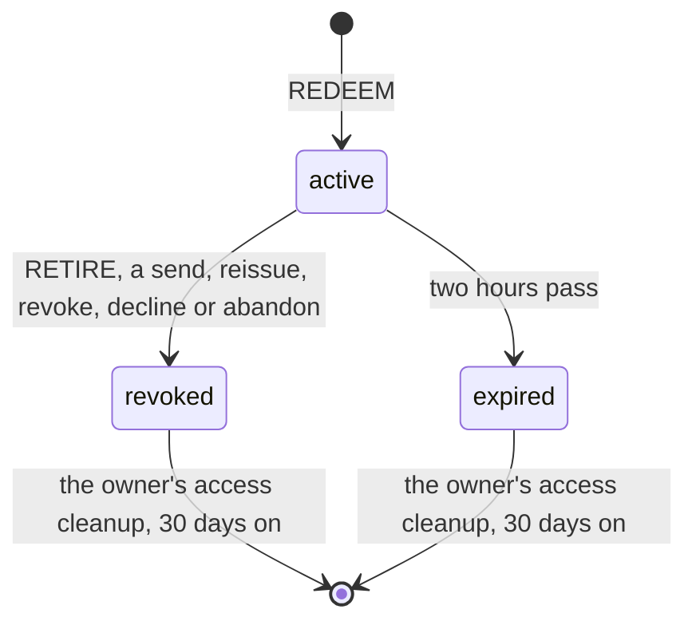

# Signing and agreements: conversion design

Status: proposed 2026-11-23 as the design PR for step 3 of `docs/plans/2026-11-effect-conversion.md`, reviewed before
any conversion code; this PR changes nothing under `src/`. Every claim about today's code cites a file and line on
`origin/main` at `98e9404a`. Short names used below: `link.ts`, `draft.ts`, `review.ts` and `sign.ts` are the files of
that name in `src/pages/api/offer/[token]/`; `owner-agreements.ts` is `src/pages/api/owner/agreements.ts`;
`agreement.ts` and `attachments.ts` are `agreement.ts` and `agreement-attachments.ts` in
`src/pages/api/owner/requests/[id]/`; `access.ts`, `artifacts.ts`, `pdf.ts`, `retention.ts`, `templates.ts` and
`draft-lib.ts` are `agreement-access.ts`, `agreement-artifacts.ts`, `agreement-pdf.ts`, `agreement-retention.ts`,
`agreement-templates.ts` and `agreement-draft.ts` in `src/lib/`; `software-agreements.ts` is
`src/lib/software-agreements.ts`. "The verify pages" are `src/pages/offer/[token]/verify.astro` (the signing link)
and `src/pages/agreements/verify.astro` (the archive link).

## Owner decisions

Decided before this design, and not asked again:

- Owner, 2026-11-12: business logic out of SQL strings; Effect for rules and Effect Schema for input; one complete
  area at a time; a conversion changes no behaviour.
- Owner, 2026-11-14: an unexpected database or store failure answers 500 with the route's fixed sentence and never the
  error's own text; a lost race or a stale version 409; 503 only for a missing binding or a known unavailable
  dependency. Fixes B1 to B5 and B8 in section 5 follow from this decision, as the offers area's F1 to F6 and the
  sign-in area's S1 and S2 did.
- Owner, 2026-11-15: "Effect schema as our only validator no zod use from us"; stacked conversion PRs.
- Owner, 2026-11-15 ("Go"): the order of `docs/plans/2026-11-effect-conversion.md`, in which this is step 3.

Settled in earlier areas and applied here without asking again: a condition that only a guard checks today is read
first and refused by name, with today's answer (`docs/plans/2026-11-offers-conversion.md`, section 2); a refused
compare-and-set guard is not retried, while a UNIQUE constraint that backs a rule's fact is read and decided again
(offers F7, and CLAUDE.md); a missing or empty id answers what an unknown id answers (offers F6); a fixed 500 reuses the
route's existing sentence where one fits (`docs/prelaunch-qa-2026-11-14-agreement-access.md`, judgment call (b)).

### Questions for the owner (decided)

Three, each asked with a recommendation, then two judgment calls the owner may overrule. Nothing else in this design
needs an owner decision. The owner chose the recommendation on all three (in conversation, 2026-11-23): Q1 "The real
reason", Q2 "Approve all three", Q3 "Success with receipt". The fix PRs build those answers.

**Q1. The signing link when the offer stops being signable before its batch (decided: the recommendation).** Today a
link request answers 429 "Wait at least 30 seconds before requesting another link." when, between its read and its link
batch, the request is withdrawn or resolved, the offer is superseded, its link is revoked, signing is switched off or
the project starts, and also when the offer already has a project (golden `offer-link`, 14 cases). The batch's two
guards raise the same error and the catch answers it as the 30-second window (access.ts:207-251). The conversion reads
the offer's state before the batch and, as the converted archive link does after a lost guard, reads and decides again
(three tries). Recommended: each answers what the same request would get a moment later, with today's sentences: 404
"Website signing is off." when signing is off, otherwise 404 "This offer is unavailable for signing."
(access.ts:135-143); "another request issues a link between the lookup and the batch" keeps its 429. The alternative
keeps 429 for all 14 and needs an exception to the 409 rule, like the sign-in routes' (that one rests on
non-interference, which does not apply here: the visitor holds the offer's own link).

**Q2. Three sentences for a failure on the site's side (decided: approved as written).** Three client answers have no
sentence that fits a store failure: the draft's only failure sentence is "Your details could not be saved. Check the
fields and try again." (draft.ts:59-66), the sign route's is "The reviewed agreement changed. Reload and review it
again." (sign.ts:95-102), and the verify pages show "This link has expired." or fail with a bare 500 (archive
verify.astro:35, offer verify.astro:44). Proposed:

- draft, 500: "Your details could not be saved. Try again in a moment."
- sign, 500: "Your signature could not be saved. Try again in a moment."
- both verify pages, 500: heading "This link could not be opened.", text "Something went wrong on my side. Try the link
  again in a few minutes."

Recommended: approve these, or edit them; the fix PRs use the approved text.

**Q3. A failed read after the signatures are saved (decided: the recommendation).** After the signing batch commits,
sign.ts:79-81 reads the agreements again to send the two notices; that read is outside the notices' own `try` (83-88),
so when it fails the client is told 409 "The reviewed agreement changed. Reload and review it again." although the
signature is saved (golden `offer-sign` "outage: the second read of the agreements, after the signatures committed"; the
same request again answers 200 with the saved receipt). Recommended: the read becomes part of the notices step, whose
failures are already ignored ("Saved signatures survive notification failures.", sign.ts:87), so the client gets 200
with the receipt and the owner's retry-copy sends the notices. The alternative is a 500 whose sentence says the
signature was saved.

### Judgment calls (the owner may overrule)

**J1. The owner's downloads when a ready copy's file is gone (B8).** They answer 500, logged, not the 404 the visitor
routes give since agreement access judgment call (a) (`docs/prelaunch-qa-2026-11-14-agreement-access.md`, item 2 and
"Owner decisions"). That call's reason is that a verified visitor cannot tell a missing object from an unknown id; the
owner already knows the row exists, and a ready copy whose object is gone is an unexpected store state, which the
2026-11-14 decision answers 500 and logs. The alternative is 404 "Not found", as the visitors get.

**J2. Where the discount's send check runs (discount PR 4).** It runs only for a send with signing on, the one move
that pins the current SOW template (offer-send.ts:245-248). With signing off nothing is pinned, and the website cannot
sign the offer later without a new send (its link request answers 404 "This offer is unavailable for signing.",
access.ts:139-143, and its review "The pinned templates are unavailable.", software-agreements.ts:243), so
there is nothing for the check to protect, and a discounted offer signed outside the website can still be sent. The
discount plan states the refusal without that condition (section 4.5); PR 4 adds it there. The alternative refuses
every send of a discounted offer while the template has no discount line, signing on or off.

## The area today

### Files in scope

`grep -L runRoute` over `src/pages/api` lists 21 files; this step converts 8 of them, and both verify pages, which
write. Two of the 21 need no conversion (`resume-approve.ts`, the publication route), so 11 are left after this step.

| File | Lines | In this step |
|---|---|---|
| `src/pages/api/offer/[token]/link.ts` | 83 | converted |
| `src/pages/api/offer/[token]/draft.ts` | 68 | converted |
| `src/pages/api/offer/[token]/review.ts` | 137 | converted (GET and POST) |
| `src/pages/api/offer/[token]/sign.ts` | 109 | converted |
| `src/pages/api/owner/agreements.ts` | 273 | converted (templates, the signing setting, the contractor's details, access cleanup, retention) |
| `src/pages/api/owner/agreements/[id]/file.ts` | 9 | converted |
| `src/pages/api/owner/requests/[id]/agreement.ts` | 389 | converted (countersign, abandon, end, hold, record a copy, the two retries) |
| `src/pages/api/owner/requests/[id]/agreement-attachments.ts` | 152 | converted (PUT and GET) |
| `src/pages/offer/[token]/verify.astro` | 45 | converted (it consumes the link and makes the session) |
| `src/pages/agreements/verify.astro` | 36 | converted (the same, for the archive link) |

Route files: 1,220 lines; pages: 81. The library code they call:

| File | Lines | What happens to it |
|---|---|---|
| `src/lib/agreement-access.ts` | 442 | `issueAgreementLink` (112-315), `liveSigningGuard` (317-327), `completeAgreementLink` (329-442) and `cleanupAgreementAccess` (26-41) move into the store, rules and flows and are deleted. `agreementJson`, `agreementText`, `maskedAgreementEmail` and `sessionCookie` stay; `agreementSession` (73-109) and `signingEnabled` (43-53) stay for the pages that only read (`agreements.astro`, `offer/[token].astro`, `sign.astro`, two owner components) |
| `src/lib/software-agreements.ts` | 742 | `reviewAgreements` (161-389), `signAgreements` (398-545), `countersignAgreements` (644-733), `sessionGuard` (109-116), `reusedMsaGuard` (547-557), `signatureInsert` (559-614), `closeObsoleteAgreementNotifications` (616-642) and `otherRequestChangedClient` (124-159) move and are deleted. `offerAgreements`, `executedOfferAgreement`, `retireRequestSigning` and `abandonUnsignedAgreementReviews` stay for the read pages, `src/lib/owner-requests.ts` and `[id]/project.ts` (steps 12 and 6); `legalNameKey` and `signatureIds` are pure and stay |
| `src/lib/agreement-artifacts.ts` | 523 | `prepareAgreementArtifact` (149-346), `deliverAgreementCopies` (357-447), `recoverAgreementRendering` (449-465) and `deliverAgreementNotifications` (470-523) move and are deleted; `hashBytes`, `canonicalJson`, `newYorkTime` and `currentSigningNotification` (read by `SoftwareAgreementPanel.astro`) stay |
| `src/lib/agreement-pdf.ts` | 500 | the renderer keeps its code; its reads already pass through a `PacketRead` (82-85), which the packet service gives it. `preflightAgreementPacket` (412-500) becomes the packet flow's preflight, which the offers area's `AgreementPreflight` calls |
| `src/lib/agreement-retention.ts` | 598 | moves into rules, the store and a flow; deleted |
| `src/lib/agreement-templates.ts` | 381 | the pure half stays (fields, render, validate, compare); `templateVersion` (275-286), `compareWithPrevious` (296-307) and `publishTemplate` (309-381) move; `currentTemplate` (266-273) stays for the owner pages |
| `src/lib/agreement-draft.ts` | 81 | `saveAgreementDraft` (53-81) moves; `loadAgreementDraft` and `prefillAgreementDraft` stay for `sign.astro` |
| `src/lib/agreement-download.ts` | 79 | the owner's download (10-79) moves; deleted |
| `src/lib/agreement-events.ts` | 14 | used as it is: the store builds its events with it, as `src/server/agreement-store.ts:12` already does; `[id]/project.ts` uses it too |
| `src/lib/audio-client-access.ts` | 378 | `reserveStudioAllowance` (68-98), whose last caller is `issueAgreementLink`, is deleted |
| `src/lib/software-offers.ts` | 558 | `getLinkedOffer` (451-460) stays for the read pages; the routes read the offer through the store and decide with a rule |
| `src/lib/software-deposit-block.ts` | 124 | gains the abandon decision with its contract (section 7) |

Used as they are: `agreement-request.ts` (167), `agreement-owner-input.ts` (168), `agreement-fields.ts` (424),
`agreement-client-fields.ts` (173), `agreement-draft-fields.ts` (233, also browser code),
`agreement-template-fields.mjs` (83), `agreement-host.ts` (25), `agreement-version-label.ts` (6),
`software-guard.ts` (29), `reader-message.ts` (12). About 3,400 library lines move or go and about 1,300 are used
as they are. Already converted and reused or extended: `src/server/agreement-store.ts` (442),
`agreement-services.ts` (123), `agreement-input.ts` (98), `flows/agreement-session.ts` (67),
`rules/agreement-session.ts` (146), `rules/agreement-link.ts` (275), `rules/agreement-download.ts` (222),
`studio-signin-store.ts` (515), `rules/studio-allowance.ts` (69), `offers-services.ts` (282),
`machines/offer-version.ts` (98).

Four route files still import Zod: link.ts:2, review.ts:4, sign.ts:2 and owner-agreements.ts:7.

### POST /api/offer/[token]/link

`issueAgreementLink`, access.ts:112-315, behind the route's own checks.

| Check | Answer | Code |
|---|---|---|
| The body (4 KiB; JSON, or a same-origin form) | `agreementRequest`'s answers | link.ts:30-32; agreement-request.ts:9-108 |
| The shape (Zod: `turnstileToken` 1 to 2,048) | 400 "Complete the security check." | link.ts:34-42 |
| No token | 404 for another host, 503 when the settings are missing, else 400 "Enter a valid email address." | link.ts:13-27, 46 |
| Another host | 404 `{ok:false}` | access.ts:118-119 |
| No D1, code key, Resend key, sender or Turnstile secret | 503 "Agreement sign-in is temporarily unavailable." | 121-133 |
| Signing off | 404 "Website signing is off." | 135-136 |
| No sent offer linked by the token, or no recipient or MSA template | 404 "This offer is unavailable for signing." | 137-143; software-offers.ts:451-460 |
| The recipient is not a valid address | 400 "Enter a valid email address." | 145-151 |
| `agreement-link-ip`, 20 per window | 429 "Please wait a few minutes before requesting another link." | 156-182 |
| Turnstile | 403 "Complete the security check again." | 184-190 |
| `agreement-link-email`, 3 per window | 429, as for the address | 192-194 |
| The link batch: a link under 30 seconds old (A4), the offer no longer signable (A1), or any failure | 429 "Wait at least 30 seconds before requesting another link." | 207-251 |
| The email refused (4xx) | the link's sessions, the link and one use of each allowance taken back; 502 "That email didn’t go through. Please try again." | 270-305 |
| Accepted or uncertain | the recipient's older unused links consumed; 200 with the receipt (the full address when the visitor holds a live session for this offer, else masked), or a form's 303 to `/offer/<token>/sign?email=sent` | 196-199, 307-314; link.ts:56-69 |
| Anything thrown | 503 "Agreement sign-in is temporarily unavailable." | link.ts:72-77 |

A code key under 32 characters fails at the first keyed hash, in the `agreement-link-ip` allowance, after the signing
setting and the offer are read, and answers the catch's 503 (golden "a code key under 32 characters"). The archive path
checks the length first; the agreement access record left the signing path to this area
(`docs/prelaunch-qa-2026-11-14-agreement-access.md`, item 7). This design keeps it where it fails today (section 5).

### The verify pages

Each page calls `completeAgreementLink` with its purpose (lines 7-17 of both), returns a 303 as it is (19), otherwise
sets the answer's status, `Referrer-Policy: no-referrer` and `Cache-Control: no-store` (21-25) and renders "Your
documents are ready" or "Your agreement is ready" with a Continue form for a 200, and "This link has expired." for any
other status (archive verify.astro:27-35; offer verify.astro:27, 38-45). The offer page also reads the offer and shows
its `outcome` from `JSON.parse(terms_json)` (offer verify.astro:31-36, 40).

| Check | Answer | Code |
|---|---|---|
| Another host | 404, the expired content | access.ts:335-336 |
| No D1, or a key that is not 43 URL-safe characters | 401 | 344 |
| No unused, unexpired link of the page's purpose for the key; a signing link whose offer token differs | 401 | 349-362 |
| GET, signing link: the offer no longer open for signing (A1 run as a read; a failed read too) | 401 | 364-376 |
| GET | 200 | 378 |
| A method other than GET or POST | 401 | 381 |
| POST: the batch (A1 for a signing link, A5; or any failure) | 401 | 387-428 |
| POST | 303 to `/offer/<token>/sign` or `/agreements`, with the two-hour session cookie | 383-385, 430-441 |
| A POST whose body is not a form (`formData()` throws) | the page throws, a bare 500 | both verify.astro:9 |
| The link read fails; on the offer page, the offer read fails | the page throws, a bare 500 | 349-359; offer verify.astro:31-36 |
| On the offer page, terms that are not JSON (parsed in the layout's slot, after the status and headers are set) | no response at all: the body fails before its first byte (production streams, and the renderer still holds the page's bytes when the slot throws), and workerd then sends no status line and no headers | offer verify.astro:40 |

No golden corpus records the pages. `offer-link` and `agreements-link` call `completeAgreementLink` directly as steps
that follow the emailed link (`tests/golden/areas/agreement-access.ts:350-378`), so the function's answers are recorded
and the pages' are not.

### POST /api/offer/[token]/draft

| Check | Answer | Code |
|---|---|---|
| The body (16 KiB) | `agreementRequest`'s answers | draft.ts:16-18 |
| No D1, no sent offer linked by the token, no open signing session for it, or signing off | 401 "Open a fresh email link to keep going. Your saved details will be here." | 15, 20-36 |
| `csrf_nonce` is not the session's | 403 "Reload and try again." | 38-41 |
| The values (`readDraft`) | 400 "Check the highlighted details." with `errors` | 42-52 |
| The batch: A1 (a project included), A2, A3, or any failure | 409 "Your details could not be saved. Check the fields and try again." | 54-67; draft-lib.ts:59-78 |
| Saved | 200 `{ok:true}` | 57 |
| A JSON `null` body; a read before the `try` fails | the handler throws, a bare 500 | 37-38, 20-28 |

### GET and POST /api/offer/[token]/review

| Check | Answer | Code |
|---|---|---|
| GET: no D1, no linked offer, no session, signing off | 401 `{ok:false}` | review.ts:23-32 |
| GET: the document is not this review session's | 404 `{ok:false}` | 34-40 |
| GET | 200, the document's text as a `text/plain` attachment | 42-50 |
| POST: no D1 | 503 `{ok:false}` | 56 |
| POST: the body (16 KiB) | `agreementRequest`'s answers | 57-59 |
| POST: no linked offer or session, or signing off | 401 "Open a fresh email link ..." | 65-78 |
| POST: the shape (Zod: `csrf_nonce`, `values`) or the nonce | 403 "Reload and try again." | 61-63, 80-81 |
| POST: the client's details (`resolveClientDetails`) | 400 "Check the highlighted details." with `errors` | 84-97 |
| POST: the draft batch, then `reviewAgreements` | see below | 98-107 |
| A sentence the code wrote (`ReaderMessage`) | 409 with it: a signature is already saved, the MSA does not match, another offer has a pending MSA, the templates are unavailable, render refusals | software-agreements.ts:181-304; `src/server/failure.ts:50-62` |
| A guard, a UNIQUE index, a `LostRace`, or stored data a reader refuses (`FieldsRefused`) | 409 "The agreement could not be reviewed." | review.ts:108-131 |
| Anything else | 500 "The agreement could not be reviewed.", logged | 112-119 |
| Reviewed | 200 `{ok:true, documents, reused_msa}`, or a form's 303 to `?review=1` | 100-107 |
| A read before the `try` fails (both methods) | the handler throws, a bare 500 | 24-31, 34, 65-70 |

### POST /api/offer/[token]/sign

| Check | Answer | Code |
|---|---|---|
| No D1 | 503 `{ok:false}` | sign.ts:22 |
| The body | `agreementRequest`'s answers | 23-25 |
| No linked offer or session, or signing off | 401 "Open a fresh email link ..." | 43-56 |
| The shape (Zod: `csrf_nonce`, one or two documents of uuid and hash, `consent` true) | 400 "Agree to sign electronically after reviewing the agreement." | 27-41, 58-65 |
| The nonce | 403 "Reload and try again." | 67-68 |
| All documents already `client_signed` by this session | 200 with the saved receipt | software-agreements.ts:416-429 |
| Anything `signAgreements` throws: the documents differ, another session signed, the details changed, the evidence is too long, a name the fonts cannot print, a guard (A1 A2 A7 A8 A9), a read or the batch failing | 409 "The reviewed agreement changed. Reload and review it again." | sign.ts:70-103; software-agreements.ts:398-545 |
| Signed | the two notices sent before the answer, every failure swallowed; 200 `{ok:true, receipt_id}`, or a form's 303 | sign.ts:79-94 |
| A read before the `try` fails | the handler throws, a bare 500 | 43-48 |

### POST /api/owner/requests/[id]/agreement

| Check | Answer | Code |
|---|---|---|
| Not the owner | 403 `{ok:false}` | agreement.ts:43 |
| No D1, or no `id` | 503 `{ok:false}` | 45 |
| The body (16 KiB) | `agreementRequest`'s answers | 46-48 |
| The action (`readOwnerAgreementAction`, Effect Schema) | 400 "Complete the required confirmations." | 49-55 |
| The request's sent offer, read for every action | when it fails, the handler throws, a bare 500 | 60-65 |
| Anything thrown inside the `try` | abandon reads the deposits again and answers their sentence; end reads the MSA's use again and answers its sentence; otherwise 409 "The agreement changed or the operation failed. Reload before retrying." | 361-383 |

| Action | Today | Code |
|---|---|---|
| countersign | No sent offer, or signing off: 409 "Signing is off or the offer changed.". `countersignAgreements`: the pending documents read and compared, one batch (A10, A8, A11 per document, the signatures, events, obsolete notices failed, executed, packet rows, two delivery rows). Then, inside a `catch {}`, the MSA's packet (when the SOW names one), the SOW's packet and the copies. Always 200 "Signed by both parties. Copy preparation needs attention." | agreement.ts:68-117; software-agreements.ts:644-733 |
| abandon | No sent offer: 409 `{ok:false}`. The `client_signed` documents differ from those named: 409 "Review the complete pending signing action.". A first deposit that counts: 409 "Void the deposit invoice first, or refund it in Stripe and record the refund with owner:stripe:reconcile --software-deposit-refunded.". One batch: A12, A11 per document, abandoned, events, obsolete notices failed, the offer superseded, links revoked, sessions revoked, signing links used, drafts deleted | 119-194 |
| end | Not this request's agreement: 404 `{ok:false}`. Not executed or abandoned: 409 `{ok:false}`. A day before signing or after today in New York: 409 "Use an end date from signing through today.". A date that does not exist throws (the generic 409). An MSA an open offer reuses: 409 "An open offer uses this agreement. Withdraw that offer first.". One batch: A13 for an MSA, then the update with A14 | 196-209, 305-353 |
| hold | 404; one batch: `legal_hold` and an event | 291-303 |
| record-alternate-copy | 404; one batch: the delivery row and an event | 275-289 |
| retry-copy | 404; failed copies and current notices, and those stuck `sending` a minute that the owner confirms, reset to pending (two statements); then the notices and the copies delivered | 211-234 |
| retry-artifact | 404; with `expectedAttempt`, a stale attempt recovered (A17) or 409 "Check the stale preparation attempt before recovery."; the MSA's packet and the agreement's prepared, then the copies sent | 236-273 |
| any | 200 `{ok:true}`, or a form's 303 to `/owner/requests/<id>` | 356-360 |

### The packet and the emails

`prepareAgreementArtifact` claims the packet row (A15, artifacts.ts:165-172; no row claimed, nothing happens), reads
the agreement, the MSA it names and each document's signatures and template labels (176-233), renders the packet with
pdf-lib unless the packet is already stored (250-262), puts the packet, its certificate, its manifest and each
document's text in R2 (274-292), reads two of them back (295-304) and marks the row ready by attempt (305-326). Any
failure logs one line, "Agreement artifact preparation failed:", the error's name and its message ("Invalid JSON." for a
`SyntaxError`, 330-338), and marks the row failed by attempt with the step it reached: render, storage or readback
(339-344). `deliverAgreementCopies` (357-447) and `deliverAgreementNotifications` (470-523) claim each row (A18, A19,
`RETURNING email`), send through `sendAudioMessage` with an idempotency key, and write the outcome by attempt; an
uncertain answer writes nothing.

### POST /api/owner/agreements

Already in step with the owner's 2026-11-14 decision: its catch answers a `ReaderMessage` with 409 and the sentence, a
guard or a UNIQUE index with 409 "The agreement could not be saved.", and anything else with that sentence as a 500,
logged (owner-agreements.ts:252-267).

| Check | Answer | Code |
|---|---|---|
| Not the owner | 403 `{ok:false}` | 87 |
| No D1 | 503 `{ok:false}` | 89 |
| The body (120,000 bytes) | `agreementRequest`'s answers | 90-92 |
| The command (Zod union of seven actions; the contractor's values read with Effect Schema inside a transform) | 400 "Check required fields and limits." | 31-82, 93-99 |
| access-cleanup | sessions and links older than 30 days deleted, one batch; 200 | 106-114; access.ts:26-41 |
| retention-preview, retention-apply | no bucket or binding id: 503 "Retention storage identity is not configured."; the manifest, then the guarded batches and R2 deletes; refusals 409 with their sentence | 116-147; retention.ts:54-598 |
| setting | one update; 200 | 149-162 |
| config | the version guard (A23) and the insert, one batch; 200 | 164-186 |
| template-version | 404 "That version was not found."; the version and the comparison with the one before | 188-204 |
| preview | `validateTemplate`, the current version read, the text rendered with sample values | 206-226 |
| publish | not confirmed: 400 "Confirm publication of a new immutable version."; `publishTemplate`: the label pattern, the same text as the current version, the label in use, then the version guard (A22), the insert and an event | 228-251; templates.ts:309-381 |

### PUT and GET /api/owner/requests/[id]/agreement-attachments, GET /api/owner/agreements/[id]/file

| Check | Answer | Code |
|---|---|---|
| PUT: not the owner; no D1 or no bucket; another origin | 403 `{ok:false}`; 503 `{ok:false}`; 403 | attachments.ts:15-20 |
| PUT: signing off | 404 `{ok:false}`; the read failing throws | 22 |
| PUT: the query (filename, version, date), the type, a body | 400 "Choose a PDF, version and date." | 24-34 |
| PUT: over 10 MiB; not starting `%PDF-` | 413 "Keep each PDF under 10 MiB."; 400 "The file must be a PDF." | 35-44 |
| PUT: pdf-lib cannot load it (or cannot be loaded); no pages | 503 "The PDF could not be validated. Use a supported PDF or sign outside the website."; 400 "The PDF has no pages." | 46-61 |
| PUT: the R2 put, then the batch (A24, the insert) | any failure, the request's state included: the object deleted unless the row is there (a failure of that check or delete is swallowed), 503 "The attachment could not be saved." | 63-124 |
| PUT | 200 with the attachment | 97-107 |
| GET: not the owner; no row for the id and request (no D1 included) | 403 "Forbidden"; 404 "Not found" | 127-138 |
| GET: no object | 503 "Unavailable"; no bucket, a failed read: the handler throws | 139-151 |
| file: not the owner | 403 "Owner access required." | owner agreements/[id]/file.ts:6-9 |
| file: no D1 or bucket; not executed or archive closed; no ready copy | 503 "Unavailable"; 404 "Not found"; 409 "Signed by both parties. Copy preparation needs attention." | agreement-download.ts:13-50 |
| file: no object; bytes that fail the digest | 503 "Signed copy unavailable. Contact Kazon."; 503 "Signed copy failed its integrity check. Contact Kazon." | 52-69 |
| file: a read throws | a bare 500 | 22-41, 52, 60 |

### The clock and the ids

The flows read the time where the code reads it today and pass it in: the link's `at` once, after the allowances and
the session read (access.ts:201), and each allowance its own (audio-client-access.ts:74); the redeem's `at` once
(access.ts:347); `sessionGuard`'s `now` as each batch is built (software-agreements.ts:113); the draft's `updated_at`
(draft-lib.ts:76); the review's `at` and its New York `effective_on` (software-agreements.ts:190-196); the signature's
`at` (433) and the countersignature's (664); the owner route's `at` (agreement.ts:58), today for an end date (321) and
the one-minute cutoffs (219, 229; artifacts.ts:462); the packet's claim, ready and event times (163, 317, 325); each
copy's and notice's claim and outcome times (392, 425, 439; 483, 516); the publish's `at` (templates.ts:319); the owner
agreements route's `at` (owner-agreements.ts:102); the cleanup's cutoff (access.ts:27); the upload's `at`
(attachments.ts:66); retention's `now` (retention.ts:58, 265). Every new id is drawn where today's code draws it, in
the order the statements are built: `agreementEvent` draws its id as its statement is built (agreement-events.ts:14),
and so do the signature, notice and obsolete-notice statements (software-agreements.ts:478, 588, 629). The golden
digests fail any id drawn in another order.

## 1. The machines

Three new machines in `src/server/machines/`, asked through `next()` and `sourcesOf()`, and one reused. The writes stay
SQL compare-and-set guards; the store builds each `status IN (...)` list from the machine, and a test holds each list to
it.

**The guards.** IDs used below.

| ID | Re-checks at write time | Code |
|---|---|---|
| A1 | The offer is sent through the link the session or link names, to the same recipient, the request is open, there is no project, signing is on (`liveSigningGuard`) | access.ts:317-327; link 219, redeem 389-398, draft draft-lib.ts:61, review software-agreements.ts:308, sign 461 |
| A2 | The signing session is unexpired and unrevoked (`sessionGuard`) | software-agreements.ts:109-116; draft draft-lib.ts:62, review 309, sign 462 |
| A3 | No agreement of the offer is `client_signed` or `executed` | draft-lib.ts:63-67; software-agreements.ts:310-314 |
| A4 | No signing link for the recipient and offer issued in the 30 seconds before `at` | access.ts:209-218 |
| A5 | The emailed link is still unused and unexpired at `at` | access.ts:399-408 |
| A6 | The older links consumed after a mail are only those still unused (today the update's own filter, which chooses them) | access.ts:307-312 |
| A7 | The saved draft is the one read | software-agreements.ts:463-469 |
| A8 | A reused MSA is still executed and not terminated | software-agreements.ts:547-557; sign 472, countersign 679 |
| A9 | Each document is still in review, with the hash and review session read | software-agreements.ts:489-493 |
| A10 | The offer is sent, the request open and signing on (countersign) | software-agreements.ts:674-678 |
| A11 | Each document is still `client_signed` with the hash read (and, for abandon, of this request and offer) | software-agreements.ts:681-685; agreement.ts:144-148 |
| A12 | No first deposit of the offer counts: creating, open, payment_failed, uncollectible, or paid and not refunded | agreement.ts:34-35, 140-142 |
| A13 | No draft or sent offer of an open request without a project reuses the MSA | agreement.ts:37-38, 340-346 |
| A14 | The end date is written only while the agreement is executed or abandoned (a filter: no row changes otherwise, 200) | agreement.ts:349 |
| A15 | A packet is claimed only from pending or failed, while its archive is open | artifacts.ts:165-172 |
| A16 | A packet is marked ready or failed only by the attempt that claimed it, while rendering | artifacts.ts:305-326, 339-344 |
| A17 | A stale packet is recovered only for the attempt the owner saw, at least a minute old | artifacts.ts:457-463 |
| A18 | A copy is claimed only while pending, its agreement executed and its archive open; its outcome only by its attempt, while sending | artifacts.ts:394-399, 418-445 |
| A19 | A notice is claimed only while pending and current (its agreement `client_signed`, archive open, no project); its outcome only by its attempt | artifacts.ts:467-468, 485-489, 510-521 |
| A20 | A reset only from failed, or from sending when the owner confirmed and the attempt is a minute old | agreement.ts:212-231 |
| A21 | An obsolete notice is failed only while sending | software-agreements.ts:616-642 |
| A22 | The template's newest version is the one the page expected | templates.ts:348-352 |
| A23 | The contractor config's newest version is the one the page expected | owner-agreements.ts:166-170 |
| A24 | The attachment's request is a software request that is neither withdrawn nor resolved | attachments.ts:74-78 |
| A25 | Retention: the project evidence unchanged, the agreement still eligible with the same text, each object shared with no other agreement and pinned by no open offer; for unattached and orphan files, the same and their rows unchanged | retention.ts:305-361, 478-512, 558-566 |

The database adds guards that stay where they are: six raise-only triggers keep templates, the contractor config,
signatures, signed agreement texts, clients and notices immutable, and `software_agreement_cleanup_lock` refuses a
change of `ended_at`, `retain_until`, `legal_hold` or `terminated_at` once the archive is closed
(migrations/music/0023_software_signing.sql:25-36). They write nothing, so they are not among the five writing triggers
of issue 242, and no writing trigger fires on this area's tables. The UNIQUE constraints: `(kind,version)` and
`(kind,version_label)` on templates (0023:4; 0026:3); one live SOW per offer and one pending MSA per client and template
(0023:13-14); the client's natural key (0023:11); `(agreement_id,party)` on signatures and `agreement_id` on notices
(0023:15, 35); the link's token hash (0023:16). Section 2 says which of them back a rule's fact.

### The agreement document

`software_agreements.status` holds review, client_signed, executed or abandoned (0023:12). The machine
`agreementDocument` has these four states and the events REVIEW, SIGN, RETIRE, COUNTERSIGN, ABANDON, END, HOLD and
RECORD_COPY. A closed archive (`archive_closed_at`) is not a state: retention sets it on an executed or abandoned
agreement and later deletes the row, and the rules read it as a fact.

HOLD and RECORD_COPY are allowed from every state because today neither looks at the status (golden headers of
`owner-request-agreement-hold` and `-record-copy`); END only from executed and abandoned (agreement.ts:306-307). RETIRE
is written by the offers store's `retireSigning` (`src/server/offers-store.ts:235`) with `status='review'`; a test holds
that list to `sourcesOf(agreementDocument, "RETIRE")` without changing its SQL.

### The signed copy

`software_agreement_artifacts.status` holds pending, rendering, ready or failed (0023:19). The machine
`agreementPacket`:

### A copy or a signing notice

`software_agreement_deliveries.status` and `software_agreement_notifications.status` share pending, sending, sent and
failed (0023:20, 37). The machine `agreementMessage`:

The audio area's `projectNotice` (`src/server/machines/project-notice.ts`) has the same four statuses, but its QUEUE
moves pending to pending; the reset here does not match a pending row (agreement.ts:214, 224), and a same-value update
of one would enter the golden table sets, so this area gets its own machine.

**No bridge.** The `@xstate/effect` bridge is for a move saved only after outside work, from a state that is never
saved (the offers area's `asking` and `declining`). Here the waiting state is saved first: a packet is `rendering`
before pdf-lib and R2 run, a copy or notice is `sending` before Resend is asked, as the audio notices are
(`docs/plans/2026-11-audio-projects-conversion.md`, section 1). Each is two compare-and-set writes around the outside
work, the second by attempt, and the flow calls the services between them.

### The signing link and session

Drawn for people; no machine module, as the converted archive link has none (its decisions are rules,
`src/server/rules/agreement-link.ts`).

A session counts only while its offer is still sent through its link to its recipient and the request is open, which
`signingIsLive` (`src/server/rules/agreement-session.ts:74-100`) already decides for the converted downloads.

### The offer version

Reused unchanged (`src/server/machines/offer-version.ts`). Abandon supersedes the sent offer (agreement.ts:172-175):
SUPERSEDE, whose status list (`OFFER_MOVES.SUPERSEDE`, sent) is the one the statement has today. Templates, the
contractor config and the signing setting have no moves beyond insert and update and get no machine.

## 2. The rules

In `src/server/rules/`, each opening with the comment CLAUDE.md asks for. Every rule is `rule(...)` or
`alwaysWrites(...)` from `src/server/terms.ts`, reads no clock and draws no id. Refusals are `Data.TaggedError` classes
with a `say` sentence, exactly today's.

| File | Rules | Given | Refusals | Writes |
|---|---|---|---|---|
| `signing-offer.ts` | `linkedOffer`, `openForSigning` | the offer, its link and its brief read by the token's hash; for `openForSigning` also the project, the setting and the recipient | `OfferUnavailable`, `SigningOff`, `SigningStarted` | the offer |
| `signing-link.ts` | `issueSigningLink`, `refundAllowances` | `at`, the recipient's signing links of the offer, `openForSigning`'s facts; the uses counted | `CooldownRunning` (reused), Q1's refusals | the link (an hour's life, the 30-second `since`), the receipt's address form; the uses to give back |
| `agreement-link.ts` (reused) | `withinAllowance`, `afterMail`, `consumeOlderLinks` | as for the archive link | `TooManyLinks`, `SecurityCheckFailed` | as today |
| `signing-redeem.ts` | `redeemLink` | `at`, the link read by the key's hash and purpose, the token's hash, `openForSigning`'s facts for a signing link | `LinkExpired` | the link used, the event, the session (two hours) |
| `signing-draft.ts` | `saveSigningDraft` | the session, the setting, the nonce, the draft read, a signed agreement, a project | `SessionMissing`, `CsrfMismatch`, `DraftRefused`, `AlreadySigned`, `SigningStarted` | the draft |
| `signing-review.ts` | `reviewDocument` (the GET) | the document id asked for, the offer's agreements (`readOfferAgreements`, plain rows: the rule leaves out the abandoned ones, as `offerAgreements`' filter does today), the session's token hash | `DocumentNotFound` (404 `{ok:false}`) | nothing written: it answers the document's kind and text |
| `signing-review.ts` | `reviewDocuments`, staged as the offers' send is | the offer's stored terms, details and contractor, the existing agreements, the client row, the reused MSA, the templates, a pending MSA elsewhere, `at` | `SignatureSaved`, `MsaMismatch`, `TemplatesUnavailable`, `PendingMsaElsewhere`, `RenderRefused` (the template code's sentences), `StoredDataRefused`, `AlreadySigned`, `SigningStarted` | the client, the review rows, the stale clients removed, the event |
| `signing-sign.ts` | `signDocuments` | the offer's agreements, the documents named, the saved receipt, the draft, the stored values, the browser evidence | `DocumentsChanged`, `SignedElsewhere`, `DetailsChanged`, `EvidenceTooLong`, `NameNotPrintable`, `StoredDataRefused` (the stored values: golden "values with no client object", "values with no contractor object", "values whose client misses a field", "... has an extra field", "... names a portfolio but denies it"), `SigningStarted` | the notice, signatures, events, statuses, the draft removed, two notices |
| `agreement-countersign.ts` | `countersign` | the offer, the setting, the pending agreements, the documents named, the contractor snapshot, the client's email snapshot, the typed name, the browser evidence | `OfferChanged`, `PendingChanged`, `NameNotPrintable` (the typed name or the contractor's title: golden "a typed name in Chinese cannot be printed", "... with an emoji ...", "... with a zero-width joiner", "... with a right-to-left mark", "a contractor title the fonts cannot print"), `EvidenceTooLong` ("... an address of 101 characters", "... a user agent of 2001 characters", "... a user agent that has a control character"), `StoredDataRefused` (the contractor snapshot missing, not JSON, empty, with an extra field, or not confirming the registered agent: five cases), `RecipientMissing` ("an offer with no client email snapshot", which today fails the batch's NOT NULL) | signatures, events, obsolete notices, statuses, packet rows, two copies |
| `agreement-abandon.ts` | `abandonSigning` | the offer, the `client_signed` agreements, the documents named, the offer's invoices | `NoSentOffer`, `PendingActionDiffers`, `DepositCounts` | the abandon batch |
| `agreement-record.ts` | `endAgreement`, `holdAgreement`, `recordCopy` | the agreement, today in New York, the date, the open offers reusing an MSA, the closed archive | `AgreementNotFound`, `NotEndable`, `EndDateOutside`, `DateDoesNotExist`, `MsaInUse`, `ArchiveClosed` | the end (with no event, as today), the hold and the copy record, each with its event |
| `agreement-packet.ts` | `packetClaimable`, `packetRecoverable` | the packet row, `now`, the attempt | `StaleAttemptUnconfirmed` | the claim, the outcome |
| `agreement-messages.ts` | `messagesToReset`, `copySigned` then `copyClaimable`, `noticeAgreementFound` then `noticeClaimable` | the rows, `now`, the agreement's status and archive, the project | none: a row that cannot move is skipped, as today | the reset, the claims |
| `agreement-templates.ts` | `previewTemplate`, `publishTemplate`, `saveContractor` | the text, the current version, the label's use, the expected version | `TemplateRefused`, `NothingToPublish`, `LabelInvalid`, `LabelUsed`, `NotConfirmed`, `VersionChanged`, `VersionNotFound` | the version, the config |
| `agreement-retention.ts` | `accessCleanup`, `retentionEligible`, `manifestFresh`, `objectsToDelete` | the rows each read gives, `now` | `ManifestStale`, `ArchiveChanged`, `ObjectChanged`, `UnattachedChanged`, `OrphanChanged` | the rows to delete or close |
| `agreement-upload.ts` | `acceptAttachment` | the query, the bytes, the page count, the request row | `UploadRefused` (each 400 and 413 above), `PdfUnreadable` (B4), `RequestNotFound`, `RequestClosed` (B4) | the row |
| `agreement-download.ts` (extended) | `ownerCopy` | the agreement, its copy row, the bytes' digest | `AgreementNotFound`, `CopyNotReady`, `CopyIntegrity` (all reused) | none |

A refusal that today shares an answer with others keeps that answer: every `signDocuments` refusal answers the sign
route's one 409; `OfferChanged` answers "Signing is off or the offer changed."; every other `countersign` refusal,
`DateDoesNotExist`, `ArchiveClosed` and a lost guard answer the owner route's generic 409 (today's catch,
agreement.ts:361-383, answers so every error thrown inside it, after abandon's re-read of the deposits and end's
re-read of the MSA's use, 362-373); `StoredDataRefused` and `AlreadySigned` on the review answer "The agreement could
not be reviewed."; `LinkExpired` answers the expired page's 401. `endAgreement` decides in today's order, which that
catch makes: `NotEndable`, `EndDateOutside`, then for an MSA `MsaInUse`, then `DateDoesNotExist`. Today an impossible
date throws (330-331) before the MSA check (334-338), and the catch then reads the MSA's use, so an impossible date on
an MSA an open offer reuses answers "An open offer uses this agreement. Withdraw that offer first." (no golden case
holds it: every impossible-date case ends a SOW).

`agreementValues`, `renderAgreement`, `validateTemplate`, `templateFields` and `legalNameKey` stay pure in `src/lib`
and the rules call them, so the rendered texts and their hashes are byte for byte today's. The abandon's deposit
decision is the pure `abandonBlocked` in `src/lib/software-deposit-block.ts`, which `abandonSigning` wraps (section 7).

**Conditions only a guard checks today (read first, same answer).** A project, which only A1 checks: the draft
("a project exists so signing has ended", 409), the review ("a started project ends the review", 409), the sign route
("a project already exists for the offer", 409) and the link (Q1). A signed agreement, which only A3 checks: the draft
("a client-signed agreement stops a draft") and the review ("a client-signed agreement cannot be reviewed again"), both
409. A closed archive, which only the cleanup lock checks: end and hold (409 generic). The open request of an upload,
which only A24 checks (B4 changes its answer). Each read comes just before the batch that checks it today, after every
check that answers before that batch today, so the order of answers does not move, and the guard stays as the re-check.
Every new read matches no golden hook pattern (they count by `nth`).

**Guard failures and retries.** A refused compare-and-set guard is `GuardRefused` and is not retried: every guard of
the draft, review, sign and redeem batches and of the owner's batches. The store recognises a raise-only trigger's
message (`Archive cleanup is reserved`, the `Immutable ...` ones) as `GuardRefused` too, so a closed archive found at
write time still answers 409. Read and decided again, three tries in all, through `decideAndSave`:

- the link batch, as the archive link's is (the first `at` kept across tries; `SaveKeptChanging` answers
  `CooldownRunning`);
- the review batch's UNIQUE failures that back a rule's fact: one pending MSA per client and template
  (`PendingMsaElsewhere`) and the client's natural key (the client id the rule chose). The client case is recognised as
  today, on the evidence `otherRequestChangedClient` reads after a FOREIGN KEY failure (software-agreements.ts:124-159,
  372-380); any other failure is `AgreementStoreFailed`. This changes nine golden cases (three, in three formats each;
  B7);
- the template's label UNIQUE, whose re-decision answers `LabelUsed` with today's sentence (golden publish "the label is
  taken between the check and the insert" is unchanged).

The signature and notice UNIQUEs repeat what A9 and A11 re-check and back no fact the rules read; a violation stays a
409, not retried (golden sign "a signature row for the MSA appears before the batch", "the SOW has a notice already for
the same agreement"). So do countersign's packet and copy rows, whose primary keys back no fact either (golden
countersign "an artifact row appears first", "a delivery row appears first"): `GuardRefused`, the generic 409. A FOREIGN
KEY failure when an agreement was deleted between the read and a hold or copy record is a lost race on the evidence read
afterwards (golden hold and record-copy "the agreement is deleted before the batch"), 409 as today; hold's "the archive
is closed before the batch" is the cleanup lock's raise, 409 as today.

## 3. The flows

In `src/server/flows/`. Each calls only services, the store and the rules, takes the time and each new id or token as
inputs at the point the code reads them today, and builds no response text. Each keeps today's order of reads,
decisions and outside effects.

- `signing-link.ts`, `requestSigningLink`: the host; the signing setting (`SigningOff`); the offer by the token
  (`OfferUnavailable`); the recipient (`InvalidEmail`); count `agreement-link-ip`; Turnstile; count
  `agreement-link-email`; the visitor's session (`visitorSession`, `src/server/flows/agreement-session.ts:24-48`, for
  the receipt's address); `at`; then `decideAndSave` over the recipient's links and `openForSigning`'s facts (read just
  before the batch), `issueSigningLink`, and the link batch (A4, A1, the event, the insert); the brief's name; the
  terms' outcome (a `JSON.parse` that throws is B5's 500); the mail; `afterMail`: a refusal takes the link, its sessions
  and the uses (`refundAllowances`) back in one batch, `removeRefusedLink`, and answers 502, otherwise the older links
  are consumed (A6) and the receipt given.
- `signing-redeem.ts`, `redeemAgreementLink`: the host, the key's shape, `at`, the link read, `redeemLink`; a GET for a
  signing link reads `openForSigning`'s facts and decides; a POST draws the session token, hashes it, draws the nonce
  (access.ts:383-385) and writes the batch (A1 for a signing link, A5, the link used, the event, the session). It runs
  through `runRoute` and answers the Response today's function answers (303 with the cookie, 200, 401, 404), which the
  pages map as they do today; a store failure or defect answers B1's 500, which the pages render as Q2's failure page.
  `tests/golden/areas/agreement-access.ts:351-357` calls it in place of `completeAgreementLink`.
- `signing-draft.ts`, `saveSigningDraft`: the offer, the session (`visitorSession`), the setting; the nonce; the
  values; a signed agreement and a project; the batch (A1 A2 A3, the upsert). The rule's request names the route that
  saves (`route`), since the draft route stores the values read a second time and the review stores them as read once.
- `signing-review.ts`, `reviewSigningDocuments`: as today, the draft batch first (`route: "review"`), then the
  review's reads in today's order, its staged rule, and the review batch through `decideAndSave` (section 2).
- `signing-review.ts`, `readReviewDocument` (the GET): the offer by the token, the session (`visitorSession`), the
  setting, in today's order (review.ts:23-32); then the offer's agreements and `reviewDocument`. The route builds the
  200 with today's five headers (42-50) from the kind and text the rule answers.
- `signing-sign.ts`, `signSigningDocuments`: the agreements, the saved receipt, the draft, the batch (A1 A2 A7 A8 A9);
  then the notices (below), each failure ignored by name (`Effect.ignore` on `AgreementStoreFailed` and
  `AgreementMailFailed` only). Under Q3 the agreements read after the batch moves into that step.
- `agreement-countersign.ts`: the setting, the agreements, the batch (A10 A8 A11); then the MSA's packet when the SOW
  names one, the SOW's packet and the copies, stopping at the first failure that escapes a packet's own handling and
  ignoring it by name (section 4, "The best-effort steps' dependencies"); 200 whatever they did, as today.
- `agreement-abandon.ts`: the agreements, the deposits (`DepositCounts`), the batch (A12 A11, the retirement); after a
  `GuardRefused`, the deposits again, as today's catch does (agreement.ts:362-367).
- `agreement-record.ts`: end, hold and record-copy; end reads the MSA's use and, after a `GuardRefused`, reads it again
  (agreement.ts:369-373).
- `agreement-packet.ts`, `preparePacket`: claim (A15; nothing to do when no row changes); the agreement, its MSA, the
  signatures and labels; the certificates and the render through `AgreementPacket` (today's certificate code runs
  inside the service, so a `TypeError` there is logged and FAIL'd as today: golden retry-artifact "the record lacks the
  contractor"), reading through the store and the
  bucket in today's order; the R2 puts, the readback, READY by attempt (A16). A failure after the claim (the reads,
  the render, the puts, the readback, READY) is logged with today's line, name and message, then FAIL by attempt with
  the step reached, and `preparePacket` then succeeds, as `prepareAgreementArtifact` returns normally today
  (artifacts.ts:327-345): it does not reach the caller. `preflightPacket` is the send's preflight: the offers
  area's `AgreementPreflight` (`src/server/offers-services.ts:251-282`) calls it, with `PreflightReadFailed`'s meaning
  kept (pdf.ts:396-409).
- `agreement-messages.ts`: `deliverNotices` and `deliverCopies` (per kind or role, in today's order: read, CLAIM with
  `RETURNING email`, the mail with its idempotency key, the outcome by attempt), and `resetMessages` (read, rule,
  compare-and-set).
- `agreement-templates.ts` (preview, publish, template-version, config, setting, access cleanup) and
  `agreement-retention.ts` (preview and apply: every D1 batch and R2 operation in today's order, the marker included).
- `agreement-upload.ts` (the PUT: the PDF check, the R2 put, the request read, the batch, and after a failure the row
  check and the object deleted, their failures ignored by name as today's inner `catch` does, attachments.ts:108-118)
  and `owner-agreement-files.ts` (the owner's attachment and signed-copy downloads).

The owner request route reads the sent offer for every action, before the action, as today (agreement.ts:60-65). Hold,
end, record-copy and the retries never use it, but its failure answers B2's 500 for them too, so dropping the read
would change those answers; it is kept.

## 4. The store and the services

**`src/server/agreement-store.ts`**, extended. It is this area's store already: the agreement access conversion opened
it for the archive link, the downloads and the session reads (`AgreementStoreFailed`), as the audio conversion opened
`studio-signin-store.ts` before the sign-in area extended it. One function per statement or batch over `MusicDb` and
`AudioBucket`, each with `Effect.tryPromise`; rows read through Effect Schema readers (`rowsOf`, 52-61). A rejection is
`AgreementStoreFailed` with the cause in `failure`, logged once by the route. A raised JSON guard or raise-only trigger
is `GuardRefused`; a UNIQUE failure that section 2 reads and decides again is `ChangedSinceRead`, and the others it
names (the signature and notice UNIQUEs, countersign's packet and copy keys) are `GuardRefused`; a FOREIGN KEY failure
with the evidence read after it is `ChangedSinceRead` (the review's client) or `GuardRefused` (an agreement deleted
under a record). Statements keep today's SQL where a golden hook matches it; where one must change, its pattern changes
in the re-record commit and the `trigger-hit` marker stays the same.

| Group | Functions | Today |
|---|---|---|
| The offer and the session | `readLinkedOffer`, `readSigningFacts` (the project, the setting, the recipient), `readSigningEnabled`; the session reads are the existing `readSession`, `readSigningOffer` | software-offers.ts:451-460; access.ts:43-53, 88-106 |
| The signing link | `readSigningLinks`, `storeSigningLink` (A4 A1, event, insert), `readBriefName`, `removeRefusedLink` (one batch: the sessions, the link, each use's two refund statements), the existing `consumeLinks` (A6) | access.ts:207-242, 257-260, 281-299, 307-312 |
| The redeem | `readLinkByKey`, `redeemLinkBatch` (A1, A5, used, event, session) | access.ts:349-359, 387-425 |
| The draft and review | `readDraft`, `saveDraftBatch` (A1 A2 A3), `readOfferAgreements`, `readClientByKey`, `readReusedMsa`, `readTemplate`, `readPendingMsa`, `reviewBatch`, `readClientEvidence` | draft-lib.ts:42-78; software-agreements.ts:98-107, 124-159, 202-300, 306-380 |
| Signing | `readSavedReceipt`, `signBatch` | software-agreements.ts:418-545 |
| The owner's actions | `readSentOffer`, `countersignBatch`, `readOfferDeposits`, `abandonBatch`, `readAgreement`, `readMsaUse`, `endBatch`, `holdBatch`, `recordCopyBatch` | agreement.ts:60-65, 122-353; software-agreements.ts:644-733 |
| The packet | `claimPacket`, `readPacketDocuments`, `readDocumentSignatures`, `readTemplateLabel`, `markPacketReady`, `markPacketFailed`, `recoverPacket`; R2 through `AudioBucket` | artifacts.ts:108-346, 449-465 |
| The emails | `readCopyArtifact`, `readReceiptId`, `claimCopy`, `recordCopyOutcome`, `readNoticeAgreement`, `claimNotice`, `recordNoticeOutcome`, `readMessages`, `resetCopies`, `resetNotices` | artifacts.ts:357-447, 470-523; agreement.ts:211-231 |
| Templates and settings | `readCurrentTemplate`, `readTemplateVersion`, `readLabelUse`, `publishBatch` (A22), `saveContractorBatch` (A23), `saveSetting`, `readAccessRows`, `cleanupBatch` | templates.ts:266-381; owner-agreements.ts:149-186; access.ts:26-41 |
| Retention | one function per read and batch of `retention.ts`, the `eligible` condition kept in the guard (A25) | retention.ts:54-598 |
| Upload and downloads | `readUploadRequest`, `insertAttachment` (A24), `readAttachmentSaved`, `readOwnerAttachment`, `readOwnerCopy` | attachments.ts:73-138; agreement-download.ts:22-41 |

Where a decision is in SQL today, the store reads plain rows and the rule decides, and the guard keeps the condition as
the re-check: `getLinkedOffer`'s filter, the redeem's `used_at IS NULL AND expires_at>?`, `offerAgreements`'
`status<>'abandoned'`, the reused MSA's six conditions, the pending MSA's statuses, the reset's one-minute rule, the
cleanup's 30-day cutoff, the older links' filter, and retention's `eligible` (retention.ts:37-46), its `LIMIT 20` and
its order. A test runs each kept guard's SQL on sqlite against its rule for the facts the rule reads, as
`tests/lib/software-deposit-block.test.ts` does for the deposit guard. Write-time filters that refuse nothing and only
choose rows stay in SQL, as the offers design keeps the attachment delete's `NOT EXISTS`: the replaced clients' delete
(software-agreements.ts:358-366), the obsolete notices (A21) and the abandon's retirement statements
(agreement.ts:171-193).

**The allowance.** Its statements live in `src/server/studio-signin-store.ts`. `countAllowance` (430-447) also answers
the window start its `RETURNING uses,window_start` already reads, so `reserveStudioAllowance` goes. The refund gets no
function of its own: today's two refund statements (access.ts:288-297) run only after a refused email, in the same
`db.batch` as the deletes of the link and its sessions, so they stay in that batch, `removeRefusedLink` in
`agreement-store.ts`. A failure leaves the link, its sessions and both uses as they were, as today; split into
separate calls, a failure between them could delete the link and keep a use, so a visitor whose email never went out
would be counted for it.

**Services.**

| Service | What it wraps | Its failures |
|---|---|---|
| `MusicDb` (exists) | the database, through `bindingsOrUnavailable` on every route | none |
| `AudioBucket` (exists) | the bucket. The attachment routes and the downloads ask `bindingsOrUnavailable` for it, so a missing bucket is their 503 (B3 for the attachments GET). The owner request route and the owner agreements route do not: they provide it only when `env.AUDIO` is set, as the offers routes do (`src/server/offers-services.ts:146-171`), and the retention actions keep today's 503 "Retention storage identity is not configured." when it is absent (owner/agreements.ts:119-123). The client routes never use it | none |
| `AgreementMail` (exists, `src/server/agreement-services.ts:33-55`) | `sendAudioMessage`, the payload passed as each caller builds it so the request body Resend sees is byte for byte today's; it gains the idempotency key and attachments the packet's copies and the notices send | `AgreementMailFailed` (never expected: `sendAudioMessage` answers every outcome) |
| `AgreementAllowance` (exists, 57-111) | `reserve` also answers the key and window start | `AgreementAllowanceFailed`; a code key under 32 characters is `CodeKeyUnusable` at the first keyed hash, which keeps today's 503 there |
| `Turnstile` (exists) | `verifyTurnstile` | `TurnstileFailed` |
| `AgreementPacket` (new) | `renderAgreementPacket`, loaded with today's dynamic import (agreement.ts:85, 254) | `PacketNotRendered` with the cause, whose name and message the log line prints as today |
| `PdfCheck` (new) | pdf-lib's `PDFDocument.load` and its page count, loaded as today (attachments.ts:47-51) | `PdfLibUnavailable` (503), `PdfUnreadable` (B4) |
| hashing (exists, `hashing` in agreement-services.ts:118-123) | `hashOfferToken`, `hashBytes` | `HashFailed` |

**The best-effort steps' dependencies.** After a legal write commits, the packets, the copies and the notices are best
effort, and today a missing bucket or mail setting skips them before anything is claimed: `prepareAgreementArtifact`
throws "Storage unavailable." before its claim (artifacts.ts:160); `deliverAgreementCopies` returns after reading the
ready packet row when the Resend key, the from address or the bucket is missing (360-372);
`deliverAgreementNotifications` returns before any read when the key or the from address is missing (471). Each flow
keeps its check at that point, so no missing service is ever a defect: `AgreementMail` is provided only when the Resend
key and the from address are both set, and the steps read it and the bucket with `Effect.serviceOption`. The packet step
fails with `StorageUnavailable` before the claim when the bucket is absent; the copies step reads the row, then does
nothing when the bucket or the mail is absent; the notices step does nothing when the mail is absent, before its read. A
render, storage or readback failure stays inside `preparePacket`, logged and recorded as FAIL (section 3), so
countersign still prepares the SOW's packet after the MSA's fails (golden countersign "R2 put fails: the packet is
marked failed (storage)" marks both) and retry-artifact answers 200 after one. Only what escapes today's function stops
a step: `StorageUnavailable` before the claim, a failed claim or FAIL write, the renderer's import, and the route's read
of the MSA id; and, from the copies and notices, every store or bucket failure, since `deliverAgreementCopies` and
`deliverAgreementNotifications` catch nothing today (the artifact and signature reads, the claims, the R2 get, the
outcome writes). Countersign's step (the MSA's packet, the SOW's packet, the copies) stops at the first of those, as
today's single `try` does (agreement.ts:84-106), and ignores them by name, so it answers 200 (golden countersign
"outage: the claim of the client copy"); retry-artifact and retry-copy have no such `try`, so there they answer B1's
500 (golden retry-copy's "outage:" cases, 409 today); the sign route's notices
are ignored the same way (sign.ts:83-88); retry-copy answers 200 as today; retry-artifact answers B3's 503.

The packet keeps today's log line byte for byte: the golden packet cases record it ("a values record that lacks the
contractor" logs a `TypeError` and its message, "a character the fonts cannot print" the renderer's `Error`). The
service runs today's certificate and render code inside its `tryPromise`, so the cause is the same error.

**The readers.** Effect Schema readers in `src/server/agreement-input.ts` for the link's body (`turnstileToken`), the
review's and the sign's bodies, and the owner agreements command (seven actions, Zod 3's `coerce.number()` for the
versions, so an empty string, `null`, `false` and `[]` read as 0 as today, and the contractor's values read by
`readContractor`). Their Zod schemas are frozen as `tests/fixtures/legacy-validators/agreement-signing.ts` and
`owner-agreements.ts`, listed in `tests/architecture/legacy-validators.test.ts`, each with a block in
`tests/server/validators-differential.test.ts`. The draft body keeps its cast's meaning (the two fields read), with B5's
answer for a body that is not an object.

## 5. The answers

The fixed answers live next to `agreementJson` and `agreementText` in `src/lib/agreement-access.ts`, and each route
passes `{ route, answer }` to `runRoute`, so a defect is logged once and answered with the route's fixed 500. `route`
is the label the route logs under today where it logs ("Agreement review", review.ts:113; "Owner agreements",
owner/agreements.ts:255), so the console lines stay byte for byte; the routes that log nothing today take the label
their fix PR gives them, and the conversion keeps it.

| Route | Missing binding | A store failure or a defect |
|---|---|---|
| link | 503 "Agreement sign-in is temporarily unavailable." (today) | 500, the same sentence (B1, B2; the archive link's answer) |
| verify pages | 401, the expired page (today, no D1) | 500, Q2's failure page |
| draft | 401 "Open a fresh email link ..." (today, no D1) | 500, Q2's sentence |
| review | POST 503 `{ok:false}`; GET 401 `{ok:false}` (today) | 500 "The agreement could not be reviewed." |
| sign | 503 `{ok:false}` | 500, Q2's sentence |
| owner agreements | 503 `{ok:false}`; retention 503 "Retention storage identity is not configured." | 500 "The agreement could not be saved." (today) |
| owner request agreement | 503 `{ok:false}`; retry-artifact with no bucket the same (B3) | 500 "The agreement changed or the operation failed. Reload before retrying." |
| upload (PUT) | 503 `{ok:false}` | 500 "The attachment could not be saved." |
| owner attachment (GET) | 503 "Unavailable" (B3) | 500 "Unavailable" |
| owner signed copy | 503 "Unavailable" | 500 "Signed copy unavailable. Contact Kazon." |

Every other answer is today's.

### Behaviour fixes

Each fix PR comes before the conversion, without the `conversion` label, re-records its changed cases in a commit of
its own and explains each one. Counts are golden cases, from the fixtures at `98e9404a`, except B5's four verify-page
cases, which PR 2 adds. PR 2 also records verify-page outage cases (the link read, the GET's live check, the POST's
batch) that answer 401 or a bare 500 today; the verify pages' fix PR changes them under B1, B2 and Q2 and lists each,
with its count, in its own description.

| # | What happens today | Golden cases | Count |
|---|---|---|---|
| B1 | A store failure answers as a refusal | `offer-link`: "the signing switch lookup fails", "the offer lookup fails", "the ip allowance batch fails", "the email allowance batch fails", "the link batch fails", "the name lookup fails after the link is stored", "the used_at update after a sent email fails", "the clean-up batch after a refused email fails", "the session lookup for the message fails", each (json) and (form). `offer-link` and `agreements-link`: "the consume batch fails" (json, form). `offer-draft`: "the draft batch fails" (three formats). `offer-sign`: "outage: the first read of the agreements", "... the saved receipt lookup", "... the draft lookup", "... the signing batch", "... the signing batch, then the same request again", "form: outage: the signing batch". `owner-request-agreement-countersign` 5, `-abandon` 6, `-end` 6, `-hold` 4, `-record-copy` 4, `-retry-artifact` 10, `-retry-copy` 14 (every "outage:" case that answers 409, and retry-copy's "R2 get fails"). `owner-agreement-attachments-put`: "the bucket put fails", "the batch fails and the object is deleted", "the batch fails and the check fails too, so the object is kept", "the batch fails and the bucket delete fails" | 84 |
| B2 | A store failure throws: a bare 500 | `offer-draft`: "the offer lookup fails", "the session lookup fails", "the live check of the session fails", "the signing switch lookup fails" (three formats each). `offer-review`: the same three of POST (three formats each), and GET's "the agreements lookup fails", "the session lookup fails", "the signing lookup fails". `offer-sign`: "outage: the offer lookup", "... the session lookup", "... the live offer check of the session", "... the signing setting", "form: outage: the offer lookup". The seven action corpora: "outage: the offer lookup"; abandon "outage: the first deposit check and the recheck after it"; end "outage: the batch of an MSA, and the recheck". `owner-agreement-attachments-get`: "the bucket read fails", "the database query fails". `-put`: "the signing setting cannot be read". `owner-agreement-file`: "the agreement query fails", "the artifact query fails", "the bucket read fails" | 44 |
| B3 | A missing id answers 503; a missing binding answers 404, throws or answers 409 | `owner-request-agreement-wire`: "no id parameter", "an empty id parameter" (both send a countersign: 503 to 409 "Signing is off or the offer changed.", what an unknown id gets). `owner-agreement-attachments-put`: "no id param" (503 to 404 `{ok:false}`, what an unknown request gets after B4: the object is put, then deleted). `-get`: "no database is bound" (404 to 503 "Unavailable"), "no bucket is bound" (thrown, to 503). `owner-request-agreement-retry-artifact`: "no storage bucket" (409 to 503 `{ok:false}`) | 6 |
| B4 | An upload refusal answers 503 | `owner-agreement-attachments-put`: "an unknown request", "a service request", "an id that looks like SQL" (to 404 `{ok:false}`); "a withdrawn software request", "a resolved software request", "the request is withdrawn just before the batch", "an attachment then the request is withdrawn then another upload" (to 409, today's sentence); "only the five-byte PDF header", "a PDF header over garbage" (to 400, today's sentence) | 9 |
| B5 | Bad input or bad stored data throws or answers 503 | `offer-draft`: "a JSON null body (the handler throws today)" (to 403 "Reload and try again.", what the review answers for the same body). `offer-link`: "an offer whose terms are not JSON stores the link and fails before the email" (json, form; 503 to 500). PR 2 records them: both verify pages' "a POST whose body is JSON, not a form: the page throws" and "a POST of plain text: the page throws" (a bare 500 to 401 with the expired page, what a POST with no key gets) | 7 |
| B6 | After the signatures commit, a failed read answers 409 "The reviewed agreement changed" | `offer-sign`: "outage: the second read of the agreements, after the signatures committed" (Q3) | 1 |
| B7 | A decision that SQL makes today, moved into a rule, answers otherwise | `offer-review`: "the same legal party is created by another tab before the review batch" (to 200, with the other tab's client), "another offer's MSA for the party appears before the review batch" and "another offer's MSA for the same party is inserted after the pending check" (to 409 "Another offer has a pending MSA for this party. Ask Kazon to resolve it."), three formats each. `offer-link`: the six "... between the lookup and the batch" races and "signing already started: a project exists", each (json) and (form) (Q1) | 23 |
| B8 | The owner's downloads answer a missing object of a ready copy 503 | `owner-agreement-file`: "the stored object is missing" (to 500 "Signed copy unavailable. Contact Kazon.", logged). `owner-agreement-attachments-get`: "the stored object is missing" (to 500 "Unavailable", logged) | 2 |

**B1 and B2.** A converted route maps its store failure to the fixed 500 (CLAUDE.md, rule (c) and the 2026-11-14
decision) and cannot reject (`runRoute` with a `DefectAnswer`, `src/server/run.ts:28-46`), so neither today's 409, 401,
429 and 503 nor today's bare 500 can be kept. The link's 500 is the archive link's (agreement access fix 5), and its
batch answers 429 only when a guard raised (fix 6). The verify pages render Q2's page with status 500; on a form post,
`nativeAgreementRoute` turns each JSON 500 into its HTML page as it does every failure (agreement-request.ts:129-167).

**B3.** A missing or empty `id` is treated as an id that matches no request, at the point today's code answers an
unknown id, after the body and the command are read, as offers F6 decided. On the owner request route that answer
depends on the action: countersign's 409 "Signing is off or the offer changed." (agreement.ts:69-73), abandon's 409
`{ok:false}` (120), the other actions' 404 `{ok:false}` (209). On the upload it is the unknown request's answer after
B4, after the PDF checks and the R2 put. A missing binding the route asks `bindingsOrUnavailable` for answers 503
before any read, as the visitor's attachment route does since agreement access fix 4. retry-artifact's missing bucket
is a known unavailable dependency, answered 503 where today's throw is, at the packet step before its claim (today
`prepareAgreementArtifact` throws "Storage unavailable.", artifacts.ts:160, after the recovery write, the renderer's
import and the MSA's read, which keep their order); countersign's and retry-copy's keep their
200, since their packet and copies are best effort after the commit.

**B4.** An unknown or service request and a closed request are refusals, not an unavailable dependency. They keep
today's R2 effects: the object is put first, the request is read just before the batch, and a refused upload deletes
the object as today. pdf-lib failing to load the bytes is bad input (400, like "The PDF has no pages."); pdf-lib failing
to load as a module stays 503.

**B7.** The review's UNIQUE re-decision is the rule CLAUDE.md sets, as offers F7 was. Its PR changes the old
`reviewAgreements` to read and decide again on these failures, so the conversion is neutral.

**B8.** The owner is not a stranger, so the visitor routes' reason for a 404 (non-disclosure) does not apply; a ready
copy whose object is gone is an unexpected store state, so it answers the fixed 500 and is logged. The integrity 503s
stay, as the visitor download kept `CopyIntegrity` (`docs/prelaunch-qa-2026-11-14-agreement-access.md`, checklist).

**Second triggers that stop firing.** Once a first failure answers directly, a second failure injected on a read
after it never fires, and a declared trigger that never fires fails its case (`tests/golden/README.md:442-450`): abandon
"outage: the first deposit check and the recheck after it" and end "outage: the batch of an MSA, and the recheck". The
B1 PR rewrites both, the second trigger marked optional with its reason.

**Kept as they are.** The front checks and their order (the draft reads its body before its database check, draft.ts:
15-18; the review and sign routes decide the 401 before the body's shape). The sign route's and countersign's
best-effort steps after the commit, and countersign's one message. retry-copy with no bucket: 200, nothing sent. A code
key under 32 characters on the link: 503 where the first keyed hash fails it. The 409s for bad stored data, through
named refusals: the review's stored terms, details and contractor where a schema refuses them (`FieldsRefused` today),
the sign route's stored values, end's impossible date. The review's text that is not JSON and its missing contractor
snapshot stay the logged 500 "The agreement could not be reviewed." (golden `offer-review` "the offer terms are not JSON
...", "the agreement details are not JSON", "the contractor snapshot is missing ...", three formats each), so
`StoredDataRefused` covers only a schema's refusal. The verify pages' 404 for another host, with the expired content.
Retention's partial failures: 500 with its sentence after objects were deleted, the owner re-runs it.

**Defects inside today's catch-alls.** Today's `catch {}` blocks (sign.ts:83-88, agreement.ts:84-106, attachments.ts:
116-118, and `prepareAgreementArtifact`'s own, artifacts.ts:327-345) also swallow a programming error. The converted
steps ignore or log only named failures, so a bug there becomes a defect and the route's fixed 500. No golden case
reaches one: each recorded failure there is a store, R2, mail or renderer failure, and each is named.

**Retention's catches.** Retention has three more, each kept by name in `agreement-retention.ts`. A cursor marker whose
body cannot be read or parsed, or parses to `null`, is `MarkerUnreadable`, ignored, so the scan restarts as today
(retention.ts:174-188 in the preview, 576-585 in the apply; golden "an unreadable marker restarts the scan"). A `null`
is caught today because `saved.version` throws inside the same `try` (180); any other value that is not an object is
read as no cursor without throwing, and stays so. The marker's other checks (version, length, type) stay the rule's. A
failed bucket list with a saved cursor, outside a reviewed scan, is retried once from the first page by catching
`BucketListFailed` only (192-209), and a second failure is the route's 500 ("a saved cursor and a failing bucket list
retries and fails again"). A failed object delete puts the attachment row back with today's `INSERT OR IGNORE` and then
fails with the same `BucketDeleteFailed` (513-534), the route's 500 with its sentence.

## 6. What depends on what

| Today | From | In the conversion | Note |
|---|---|---|---|
| `reserveStudioAllowance` | audio-client-access.ts:68-98 | `countAllowance` (answering the window start), `takeAllowance`; the refund in `removeRefusedLink` | deleted with its last caller |
| `normalizeClientEmail`, `keyedHash` | client-portal.ts | used as they are | none |
| `verifyTurnstile` | src/lib/turnstile.ts:66 | `Turnstile` | none |
| `sendAudioMessage` | src/lib/audio-resend.ts | `AgreementMail` | the payload's key order kept |
| `getLinkedOffer` | software-offers.ts:451-460 | `readLinkedOffer` and `linkedOffer` | stays for three read pages; a test holds the two to the same answers |
| `agreementSession`, `signingEnabled` | access.ts:43-109 | `visitorSession` and `readSigningEnabled` | stay for the read pages |
| `liveSigningGuard`, `sessionGuard` | access.ts:317-327; software-agreements.ts:109-116 | store guard statements (A1, A2) | deleted |
| `retireRequestSigning` | software-agreements.ts:54-77 | not used here (the offers store has `retireSigning`) | stays for `owner-requests.ts` and `[id]/project.ts` |
| `offerAgreements`, `executedOfferAgreement` | software-agreements.ts:98-107, 735-742 | `readOfferAgreements` | stay for the read pages and `[id]/project.ts` |
| `preflightAgreementPacket` | pdf.ts:412-500 | `preflightPacket`, called by `AgreementPreflight` | the offers corpora stay neutral |
| `depositUse` | agreement.ts:34-35 | `readOfferDeposits`, `abandonBlocked`, A12 | the contract in section 7 |
| `agreementRequest`, `nativeAgreementRoute`, `nativeAgreementResponse` | agreement-request.ts | used as they are | none |
| `readOwnerAgreementAction`, `readAttachmentQuery` | agreement-owner-input.ts | used as they are (Effect Schema) | none |
| `z` | astro/zod (link.ts, review.ts, sign.ts, owner-agreements.ts) | Effect Schema readers | frozen copies and differential blocks (section 4) |

The read-only pages (`agreements.astro`, `offer/[token].astro`, `sign.astro`, `owner/agreements.astro` and the owner
components) keep their `src/lib` reads; they are among the SQL reads in `.astro` files that the plan counts apart from
the areas. Step 6 (software projects) keeps `executedOfferAgreement`, `offerAgreements` and `retireRequestSigning`;
step 12 keeps `retireRequestSigning` for the status route's withdraw.

### Room for the discount

Discount PR 4 (`docs/plans/2026-11-discount-flow.md`, section 7) waits for this step. It adds `sow.discount` and
`milestone.discount` to `agreementValues` (agreement-fields.ts:253) and to `optionalFields` (templates.ts:16), and a
send refusal while the current SOW template has no `{{sow.discount}}`. Both stay in pure code this design keeps in
`src/lib`: the review flow calls `agreementValues` and `renderAgreement` unchanged and the packet's preflight renders
through the same functions, so PR 4 changes neither flow. The send check belongs to the offers area's send:
`pinAgreement` already reads the current SOW template (`readCurrentTemplate`, `src/server/offers-store.ts:806`),
and PR 4 adds the refusal to `src/server/rules/offer-pin.ts`, decided from that template's text and the terms.
`pinAgreement` runs only for a send with signing on (offer-send.ts:245-248); J2 says why that is the condition the
refusal needs. The golden `offer-review` corpus pins today's texts and hashes; discount PR 3 adds its anchor test
(discount plan, section 5.3).

## 7. Verification

### The Quint models

**`verification/discount-offers.qnt`, extended.** It already models the offer link, send in three steps, decline in
three, revoke, the 20-second window, review (one step through the live link) and sign (one batch with the live-signing
and session guards), start and the invoices (`docs/verification.md`, "The discount-offers model"). It has no emailed
link or session, no countersign or abandon, no signing setting, and review and sign are one step each. The extension:

- the signing session: an emailed link issued (a read, then the batch with A4 and A1) and redeemed (a read, then the
  batch with A5 and A1), the session revoked by the retirement every send, reissue, revoke, decline and abandon runs;
- the signing setting switched on and off;
- review and sign each as a read and a batch, so a send, revoke or decline can land between them;
- countersign (a read, then the batch with A10 and A11) and abandon (a read of the agreements and the deposits, then
  the batch with A12 and A11; it supersedes the offer, revokes the link and the sessions), and start needs an executed
  agreement, as `executedOfferAgreement` makes it for a website signing.

New properties, each with a mutant kept in the model that must fail in CI:

| Property | Meaning | Mutant |
|---|---|---|
| `reviewOfSentOffer` | a review that is not revoked was rendered from the version that is sent now (a resend during review) | `review-no-guards`: the review batch without A1 and A2 |
| `supersededInert` (exists) | no sign batch wrote for an offer that was not sent at that moment (signing a withdrawn offer) | the existing `no-sign-guards`, and `sign-guards-at-read`: the guards judged at the read, not in the batch |
| `noSessionForDeadOffer` | no session is made while its offer is not signable (not sent, link revoked or replaced, request closed, a project, signing off) | `redeem-no-live-guard`: the redeem batch without A1 |
| `executedStays` | an executed agreement is never abandoned, and its offer stays sent until the project starts | `abandon-no-status-guard`: the abandon batch without A11 |
| `executedOnlyWhenSigned` | countersign executes only a `client_signed` agreement of the sent offer, with the request open and signing on | `countersign-no-guards`: the countersign batch without A10 and A11 |
| `abandonedHasNoDeposit` | an abandoned signing's version has no open or paid first deposit | `abandon-deposit-at-read`: the deposits judged at the read only, so a deposit reserved and written between the read and the batch survives |

`redeem-no-live-guard` can be caught only through the signing switch or a project started from a website signing:
every other way an offer stops being signable (a send, reissue, revoke, decline or abandon, a request closed, a project
started from an outside signature) also marks its links used (the offers store's retirement, offers-store.ts:255-259,
for a send, reissue, revoke or decline; abandon's own statement, agreement.ts:186-190; `retireRequestSigning`,
software-agreements.ts:72-75, for a request closed in owner-requests.ts:302, and in project.ts:270-272 only when the
signature source is `external`), so A5 refuses the redeem without A1. A start after a website signing leaves the links
unused and the sessions open, so only A1 refuses a redeem after it, and the model's start must not retire links. The
model lets signing be switched off between a link's issue and its redeem; if a run shows the mutant cannot break the
property, it is listed as equivalent with that reason.

The seven existing properties must still hold over the split steps. A mutant that turns out equivalent (one of today's
other guards already stops what it removes) is listed with the equivalents in `scripts/lib/quint-mutants.mjs`, with its
reason, as `discountSecondBatchNoSendingGuard` is. The extension makes runs longer: the model PR measures the random
runs' steps each new mutant needs, raises `steps` where it must, runs the Apalache check
(`pnpm run verify:quint:exhaustive`) and records bounds, results and times in `docs/verification.md`, as the offers
extension did. Expected and to confirm there: nothing today's code does breaks a property (no new finding), since each
modelled guard is in today's batches.

**`verification/audio-project-notices.qnt`, two kinds added.** The conversion turns the owner's reset, one statement
that decides in SQL today (agreement.ts:212-231), into a read, a rule and a compare-and-set, the shape the audio area
modelled for its notices. That model takes the kind as a parameter; this adds `copy` (claim while executed and the
archive open, A18) and `signing` (claim while `client_signed`, the archive open and no project, A19, plus OBSOLETE from
sending, A21). Their reset is A20, not the audio queue: the audio `queueRead` moves a `pending` notice too
(audio-project-notices.qnt:171), which A20 never matches (agreement.ts:214, 224), the same difference that gives this
area its own machine (section 1). So the reset's condition becomes per kind in the model: today's for the audio kinds,
A20's (failed, or sending, confirmed not sent and at least a minute old, and for a signing notice also
`currentSigningNotification`, agreement.ts:224) for the two new ones. The existing
`oneEmailInTotal` and `sentMeansMailed` must hold for both kinds, `failedMeansNotMailed` for copies (a signing notice
made obsolete while its email was in flight ends `failed` today, by design, software-agreements.ts:615), and two new
properties: `copyOnlyWhenExecuted` (mutant `CopyClaimNoState`) and `noticeOnlyBeforeCountersign` (mutant
`NoticeClaimNoState`). Resend's idempotency key (artifacts.ts:405, 495) is a second protection outside the model.

**`verification/agreement-link.qnt`, unchanged.** The signing link's batch is the archive link's link batch without the
cooldown, with A1 added: the 30-second guard, its retry keeping the first `at`, and the redeem's read and guarded batch
are what properties 1, 3, 4 and 7 there check. Whether a link or session is made for a dead offer is modelled with the
offer's state in `discount-offers.qnt` (`noSessionForDeadOffer`).

### LemmaScript

One money rule: whether a first deposit stops an abandon. `abandonBlocked` goes into `src/lib/software-deposit-block.ts`
(already in `LemmaScript-files.txt`), with the contract: it blocks if and only if some invoice of the offer is the first
milestone's deposit (milestone 0, kind `deposit`) and either may still be charged (`mayStillBeCharged`: creating, open,
payment_failed or uncollectible), refunded or not, or is paid and not refunded. That is A12 as written (agreement.ts:
34-35), which looks at `refunded_at` only for a paid invoice; it differs from the send mode's block, whose
`countsAsFirstDeposit` leaves out every refunded invoice (software-deposit-block.ts:35-42), for an unpaid invoice with a
refund recorded. The conversion keeps A12's meaning; aligning the two would be a behaviour fix of its own.
`tests/lib/software-deposit-block.test.ts` runs A12's SQL (agreement.ts:34-35) on sqlite against it for every status,
kind, milestone and refund. It lands in the conversion's bottom PR, with the rules. The SOW's printed amounts are
formatting, held by the review corpus and the discount plan's contracts.

### The golden corpora

To record first, on today's code, before any fix: `offer-verify-page` and `agreements-verify-page`. The harness renders
a page with `experimental_AstroContainer`, built as `tests/helpers/render-astro.ts` builds one, streamed and compact as
production renders it, with the case's request, params and locals, so a step's answer is the page's own status, headers,
cookies and HTML. Cases for each page: GET and POST with a good key, a key of the wrong shape, an unknown, used, expired
or other purpose's key, another offer's token (the signing page), another host, no D1, another method, a POST twice, a
POST whose body is not a form, a POST after the offer is resent, revoked or withdrawn, after signing is switched off and
after a project starts (the signing page), an outage on the link read, on the GET's live check and on the POST's batch,
and on the signing page an outage on the offer read and terms that are not JSON.

To hold NEUTRAL under `pnpm run golden:neutral --all <base> <head>` on the conversion's bottom PR: this area's corpora
(`offer-link`, `offer-draft`, `offer-review`, `offer-sign`, the two verify pages, `agreements-link` for the redeem, the
eight `owner-agreements-*`, the three `owner-agreement-*` and the eight `owner-request-agreement-*`) "identical" or
"neutral with D1 changes"; every other corpus identical, `owner-request-software-offer-signing` (the preflight) and the
sign-in corpora (`countAllowance`) included; no case added, removed or renamed. Allowed to differ: the D1 statements
(the new reads, the re-decisions, the guards' and filters' text). Not allowed: any response, a Resend body, an R2
operation, a console line, a `trigger-hit` marker, any digest or table set. Statement patterns that a converted read no
longer matches (the session's live check, for one) are re-pointed in a commit before the re-record, as the agreement
access conversion did.

## 8. The PR order

1. This design.
2. The verify pages' corpora: the page handler in `tests/golden/harness/`, the two corpora, recorded on today's code.
3. The models: `discount-offers.qnt` and `audio-project-notices.qnt` extended, the mutants in
   `scripts/lib/quint-mutants.mjs`, `docs/verification.md` updated with the Apalache results.
4. The behaviour fixes, each its own PR to `main`, no `conversion` label, each re-recording its changed cases in a
   commit of its own:
   - client routes: B1, B2 and B5's draft and link cases on the link, draft, review and sign routes, B6 as Q3 decides,
     Q2's draft and sign sentences;
   - the verify pages: B1 and B2 on the redeem and the pages, B5's POST whose body is not a form, Q2's failure page, the
     four consume-batch cases of `offer-link` and `agreements-link`; the failure page is a UI change, so this PR runs
     `hallmark audit` on both pages and carries their screenshots, as CLAUDE.md asks;
   - the owner routes: B1, B2, B3, B4 and B8, and the two cases whose second trigger stops firing;
   - decisions out of SQL: B7, the review's re-decision on its UNIQUE failures and the link's races as Q1 decides.
5. The conversion, in four parts. The owner asked on 2026-11-23 for small pull requests, since one PR per part
   (the first was #394, about 21,000 lines) cannot be reviewed properly. So each part is a series of small PRs, each
   one rule group, store group or flow, stacked on the one before it and reviewed on its own. They merge in order into
   the integration branch `claude/signing-conversion` (GitHub retargets the next PR when a merged branch is deleted),
   and one integration PR, carrying the `conversion` label, takes the whole conversion into `main`, so the area is
   converted completely or not at all (CLAUDE.md). The parts:
   1. **Readers, machines, rules.** The Effect Schema readers with the frozen Zod copies and differential blocks; the
      `agreementDocument`, `agreementPacket` and `agreementMessage` machines with the tests that hold the store's
      status lists to them; every rule file of section 2 with its tests; `abandonBlocked` with its contract and its SQL
      test; the tests that hold each kept guard's SQL to its rule. Before it, `pnpm run verify:quint:exhaustive` again,
      its bound and result in the PR.
   2. **Store, services, answers.** `agreement-store.ts` extended, `countAllowance`'s window start,
      `AgreementMail` and `AgreementAllowance` extended, `AgreementPacket` and `PdfCheck`, the fixed
      answers; store and service tests.
   3. **Client flows and routes.** The link, redeem, draft, review and sign flows; the four client routes and both
      verify pages on `bindingsOrUnavailable` and `runRoute`; `issueAgreementLink`, `completeAgreementLink`,
      `saveAgreementDraft`, `reviewAgreements`, `signAgreements`, `sessionGuard`, `liveSigningGuard` and
      `reserveStudioAllowance` deleted, their tests moved to the flows.
   4. **Owner flows and routes.** The countersign, abandon, record, packet, messages, templates, retention, upload and
      download flows; the four owner routes; the rest of the deletions listed in "Files in scope"; the statement
      patterns re-pointed, the fixtures re-recorded in a commit of their own; the `golden:neutral` output; a release
      record `docs/prelaunch-qa-<date>-signing-area.md`.

   Part 1 is twelve PRs: the machines and `openForSigning`; the readers; the link, redeem and draft; the review; the
   sign; countersign and abandon; end, hold and record a copy; the packet and the emails; the upload and the owner's
   download; the templates; retention; retention held to today's SQL. Part 2 is one PR per store group and one for
   the services and answers. Parts 3 and 4 are one PR per flow and its route. The `golden:neutral` output and the
   release record belong to the integration PR.

After it, discount PRs 3 to 5 (step 4 of the plan).

A small test-comment PR, not part of this stack, corrects the golden header comments that still say 409 where the
fixtures hold the 500 that `f78896099` brought: `tests/golden/owner-agreements-access.test.ts:37, 44`,
`owner-agreements-config.test.ts:31`, `owner-agreements-preview.test.ts:34`, `owner-agreements-publish.test.ts:38`,
`owner-agreements-template-version.test.ts:27` and `owner-agreements-retention-preview.test.ts:43`.

## 9. What the rules PR found

The first PR of the stack (readers, machines, rules) holds each rule to today's code on sqlite and, where it could, runs
today's function beside the rule on the same database. What it found, for the store, flows and routes that follow:

- **Rules are staged.** Where today's code reads, draws an id or calls an outside service between two decisions, the
  rule is split at that point, each stage repeating the refusals before it, as the offers' send is
  (`src/server/rules/offer-send.ts`). So the link has `signingOn`, `linkRecipient`, `issueSigningLink` and
  `refundAllowances`; the review seven stages (`reviewStored` to `reviewDocuments`); the sign four
  (`documentsToSign`, `savedReceipt`, `signDocuments`, `stillSignable`); countersign, abandon, end, the upload, the
  templates and retention likewise. Each rule file's opening comment lists its stages in order.
- **Refusals the table above did not name:** `DetailsRefused` (the review: `validateAgreementDetails`' four sentences,
  409 with that sentence), `MailRefused` (the link's 502), `ListedObjectGone` (retention's preview: "Archive changed."
  when a listed object is gone by the time it is read).
  Refusals that share an answer keep one class per rule file; a route maps each tag to its own answer (`SigningStarted`
  says the link's 404 sentence; the draft, review and sign answer it with their own 409).
- **Random draws.** The golden corpora seed the random values per case, so a flow draws its ids in today's order and the
  store binds the ids it is given; a statement builder that draws its own id (`agreementEvent`) is called only where
  today calls it, at the same point. Where a rule now refuses before today's code drew its ids (countersign's
  `RecipientMissing` and its SOW-less pending MSA), no later step of a golden case depends on them.
- **Today's throws stay defects.** The review's terms that are not JSON and a missing contractor snapshot throw the same
  errors from the rule, so the route logs today's line; on the draft route a draft value whose NFC form outgrows its
  limit stays the fixed 500 (the review reads the values once, as today, and stores them as read: `route` in
  `saveSigningDraft`'s request). `readOwnerAgreementsCommand` throws where Zod threw (`Number()` of a symbol or of an
  object with a bad `toString`): the owner route calls it in plain code before `runRoute`, as the offers route calls its
  reader, so the owner still gets a bare 500.
- **Not reachable, decided by name:** the sign's pending set with no SOW (today a TypeError, 409) is `DocumentsChanged`;
  a contractor notice email that is not text (today 409, 500 or 200 by its type; the review always writes text) is
  `StoredDataRefused`; `LabelInvalid` (the reader refuses a bad label first). No golden case reaches any of them.
- **New reads.** Before claiming a packet, a copy or a notice, and before the contractor's save, the flows read the row
  they decide on; PR 2 checks each new read against the golden hook patterns, which count statements by `nth`.

## Open questions from reading the code

None beyond Q1 to Q3, J1 and J2. Notes for review:

- Countersign answers "Signed by both parties. Copy preparation needs attention." whether or not the packet and copies
  went out (agreement.ts:109-116). Kept.
- The review's `error instanceof z.ZodError` (review.ts:110) cannot be reached: everything inside its `try` reads with
  Effect Schema and throws `FieldsRefused`. The conversion drops it.
- Hold and record-copy do not look at the agreement's status, so a review document can be put on hold. Kept; the
  machine allows both moves from every state.
- The offer verify page reads `outcome` from `JSON.parse(terms_json)` without the terms reader (verify.astro:40). The
  converted page keeps that reading; `parseOfferTerms` would refuse terms the page shows today. The parse runs in the
  layout's slot, after the status and headers are set, so for terms that are not JSON the body fails before its first
  byte and workerd sends no response at all (golden `offer-verify-page`, "terms that are not JSON: the body fails before
  its first byte"), neither a 200 nor a bare 500. No fix in this plan changes it; changing it would be a behaviour fix
  of its own.
- `agreement-link.qnt`'s finding `issuedStillExecuted` has a signing twin: a link can be issued for an offer that stops
  being signable after the batch. It is harmless for the same reason (the redeem's A1 refuses it).
