# Studio sign-in: conversion design

Status: proposed 2026-11-22, as the design PR for step 2 of `docs/plans/2026-11-effect-conversion.md`, reviewed before
any conversion code; this PR changes nothing under `src/`. Every claim about today's code cites a file and line on
`origin/main` at `2f93a646`. `code.ts`, `session.ts` and `sign-out.ts` below mean the files of that name in
`src/pages/api/studio/`, and `access.ts` means `src/lib/audio-client-access.ts`.

## Owner decisions

Decided before this design, and not asked again:

- Owner, 2026-11-12: business logic out of SQL strings; Effect for rules and Effect Schema for input; one complete
  area at a time; a conversion changes no behaviour.
- Owner, 2026-11-14: an unexpected database or store failure answers 500 with the route's fixed sentence and never the
  error's own text; a lost race or a stale version 409; 503 only for a missing binding or a known unavailable
  dependency. The two behaviour fixes in section 5 follow from this decision, as the offers area's F2 did.
- Owner, 2026-11-15: "Effect schema as our only validator no zod use from us"; stacked conversion PRs.
- Owner, 2026-11-15 ("Go"): the order of `docs/plans/2026-11-effect-conversion.md`, in which this is step 2.

This design asks the owner nothing new. The fixes keep today's sentences and change only the status code, and no
answer a visitor sees changes in wording.

## The area today

Three routes. All three answer 404 "Not found" (plain text) before anything else when `AUDIO_CLIENT_PORTAL_ENABLED` is
not exactly `"true"` (code.ts:38-39, session.ts:38-39, sign-out.ts:14-15).

**`POST /api/studio/code`**, a visitor asks for an emailed eight-digit code:

| Check | Answer | Code |
|---|---|---|
| A binding or secret missing (D1, Turnstile, code key, Resend key, from address) | 503 "Studio sign-in is temporarily unavailable." | code.ts:41-50 |
| The body (4 KiB, JSON, same origin) | `musicRequest`'s own answers | code.ts:52-54 |
| The shape (Zod: email up to 320, token 1 to 2,048) | 400 "Enter your email and complete the security check." | code.ts:25-28, 55-60 |
| The address (Zod's email check after trim and lower case) | 400 "Enter a valid email address." | code.ts:62-67; client-portal.ts:7-14 |
| The `code-ip` allowance, 10 per five minutes | 429 "Please wait a few minutes before asking for another code." | code.ts:73-86 |
| Turnstile | 403 "Please complete the security check again." | code.ts:90-98 |
| The `code-email` allowance, 3 per five minutes | 429, as for the address allowance | code.ts:103-116 |
| The issue (no open project, six live codes, a lost race: no code) | 200, the same generic sentence and cookie | code.ts:122-171 |
| Anything thrown inside the `try` | 503 "Studio sign-in is temporarily unavailable." | code.ts:173-177 |

The code's email goes out after the response (`ctx.waitUntil`, code.ts:135-161). A confirmed rejection discards the
code (`discardUndeliveredCode`, access.ts:209-264); a timeout or provider error keeps it; a failure of either logs one
fixed line, "Studio code delivery or cleanup failed." (code.ts:157-160). Every 200 sets the pending sign-in cookie to
the value the browser sent, or to the new code's value, or to a fresh random one (code.ts:164-171), so the answer and
the cookie never show whether the address has a project.

**`POST /api/studio/session`**, the visitor enters the code:

| Check | Answer | Code |
|---|---|---|
| No D1 or no code key | 503 "Studio sign-in is temporarily unavailable." | session.ts:41-46 |
| The body | `musicRequest`'s own answers | session.ts:48-50 |
| The shape (Zod: email up to 320, code of eight digits) or the address | 400 "Check the email and eight-digit code." | session.ts:19-22, 51-58 |
| No well-formed pending cookie | 401, the one invalid-or-expired sentence, before anything is read or counted | session.ts:24-33, 60-64 |
| The `session-ip` allowance (20) then the `session-requester` allowance (10, keyed by address and cookie hash) | 429 "Too many attempts. Please wait a few minutes." | session.ts:66-87 |
| The code (none, used, expired, out of attempts, wrong, no open project, a lost race) | 401, the same sentence | session.ts:89-97 |
| Right | 200 `{ok:true}` and the 14-day `studio_session` cookie | session.ts:99-104 |
| Anything thrown inside the `try` | 503 "Studio sign-in is temporarily unavailable." | session.ts:106-110 |

**`POST /api/studio/sign-out`**: no origin check and no body; whoever holds the session cookie can end it. Every answer
clears the cookie. No D1: 503 `{ok:false, localSignedOut:true}` (sign-out.ts:19-23). A cookie that is not 72
characters of hex and dashes: 200 with no statement. Otherwise one guarded `UPDATE` (access.ts:640-653): 200
`{ok:true}`; if it throws, one fixed log line and 503 `{ok:false, localSignedOut:true}` (sign-out.ts:30-36).

**The decisions** are already pure functions with named refusals (`src/lib/signin-code-rules.ts`: `decideIssue`,
`decideComplete`, `decideDiscard`), written so they convert to `rule()` unchanged; the SQL keeps only guards. What
is not converted is the shape around them: the routes validate with Zod, the store is plain functions in `src/lib`
that throw, a guard is caught by matching an error message, every failure is one catch-all 503, and the allowance
(`reserveStudioAllowance`, access.ts:410-440) is called by the sign-in routes and by two agreement paths.

**The clock.** Each allowance reads the clock as it is called (its default `now`, access.ts:416 and 448); the issue
reads it once, before its first batch (code.ts:128); the entry reads it once, as `completeClientCode` is called
(its default `now`, access.ts:315, called at session.ts:89); the background discard reads it after the email
(access.ts:215). The non-interference test fails any
ordering in which a code request or an entry reads the clock after its first gated batch
(`tests/api/studio-signin-noninterference.test.ts`, `watchClock`), so the converted flows read the time at these same
points and pass it in.

## 1. The machines

Two machines in `src/server/machines/`, asked through `next()` (`src/server/machines/next.ts`). Neither stores a
status column: a code's state is read from its row (`used_at`, `expires_at`, `attempts`), and a session's from
`revoked_at` and `expires_at`. A machine says which moves its state allows; the rules in section 2 add the facts of
the address (its projects, its other codes) and the typed code's hash.

**The guards** re-check, at write time, what the decision relied on. The IDs are used below.

| ID | Re-checks at write time | Code |
|---|---|---|
| C1 | A project of the address is still open | access.ts:170-181, 371-383 (`activeProjects`, 44-46) |
| C2 | The address's live codes other than this browser's are still under the cap | access.ts:170-181 |
| C3 | An expired row to sweep still holds the code that was read | access.ts:149-163 |
| C4 | The attempt is counted only on the code read, while it is unused, unexpired and under the limit | access.ts:366-369 |
| C5 | The accept happens only on that same code, after the counted attempt (`changes()=1`) | access.ts:370-383 |
| C6 | The session row exists only for the accepted code's token | access.ts:384-387 |
| C7 | An audit row is written only for a project still open (and, for a sign-in, only with the session) | access.ts:79-89, 388-397 |
| C8 | A discard happens only to the unused code that was read | access.ts:241-259 |
| C9 | A sign-out sets `revoked_at` only while it is null | access.ts:647-652 |

The table's primary key `(nonce_hash, email)` adds one: a browser holds at most one row per address, and the write
replaces that row before it inserts (access.ts:182-192), so the insert never collides.

### The sign-in code

```mermaid
stateDiagram-v2
    [*] --> live: ISSUE (a project is open, the address has room; C1, C2)
    live --> live: ENTER, wrong (attempts + 1; C4)
    live --> used: ENTER, right, a project open (C4, C5, C1; a session is made, C6)
    live --> locked: ENTER, wrong, the last attempt (C4)
    live --> live: ISSUE again from the same browser (the row is replaced: a new code)
    live --> gone: DISCARD (the email was refused; C8)
    live --> expired: the lifetime passes (a fact of the clock, not a move)
    locked --> expired: the lifetime passes
    used --> expired: the lifetime passes
    expired --> gone: SWEEP (the next code request for the address; C3)
    expired --> live: ISSUE from the same browser (the row is replaced)
    gone --> [*]
```

`locked` is a live row whose attempts reached the limit: ENTER is refused there, as on `used` and `expired`, with the
one invalid-or-expired answer. ISSUE from the same browser replaces the row in every state but `gone`, where it is an
insert. The machine has no move for another browser: its requests read and write only rows of its own cookie value
and address, which is what the model's `othersUntouched` and `noCrossAddressEffect` check.

### The studio session

```mermaid
stateDiagram-v2
    [*] --> active: a code is accepted (C6)
    active --> revoked: SIGN_OUT (C9)
    active --> expired: 14 days pass (a fact of the clock)
    expired --> revoked: SIGN_OUT (C9; the corpus holds that an expired session is revoked)
    revoked --> revoked: SIGN_OUT (nothing written; revoked_at is kept)
```

Sign-out reads nothing first. Its one statement is the move and its guard; the route answers 200 whether the token was
unknown, live, expired or already revoked, so the machine is a diagram and a test of `next()`, and the flow asks it
nothing at run time. This keeps sign-out at one statement, as today.

## 2. The rules

In `src/server/rules/`, each opening with the comment CLAUDE.md asks for: what it decides, from which facts, and which
guard re-checks it.

| File | Rule | Given | Refusals (`Data.TaggedError`, with `say`) | Writes |
|---|---|---|---|---|
| `signin-sweep.ts` | `sweepCodes` (`alwaysWrites`, no refusals: the sweep is written whatever the issue's answer) | `now`, the address's code rows | none | the expired rows to delete, each with the code it held |
| `signin-issue.ts` | `issueCode` | the address, the browser's cookie hash, `now`, the projects, the address's code rows | `NoOpenProject`, `AddressFull` | the audit ids, and the cap for C2 |
| `signin-complete.ts` | `enterCode` | the stored code or none, the projects, `now`, the limit, the typed code's hash | `NoCodeToTry` | count the attempt; accept or not; the audit ids |
| `signin-discard.ts` | `discardCode` | the stored code or none, the projects | `NothingToDiscard` (its `nothingToDoIf`) | the audit ids |
| `studio-allowance.ts` | `takeAllowance` | the uses counted, the limit | `AllowanceSpent` | nothing |

The bodies are today's functions, moved; `decideIssue` splits into `sweepCodes` and `issueCode`, which decide from the
same facts read once. `sameHash` (the constant-time compare) moves with `enterCode`. `ENTER` is asked of the code
machine from the row's state before the facts of the address are looked at, so a used, expired or locked code is
refused by the machine and the rule never sees it. `ISSUE` is allowed from every state (the browser's own row is
replaced), so the issue rule decides on the address's facts alone. `src/lib/signin-code-rules.ts` is deleted with its
last caller.

No refusal is shown to the visitor by name. `NoOpenProject`, `AddressFull` and a refused guard answer the generic 200;
`NoCodeToTry`, a wrong code and a refused guard answer the one 401. The names are for the tests and the flows.

## 3. The flows

In `src/server/flows/`. Each calls only services, the store and the rules, takes the time and each new random value as
inputs at the point the route reads them today, and builds no response text.

- `signin-code.ts`, `requestCode`: count `code-ip` (reading the clock), verify Turnstile, count `code-email` (reading
  the clock), then the issue: read the clock, read the facts (one batch), decide, sweep (one batch), write (one batch).
  The write batch runs for every answer, bound to do nothing when the rule refused, so every request makes the same
  three round trips with the same statements whatever the address (access.ts:100-104). A refused guard is answered like
  a refusal and not retried, as today, so a request never makes extra round trips that depend on the address. On issue
  it hands the delivery to `Background.defer`: send the email, and on a confirmed rejection run `discardCode` (read the
  clock, read, decide, write). A failure there is logged with today's fixed line. The cookie value is decided here (the
  one sent, else the new code's, else a fresh one) and returned with the outcome, never the outcome alone.
- `signin-session.ts`, `enterCode`: with no well-formed cookie, stop with the refusal before any read; count
  `session-ip`, then `session-requester` (each reading the clock); read the clock; read (one batch); decide; write
  (one batch, run for every entry and bound to match no row when the rule refused, as today, access.ts:296-298); return
  the token only when the accept's `RETURNING` row came back. The token is made and hashed on
  every entry, accepted or not, as today, so a right and a wrong code do the same work.
- `signin-sign-out.ts`, `signOut`: with no well-formed token, nothing; else read the clock and revoke (one statement).

The flows keep every round trip the routes make today, in the same order and with the same batches, so each golden
corpus differs only in D1 statement text where any differs at all.

## 4. The store and the services

**`src/server/signin-store.ts`**, one function per statement or batch over `MusicDb`, each with `Effect.tryPromise`:

| Function | Statements | Today |
|---|---|---|
| `readIssueFacts` | the address's projects and code rows (one batch) | access.ts:129-135 |
| `sweepExpired` | the guarded delete of the rows read as expired (C3) | access.ts:149-163 |
| `writeIssue` | the guard (C1, C2), the replace, the insert, the audit (one batch) | access.ts:168-199 |
| `readDiscardFacts`, `writeDiscard` | the code's `used_at` and the projects; the guard (C8), the audit, the delete | access.ts:221-259 |
| `readEntryFacts`, `writeEntry` | the browser's row and the projects; the four guarded statements (C4 to C7) | access.ts:324-337, 365-398 |
| `countAllowance` | the prune of stale windows and the counting upsert (one batch) | access.ts:420-427 |
| `revokeSession` | the guarded update (C9) | access.ts:647-652 |

A rejected statement becomes `SigninStoreFailed` with the cause in `failure`, which the route logs once through
`logUnexpected`. A guard that raised (`raisedByJsonGuard`) becomes `GuardRefused`, which the flows answer as the rule's
refusal (no retry). No statement here has a unique constraint that a rule's facts depend on, so there is no
`ChangedSinceRead`.

**Services.** `Turnstile` (exists), `Background` (exists), `Mail` and `SigninKeys`. The `Mail` this route gets is built
on `sendAudioMessage`, as the offers area's `liveOfferMail` is (`src/server/offers-services.ts:80`), with the payload's
keys in this route's order (from, to, subject, then the email's own fields, code.ts:139-144), so the request Resend sees
is byte for byte today's; `MailRefused` is the confirmed rejection that discards the code and `MailUncertain` keeps it.
`SigninKeys` is the code key's keyed hash and the plain hash, with `Effect.tryPromise`. A code key under 32 characters
is checked with the other bindings, before any statement, and answers today's 503, as a missing secret does; today it is
the same 503, reached by the throw inside the `try`.

**The address.** `normalizeClientEmail` (client-portal.ts:7-14) moves from Zod to Effect Schema, with the Zod schema
frozen in `tests/fixtures/legacy-validators/` and a block in `tests/server/validators-differential.test.ts` (Zod 4's
email pattern, trimmed and lower-cased, at most 320). It keeps its signature, so the agreement callers
(`src/lib/agreement-access.ts`, `src/server/flows/agreement-link.ts`) do not change. The three request shapes become
Effect Schema readers in `src/server/signin-input.ts`, their Zod schemas frozen the same way.

**What stays in `src/lib`.** The cookie helpers (pure), the session reads the studio pages and the project routes use
(`clientProjectForSession`, `clientProjectsForSession`, `clientSoftwareProjectsForSession`, steps 6 and 7),
`listStudioSignInFailures` (an owner page read), `deleteRetiredCodes` (project revocation, step 7), and
`reserveStudioAllowance` for its last caller, `issueAgreementLink` (`src/lib/agreement-access.ts`, the signing area,
step 3, which deletes it). The converted agreement link route stops calling it: `liveAgreementAllowance`
(`src/server/agreement-services.ts:71-83`) counts through `countAllowance` and `takeAllowance`, with the same two
statements, so the `agreements-link` corpus stays neutral. `issueClientCode`, `discardUndeliveredCode`,
`completeClientCode`, `takeStudioAllowance` and `revokeClientSession` are deleted, and the tests that call them
(`tests/lib/audio-client-access.test.ts`, `tests/lib/audio-client-signin-binding.test.ts`, and the setup in
`tests/api/project-messages.test.ts`, `tests/api/studio-file.test.ts`, `tests/lib/audio-project-messages.test.ts` and
`tests/lib/software-projects.test.ts`) move to the flows or to seeded rows.

## 5. The answers

The fixed answers live in `src/lib/studio-signin.ts`, beside the sentences the routes already give, and each route
passes `{ route, answer }` to `runRoute`, so a defect is logged once and answered with the route's fixed sentence.

| Outcome | Code route | Session route | Sign-out route |
|---|---|---|---|
| A binding missing, or a code key under 32 characters | 503, today's sentence | 503, today's sentence | 503 `{ok:false, localSignedOut:true}`, cookie cleared |
| `SigninStoreFailed`, a hash failure, a defect | 500, today's sentence (fix S1) | 500, today's sentence (fix S1) | 500 `{ok:false, localSignedOut:true}`, cookie cleared (fix S2) |
| Every other answer | as today | as today | as today |

### Behaviour fixes

Each goes in its own PR before the conversion, with its changed golden cases explained there.

- **S1. A database failure answers 500 on the code and session routes.** Today any throw inside the `try`, a D1
  failure included, answers 503 "Studio sign-in is temporarily unavailable." (code.ts:173-177, session.ts:106-110) and
  logs nothing. Fixed: a store failure, a hash failure and a defect answer 500 with the same sentence and are logged
  once through `logUnexpected`. The sign-in page shows `error` for any answer that is not ok
  (`src/scripts/studio-sign-in.ts:44-45, 151`), so a visitor sees the same sentence. The code-key check moves before
  the first statement and keeps 503 (section 4).
- **S2. A database failure answers 500 on sign-out.** Today 503 `{ok:false, localSignedOut:true}` with the cookie
  cleared and the fixed log line "Studio session revocation failed." (sign-out.ts:30-36). Fixed: 500 with the same
  body and cookie, logged once through `logUnexpected`. The sign-out script reads `response.ok` and `localSignedOut`,
  not the status (`src/scripts/studio-sign-out.ts:17-25`), so the page behaves the same.

The background delivery keeps its fixed log line: it runs after the response, and no answer depends on it.

## 6. What depends on what

- The agreement link route (converted) moves onto `countAllowance` in the conversion; its corpus must stay neutral.
- `issueAgreementLink` (`src/lib/agreement-access.ts`, unconverted) keeps `reserveStudioAllowance` until step 3.
- Both agreement paths keep calling `normalizeClientEmail`, now Effect Schema, with the same answers (the
  differential test holds it).
- The studio pages and the studio project routes keep the session reads and the cookie helpers in `src/lib` until
  steps 6 and 7.

## 7. Verification

`verification/signin-codes.qnt` models the codes, attempts, the cookie and the cross-address frame; it leaves out the
sessions and the allowance windows (`docs/verification.md`, "The sign-in codes model"). The step's plan asks for
codes, attempts and sessions under parallel requests, so a model PR before the fixes extends it:

1. **The issue's time.** The model stamps a new code with the write step's time; the code stamps it with the time read
   before its read batch (#333's record, "Known and not changed"). The model is changed to stamp with the read step's
   time, so a request that waits between its read and its write issues a code that expires sooner and counts the
   address's live codes at the time it read. Every property must still hold; one that fails is a behaviour finding
   and goes to the owner before any code changes.
2. **Sessions.** A session row is made by the accept's write and revoked by sign-out; a session expires by time. New
   properties: `sessionOnlyFromAcceptedCode` (every session comes from one accepted code of its browser and address),
   `oneSessionPerCode` (two right entries in flight at once make one session), and `revokedStaysRevoked` (a sign-out
   never moves `revoked_at` once set). Each with a mutant that breaks it, kept in the model and failing in CI: the
   session insert not matched to the accepted token, the accept without `changes()=1`, and a sign-out without C9.

There is no money rule here, so no LemmaScript contract. The golden corpora (`studio-code`, `studio-session`,
`studio-sign-out`, and `agreements-link` for the allowance) must be NEUTRAL under `pnpm run golden:neutral` against
`main` after the fixes merge; the non-interference test and the clock guard must pass unchanged.

## 8. The PR order

1. This design.
2. The model extension (section 7), with `docs/verification.md` updated.
3. The fixes S1 and S2, one PR, re-recording the changed cases in a commit of their own.
4. The conversion, a stack of two PRs merged into `main` as one, with the `conversion` label: the input readers, the
   machines, the rules and the store; then the services, the flows, the three routes, the agreement allowance and the
   deletions, with the `golden:neutral` output in the second PR and a release record.

## Open questions from reading the code

None that need the owner. Two notes for review: the background discard reads the clock after the email, which the
clock guard allows because it runs after the gated batches of the request; and `listStudioSignInFailures` reads the
audit rows this area writes, so the audit's action names (`code-issued`, `code-delivery-failed`, `signed-in`) do not
change.
