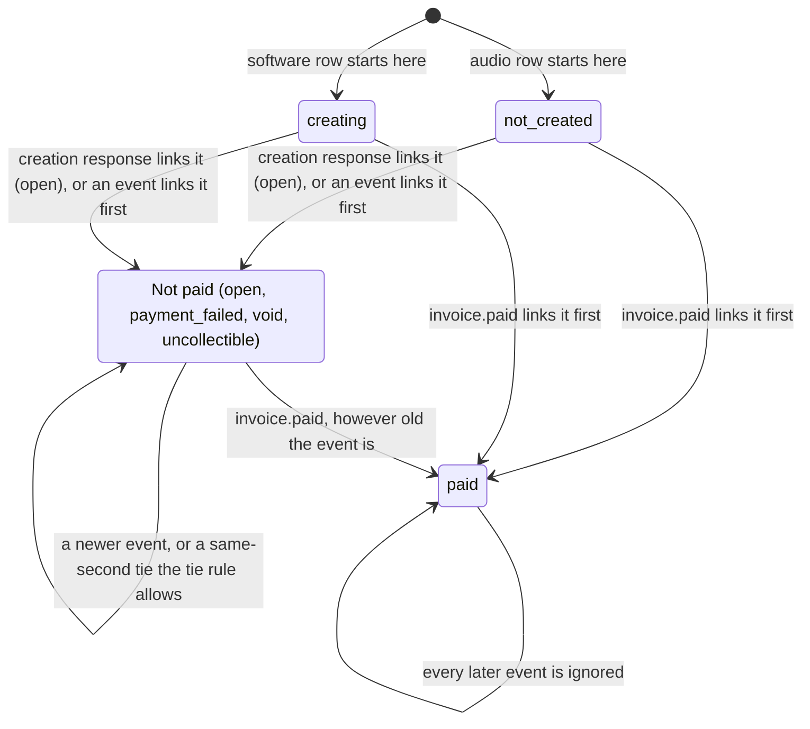
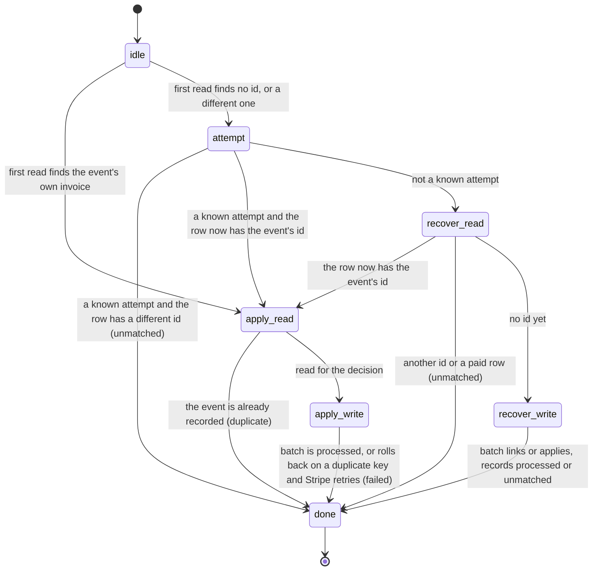

# Design-time verification: Quint models and LemmaScript contracts

Read this before writing a flow where order or timing matters, and before adding or changing a `//@` contract. It follows Tally's `docs/verification.md` (kwilson21/tally, decision 188) and keeps the same names, pins and CI step so the two repositories stay alike. The website differs from Tally in one way, by owner decision (2026-11-12): the Quint models are committed and run in CI, and their mutants must fail there. Tally keeps its Quint models as uncommitted scratch aids.

## Why this exists

Stripe sends invoice events in any order, can send one twice, and our handlers run at the same time. In PR 251 an older `invoice.paid` was dropped because the rule ignored every event older than the stored one. Review then found two more holes by reading: a stale read race (the guard was chosen from a time read before a newer event committed), and a paid event overwriting a concurrently linked, different Stripe invoice id. The model below finds all three without anyone having to think of them, and when it was extended to the audio path where the invoice is not linked yet, it found two more in code that was live: a paid event parked as a conflict because the invoice was linked a moment earlier, and a late recovery batch undoing a tie. Both are fixed (see "What the model found").

## When to use which

| Tool | Use it when | It checks |
|---|---|---|
| XState diagram | The rule is states and moves | Which moves exist. Draw it first (the diagram below is the invoice status one). |
| Quint model | Order, timing, retries or interleaving matter: webhooks, queues, anything that reads, waits, then writes | Properties hold after the orders of events and steps it searches, up to a bound (see "What is checked") |
| LemmaScript contract | A pure function decides something about money | The code meets a stated rule for every input inside a stated bound |
| Ordinary test | Everything else, and always alongside the above | The cases someone thought of |

A Quint model is written before the code exists, from the design. A LemmaScript contract is written for a pure function that has a plain-sentence rule.

## Invoice status moves

An older non-paid event is ignored. Audio: the later arrival wins a same-second tie. Software: the higher rank wins (paid, void, uncollectible, payment_failed, open). An event for a different Stripe invoice than the linked one never changes the row.

Each delivery of an event is several steps with other deliveries in between. Audio (software skips the attempts and recovery steps):

## What is checked

Be exact about the strength of each check:

- **CI, every run:** `quint run` random simulation. The invoice-events model (audio and software) runs 100,000 random executions of up to 20 steps with a fixed seed, and the discount-offers model 10,000 (its steps cost about three times as much); every property must hold in every state of every execution. This is strong evidence, not a proof: a rare interleaving can be missed. The mutants (below) are what show it finds real bugs.
- **By hand, before changing the rule:** `pnpm run verify:quint:exhaustive` runs Apalache, which searches every order of events and steps up to a step bound, with 3 events, 3 timestamps, 2 Stripe invoice ids and 3 handler runs. It needs Java 17 or newer, downloads Apalache on first use, and is slow (minutes at a shallow bound, hours past about 9 steps), so CI does not run it. Run it before changing a modelled rule, and say the bound and the result in the PR. Its bound is shallower than the random runs reach, so it complements them; it does not replace them. Recorded results are in "Exhaustive runs" below.
- **LemmaScript and Dafny, every CI run:** a proof, for every input, of the contracts on the invoice event decision and on the discount money rule (see "Verified modules").

## Tools and pins

- **Quint** (`@informalsystems/quint` 0.33.1, pinned exactly). Dev and CI only; it never reaches the Worker.
- **LemmaScript** (`lemmascript` 0.6.6, pinned exactly, the same as Tally) reads ordinary TypeScript with `//@` comments, which do nothing when the app runs.
- **Dafny** 4.9.0 (the same as Tally; ships its own Z3 prover) does the checking for `lsc`. It is not an npm package. CI downloads it by version and checksum. To run it locally, unpack the 4.9.0 release for your machine and put its folder on `PATH`.
- **Quint's Rust evaluator** 0.7.1 (the version Quint 0.33.1 expects). By default Quint downloads it from a GitHub release over the unauthenticated API with no checksum. CI instead downloads the exact release asset by URL (`https://github.com/quint-co/quint/releases/download/evaluator/v0.7.1/quint_evaluator-x86_64-unknown-linux-gnu.tar.gz`), checks its sha256 (`ce0502bd...f5eb`, the same value GitHub publishes for the asset and the value computed from the downloaded file) and places it under `QUINT_HOME`, where Quint looks first, so Quint downloads nothing. No `actions/cache` step is used: the file is under 1 MB, and a cache would add a copy that is not checked against the digest. When Quint is upgraded, update the version, URL and digest together.

| Command | What it does |
|---|---|
| `pnpm run verify:quint:all` | Both checks below in one pool of runs, longest first (what CI runs) |
| `pnpm run verify:quint` | The current rule keeps every property, in every model (audio, software, discount) |
| `pnpm run verify:quint:mutants` | Every mutant breaks the property named for it, every equivalent mutant keeps them all, and every property of every model has a mutant; fails otherwise |
| `pnpm run verify:quint:exhaustive` | Manual: Apalache search of every model's exhaustive modules (see above) |
| `pnpm run verify:dafny` | `lsc check --backend=dafny` on the files in `LemmaScript-files.txt` |

The driver (`scripts/verify-quint.mjs`, the models and their mutants in `scripts/lib/quint-mutants.mjs`, result parsing in `scripts/lib/quint-run.mjs`, tested in `tests/scripts/quint-run.test.ts`) prints each check with its run time and counts a model run as passing only on exit status 0 and the exact line `[ok] No violation found`. A mutant counts as breaking its property only on a non-zero exit with the lines `[violation] Found an issue` and `error: Invariant violated` for the named property. A parse error, a crash, a missing evaluator or truncated output is a failure, never a pass: Quint also prints `[ok] Rust evaluator installed at: ...` when it fetches its evaluator, and that line is ignored.

## The invoice-events model

File: `verification/invoice-events.qnt`. One invoice row.

**State.** The stored row (status, status time with 0 meaning SQL NULL, Stripe invoice id with 0 meaning none, and the event that linked it by recovery), the invoice ids in the attempts table (audio), the event ids recorded as processed, the event ids recorded as unmatched, the events Stripe has sent (status, created time, Stripe invoice id) and up to four handler runs, each remembering what it read.

**Start states.** Audio rows start `not_created` with no id; software rows start `creating` with no id. Software's match at read requires `creating` when no id is stored.

**Actions.**
- `link`: the creation response links the real Stripe invoice id. Audio (`recordInvoice`): only while the row has no id and is `not_created`, and it inserts the attempt row with it. Software (`recordSoftwareInvoice`): while the row has no id or this id; `creating` becomes `open`.
- Audio, the webhook's steps: the first read of the row; the known-attempt check (a known attempt whose invoice is now linked to the event's id goes on to apply, any other known attempt is a conflict); recovery's own read (same rule); recovery's batch (link the row if it has no id and is not paid, else apply through the guarded update; record the attempt and the processed event if the row has the event's id, or the event as unmatched if it has another); and the apply path (duplicate check and row read, then the write batch).
- Software: the read (match, then duplicate check) and the write batch.
- The write batch is one atomic step against the row as it is when the batch runs, guarded as the SQL is: not paid, the id pin, the time guard. Audio's apply path also needs its stale-read decision (`invoiceEventDecision`) to say apply, and a duplicate event id at write time rolls the whole batch back (the primary key), so the webhook answers 500 and Stripe retries; that retry is a later delivery of the same event. Software's write-time duplicate returns processed and leaves the row alone.

Events are created up front with any status, one of three times and one of two Stripe invoice ids. Delivery order, redelivery and interleaving are chosen freely, so any number of handlers can have read before any writes.

**Properties** (all must hold in every state; `allProperties` is their conjunction):
1. `paidAbsorbing`: once the stored status is paid it never changes.
2. `moneyNotLost`: when every started delivery has finished, a delivered paid event for the linked Stripe invoice always ends paid, and its delivery does not end unmatched.
3. `noStaleOverwrite`: a non-paid event older than the stored time never replaces a non-paid status.
4. `idNeverOverwritten`: a stored Stripe invoice id is never replaced by a different one, and an event for a different id never changes the status.
5. `oneOutcome`: every finished delivery ends in exactly one of processed, unmatched, duplicate or (audio) failed-and-retried; the outcome agrees with what was recorded; an event is never both processed and unmatched, including across a retry.
6. `realStoredTime`: the stored time is 0 or the time of a real event, never the far-future guard value.
7. `tieRule`: a same-second tie between two non-paid events resolves by the domain's rule (audio: the later arrival applies; software: the higher rank applies).
8. `redeliveryInert`: an event already recorded as processed never changes the row again.
9. `differentIdUnmatched`: an event for a different Stripe invoice than the stored one ends unmatched and never processed.

Properties 3, 4, 7 and 8 use flags that a write step sets from the row as it really is at write time, not from the stale read, so a rule that trusts a stale read cannot hide its own mistake.

### Mutants: proof that the model has teeth

Each mutant is a module (`audioX` and `softwareX`) that changes one thing. The driver fails if a mutant does not break its property, and it fails if any property in `allProperties` has no mutant.

| Mutant | The change | Breaks |
|---|---|---|
| `OldRule` | PR 251 bug a: ignore any event older than the stored time, even a paid one | `moneyNotLost` |
| `StaleGuard` | PR 251 bug b: the guard time is chosen from the stale read | `moneyNotLost` |
| `NoIdPin` | PR 251 bug c: the write guard does not pin the Stripe invoice id (software: the write batch; audio: recovery's guarded update) | `idNeverOverwritten` |
| `PreFixLink` (audio) | The unlinked-invoice bug: an event whose id equals the id just linked is parked as a conflict | `moneyNotLost` |
| `RecoverNoDupGuard` (audio) | The recovery batch's guarded update does not refuse an event already processed | `redeliveryInert` |
| `NoTimeGuard` | The write guard has no time comparison | `noStaleOverwrite` |
| `OverwritePaid` | The write guard does not refuse a paid row | `paidAbsorbing` |
| `NoDupDetection` (audio) | A recorded event is not recognised again, at read or at write | `redeliveryInert` |
| `NoRank` (software) | A same-second tie never applies (the rank tie-break is gone) | `tieRule` |
| `RankGe` (software) | A tie applies on equal rank (`>=` for `>`) | `tieRule` |
| `AudioLt` (audio) | The write guard is `<` instead of `<=` | `tieRule` |
| `NeverUnmatched` | An event for a different Stripe invoice is not recorded as unmatched | `differentIdUnmatched` |
| `ProcessedOnMismatch` (software) | Processed is recorded even though the id no longer matches | `oneOutcome` |
| `StoreGuardTime` | The guard time is stored as the event time | `realStoredTime` |

**Equivalent mutants** keep every property, and the driver checks that they do. A reviewer found that three real changes to the code pass every property; none can be seen from outside this model, and the reasons are arguments, checked here only by sampling:
- `audioNoDecision`: audio ignores its stale-read decision (`invoiceEventDecision` in `applyStripeInvoiceEvent`). The stored time only moves forward and a paid row never changes, so whatever the read said is ignore, the write guard refuses too. In this model the audio TypeScript decision is redundant with the SQL guard: a second line of defence, not something a property can depend on.
- `softwareNoDupDetection`: software without duplicate detection. A software event applied twice leaves the same row, because the rank rule only moves forward and a repeat is a tie of equal rank.
- `softwareNoReadUnmatched`: no unmatched check at read, for the Stripe id and `creating` part of that check only. The write batch's id pin records the event as unmatched for the same reason. In the code the read also rejects a wrong amount, currency, offer, kind or milestone, which the write batch does not re-check; the mutant does not remove those (they are not modelled, see below).

### What the model found

- **A paid event parked as a conflict when the invoice was linked at the same moment** (audio, live; model mutant `PreFixLink`). `invoice.sent` and `invoice.paid` for the same Stripe invoice arrive before the creation response is recorded. The webhook reads the row (no id), then the first event's recovery or the creation response links the invoice and inserts its attempt row; the paid event then finds a known attempt, or recovery's own read finds a stored id, and records the event as an `invoice-conflict` unmatched event. Stripe got 200 and does not retry, so the row stayed linked to the right invoice but not paid. Fixed: an id equal to the event's is applied through the normal guarded path; a different id is still a conflict. The webhook re-reads the row after a known attempt, and recovery returns `current` when the row already has the event's invoice.
- **A late recovery batch undoing a tie** (audio, live; mutant `RecoverNoDupGuard`). The recovery batch's guarded update did not refuse an event that was already recorded as processed. If the first event's recovery batch ran after the invoice was linked, the event had been processed through the normal path and a later event had won the same second, the stale batch put the first event back. Fixed with a `NOT EXISTS` on the processed table in that update and its audit row.
- **Software is not affected by the first.** Its read matches a row that is still `creating` and its write guard accepts a row with no id or the same id, so a paid event for the right invoice applies whether or not the creation response linked it first (test: "software: a paid event applies when the creation response links the same Stripe invoice between its read and its batch").

### What it does not cover

- Refunds, voids of a paid invoice, amount or currency changes, partial payments. The site does not handle refunds, and Stripe cannot void or mark a paid invoice.
- Invoice replacement (`replaceTerminalInvoice`): a void invoice's id is cleared and a new one created. The stored id never changes once set in the model, so the pin on audio's apply path (`booking_invoice_id=?` in `applyStripeInvoiceEvent`) is unexercised; only recovery's pin is.
- Replacement after the re-read: once the row's id X is seen, `replaceTerminalInvoice` can clear X, and `applyStripeInvoiceEvent` then finds no row, so the event is answered 200 with nothing recorded. Only void invoices can be replaced and a void invoice cannot be paid, so no payment is lost. The model's `audioAttempt` step folds the attempts check and the re-read into one step, and would need splitting if replacement is ever modelled.
- Retention deleting external references (`external_refs_deleted_at`, `retention_fenced_at`), and the balance needing the booking paid.
- The rest of the creation flow (`creating` timeouts, creation retries). `link` stands in for the creation response and is atomic.
- The software read's amount, currency, offer, kind and milestone checks (a mismatch is recorded unmatched at read), and the amounts and currency checks in recovery (`invalidInvoice` other than a paid row), and an audio row that is paid with no invoice id (a manual payment).
- A stored id that is not the real invoice (an event for a different Stripe invoice arrived first and linked itself): the model checks that nothing is overwritten, not that the owner is told; reconciliation covers that.
- Two invoices at once, owner actions, and anything outside the invoice row (audit rows, milestone payments).
- Bounds larger than 3 events, 3 timestamps, 2 invoice ids and 4 handler runs (3 for the exhaustive run).

If the code changes shape (a new status, a new guard), update the model in the same PR and check that the mutants still fail.

### Exhaustive runs

`pnpm run verify:quint:exhaustive [steps]` (default 7 steps; both domains, one after the other). It uses `audioExhaustive` and `softwareExhaustive`: 3 events, 3 timestamps, 2 Stripe invoice ids and 3 handler runs. The bound is in steps, and an audio delivery takes up to 5 of them, so a depth of 7 reaches the unlinked-invoice bug (a delivery, the link, the attempts check: 3 steps) but not the recovery-guard bug (it needs about 11). Last run (2026-11-13, Apalache 0.62.4, one core, Apple-silicon laptop): `audioExhaustive` and `softwareExhaustive` at 7 steps, no violation, 2 minutes 1 second for both. At 8 steps (`pnpm run verify:quint:exhaustive 8`): no violation in either domain, 5 minutes 41 seconds for both. An earlier, smaller audio model finished 9 steps in 8 minutes 45 seconds; the extended audio model at 10 steps did not finish (stopped after about 15 minutes, still inside step 9). Past about 8 steps use the random runs instead.

## The discount-offers model

File: `verification/discount-offers.qnt`, written before the code from the design in `docs/plans/2026-11-discount-flow.md` (owner decisions of 2026-11-13). One software request whose offer carries a discount per milestone, while the owner drafts, edits, sends and declines and the client reviews and signs, with invoices reserved before and after a revision. Module `discount` (2 offer versions).

**State.** The offer versions (status none, draft, sent, superseded or withdrawn, and their terms: the discount on each of two milestones and the payment mode), the terms each version had when it was sent, whether the request is open, the client's review (version, the terms its text was rendered from, revoked or not), the signature (version and terms), the project's version and its own copy of the terms (`software_projects.terms_json`, which the client's project page reads), and twelve invoice slots (version, milestone, kind), each none, open, paid or void with its amount. Usual fees are 5 and 4 units, where 1 is the $1 minimum, so every split has an odd fee somewhere.

**Actions**, each one step, in any order: a new draft with any discount; editing the draft (`UPDATE ... WHERE status='draft'`); sending (supersedes the sent offer, revokes the review session; refused after the client signed and while another version has an open or paid first deposit); declining (refused while a deposit is open, not while one is paid); reopening; opening review; signing (the batch's live-signing and session guards); starting the project (copies the signed offer's terms into the project, needs the first deposit paid on standard terms); the invoice reservation's read (amount from the offer's `terms_json`, which the code reads also after the project starts, not the project's copy) and its batch (re-checks that the offer is still sent, or the project's); Stripe paying or voiding an invoice.

**Properties** (`allProperties`):
1. `invoicedMatchesSigned`: every open or paid invoice of the signed version is the installment the signed terms give, so the invoices of a signed offer add up to what the client signed for; the project's copy of the terms is the signed terms, so the installments the project page states are the ones invoiced.
2. `sentTermsFrozen`: a version keeps the terms it was sent with, discount included; the signed terms are that version's.
3. `oneVersionInvoiced`: all open or paid invoices belong to one version.
4. `installmentsSum`: every version's installments add up to its discounted total.
5. `supersededInert`: no sign or invoice batch writes for an offer that is not sent at that moment, and a signed offer stays the sent one.

| Mutant | The change | Breaks |
|---|---|---|
| `discountEditSent` | The draft update does not require status draft | `sentTermsFrozen` |
| `discountLatestTerms` | The invoice amount comes from the newest version's terms | `invoicedMatchesSigned` |
| `discountStartCopiesNewest` | Start copies the newest version's terms into the project, not the signed offer's | `invoicedMatchesSigned` |
| `discountStartDropsDiscount` | Start copies the signed offer's terms without the discount fields | `invoicedMatchesSigned` |
| `discountDepositFromUsual` | The deposit is half the usual fee | `installmentsSum` |
| `discountNoDepositGuard` | Send ignores another version's deposit | `oneVersionInvoiced` |
| `discountTodayDepositGuard` | The deposit guard as the code has it today (only the sent offer counts) | `oneVersionInvoiced` |
| `discountNoWriteStatusGuard` | The invoice batch trusts its stale read | `supersededInert` |
| `discountNoSignGuards` | The sign batch has neither the live-signing nor the session check | `supersededInert` |
| `discountSendAfterSign` | Send is allowed after the client signed | `supersededInert` |

**Found by the model.** `discount` includes a guard the code does not have yet: send refuses while any other version has an open or paid first deposit. Today's guard counts only the sent offer, so after a decline with a paid deposit and a reopen, new terms can be sent and a second deposit invoiced (`discountTodayDepositGuard`). It is to be reproduced against the real handlers and fixed if real (PR 2 of the plan); until then this model describes the intended code on that path.

**Witnesses.** The pass run alone does not show that deep states are reached, so two negated witnesses were run by hand (`quint run verification/discount-offers.qnt --main discount --invariant <witness> --max-steps 40 --max-samples 100000 --seed 0x1`): `neverFullyPaidAfterRevision` (a project from the second version, discounted, every installment paid, on invoice terms; found within 20 steps) and `neverStandardPaidAfterSentRevision` (the same on standard terms after the first version was sent and superseded; about 19 steps). Each is violated within a second, as it should be.

**What it does not cover.** Refunds; the order of milestones and delivery gating (once the project starts, any installment of the plan may be invoiced); a third milestone; three or more offer versions; retention; Stripe event order and redelivery (the invoice-events model); the amounts and copy on pages and in the SOW (tests). An invoice slot holds one live row, which is what the reservation's guards give, not something this model checks.

**Exhaustive.** `discount` is in the exhaustive list. Run once at 3 steps (2026-11-13, Apalache 0.62.4): no violation, 15 seconds. Run it deeper before changing a modelled rule of the offer flow.

## Verified modules

Tally's four questions decide whether a function carries a contract: is it pure, does its rule involve a sum, count, partition or conservation law, would a break lose or miscount money, and can the rule be said in one plain sentence. The decision function is pure and a break loses money. Question two is met loosely (the rule is "money received is never lost"), and the owner asked for it (2026-11-13), so it is in. `guardTime` is not: it is one conditional, a test says it as clearly, and the model checks that its value is never stored.

| Module | Rule (one sentence) |
|---|---|
| `src/lib/invoice-event-order.ts` `decideByOrder` (spec helper `rankOf`) | For any stored and incoming status and any time relation (first, older, same, newer): a paid invoice is never changed; a paid event applies to any invoice that is not paid; otherwise an event applies exactly when it is the first, or newer, or in a same-second tie the tie rule allows (audio: always; software: higher rank). |
| `nextStatus`, `statusAfter` | Lemmas by induction over a sequence of events, not restatements of the body: a paid invoice stays paid whatever follows, and a sequence of events that contains a paid event ends paid in whatever order the events arrive (so for any two events where one is paid, both orders end paid). |
| `invoiceEventDecision` (called by the audio handlers) | A paid invoice is never changed, and a paid event applies to any invoice that is not paid, whatever the times. The time comparison itself is not specified (see below). |
| `tests/fixtures/discount-installments.ts` (reference, not product code) `discountedInstallment`, `milestoneCharged`, `offerCharged` | For every usual fee up to $1,000,000 and whole-dollar discount (a multiple of 100 cents; decision 6 of the plan) that leaves the client at least $1 per milestone: every installment is whole, non-negative and never more than without the discount (a deposit at least 50 cents), equals today's amount when the discount is 0, and the installments of up to three milestones add up exactly to the usual total less every discount. `allowedMilestone` is exactly the validation rule: a discount that is not whole dollars, or leaves less than $1, is refused. |

The contract is stated over the time relation, not two time strings. `invoiceEventDecision` computes the relation with `relateTimes` and calls `decideByOrder`. That split is a behaviour-preserving rewrite for the tool, and the status ranks moved from a `Map` to `rankOf` for the same reason. The relation is named `first` (not `none`) because the tool's generated Dafny already has a `None`.

`relateTimes` and `invoiceEventDecision` are translated and checked but only the two paid rules are specified for the composed function. LemmaScript reads the string comparison as a lexicographic order, but proving that two times are "same" only when equal needs a hand-written Dafny lemma about that recursive order, which would mean committing a `.dfy` file. The 75-row matrix in `tests/lib/invoice-event-order.test.ts` covers the time relation instead.

A redelivery lemma (handling an event a second time leaves the status as it was) was tried and dropped: it holds for any deterministic rule of this shape, so no planted bug can break it. Redelivery against the real handlers is the `redeliveryInert` property of the model.

LemmaScript cannot express the whole delivery flow (reads, writes, interleaving, two tables), so what remains for Quint is: redelivery against the real handlers, the stale read race, concurrent linking, the id pin, and the outcome of every delivery.

The discount rule is written before its code, as a reference under `tests/fixtures/` that nothing in `src/` imports. `tests/verification/discount-installments.test.ts` holds it to the live `softwareInvoiceTerms` (equal with no discount on a table of fees, equal on the lower fee with a discount), so the contract is about the code that runs. When the discount lands, the product module takes the contract and this reference is deleted. Its contracts first ran in CI on PR 265 (`87de79fa`) and passed; no planted bug has been run against them yet.

`rankOf` has a second copy in the SQL of `applySoftwareInvoiceEvent` (the `eligible` clause). `tests/lib/invoice-rank-sql.test.ts` reads both `CASE` expressions out of `src/lib/software-invoices.ts`, runs them on sqlite for every status and compares them with `rankOf`, so the copies cannot drift.

Planted bugs the prover rejected (a contract that passes on broken code proves nothing): the original bug (ignoring an older paid event before the paid shortcut), letting a newer event change a paid invoice, removing the paid shortcut (fails the paid-sequence lemma too), and a rank tie that applies on equal rank. Each fails with "a postcondition could not be proved".

## How a verified module is written

Follow Tally: one file per module listed in `LemmaScript-files.txt`; mark verified functions with `//@ verify` (once any function in a file has it, only marked ones are checked); use `//@ skip` for code the tool cannot read, with a one-line reason; never `//@ assume`; keep the production code natural. `lsc check` leaves a `.dfy` and `.dfy.gen` beside the module. `.gitignore` names them per module (one pair of lines per file in `LemmaScript-files.txt`); a module that ever needs a hand-written proof loses its lines and commits its `.dfy`. Delete them before re-checking a changed function, because with a stale `.dfy` present `lsc` stops before Dafny runs. Inline object types in a parameter list do not translate; use a named type or separate arguments.

## Supply chain and install size

`lemmascript` depends on `lemmascript-claimcheck`, which pulls `claimcheck` and the Anthropic SDKs; Tally's lockfile has the same chain, so the roughly 190 added dev packages are not specific to this repository. `lsc check` does not use them. A pnpm override `lemmascript-claimcheck: "-"` in `pnpm-workspace.yaml` removes that chain (in a scratch project, `lemmascript` alone went from 133 to 28 installed packages, and `lsc check` on this repository's module still printed "8 verified, 0 errors"). It is not applied here, to stay identical to Tally; apply it to both repositories together if the install size matters.

## CI

`.github/workflows/validate.yml` installs Dafny 4.9.0 and Quint's evaluator by version and checksum, then runs `verify:dafny` and one Quint step, "Quint models keep their properties and their mutants fail" (`verify:quint:all`). No new GitHub Action is used.

The Quint runs are independent, so the driver runs them in one pool, up to the number of CPUs (`QUINT_JOBS` sets a smaller number, to see locally what a smaller runner would take). Each run is one process on one core: the evaluator's `--n-threads` made no difference to a single seeded run here. Runs that must pass (the three pass runs and the three equivalent mutants) start first, largest sample count first, and the mutants, which stop at their first violation within seconds, fill the free cores. Each printed line ends with that run's time.

Why one pool: with the discount model added, two separate steps took 76 s and 125 s on the runner (3 minutes 21 seconds). The second step started the three equivalent mutants (each a full 100,000-run pass) last, so three cores ran long after the rest had finished. Measured locally, on a 12-core laptop shared with other work, so only roughly: the work is about 230 CPU-seconds, mostly the invoice-events pass runs and its equivalent mutants (about 30 to 40 s each); the discount model adds about 25 (its pass run about 12, its ten mutants about 14 together). Estimate for a 4-core runner, scaling each run by the factor the old first step shows (76 s for a run that takes about 38 s here): about 115 to 130 s for the one step, against a budget of 2 minutes 30 seconds; measure it on the PR. The startup of each `quint run` (about 1 s of parsing and checking the model) is a fixed cost per mutant.
