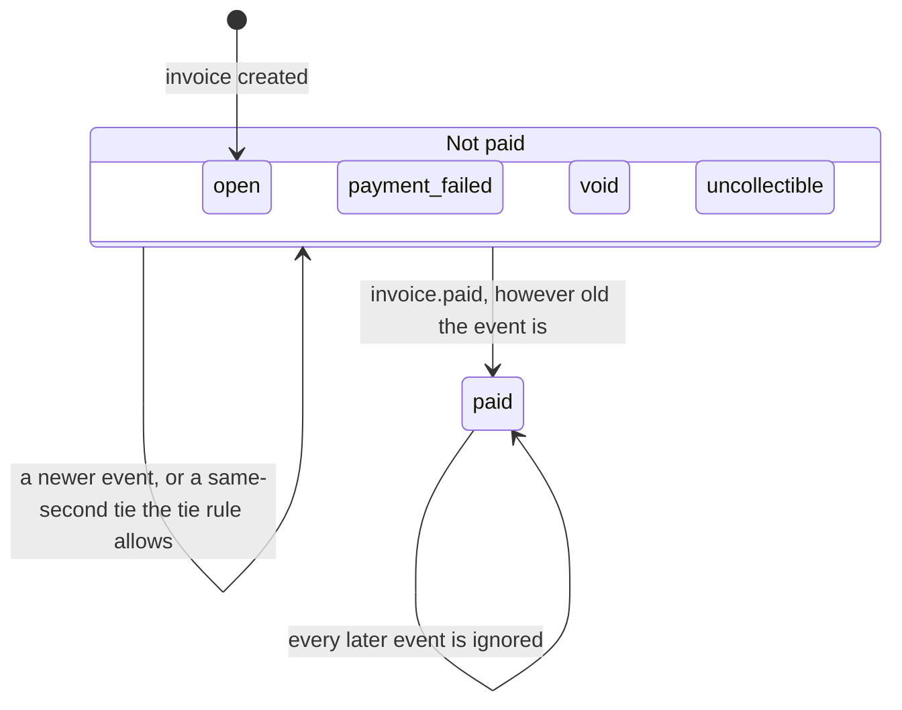
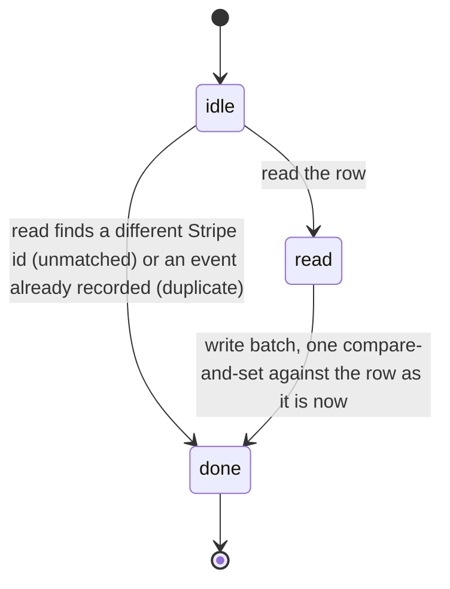

# Design-time verification: Quint models and LemmaScript contracts

Read this before writing a flow where order or timing matters, and before adding or changing a `//@` contract. It follows Tally's `docs/verification.md` (kwilson21/tally, decision 188) and keeps the same names, pins and CI step so the two repositories stay alike. The website differs from Tally in one way, by owner decision (2026-11-12): the Quint model is committed and runs in CI, and its mutants must fail there. Tally keeps its Quint models as uncommitted scratch aids.

## Why this exists

Stripe sends invoice events in any order, can send one twice, and our handlers run at the same time. In PR 251 an older `invoice.paid` was dropped because the rule ignored every event older than the stored one. Review then found two more holes by reading: a stale read race (the guard was chosen from a time read before a newer event committed), and a paid event overwriting a concurrently linked, different Stripe invoice id. A model that tries every order finds all three without anyone having to think of them. The `invoice-events` model below does that, and its mutants are those three bugs.

## When to use which

| Tool | Use it when | It checks |
|---|---|---|
| XState diagram | The rule is states and moves | Which moves exist. Draw it first (the diagram below is the invoice status one). |
| Quint model | Order, timing, retries or interleaving matter: webhooks, queues, anything that reads, waits, then writes | Properties hold after every order of events and steps it tries, up to a bound |
| LemmaScript contract | A pure function decides something about money | The code meets a stated rule for every input inside a stated bound |
| Ordinary test | Everything else, and always alongside the above | The cases someone thought of |

A Quint model is written before the code exists, from the design. A LemmaScript contract is written for a pure function that has a plain-sentence rule.

## Invoice status moves

An older non-paid event is ignored. Audio: the later arrival wins a same-second tie. Software: the higher rank wins (paid, void, uncollectible, payment_failed, open).

Each delivery of an event is two steps with other deliveries in between:

## Tools and pins

- **Quint** (`@informalsystems/quint` 0.33.1, pinned exactly). Dev and CI only; it never reaches the Worker.
- **LemmaScript** (`lemmascript` 0.6.6, pinned exactly, the same as Tally) reads ordinary TypeScript with `//@` comments, which do nothing when the app runs.
- **Dafny** 4.9.0 (the same as Tally; ships its own Z3 prover) does the checking for `lsc`. It is not an npm package. CI downloads it by version and checksum. To run it locally, unpack the 4.9.0 release for your machine and put its folder on `PATH`.

| Command | What it does |
|---|---|
| `pnpm run verify:quint` | The current rule keeps every property, for the audio and software domains (200,000 random runs of up to 14 steps each, fixed seed) |
| `pnpm run verify:quint:mutants` | Each mutant must break its property; the command fails if one does not |
| `pnpm run verify:dafny` | `lsc check --backend=dafny` on the files in `LemmaScript-files.txt` |

`quint run` samples random executions, so a green run is strong evidence and not a proof, and the bound is small (3 events, 3 timestamps, 4 handler runs). A wider search by hand is `pnpm exec quint verify verification/invoice-events.qnt --main audio --init init --step step --invariant allProperties --max-steps 9`, which runs Apalache (needs Java 17 or newer, downloads Apalache on first use). It is slow, so CI does not run it.

## The invoice-events model

File: `verification/invoice-events.qnt`. One invoice row.

**State.** The stored status, the stored status time (0 means none yet, as SQL NULL), the stored Stripe invoice id (0 means none), the event ids recorded as processed, the event ids recorded as unmatched, the events Stripe has sent (status, created time, Stripe invoice id), and up to four handler runs.

**Actions.**
- `link`: the creation response links the real Stripe invoice id (`recordSoftwareInvoice`: `id IS NULL OR id = ?`).
- `read(d, e)`: a handler run starts for event `e` (a first delivery or a redelivery) and reads the row. It finishes at once when the stored id is a different Stripe invoice (unmatched) or the event is already recorded (duplicate); otherwise it keeps what it read and waits to write.
- `write(d)`: the handler's batch, one atomic step against the row as it is when the batch runs, guarded as the SQL is: not paid, the id pin, the time guard. Audio also needs its stale-read decision (`invoiceEventDecision`) to say apply.

Events are created up front with any status, one of three times and one of two Stripe invoice ids. Delivery order, redelivery and interleaving are chosen freely, so two handlers can both read before either writes. Both domains are checked: `audio` (later arrival wins a same-second tie; the decision is made on the read) and `software` (higher rank wins; the SQL guard alone decides).

**Properties** (all must hold in every reachable state):
1. `paidAbsorbing`: once the stored status is paid it never changes.
2. `moneyNotLost`: when every started handler run has finished, a processed paid event for the linked Stripe invoice means the stored status is paid.
3. `noStaleOverwrite`: a non-paid event older than the stored time never replaces a non-paid status.
4. `idNeverOverwritten`: a stored Stripe invoice id is never replaced by a different one, and an event for a different id never changes the status.
5. `oneOutcome`: every finished run ends as exactly one of processed, unmatched or duplicate, and no event is both processed and unmatched.
6. `realStoredTime`: the stored time is 0 or the time of a real event, never the far-future guard value.

Properties 1, 3 and 4 use flags that a write step sets from the row as it really is at write time, not from the stale read, so a rule that trusts a stale read cannot hide its own mistake.

### Mutants: proof that the model has teeth

Each mutant is a module that changes one thing about the rule. `pnpm run verify:quint:mutants` runs them and fails if any property still holds.

| Module (audio and software) | The bug | Breaks |
|---|---|---|
| `OldRule` | The original rule: ignore any event older than the stored time, even a paid one | `moneyNotLost` |
| `StaleGuard` | The guard time is chosen from the stale read: far future only if the read time was newer than the event | `moneyNotLost` |
| `NoIdPin` | The write guard does not pin the Stripe invoice id | `idNeverOverwritten` |
| `NoTimeGuard` | The write guard has no time comparison | `noStaleOverwrite` |
| `OverwritePaid` | The write guard does not refuse a paid row | `paidAbsorbing` |

The first three are the real bugs. The last two keep properties 1 and 3 from being vacuous. A new property needs a mutant that breaks it.

### What it does not cover

- Refunds, voids of a paid invoice, amount or currency changes, partial payments. The site does not handle refunds, and Stripe cannot void or mark a paid invoice.
- Retention deleting external references (`external_refs_deleted_at`, `retention_fenced_at`).
- The invoice creation flow itself (`creating`, retries, known invoice attempts). `link` stands in for the creation response.
- The audio recovery path is folded in: an event may link the row when no id is stored. In code that is the software write pin (`IS NULL OR =?`) and audio's `recoverInvoiceFromWebhook`, which differ in detail.
- If an event for a different Stripe invoice arrives first and links itself, that id stays and the real invoice's events are unmatched. The model checks that nothing is overwritten, not that the owner is told; reconciliation covers that.
- Two invoices at once, owner actions, and anything outside the invoice row (audit rows, milestone payments).
- Bounds larger than 3 events, 3 timestamps and 4 handler runs.

If the code changes shape (a new status, a new guard), update the model in the same PR and check that the mutants still fail.

## Verified modules

Tally's four questions decide whether a function carries a contract: is it pure, does its rule involve a sum, count, partition or conservation law, would a break lose or miscount money, and can the rule be said in one plain sentence. The decision function is pure and a break loses money. Question two is met loosely (the rule is "money received is never lost"), and the owner asked for it (2026-11-13), so it is in. `guardTime` is not: it is one conditional, a test says it as clearly, and the model checks that its value is never stored.

| Module | Rule (one sentence) |
|---|---|
| `src/lib/invoice-event-order.ts` `decideByOrder` (spec helper `rankOf`) | For any stored and incoming status and any time relation (none, older, same, newer): a paid invoice is never changed; a paid event applies to any invoice that is not paid; otherwise an event applies exactly when it is the first, or newer, or in a same-second tie the tie rule allows (audio: always; software: higher rank). |

The contract is stated over the time relation, not two time strings. `invoiceEventDecision` computes the relation with `relateTimes` (`//@ skip`: ISO timestamps compare as strings, which the prover does not model; the 75-row matrix in `tests/lib/invoice-event-order.test.ts` covers it) and calls `decideByOrder`. That split is a behaviour-preserving rewrite for the tool, and the status ranks moved from a `Map` to `rankOf` for the same reason. There is no numeric bound: the function only compares statuses as strings (an unknown status ranks 0).

Planted bugs the prover rejected (a contract that passes on broken code proves nothing): the original bug (ignoring an older paid event before the paid shortcut), letting a newer event change a paid invoice, removing the paid shortcut, and a rank tie that applies on equal rank. Each fails with "a postcondition could not be proved".

## How a verified module is written

Follow Tally: one file per module listed in `LemmaScript-files.txt`; mark verified functions with `//@ verify` (once any function in a file has it, only marked ones are checked); use `//@ skip` for code the tool cannot read, with a one-line reason; never `//@ assume`; keep the production code natural. `lsc check` leaves a `.dfy` and `.dfy.gen` beside the module (git-ignored). Delete them before re-checking a changed function, because with a stale `.dfy` present `lsc` stops before Dafny runs. Inline object types in a parameter list do not translate; use a named type or separate arguments.

## CI

`.github/workflows/validate.yml` installs Dafny 4.9.0 by version and checksum (the same download Tally's CI uses), then runs `verify:dafny`, `verify:quint` and `verify:quint:mutants`. No new GitHub Action is used.
