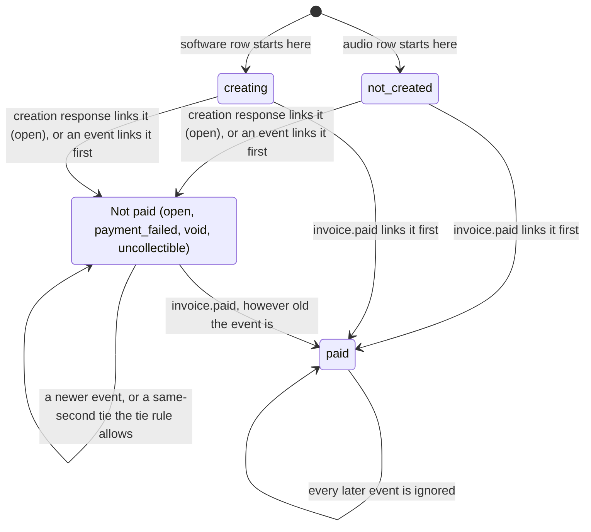
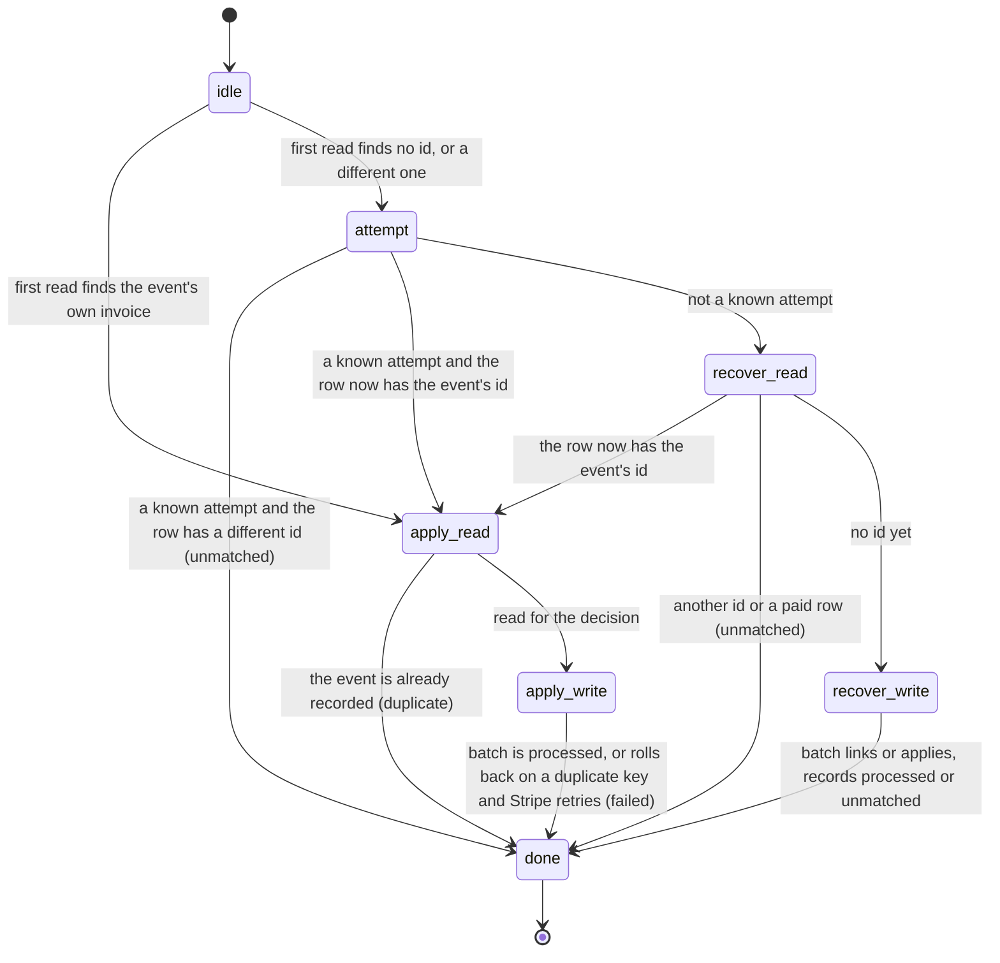
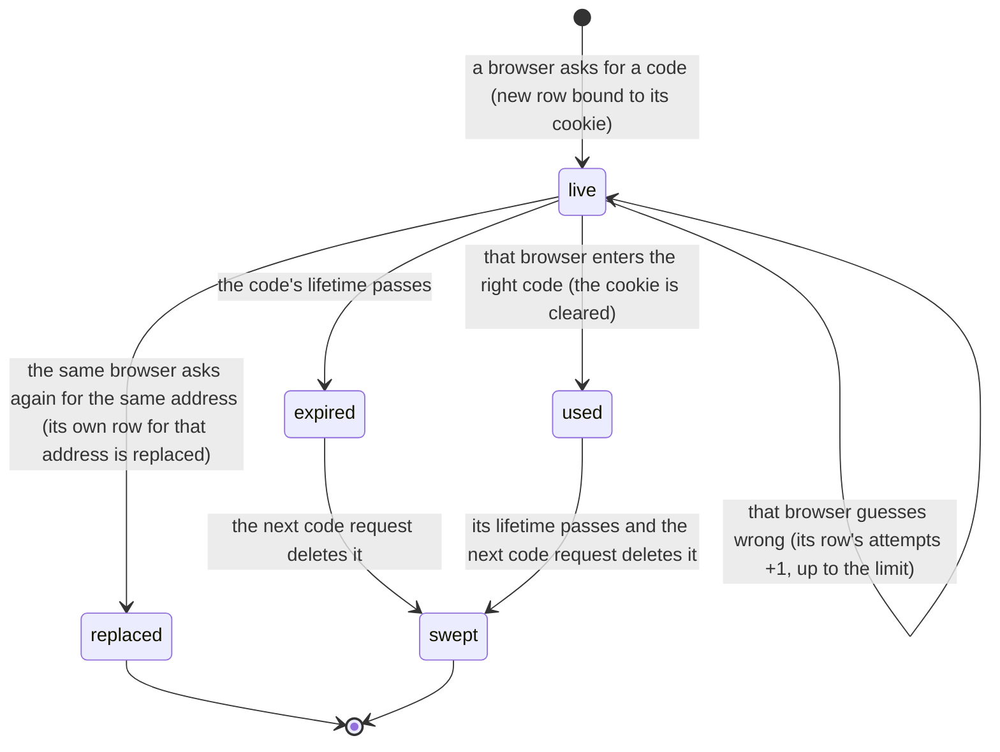

# Design-time verification: Quint models and LemmaScript contracts

Read this before writing a flow where order or timing matters, and before adding or changing a `//@` contract. It follows Tally's `docs/verification.md` (kwilson21/tally, decision 188) and keeps the same names, pins and CI step so the two repositories stay alike. The website differs from Tally in one way, by owner decision (2026-11-12): the Quint models are committed and run in CI, and their mutants must fail there. Tally keeps its Quint models as uncommitted scratch aids.

## Why this exists

Stripe sends invoice events in any order, can send one twice, and our handlers run at the same time. In PR 251 an older `invoice.paid` was dropped because the rule ignored every event older than the stored one. Review then found two more holes by reading: a stale read race (the guard was chosen from a time read before a newer event committed), and a paid event overwriting a concurrently linked, different Stripe invoice id. The model below finds all three without anyone having to think of them, and when it was extended to the audio path where the invoice is not linked yet, it found two more in code that was live: a paid event parked as a conflict because the invoice was linked a moment earlier, and a late recovery batch undoing a tie. Both are fixed (see "What the model found").

## When to use which

| Tool | Use it when | It checks |
|---|---|---|
| XState diagram | The rule is states and moves | Which moves exist. Draw it first (the diagram below is the invoice status one). |
| Quint model | Order, timing, retries or interleaving matter: webhooks, queues, anything that reads, waits, then writes | Properties hold after the orders of events and steps it searches, up to a bound (see "What is checked") |
| LemmaScript contract | A pure function decides something about money | The code meets a stated rule for every input inside a stated bound |
| Ordinary test | Everything else, and always alongside the above | The cases someone thought of |

A Quint model is written before the code exists, from the design. A LemmaScript contract is written for a pure function that has a plain-sentence rule.

## Invoice status moves

An older non-paid event is ignored. Audio: the later arrival wins a same-second tie. Software: the higher rank wins (paid, void, uncollectible, payment_failed, open). An event for a different Stripe invoice than the linked one never changes the row.

Each delivery of an event is several steps with other deliveries in between. Audio (software skips the attempts and recovery steps):

## What is checked

Be exact about the strength of each check:

- **CI, every run:** `quint run` random simulation. The invoice-events model (audio and software) runs 100,000 random executions of up to 20 steps with a fixed seed, and the discount-offers model 10,000 of up to 50 steps for each of its two modules (its steps cost about three times as much, and a send or a decline takes three of them); every property must hold in every state of every execution. This is strong evidence, not a proof: a rare interleaving can be missed. The mutants (below) are what show it finds real bugs.
- **By hand, before changing the rule:** `pnpm run verify:quint:exhaustive` runs Apalache, which searches every order of events and steps up to a step bound, with 3 events, 3 timestamps, 2 Stripe invoice ids and 3 handler runs. It needs Java 17 or newer, downloads Apalache on first use, and is slow (minutes at a shallow bound, hours past about 9 steps), so CI does not run it. Run it before changing a modelled rule, and say the bound and the result in the PR. Its bound is shallower than the random runs reach, so it complements them; it does not replace them. Recorded results are in "Exhaustive runs" below.
- **LemmaScript and Dafny, every CI run:** a proof, for every input, of the contracts on the invoice event decision and on the discount money rule (see "Verified modules").

## Tools and pins

- **Quint** (`@informalsystems/quint` 0.33.1, pinned exactly). Dev and CI only; it never reaches the Worker.
- **LemmaScript** (`lemmascript` 0.6.6, pinned exactly, the same as Tally) reads ordinary TypeScript with `//@` comments, which do nothing when the app runs.
- **Dafny** 4.9.0 (the same as Tally; ships its own Z3 prover) does the checking for `lsc`. It is not an npm package. CI downloads it by version and checksum. To run it locally, unpack the 4.9.0 release for your machine and put its folder on `PATH`.
- **Quint's Rust evaluator** 0.7.1 (the version Quint 0.33.1 expects). By default Quint downloads it from a GitHub release over the unauthenticated API with no checksum. CI instead downloads the exact release asset by URL (`https://github.com/quint-co/quint/releases/download/evaluator/v0.7.1/quint_evaluator-x86_64-unknown-linux-gnu.tar.gz`), checks its sha256 (`ce0502bd...f5eb`, the same value GitHub publishes for the asset and the value computed from the downloaded file) and places it under `QUINT_HOME`, where Quint looks first, so Quint downloads nothing. No `actions/cache` step is used: the file is under 1 MB, and a cache would add a copy that is not checked against the digest. When Quint is upgraded, update the version, URL and digest together.

| Command | What it does |
|---|---|
| `pnpm run verify:quint:all` | Both checks below in one pool of runs, longest first (what CI runs) |
| `pnpm run verify:quint` | The current rule keeps every property, in every model (audio, software, discount, sign-in codes) |
| `pnpm run verify:quint:mutants` | Every mutant breaks the property named for it, every equivalent mutant keeps them all, and every property of every model has a mutant; fails otherwise |
| `pnpm run verify:quint:exhaustive` | Manual: Apalache search of every model's exhaustive modules (see above) |
| `pnpm run verify:dafny` | `lsc check --backend=dafny` on the files in `LemmaScript-files.txt` |

The driver (`scripts/verify-quint.mjs`, the models and their mutants in `scripts/lib/quint-mutants.mjs`, result parsing in `scripts/lib/quint-run.mjs`, tested in `tests/scripts/quint-run.test.ts`) prints each check with its run time and counts a model run as passing only on exit status 0 and the exact line `[ok] No violation found`. A mutant counts as breaking its property only on a non-zero exit with the lines `[violation] Found an issue` and `error: Invariant violated` for the named property. A parse error, a crash, a missing evaluator or truncated output is a failure, never a pass: Quint also prints `[ok] Rust evaluator installed at: ...` when it fetches its evaluator, and that line is ignored.

## The invoice-events model

File: `verification/invoice-events.qnt`. One invoice row.

**State.** The stored row (status, status time with 0 meaning SQL NULL, Stripe invoice id with 0 meaning none, and the event that linked it by recovery), the invoice ids in the attempts table (audio), the event ids recorded as processed, the event ids recorded as unmatched, the events Stripe has sent (status, created time, Stripe invoice id) and up to four handler runs, each remembering what it read.

**Start states.** Audio rows start `not_created` with no id; software rows start `creating` with no id. Software's match at read requires `creating` when no id is stored.

**Actions.**
- `link`: the creation response links the real Stripe invoice id. Audio (`recordInvoice`): only while the row has no id and is `not_created`, and it inserts the attempt row with it. Software (`recordSoftwareInvoice`): while the row has no id or this id; `creating` becomes `open`.
- Audio, the webhook's steps: the first read of the row; the known-attempt check (a known attempt whose invoice is now linked to the event's id goes on to apply, any other known attempt is a conflict); recovery's own read (same rule); recovery's batch (link the row if it has no id and is not paid, else apply through the guarded update; record the attempt and the processed event if the row has the event's id, or the event as unmatched if it has another); and the apply path (duplicate check and row read, then the write batch).
- Software: the read (match, then duplicate check) and the write batch.
- The write batch is one atomic step against the row as it is when the batch runs, guarded as the SQL is: not paid, the id pin, the time guard. Audio's apply path also needs its stale-read decision (`invoiceEventDecision`) to say apply, and a duplicate event id at write time rolls the whole batch back (the primary key), so the webhook answers 500 and Stripe retries; that retry is a later delivery of the same event. Software's write-time duplicate returns processed and leaves the row alone.

Events are created up front with any status, one of three times and one of two Stripe invoice ids. Delivery order, redelivery and interleaving are chosen freely, so any number of handlers can have read before any writes.

**Properties** (all must hold in every state; `allProperties` is their conjunction):
1. `paidAbsorbing`: once the stored status is paid it never changes.
2. `moneyNotLost`: when every started delivery has finished, a delivered paid event for the linked Stripe invoice always ends paid, and its delivery does not end unmatched.
3. `noStaleOverwrite`: a non-paid event older than the stored time never replaces a non-paid status.
4. `idNeverOverwritten`: a stored Stripe invoice id is never replaced by a different one, and an event for a different id never changes the status.
5. `oneOutcome`: every finished delivery ends in exactly one of processed, unmatched, duplicate or (audio) failed-and-retried; the outcome agrees with what was recorded; an event is never both processed and unmatched, including across a retry.
6. `realStoredTime`: the stored time is 0 or the time of a real event, never the far-future guard value.
7. `tieRule`: a same-second tie between two non-paid events resolves by the domain's rule (audio: the later arrival applies; software: the higher rank applies).
8. `redeliveryInert`: an event already recorded as processed never changes the row again.
9. `differentIdUnmatched`: an event for a different Stripe invoice than the stored one ends unmatched and never processed.

Properties 3, 4, 7 and 8 use flags that a write step sets from the row as it really is at write time, not from the stale read, so a rule that trusts a stale read cannot hide its own mistake.

### Mutants: proof that the model has teeth

Each mutant is a module (`audioX` and `softwareX`) that changes one thing. The driver fails if a mutant does not break its property, and it fails if any property in `allProperties` has no mutant.

| Mutant | The change | Breaks |
|---|---|---|
| `OldRule` | PR 251 bug a: ignore any event older than the stored time, even a paid one | `moneyNotLost` |
| `StaleGuard` | PR 251 bug b: the guard time is chosen from the stale read | `moneyNotLost` |
| `NoIdPin` | PR 251 bug c: the write guard does not pin the Stripe invoice id (software: the write batch; audio: recovery's guarded update) | `idNeverOverwritten` |
| `PreFixLink` (audio) | The unlinked-invoice bug: an event whose id equals the id just linked is parked as a conflict | `moneyNotLost` |
| `RecoverNoDupGuard` (audio) | The recovery batch's guarded update does not refuse an event already processed | `redeliveryInert` |
| `NoTimeGuard` | The write guard has no time comparison | `noStaleOverwrite` |
| `OverwritePaid` | The write guard does not refuse a paid row | `paidAbsorbing` |
| `NoDupDetection` (audio) | A recorded event is not recognised again, at read or at write | `redeliveryInert` |
| `NoRank` (software) | A same-second tie never applies (the rank tie-break is gone) | `tieRule` |
| `RankGe` (software) | A tie applies on equal rank (`>=` for `>`) | `tieRule` |
| `AudioLt` (audio) | The write guard is `<` instead of `<=` | `tieRule` |
| `NeverUnmatched` | An event for a different Stripe invoice is not recorded as unmatched | `differentIdUnmatched` |
| `ProcessedOnMismatch` (software) | Processed is recorded even though the id no longer matches | `oneOutcome` |
| `StoreGuardTime` | The guard time is stored as the event time | `realStoredTime` |

**Equivalent mutants** keep every property, and the driver checks that they do. A reviewer found that three real changes to the code pass every property; none can be seen from outside this model, and the reasons are arguments, checked here only by sampling:
- `audioNoDecision`: audio ignores its stale-read decision (`invoiceEventDecision` in `applyStripeInvoiceEvent`). The stored time only moves forward and a paid row never changes, so whatever the read said is ignore, the write guard refuses too. In this model the audio TypeScript decision is redundant with the SQL guard: a second line of defence, not something a property can depend on.
- `softwareNoDupDetection`: software without duplicate detection. A software event applied twice leaves the same row, because the rank rule only moves forward and a repeat is a tie of equal rank.
- `softwareNoReadUnmatched`: no unmatched check at read, for the Stripe id and `creating` part of that check only. The write batch's id pin records the event as unmatched for the same reason. In the code the read also rejects a wrong amount, currency, offer, kind or milestone, which the write batch does not re-check; the mutant does not remove those (they are not modelled, see below).

### What the model found

- **A paid event parked as a conflict when the invoice was linked at the same moment** (audio, live; model mutant `PreFixLink`). `invoice.sent` and `invoice.paid` for the same Stripe invoice arrive before the creation response is recorded. The webhook reads the row (no id), then the first event's recovery or the creation response links the invoice and inserts its attempt row; the paid event then finds a known attempt, or recovery's own read finds a stored id, and records the event as an `invoice-conflict` unmatched event. Stripe got 200 and does not retry, so the row stayed linked to the right invoice but not paid. Fixed: an id equal to the event's is applied through the normal guarded path; a different id is still a conflict. The webhook re-reads the row after a known attempt, and recovery returns `current` when the row already has the event's invoice.
- **A late recovery batch undoing a tie** (audio, live; mutant `RecoverNoDupGuard`). The recovery batch's guarded update did not refuse an event that was already recorded as processed. If the first event's recovery batch ran after the invoice was linked, the event had been processed through the normal path and a later event had won the same second, the stale batch put the first event back. Fixed with a `NOT EXISTS` on the processed table in that update and its audit row.
- **Software is not affected by the first.** Its read matches a row that is still `creating` and its write guard accepts a row with no id or the same id, so a paid event for the right invoice applies whether or not the creation response linked it first (test: "software: a paid event applies when the creation response links the same Stripe invoice between its read and its batch").

### What it does not cover

- Refunds, voids of a paid invoice, amount or currency changes, partial payments. The site does not handle refunds, and Stripe cannot void or mark a paid invoice.
- Invoice replacement (`replaceTerminalInvoice`): a void invoice's id is cleared and a new one created. The stored id never changes once set in the model, so the pin on audio's apply path (`booking_invoice_id=?` in `applyStripeInvoiceEvent`) is unexercised; only recovery's pin is.
- Replacement after the re-read: once the row's id X is seen, `replaceTerminalInvoice` can clear X, and `applyStripeInvoiceEvent` then finds no row, so the event is answered 200 with nothing recorded. Only void invoices can be replaced and a void invoice cannot be paid, so no payment is lost. The model's `audioAttempt` step folds the attempts check and the re-read into one step, and would need splitting if replacement is ever modelled.
- Retention deleting external references (`external_refs_deleted_at`, `retention_fenced_at`), and the balance needing the booking paid.
- The rest of the creation flow (`creating` timeouts, creation retries). `link` stands in for the creation response and is atomic.
- The software read's amount, currency, offer, kind and milestone checks (a mismatch is recorded unmatched at read), and the amounts and currency checks in recovery (`invalidInvoice` other than a paid row), and an audio row that is paid with no invoice id (a manual payment).
- A stored id that is not the real invoice (an event for a different Stripe invoice arrived first and linked itself): the model checks that nothing is overwritten, not that the owner is told; reconciliation covers that.
- Two invoices at once, owner actions, and anything outside the invoice row (audit rows, milestone payments).
- Bounds larger than 3 events, 3 timestamps, 2 invoice ids and 4 handler runs (3 for the exhaustive run).

If the code changes shape (a new status, a new guard), update the model in the same PR and check that the mutants still fail.

### Exhaustive runs

`pnpm run verify:quint:exhaustive [steps]` (default 7 steps; both domains, one after the other). It uses `audioExhaustive` and `softwareExhaustive`: 3 events, 3 timestamps, 2 Stripe invoice ids and 3 handler runs. The bound is in steps, and an audio delivery takes up to 5 of them, so a depth of 7 reaches the unlinked-invoice bug (a delivery, the link, the attempts check: 3 steps) but not the recovery-guard bug (it needs about 11). Last run (2026-11-13, Apalache 0.62.4, one core, Apple-silicon laptop): `audioExhaustive` and `softwareExhaustive` at 7 steps, no violation, 2 minutes 1 second for both. At 8 steps (`pnpm run verify:quint:exhaustive 8`): no violation in either domain, 5 minutes 41 seconds for both. An earlier, smaller audio model finished 9 steps in 8 minutes 45 seconds; the extended audio model at 10 steps did not finish (stopped after about 15 minutes, still inside step 9). Past about 8 steps use the random runs instead.

## The sign-in codes model

File: `verification/signin-codes.qnt`, written before the code that fixes it (the code is `src/lib/audio-client-access.ts`, `src/pages/api/studio/code.ts` and `session.ts`). The driver (`scripts/verify-quint.mjs`) runs it with the invoice models: `signin` for the pass run and one module per mutant (`scripts/lib/quint-mutants.mjs`, `signinMutants`). It is registered in `scripts/lib/quint-mutants.mjs` with up to 20 steps per run. Each mutant check allows 12,000 random runs (the rarest mutant takes about 6,400 to find, with the fixed seed; a run stops at its first violation, so most take a few hundred), and the run that must pass makes 8,000 (`passSamples`, about 9 seconds of one core); a step picks only choices that can happen (an idle slot, a request in the phase a step needs), which cut the time to find the mutants by about four times; the invoice models make 100,000 and the discount model 10,000. There is no Apalache run for it.

**The problem it models.** Sign-in codes were one row per email address. Anyone who knew a client's address could spend that row's five attempts, use up the session and code allowances that were keyed by the address, or ask for a new code that replaced the one the client had just been sent, so the client could not sign in. The fix binds each code to the browser that asked for it: the code request sets a pending sign-in cookie holding a random value, the stored row is keyed by the hash of that value and the address (the table's primary key is `(nonce_hash, email)`) and the code's hash covers the value, and entering a code needs that cookie. The key matters for a second reason: a request for one address reads, writes and deletes only the rows of that address. When the first version of the fix keyed rows by the cookie value alone and a request deleted or replaced the browser's row whatever its address, a stranger that sent one cookie value with requests for two addresses could tell from the answers and from the effect on the first row whether the second address had a project (the "cross-address oracle").

A browser with no cookie, or a cookie that matches no row, is not looked up at all: nothing is charged and nothing changes. Another browser asking for a code adds its own row and leaves the others alone. The same browser asking for a different address adds a second row under the same cookie value and leaves its first row alone.

**State.** The rows (one per cookie value and address, as in the table's primary key: owner browser, the address each code is for, which code it holds, attempts, the guesses its owner made, created and expiry times, used, present), which row each browser's cookie names, the requests and entries in progress (each with the facts it read), whether each address's project is open, the time, and the emails allowance window of each address. Two addresses, each with a project that is open to begin with and that can be closed at any time. Browsers: the client's own (0, which holds a pending value from an earlier visit), the client's other browser that can read the inbox but holds no cookie (1), a stranger who knows the address and never learns a code (2, which also holds a value), and a second stranger with none (3). Numbers are scaled from the code: 2 attempts (5), 2 emails per window (3), a window of 2 ticks (5 minutes), a lifetime of 2 ticks (10 minutes), 1 live row per address (6). `signin-codes.qnt` sets `CAP = 1`: a cap of one is the smallest that a random search reaches at once, and what is checked is that the cap holds, that it is never made room for by dropping another browser's live code, and that a write cannot get past it. The allowance is kept per address, as in the code, and the email arrives the moment a code is issued.

**Actions.** A code request is four steps, one for each of the code's batches: read the facts, which are the address's rows only (`sendRead`), delete the address's expired rows it read, each only while it still holds the code that was read (`sendClear`), a guarded write that may find the facts changed (`sendWrite`, which replaces the browser's row for this address and inserts; it fails with an error outcome if the insert collides on the key), and the browser storing the cookie value the response carries (`receive`, which stores nothing after an error). Entering a code is two: read the row of the browser's value and the address (`guessRead`), then the guarded writes (`guessWrite`). Three requests and one entry are in progress at once, any other step can happen between a read and its write, a project is closed only in such a gap (a closing anywhere else can only end the run), a response can arrive in any order, and time passes (`tick`). There is no separate sweep step: the clean-up of expired rows is part of a request. Every step of a code request (read, clean-up, write) and of an entry (read, the counted attempt, the accept) records in a ghost flag (`badFrame`) whether it changed a row (any field: attempts, code, used, present) or an audit entry of an address other than its own. The model keeps a count of audit entries for each address (a code issued and a sign-in each write one) for this; the allowance windows and the session rows are not modelled, so the property does not cover them (the route-level test does). A browser can send the right code only if it can read the inbox (browsers 0 and 1); the strangers always send a wrong code.

**Properties** (all must hold in every state):
1. `clientNeverLockedOut`: a client who asked for a code and enters it correctly from the same browser while it is valid is signed in unless that browser used up its own attempts, whatever others do (others asking for codes up to the allowance included). As states: the client's current row is still there, with attempts left and its code unchanged, and no correct entry of it was refused.
2. `cookieRequired`: a browser without the matching cookie never signs in.
3. `othersUntouched`: a browser without the matching cookie never changes another requester's code or attempts (a row's stored attempts equal the guesses its own browser made).
4. `attemptsBounded`: the guesses that can ever be compared with one code are bounded by the limit.
5. `emailsBounded`: emails asked for an address in one window are bounded.
6. `deadCodeNeverSignsIn`: a used or expired code never signs anyone in.
7. `liveRowsBounded`: live rows for each address are bounded, also when requests overlap.
8. `cookieOpensEmailedCode`: if a code was emailed for a request from a browser and no later request from it issued another, then once every response to that browser has arrived its stored cookie names that code, whatever order the responses arrive in. Exempt: a browser that sent two cookie-less requests at once.
9. `noCrossAddressEffect` (a frame property, non-interference): no step of a request or an entry for address T changes any row, attempt count, code or audit entry of another address, whatever T's state is (it has a project, none, it is full, the write lost a race). The steps checked are those of a code request and of an entry; the rows and audit entries checked are those of the model (rows with their attempts, code, used and present, and a count of audit entries for each address). With property 12 (the answer and the cookie do not depend on T's state) and the route-level enumeration test, this is what stops a request for T from telling a stranger anything about T.
10. `chargeOnlyTheCodeRead`: an attempt is counted on, and a sign-in accepted for, only the code the entry read, never a code issued after it.
11. `noAuditForClosedProject`: an audit row is never written for a project that has been closed.
12. `outcomeIndependentOfAddress`: a code request's observable outcome (the answer and what happens to the cookie) does not depend on whether the address has an open project, under any interleaving. This property checks one thing: in the model the only error a request can have is a collision on the table's key, which only a request that issues can reach, so it checks that no request ends in an error. It does not check the answer's content or the cookie value; the route-level enumeration test (`tests/api/studio-signin-noninterference.test.ts`) compares those, and the emails and the later behaviour of the attacker's own codes, across the states of the target address. The delete in the write batch is for the same key as the insert and a batch is one transaction, so no request does.
13. `liveCodeNeverSwept`: a code that was emailed and is unexpired, unused and not superseded by a later request from its own browser is never removed by another request's clean-up. A clean-up carries the expired rows it read across the gap to its delete, and deletes each only if it still holds the code that was read.

| Mutant | The change | Breaks |
|---|---|---|
| `SingleRow` | One row per address (the code before this fix): a new request replaces the address's row once it is older than 30 seconds | `clientNeverLockedOut` |
| `EvictOldest` | A full address makes room by removing the oldest live row | `clientNeverLockedOut` |
| `CookieNotRequired` | A correct code signs in without the cookie (the code before this fix) | `cookieRequired` |
| `AddressAttempts` | A guess charges the attempts of the address's live rows, whoever sends it (the code before this fix) | `othersUntouched` |
| `ReplaceLive` | A request from another browser changes the live code in place (the code before this fix) | `othersUntouched` |
| `NoAttemptCap` | The attempt limit is not enforced | `attemptsBounded` |
| `NoAllowance` | The emails-per-window allowance is not enforced | `emailsBounded` |
| `IgnoreExpiry` | An expired code still signs in | `deadCodeNeverSignsIn` |
| `ReuseUsed` | A used code signs in again | `deadCodeNeverSignsIn` |
| `NoRowCap` | The live-row cap is not enforced | `liveRowsBounded` |
| `ChargeAnyVersion` | The attempt is counted on whatever code the row holds now, so a code issued after the entry was read is charged | `chargeOnlyTheCodeRead` |
| `NoOpenGuard` | The write does not re-check that a project is still open, so a code and its audit row are written for a project closed after the facts were read | `noAuditForClosedProject` |
| `AcceptNoOpenGuard` | The sign-in does not re-check that a project is still open | `noAuditForClosedProject` |
| `SweepUnguarded` | The clean-up deletes the expired rows it read by key without checking that each still holds the code that was read, so a code stored under the same key in the gap is deleted (the previous round) | `liveCodeNeverSwept` |
| `NoReplace` | The write inserts without deleting the browser's row for the same address first, so a second insert under the same key collides and the request that issues answers with an error where a refusal answers normally | `outcomeIndependentOfAddress` |
| `DeleteByCookie` | A request deletes or replaces the browser's rows by cookie value alone, whatever the address (the code of the previous four rounds): a request for one address changes the fate of a row for another, depending on the first's state. Counterexample (seed `0x1`, 13 states): a browser holds a code for address 1, asks for address 2, and its row for address 1 is gone | `noCrossAddressEffect` |
| `EntryByCookie` | The counted attempt and the sign-in of an entry match the row by the cookie value alone, so the browser's row for the other address is charged and signed in too and an audit entry is written for the other address | `noCrossAddressEffect` |
| `NoCapGuard` | The write does not re-check the address's live codes, only the count read earlier | `liveRowsBounded` |
| `FreshCookie` | Each response carries a fresh cookie value and a refused one an unrelated value (the code before this change): a later response, a refused one included, can overwrite the cookie of the code an earlier request of the browser emailed | `cookieOpensEmailedCode` |

**How the code is arranged.** Nothing decides in SQL: the facts are read, a pure function decides (`decideIssue`, `decideComplete` and `decideDiscard` in `src/lib/signin-code-rules.ts`, unit-tested over every combination in `tests/lib/signin-code-rules.test.ts`), and the write keeps only statements that re-check, at write time, a fact the decision relied on, or that write values the decision computed. Which codes are live (unused, expiring after now), whether a project is open and whether there is room are all decided in those functions from rows that were read. They are plain functions in `src/lib`, not `rule()` in `src/server/rules/`, because `src/lib` may not load from `src/server` and these functions are called from the routes and many tests; they are written as the same named conditions so they convert unchanged when the studio area is converted. A statement that repeats a predicate such as "unused and unexpired" is a guard: it exists to notice that a fact changed since it was read, and the decision was already made in TypeScript.

Issuing a code makes the same three round trips with the same statements, whatever the address and the answer, and entering a code makes the same two with the same statements, whatever the state of the code; a statement that does not apply is bound to match no row. A lost race on the code route is not retried (a retry would add round trips only for an address with a project) and is answered like a refusal. Every statement of the sign-in code path:

| Statement | Class |
|---|---|
| Allowance upsert (`reserveStudioAllowance`, twice per request) | write of a computed value (a counter; the limit is compared in TypeScript) |
| Allowance stale-window delete (`DELETE ... WHERE window_start<=?`, the first statement of that batch; it predates this change and is left as it is) | bulk clean-up by age that decides no outcome (the count and the limit are decided in TypeScript from the upsert's row) |
| Issue, round trip 1: the address's projects; the address's code rows (`WHERE email=?`) | read |
| Issue, round trip 2: one delete of the address's expired rows `decideIssue` named from the rows it read, by `(nonce_hash, email)` and only while each is still expired and still holds the code that was read | write of computed values (a delete by key, guarded by the code read) |
| Issue, round trip 3: `SELECT CASE WHEN ?=0 OR (<a project is open> AND <other live codes below the cap>) ... json_extract` | guard re-checking the two facts `decideIssue` used (the flag is the decision) |
| Issue, round trip 3: delete of the browser's row for this address, `WHERE nonce_hash=? AND email=?` (so the insert below cannot collide on the key); insert of the new row; audit insert over the project ids `decideIssue` named | write of computed values, each bound to do nothing unless `decideIssue` said to issue; the audit insert is guarded by the project still being open |
| Enter, round trip 1: the row of the browser's cookie value and the address; the address's projects | read |
| Enter, round trip 2: `UPDATE ... SET attempts=attempts+1 WHERE <the decision to count> AND <the stored hash read> AND <unused, unexpired, under the limit>` | guarded write (re-checks the facts `decideComplete` used and that the code was not replaced) |
| Enter, round trip 2: `UPDATE ... SET used_at ... WHERE <the decision to accept> AND <the stored hash read> AND <unused, unexpired> AND <the attempt landed> AND <a project is open>` | guarded write |
| Enter, round trip 2: session insert (selects the row of the cookie value, the address and the new token only; only if the code was accepted); signed-in audit insert (only if the session exists, for projects still open) | guarded write |
| Discard of an undelivered code: the code row and the projects | read |
| Discard: guard that the code is still the unused one read; audit insert for projects still open; delete of that code | guard, guarded write, guarded write |
| Access closure: `DELETE FROM audio_client_signin_codes WHERE email=(<the closed project's address>)` inside the revocation batch (`revokeProjectAccess`, `softwareAccessRevocation`) | write by address that decides nothing: closing access ends every code of the address |
| Access closure: `deleteRetiredCodes`, `DELETE FROM audio_client_codes WHERE email=(<the request's address>)`, after the revocation batch, best effort | write by address that decides nothing (the retired table, until it is dropped: [issue 271](https://github.com/kwilson21/thesuperhuman.us/issues/271)) |
| Access closure, the other callers of `deleteRetiredCodes`: withdrawing a software request (`src/lib/owner-requests.ts`, after its batch, which ends the project's codes through `softwareAccessRevocation`) and the software project's revoke action (`src/pages/api/owner/requests/[id]/project.ts`, after its batch, the same way); both best effort | write by address that decides nothing (the retired table, until it is dropped: [issue 271](https://github.com/kwilson21/thesuperhuman.us/issues/271)) |
| Retention (`scripts/studio-retention.mjs`): snapshot of codes whose use or expiry is older than 30 days; the matching delete by key, guarded by the snapshot | read; guarded write (the age predicate selects the rows the owner reviews, and the apply deletes exactly the reviewed keys) |
| Owner health (`scripts/owner-health.mjs`): the table list, and counts of codes older than 30 days | read |
| Decisions in SQL | none that decide an outcome for a person: every `WHERE` or `CASE` in the issue and entry paths either carries a decision made in TypeScript (a bound flag, a stored hash, an address, a key) or repeats a fact the decision used so that a change since the read is noticed. The remaining age predicates are bulk clean-up that decides no outcome: the allowance stale-window delete (left as it was) and the retention review (which the owner reviews first). The sweep of expired codes is done by key from rows TypeScript read, so a request sweeps only the expired rows of its own address; the others wait for retention |

**Statements that act on a row identified in an earlier batch.** A request reads, then writes in later batches, and another request can change the rows in between (including replacing a row under the same cookie value). For each statement that acts on a row (or a project) named by an earlier batch, the read fact it relies on and the guard that re-checks it at write time:

| Statement | Row or project identified by | Read fact it relies on | Guard that re-checks it at write time |
|---|---|---|---|
| Issue 2: delete of expired rows | the key `(nonce_hash, email)` and the code hash of each row read, all of this request's address | the row had expired and held that code | `email=` the request's address, `expires_at<=now` and `(nonce_hash, code_hash)` equal to the pair read: a row replaced under the same key holds a different code and is never deleted (the model's `liveCodeNeverSwept`, mutant `SweepUnguarded`) |
| Issue 3: the guard | not a row: it re-reads | a project is open and the address's other live codes are below the cap | it re-counts at write time (the model's `NoCapGuard` and `NoOpenGuard`) |
| Issue 3: delete of the browser's row for this address | the key `(cookie value, this address)`, not an earlier read | none: replacing the browser's own row for this address is the aim, and it cannot touch another browser's row or another address's row | none needed; it is what lets the insert below it never collide on the key. It is the only delete in the write batch, and it is bound to match no row unless `decideIssue` said to issue |
| Issue 3: insert | none (a new row) | the decision to issue | the guard above, in the same batch |
| Issue 3 and Enter: audit inserts | the project ids read | each project was not closed | `EXISTS` a project with that id that is still open (the model's `NoOpenGuard`) |
| Enter 2: counted attempt | the browser's row and the code hash read | the row was unused, unexpired, under the limit, and held that code | the same `WHERE`, with `code_hash=` the hash read (the model's `ChargeAnyVersion`) |
| Enter 2: use of the code | the same row | the code was right and a project was open | the same `WHERE`, `changes()=1` (the attempt landed) and a project still open |
| Enter 2: session insert | the row just marked used, by cookie value, address and the new token | the code was accepted | it selects only the row whose `session_token_hash` is the new token |
| Discard: guard, audit, delete | the row by cookie value, address and code hash | the code was still unused | the guard re-checks it, and the delete repeats `used_at IS NULL` |

**What can throw on the code route.** A database error that only some addresses can reach would show which address has an open project, so every constraint of `audio_client_signin_codes` and every statement of the three batches was checked against any interleaving of requests that share a cookie or an address:

| Constraint or statement | Can it throw? |
|---|---|
| `PRIMARY KEY (nonce_hash, email)` (one row per cookie value and address) | Only on an insert. The issuing write deletes the row of the same key in the same batch as the insert, and a batch is one transaction, so the insert cannot collide however two requests on one cookie interleave. Two requests for different addresses on one cookie have different keys and never meet. Route tests and the enumeration test interleave the batches of two and three requests on one cookie and on two, for targets that are open, closed, withdrawn, without a project and full. |
| `email`, `code_hash`, `created_at`, `expires_at` `NOT NULL` | No: every insert binds non-empty text. |
| `attempts CHECK (attempts BETWEEN 0 AND 5)` | No: the insert writes 0, and the only update is `attempts=attempts+1 WHERE attempts<5` in one statement, so a concurrent charge cannot take it past 5. |
| Index on `(email, expires_at)` | Not unique, so it cannot throw. |
| The audit table (`action` check, `request_id NOT NULL`) | No: the action is a constant from the allowed list and the ids come from project rows. |
| Issue, round trip 1: reads | No. |
| Issue, round trip 2: the delete of expired rows by key | No. |
| Issue, round trip 3: the guard | Raises on purpose when a fact changed; the route answers it like a refusal. It raises only after the decision said to issue, which already depends on the address, so a lost race is answered with the same generic 200 and the same cookie as a refusal. |
| Issue, round trip 3: delete, insert, audit | No (see the key above). The guard is the only statement of the batch that raises, and it is the first: when it raises, the batch rolls back, and nothing in the batch is a statement that must apply whatever the target's state is. |
| Enter: reads, the counted attempt, the accept, the session insert (`token_hash` is a random 240-bit value), the audit insert | No. |
| A real outage of the database | May answer 503. It does not correlate with the address's state. |

**The route-level enumeration test.** `tests/api/studio-signin-noninterference.test.ts` runs the real routes and library on a real SQL database and enumerates every interleaving of the database batches of two and of three concurrent requests (on one cookie and on two, for a client and for a stranger as the attacker), once for each state of the target address (open, closed only, withdrawn only, no project, full). It also races a request with the attacker's own entry, the target's own client signing in, a revocation of the target's project, the retention sweep, and the passing of time (an 11 minute clock step in every position). A browser is a cookie jar, so each response's cookies reach that browser's next request as they would in a real browser. For every ordering it asserts that what the attacker can observe is identical across the target's states: each answer's status, body and cookie, the emails sent to the attacker's addresses, whether each of the attacker's own codes works afterwards, and the state the attacker owns or can affect (its code rows with their attempts, whether each is used or expired, its sessions, the audit entries of its own projects and the allowance counters other than those keyed by the target). It fails on the code of `09fd9f37` (9 of 20 orderings of two requests on one cookie were observable by the target) and on a mutation that makes the replace delete by cookie value alone.

The normal run (`pnpm test`) takes a deterministic sample of the three-request sets (every 40th ordering: 42 of 1,680) and of the target's-client race (70 of 560), and runs the two-request sets and the other races whole. **The full set of orderings runs only with `SIGNIN_EXHAUSTIVE=1 pnpm exec vitest run tests/api/studio-signin-noninterference.test.ts` and is not run in CI.** It took 11 minutes 39 seconds on a laptop (Apple silicon, one core, with other work running on the machine; 23 tests, all passed on 2026-11-14). Run it before changing anything in the sign-in code path (`src/lib/audio-client-access.ts`, its hashes and address check in `src/lib/client-portal.ts`, `src/lib/signin-code-rules.ts`, `src/pages/api/studio/code.ts`, `session.ts`, the migration, retention or access closure).

**Choices the model records.** A browser that sent its cookie gets that same value back whether or not a code was issued, and its code for the address is issued under that value (an earlier code for the same address is replaced in place): a refused or lost request cannot move the cookie away from an emailed code, and the answer does not depend on whether the address has a project. A browser with no cookie gets a fresh random value. That leaves one case the model exempts: a browser with no cookie that sends two requests at once, where nothing ties its two responses together; the worst case is that it asks again. A full address refuses the new request (it does not drop another browser's code), because dropping the oldest breaks property 1 (`EvictOldest`). Asking for another address no longer ends the browser's earlier code (this reverses the rule of the previous rounds, which made the answer depend on the other address's state): the earlier code lives to its expiry, and each code opens its own address from the same browser.

**Bound on rows one browser can create.** There is no cap per cookie value. One cookie value holds one row per address it has asked for, so what bounds the rows is what already bounds each address: 3 emails per five minutes (shared by everyone who asks for that address) and 6 live codes, a solved captcha and the per-IP allowance for each request, a ten-minute life, and the removal of expired rows by the next request for that address and by retention. A browser that asks for N distinct addresses therefore holds at most N rows, at most one per address, and at most 6 live rows land on any one address however many browsers ask (20 concurrent browsers on one address leave exactly 6: a regression test). A cap per cookie would make the answer depend on which addresses the browser had asked for, so it was deliberately not added.

**What it does not cover.** The captcha, per-IP allowances, email delivery failure and the discard of an undelivered code, the project check (an address with no project gets no row and the same answer, with the same cookie value either way: the value the browser sent, or a fresh one), and what the client types. The model has two addresses and three code requests in flight; the route-level enumeration test covers the code itself. The address's email allowance (3 per five minutes) and live-code cap are shared by everyone who asks for that address, so they bound how many codes can exist, not who asked for them; property 1 is about a client who already has a code. The code before the cookie binding paused 30 seconds before replacing a row; the fixed code has no pause, and the email allowance bounds the mail (the mutants `SingleRow` and `ReplaceLive` keep the old pause).

Limits that remain, stated so they are not mistaken for properties:
- **Guessing budget.** Guesses against one address are limited per code, not per address. Each code has 5 attempts and the address's email allowance admits 3 codes per five minutes, so an attacker who asks for codes can make at most 15 guesses per five minutes (4,320 a day, about a 4.3e-5 chance per day against 10^8 codes), up from 10 per five minutes before this change. Each code asked for costs a solved captcha and sends the client an email (864 a day). In exchange, nobody can guess against or use up the client's own code. A per-address guess limit is deliberately not added, because it would let a stranger lock the client out again.
- **Cookie scope.** Over https the pending cookie is `__Host-studio_pending` (Secure, `Path=/`, no `Domain`), so a sibling subdomain cannot plant or shadow it; the plain name on `Path=/api/studio` is ignored over https. Sending it on every path for its ten-minute life is harmless: it is HttpOnly, random, useless without the matching code, and only the sign-in routes read it. Plain-http localhost cannot hold a `__Host-` cookie and keeps the plain name on `Path=/api/studio`. A browser that sent a cookie gets the same value back, so the value is not renewed on every request; over https the `__Host-` prefix means only this origin can set it, so it cannot be fixed on a browser in advance. Only on plain-http localhost could another party set it. A successful sign-in does not clear the cookie: a browser that holds codes for two addresses needs it for the second sign-in, so it expires by its ten-minute Max-Age (reset by each code request). A used code cannot be used again, and the cookie is useless without an emailed code.
- **Cookies blocked.** A browser that blocks cookies never holds the pending cookie and gets the refusal sentence that tells it to enter the code in the browser where it asked for it.
- **Two tabs.** Two code requests from one browser at once for the same address each get a code and an email, and only one of them works in that browser: if the browser sent a cookie the later write replaces the earlier row under the same key, and if it sent none each request gets its own value and the later response's cookie wins. For two addresses both work. The email allowance bounds the mail.
- **Timing.** Issuing and entering a code make the same round trips with the same statements for every address and code state, so the number of database calls does not show whether an address has a project or what state its code is in. The work inside a statement still depends on the rows it touches, and the email is sent after the response, so response time is not claimed to be constant.
- **Retired table.** `audio_client_codes` is no longer read or written by sign-in. Until a later migration (0028, [issue 271](https://github.com/kwilson21/thesuperhuman.us/issues/271)) drops it, retention, owner health and access closure still clear it (`tests/architecture/retired-sign-in-codes.test.ts` keeps the application from using it for anything else).

## The discount-offers model

File: `verification/discount-offers.qnt`, written before the code from the design in `docs/plans/2026-11-discount-flow.md` (owner decisions of 2026-11-13), and extended for the offers conversion from `docs/plans/2026-11-offers-conversion.md`, section 7 (2026-11-15). One software request whose offer carries a discount per milestone, while the owner drafts, edits, sends, revokes, reissues and declines and the client reviews and signs, with invoices reserved before and after a revision, the offer link, the 20-second sending window and the emails on a clock. Two modules, 2 offer versions each: `discount` is the code as it is today, and `discountF10Fix` is the same code with the fix that F10 proposes (section 5 of that plan). The owner accepted the plan's recommendations on 2026-11-15 ("Do the fixes"); F10's was to fix it if this model confirmed it, which it does (below), so the fix is a behaviour-fix PR of its own. The constant `F10_FIX` tells them apart.

The extension went into this model rather than a module beside it: send and decline were already modelled here as one step each, with the deposits, signing and invoices they guard, and section 7 asks for those same actions split into the route's steps. A second model would have kept a one-step send and decline that no longer describe the code, and the five existing properties now hold over the split steps too.

**State.** The offer versions (status none, draft, sent, superseded or withdrawn, and their terms: the discount on each of two milestones and the payment mode), the terms each version had when it was sent, whether the request is open, the client's review (version, the terms its text was rendered from, revoked or not), the signature (version and terms), the project's version and its own copy of the terms (`software_projects.terms_json`, which the client's project page reads), and twelve invoice slots (version, milestone, kind), each none, open, paid or void with its amount. Usual fees are 5 and 4 units, where 1 is the $1 minimum, so every split has an odd fee somewhere. The extension adds the clock, the link row (live or revoked, the tick it was created, which send wrote it), the send whose batch ran and whose answer is not yet given (in its email or at its live-link check, with its version, its link, the tick of its batch and whether the client email was accepted), the decline whose first batch ran and whose answer is not yet given (in its email or before its second batch, with the tick of its first batch), and ghost facts the properties read: whether a decline's second batch resolved the request and at which tick, the versions drafted or sent during the latest decline's email, the tick each version was sent, whether the link row was written during a decline's email, and whether a send answered 200 with its client email accepted and its link not live.

**Actions**, in any order: a new draft with any discount; editing the draft (`UPDATE ... WHERE status='draft'`); send in three steps: the batch (supersedes the sent offer, revokes the review session, writes the link row with a new token, created now; refused after the client signed, while another version has an open or paid first deposit and within 20 seconds of a live link), the email (the client's, then the copy when it was accepted) and the live-link check (the row still has this send's token and is not revoked, and the offer is still sent; with the client email accepted and the link not live the send answers 409, otherwise 200); a reissue (a send of the sent version, only while the link is revoked and no draft is open, since the route sends the open draft when there is one; the same three steps); revoke (in any request status, refused within 20 seconds of the link); decline in three steps: the first batch (withdraws draft and sent offers, revokes the link, retires signing; refused once resolved, after the client signed, while a deposit is open, not while one is paid, and within 20 seconds of a live link), the email (a failed client email ends the decline with nothing more written, as the 502 does) and the second batch (resolves the request; refused with a project or within 20 seconds of a live link); reopening; a tick of the clock; opening review through the live link; signing (the batch's live-signing guard, which needs the link live and the request open, and the session guard); starting the project (copies the signed offer's terms into the project, needs the first deposit paid on standard terms); the invoice reservation's read (the request open, with the `updated_at` it has now; the amount from the offer's `terms_json`, which the code reads also after the project starts, not the project's copy) and its batch (re-checks the request's `updated_at` and that the offer is still sent, or the project's); Stripe paying or voiding an invoice. The request's `updated_at` is a counter that the decline's two batches and reopen move.

**The clock.** One tick is 10 seconds. Each email ends within its 10-second timeout (`AbortSignal.timeout(10_000)` in `sendAudioMessage`), so a failed client email ends within one tick of the batch before it, and an accepted one with its copy within two. G5 refuses while a live link is less than two ticks old; it compares strictly (`created_at>?` with now less 20 seconds), so a link made exactly two ticks before passes. The clock does not tick past an email's timeout, nor between an email's end and the step that follows it at once (the live-link check, the second batch); within a tick, steps interleave freely. The clock is coarse on purpose, and it allows more than the code: steps that in code follow each other by a draft save, a browser round trip or a few reads can share a tick, so a case the model reaches only at exactly two ticks may not be reachable in code (F10's sent-offer case below is one). Draft, send and revoke never touch `owner_requests.updated_at`; between a decline's two batches only reopen could write it in the model, and reopen needs the request resolved, so the second batch's G1 always holds here. In code a project start from status new writes it too (`[id]/project.ts:299-302`), but G2 refuses the second batch after a start anyway; question and fit write it and are not modelled.

**Properties** (`allProperties`):
1. `invoicedMatchesSigned`: every open or paid invoice of the signed version is the installment the signed terms give, so the invoices of a signed offer add up to what the client signed for; the project's copy of the terms is the signed terms, so the installments the project page states are the ones invoiced.
2. `sentTermsFrozen`: a version keeps the terms it was sent with, discount included; the signed terms are that version's.
3. `oneVersionInvoiced`: all open or paid invoices belong to one version.
4. `installmentsSum`: every version's installments add up to its discounted total.
5. `supersededInert`: no sign or invoice batch writes for an offer that is not sent at that moment, and a signed offer stays the sent one.
6. `declinedHasNoOffer`: a request a decline resolved has no draft or sent offer and no live link. That is its form in `discountF10Fix`. In `discount` it allows exactly what today's second batch lets through (F10), as section 7 of the offers plan asks until the fix lands: a draft saved during the decline's email, and a sent offer and its live link made during the email at least 20 seconds before the second batch (a case the model's clock reaches and the code practically does not; see F10 below). Nothing from before the first batch, and no link younger than 20 seconds.
7. `acceptedSendLinkLive`: a send that answers 200 with its client email accepted had its link live at the check. It holds by construction: the flag it reads is set from the same expression the check computes (the link live with this send's token, and the offer sent), so only a send without the check can fail it. What it adds is its mutant, which shows the model reaches a link closed during an accepted send's email and that the check is what answers 409 then.

| Mutant | The change | Breaks |
|---|---|---|
| `discountEditSent` | The draft update does not require status draft | `sentTermsFrozen` |
| `discountLatestTerms` | The invoice amount comes from the newest version's terms | `invoicedMatchesSigned` |
| `discountStartCopiesNewest` | Start copies the newest version's terms into the project, not the signed offer's | `invoicedMatchesSigned` |
| `discountStartDropsDiscount` | Start copies the signed offer's terms without the discount fields | `invoicedMatchesSigned` |
| `discountDepositFromUsual` | The deposit is half the usual fee | `installmentsSum` |
| `discountNoDepositGuard` | Send ignores another version's deposit | `oneVersionInvoiced` |
| `discountTodayDepositGuard` | The deposit guard as the code had it before the fix (only the sent offer counts) | `oneVersionInvoiced` |
| `discountNoWriteStatusGuard` | The invoice batch trusts its stale read | `supersededInert` |
| `discountNoSignGuards` | The sign batch has neither the live-signing nor the session check | `supersededInert` |
| `discountSendAfterSign` | Send is allowed after the client signed | `supersededInert` |
| `discountSecondBatchNoSendingGuard` | The decline's second batch has no G5 | `declinedHasNoOffer` (today's form) |
| `discountTodaySecondBatch` | In `discountF10Fix`, the decline's second batch as it is today | `declinedHasNoOffer` (the strict form) |
| `discountNoLiveCheck` | Send answers 200 without the live-link check after the email | `acceptedSendLinkLive` |
| `discountFirstBatchKeepsLink` | The decline's first batch withdraws the offers but leaves a live link as it is | `declinedHasNoOffer` (today's form) |

`discountTodaySecondBatch` is today's code checked against the property the F10 fix needs, as `discountTodayDepositGuard` keeps the old deposit guard, so CI reproduces F10 on every run. `discountFirstBatchKeepsLink` shows that today's form still refuses a link from before the decline: each first batch clears the ghost record of what was made during a decline's email, so a link made during an earlier decline whose email failed does not count as made during this one. `discountNoLiveCheck` needs the link to close while an accepted send's email is in flight: in this model every step that closes a link (revoke, decline, a newer send) waits 20 seconds after the link was made, and an accepted email with its copy can take 20 seconds, so it happens only at that boundary (the counterexample revokes at exactly two ticks). In code the agreement preflight before the batch widens it (see "What it does not cover").

The random runs make 50 steps for this model, not 20 (`steps` in `scripts/lib/quint-mutants.mjs`). A send and a decline each take three steps and the sending window two ticks, so the deepest mutant, `discountTodayDepositGuard` (a deposit paid, a decline, a reopen, a new version sent and its deposit invoiced), needs at least 17 steps (at 20 steps 100,000 runs did not find it), and the pass run's deepest witness, `neverStandardPaidAfterSentRevision` (below), about 25. With seed 0x1 and 10,000 runs, the pass run reaches that witness's state at 50 steps (in about 150 runs; seed 0x2 also about 150), only just at 40 (about 9,300 runs; seeds 0x2 and 0x3 also about 9,300) and not at 30 (not in 100,000 runs). At 50 steps the deposit-guard mutant is found in about 2,700 runs on seed 0x1 and about 200 on 0x2 and 0x3, within the 20,000 each mutant check allows; each run that must pass makes 10,000. The cost, from `pnpm run verify:quint:all` on the 4-core container with the same model: 225 s at 30 steps and 262 s at 50, with the two discount pass runs taking 46 s and 53 s at 30 and 91 s and 109 s at 50 (single runs on a shared machine; an earlier run at 30 steps took 281 s).

**Found by the model.** Send must refuse while any other version has an open or paid first deposit. The code's guard counted only the sent offer, so after a decline with a paid deposit and a reopen, new terms could be sent and a second deposit invoiced (`discountTodayDepositGuard`, the old guard). It was reproduced against the real handlers (the golden case "a deposit paid, then the request declined, reopened, redrafted and sent" in `owner-request-software-offer-send`) and fixed in `depositOfferBlock` and `depositOfferGuard` (PR 2 of the plan), so `discount` now describes the code on that path.

**F10, reproduced (2026-11-15).** Found by reading in the offers plan (section 5) and confirmed here: the decline's second batch can resolve the request with an offer left. The draft and send batches never touch `owner_requests.updated_at`, so the second batch's G1 passes, and only its G5 looks at what happened during the email. On `discount` Apalache finds the shortest cases:

- a draft saved during the email, in 4 steps: the first batch, the email accepted, a new draft, the second batch (no violation at 3). This one is real in code: the owner saves a draft, in another tab for example, while the decline's email is in flight, which can take up to about 20 seconds (the client email accepted just under its 10-second timeout, then the copy timing out), and the request is resolved with the draft.
- a sent offer and its live link, in 7 steps: the first batch at tick 0, a new draft, its send batch at tick 0 (the link made then), two ticks, the email accepted at tick 2, the second batch at tick 2 (no violation at 6). G5 passes because the link is exactly two ticks old. This is reachable in the model's coarse clock and practically not in code. The second batch's G5 is built after the email (`software.ts:362`; `offerSendingGuard`, `src/lib/software-offers.ts:466-474`), and the email lasts 20 seconds only when the client email is accepted just under its timeout and the copy then times out (a client email that times out ends the decline, `software.ts:173-174, 336-351`). The link's `created_at` is the send's `now` (148, 805), taken after its request read, which the send batch's G1 forces to come after the first batch (767, 214-218), and the send needs the draft's `updated_at` from the draft save's answer (602). So in code `created_at` trails the first batch by a draft save, a browser round trip and two reads, and G5 passes only if all of that fits in the milliseconds between the first batch and the email's start; the model puts both in tick 0.

The random runs show more within that same boundary case, because the second batch re-checks neither G3 nor G4: the client can open the new link, review and sign, and a deposit invoice can be reserved for the offer, and the second batch still resolves the request (the first random counterexample to `neverDeclinedWithLiveOffer` at the CI setting, 50 steps, 10,000 runs and seed 0x1, is 18 steps: the first batch at tick 2, a draft saved and sent in the same tick, the client reviews and signs, a deposit invoice is reserved and left open, and the second batch at tick 4 resolves the request). All of these need the sent offer of the case above, so outside the model's boundary G5 in the second batch refuses them. A resolved request's link does not open (`getLinkedOffer` and `liveSigningGuard` refuse a resolved request), but a reopen touches neither offers nor links (`changeOwnerRequest`), so it brings back the draft as the open draft (and, in the boundary case, the sent offer and its link) while the client holds a decline email. The fix rests on the draft case, which is real. `discountF10Fix` keeps every property, the strict `declinedHasNoOffer` included: with no draft or sent offer there is no live link, since only a send makes one live and every step that ends the sent offer either sends another or revokes the link. The fix's PR changes the code and gives `discount` `F10_FIX = true` (and `discountF10Fix` goes); G5 in the second batch then refuses nothing the new check does not (a scratch run of the fix without it kept every property in 10,000 runs of 50 steps), so `discountSecondBatchNoSendingGuard` becomes an equivalent mutant and is moved to the equivalents with that reason. The signature and the deposit invoice above need a sent offer, which the fix refuses, so it closes them too.

**Witnesses.** The pass run alone does not show that deep states are reached, so negated witnesses are run by hand at the CI setting (`quint run verification/discount-offers.qnt --main discount --invariant <witness> --max-steps 50 --max-samples 10000 --seed 0x1`). The invariant does not change which runs are made (a run checking `allProperties` and `neverDeclinedWithLiveOffer` together stopped at the same 18-step trace as the witness alone), so each witness's state is one the CI pass run of `discount` reaches, at the run named. Each is violated as it should be: `neverFullyPaidAfterRevision` (a project from the second version, discounted, every installment paid, on invoice terms; the first run), `neverStandardPaidAfterSentRevision` (the same on standard terms after the first version was sent and superseded; about run 150), and F10's two: `neverDeclinedWithDraft` (about run 2) and `neverDeclinedWithLiveOffer` (about run 370, the 18-step trace above). The shortest F10 cases above are Apalache runs of the same witnesses: `quint verify verification/discount-offers.qnt --main discount --init init --step stepOrEnd --invariant neverDeclinedWithDraft --max-steps 4` (violated, 18 s; at 3, no violation, 27 s) and `--invariant neverDeclinedWithLiveOffer --max-steps 7` (violated, 31 s; at 6, no violation, 24 s).

**What it does not cover.** Refunds; the order of milestones and delivery gating (once the project starts, any installment of the plan may be invoiced); a third milestone; three or more offer versions; retention; Stripe event order and redelivery (the invoice-events model); the amounts and copy on pages and in the SOW (tests). An invoice slot holds one live row, which is what the reservation's guards give, not something this model checks. From the extension:

- At most one send and one decline in flight at a time. G5 keeps a second send's batch 20 seconds after the first send's `now`, but that `now` is taken before the first send's reads and agreement preflight (`software.ts:148, 628-740`), so in code a second send's batch can land during the first send's email by up to the preflight's time. No property depends on it: the first send's check compares its own token (831-846), so it answers 409 if its email was accepted, as it does for a revoke. A second decline during the first's email is possible in code (the status is still new or reviewed); its first batch writes `updated_at`, so the first decline's second batch would be refused by G1.
- The question and fit actions (they write `updated_at`, so they can only make a decline's second batch refuse by G1, which holds trivially here; see "The clock"); G6 (an audio project, which only refuses more); and the status route's withdraw and resolve (reopen is modelled). Those two revoke the link, and resolve does so without G5, so in code a link can also close during an accepted send's email, which its live-link check answers with 409 as it answers a revoke; the check's `status<>'withdrawn'` goes with them.
- The time between a send's `now` and its batch. The link's `created_at` is the send's `now`, read after its request read and before its other reads and the agreement preflight; the model makes `now` and the batch the same tick. For the send's own link this makes the code wider than the model: G5 counts from `now`, so a revoke, a decline or a newer send can come during the send's email when the preflight took time, and a link can close during a send whose client email failed (F9; golden "the link is revoked while an email that fails is sent"; also through the status route's resolve, above), which this model cannot reach, since a failed email ends within 10 seconds and every closing step it models waits 20. For F10 it is the other way: what binds there is how late `created_at` comes after the decline's first batch, and in code it comes later than in the model (see F10 above), so the code's window is narrower.
- One link row with one token at a time, as `software_offer_links` has; the revoke's G10 (the page's `created_at` still live) is "the link is live".

**Exhaustive.** `discount` and `discountF10Fix` are in the exhaustive list. Before the extension: run once at 3 steps (2026-11-13, Apalache 0.62.4): no violation, 15 seconds; before the deposit guard of decision 9 changed (2026-11-15): no violation at 3, 5, 7, 10 and 12 steps (12 took 36 minutes), and the old-guard mutant `discountTodayDepositGuard` violated a property at step 11 of a 12-step run.

After the extension as first written (2026-11-15, Apalache 0.62.4, a 4-core cloud container, one run at a time, each `quint verify verification/discount-offers.qnt --main <module> --init init --step stepOrEnd --invariant allProperties --max-steps N`; times are wall clock):

| Module | Steps | Result | Time |
|---|---|---|---|
| `discount` | 3 | no violation | 36 s |
| `discount` | 5 | no violation | 24 s |
| `discount` | 7 | no violation | 76 s |
| `discount` | 9 | no violation | 7 minutes |
| `discount` | 10 | no violation | 13 minutes |
| `discount` | 11 | no violation | 23 minutes |
| `discountF10Fix` | 7 | no violation | 95 s |
| `discountF10Fix` | 9 | no violation | 6 minutes |
| `discountTodaySecondBatch` | 3, 4 | none at 3; violation at 4 | 23 s each |
| `discountSecondBatchNoSendingGuard` | 4, 5 | none at 4; violation at 5 | 27 s, 32 s |
| `discountNoLiveCheck` | 6, 7 | none at 6; violation at 7 | 48 s, 79 s |

Each further step costs about twice the one before, so 12 steps (about 45 minutes) was not run. `pnpm run verify:quint:exhaustive` (7 steps, all seven exhaustive modules) passed on the same machine in 584 s, with other checks running alongside.

The review of #317 then changed the model (the invoice reservation reads the request open and its batch guards `updated_at`; a reissue needs no open draft; each decline's first batch clears the record of a link made during an earlier decline; the mutant `discountFirstBatchKeepsLink`). Run again on the changed model, the same way:

| Module | Invariant | Steps | Result | Time |
|---|---|---|---|---|
| `discount` | `allProperties` | 7 | no violation | 80 s |
| `discount` | `allProperties` | 9 | no violation | 7 minutes |
| `discountF10Fix` | `allProperties` | 7 | no violation | 70 s |
| `discount` | `neverDeclinedWithDraft` | 3, 4 | none at 3; violation at 4 | 29 s, 18 s |
| `discount` | `neverDeclinedWithLiveOffer` | 6, 7 | none at 6; violation at 7 | 24 s, 27 s |
| `discountTodaySecondBatch` | `allProperties` | 3, 4 | none at 3; violation at 4 | 15 s, 18 s |
| `discountSecondBatchNoSendingGuard` | `allProperties` | 4, 5 | none at 4; violation at 5 | 19 s, 22 s |
| `discountNoLiveCheck` | `allProperties` | 6, 7 | none at 6; violation at 7 | 36 s, 63 s |
| `discountFirstBatchKeepsLink` | `allProperties` | 6, 7 | none at 6; violation at 7 | 38 s, 58 s |

So the search reaches each new mutant's depth and the F10 witnesses (4 and 7 steps). The extension made the old deposit-guard path at least 17 steps long, beyond any bound Apalache finishes here, so that mutant is now found by the random runs only. Run it again before changing a modelled rule of the offer flow.

## The music-playback model

File: `verification/music-playback.qnt`, written for the conversion of the public music routes (module `music`). A player on a release page reports a playthrough's events (start, progress, listen30, complete, replay) one after another, and retries on a 5xx; the Worker serves several requests at once. Each delivery is three steps: deliver, read (the stored event with this id, and the playthrough's last event, as ONE step: the code reads them in a single D1 batch, one snapshot, which is what the model assumes), then judge and store in one step against the table as it is then, guarded by the table's two unique constraints (the event id; the session, playthrough and sequence). A delivery whose insert meets a constraint reads and judges again, three tries in all (`decideAndSave`).

**State.** The stored events (id, playthrough, sequence, seconds, and the delivery that stored them), four deliveries (their event and what they read, tries and outcome) and one ghost flag. Three event ids, two playthroughs, three places and two values of seconds: enough for every race and ordering the properties need, and small enough for 20,000 random runs of up to 20 steps in about two seconds.

**Properties** (`allProperties`):
1. `oneRowPerId`: no two stored events share an event id.
2. `oneRowPerPlace`: no two stored events share a place in a playthrough.
3. `contiguousFromOne`: each playthrough's places are 1, 2, 3 and so on, with none missing.
4. `secondsNeverFall`: seconds never fall along a playthrough.
5. `sameEventNeverConflicts`: the same event delivered twice at once is never answered as a refusal or a conflict: a delivery that read its own event as stored (at any place in the playthrough, not only as its newest row), or whose insert meets it, answers duplicate (the loser reads again and finds it).

| Mutant | The change | Breaks |
|---|---|---|
| `NoIdKey` | The event id is not unique (an id reused in another playthrough then stores twice) | `oneRowPerId` |
| `NoPlaceKey` | The place in the playthrough is not unique (two events at the same place) | `oneRowPerPlace` |
| `NoSequenceRule` | The rule accepts any sequence number whose place is free | `contiguousFromOne` |
| `NoSecondsRule` | The rule accepts seconds that go backwards | `secondsNeverFall` |
| `NoRetry` | A lost race answers 409 at once, without reading again | `sameEventNeverConflicts` |
| `SplitRead` | The id and the last event are read in two separate steps (the code before the fix to PR 272: two D1 calls); another request stores this very event between them, so the second read shows its place taken and the rule refuses a duplicate as out of sequence | `sameEventNeverConflicts` |

**Found by review.** Greptile found that the first version of the code read the two facts in two calls (the model read them in one step, so it could not see the bug); the model now has the `SplitRead` mutant, and the code reads both in one batch.

**Found by writing it.** The event id key and the place key guard different things: within one playthrough the place key and the sequence rule already stop a repeated id, so the id key is only needed because an id can arrive in another playthrough (the first version of the model, with one playthrough, could not break `NoIdKey`).

**What it does not cover.** The clock rule (seconds against the server's time) and the listen and completion rules, which are pure functions of the event and what was read (`tests/rules/playback.test.ts`); retention deleting old events; the rate limits and the campaign tag. The witness `neverRaced` (negated by hand) reaches a state where one delivery stored an event and another answered duplicate.

## The software-inquiry model

File: `verification/software-inquiry.qnt`, written for the conversion of the public intake routes (module `inquiry`). The software brief form makes its submission id when it opens, so a retry or a second tab sends the same id again, to a Worker that serves several requests at once. Each delivery is separate steps, as the code makes them: deliver; look up the brief stored under the id (ONE statement, one step); count the address against its request limit (a KV key per address, made once however many passes there are, in two steps as the code makes them: the key is read, and a later step writes it; a delivery that read the key as set is refused with 429, any other sets it); insert, guarded by the unique index on the submission id; and, after a stored brief, send the client's copy. A brief found by the look-up is answered at once with nothing counted. A delivery whose insert meets the index looks up again (`decideAndSave`): it finds the other brief and answers with it, and keeps the allowance it spent (the key is not deleted); when the look-up finds nothing, the try ends on the lost-brief path (no second insert, the key is given back, the visitor is told the brief was not stored).

**State.** The stored briefs (submission id, email, the delivery that stored it), three deliveries (phase, id, email, address, tries, whether it read the key as unset, how it ended), the set of addresses whose key is set, and the client copies sent. Two ids, two emails, two addresses, three deliveries. The allowance is the set of keys, not a flag on a delivery: a refusal reads the set, and the property reads it too.

**Properties** (`allProperties`):
1. `oneBriefPerId`: no two stored briefs share a submission id.
2. `oneCopyPerId`: one client copy per id, sent by the delivery that stored the brief.
3. `loserNeverFailed`: a delivery is never told its brief was lost while a brief for its id is stored.
4. `loserKeepsAllowance`: a delivery that counted and was then answered with the stored brief leaves its address's key set.
5. `keptForStored`: a stored brief keeps its address's key, whatever other deliveries from the same address do. It holds with no exception in the model because no modelled step deletes a key after a stored brief (the model's lost-brief step cannot happen, since stored rows only grow, and a delivery that finds a brief stored keeps its key). The code has one unmodelled deletion that predates the conversion: after a failed insert (the database failing, not the index), the flow gives back the whole address-wide key, so a request from the same address that stored at the same moment loses its count. That is left as it was. Checked by simulation, and `RetryGivesBack` and `NeverCounts` break it.
6. `strangerNeverSeesBrief`: a stored brief is answered only to the email that sent it.

| Mutant | The change | Breaks |
|---|---|---|
| `NoIndex` | The submission id is not unique | `oneBriefPerId` |
| `NoRetry` | A lost race answers a failure at once, without looking up again | `loserNeverFailed` |
| `LoserGivesBack` | The loser of a race, answered with the stored brief, deletes its address's key (the earlier behaviour) | `loserKeepsAllowance` |
| `RetryGivesBack` | A plain retry (a brief already stored, nothing counted) deletes its address's key | `keptForStored` |
| `NeverCounts` | The count never sets the key | `keptForStored` |
| `AnyAddress` | A stored brief is answered to any email | `strangerNeverSeesBrief` |
| `CopyForAll` | The client copy goes out for every delivery answered with a stored brief | `oneCopyPerId` |

No property is a flag set by the guard it checks: each reads the stored rows and the deliveries' own fields. The witness `neverRaced` (negated by hand) reaches a state where one delivery stored a brief and another, from another address, which had been counted, was answered with it. Each mutant is found in under 2 s in the pooled driver (2026-11-15).

**What it does not cover.** The attempt limit and the captcha (they come before the look-up and decide nothing about the brief), the owner notice, the alert on a failed insert, and the key a failed insert gives back, and an insert that fails for a reason other than the index (a defect in this model's terms: the flow answers it with the fixed sentence and gives the count back, which `tests/flows/software-inquiry-stories.test.ts` checks). No Apalache run.

## The suggestion-budget model

File: `verification/suggestion-budget.qnt`, written for the conversion of the public intake routes (module `budget`). A visitor may take 300 suggestions a day and the site 10,000 (`brief_suggestion_budget`). The flow reads the site's count first (a plain read, which only decides the early answer), then reserves for the visitor and then for the site. Each reservation is ONE statement: an upsert that adds one only while the stored count is under the cap, so the table cannot pass a cap however many requests read the same count (a compare-and-set write). The model scales the caps to 2 for a visitor and 3 for the site, with two visitors and four requests.

**Properties** (`allProperties`):
1. `visitorWithinCap` and 2. `siteWithinCap`: a count never passes its daily cap.
3. `countsAreReservations`: each count is exactly the reservations made: none lost, none counted twice.
4. `modelOnlyForReserved`: the model is called only for a request that holds both of its reservations.

| Mutant | The change | Breaks |
|---|---|---|
| `UnguardedVisitor` | A visitor's reservation adds one without the `count < cap` guard (nothing else reads a visitor's count) | `visitorWithinCap` |
| `UnguardedSite` | The site's reservation adds one without the guard, so only the early read protects the site | `siteWithinCap` |
| `ReadThenWrite` | The reservation reads the count in one step and writes it plus one in another | `countsAreReservations` |
| `IgnoreRefusal` | A refused reservation does not stop the request | `modelOnlyForReserved` |

**Found by writing it.** The early read of the site's count is not what protects the cap: with the guard removed, two requests that both read "under the cap" both reserve the last unit (`UnguardedSite`). The guard on the write is the protection, and the early read is only a shortcut. A visitor's count has no early read at all.

**What it does not cover.** The per-minute limits (Cloudflare's own counters), the pass and the captcha, the model's answer, the cleanup of old days. A visitor's reservation that succeeds when the site's is then refused is not given back (the visitor's day count stays used): the model treats this as the design, and it is not a property. No Apalache run.

## The publication-journal model

File: `verification/publication-journal.qnt`, written for the conversion of the publication routes (module `publication`). An agent delivers envelopes (publish, correct, withdraw) to one project's journal and retries on a failure; the Worker serves several deliveries at once. A delivery reads (the project's latest revision, the event under its event id and the operations of its entry, as ONE batch), judges by the commit rule and inserts; the table's constraints (the primary key on project and event id, and `UNIQUE (project_id, revision)`) refuse an insert another delivery got to first, and the delivery then reads and judges again, three tries in all (`src/server/flows/publication-commit.ts`). Every accepted write takes the next revision, so the revision key is the compare-and-set for everything the rule read.

**State.** The stored events (event id, entry, operation, expected revision, the revision taken and the delivery that stored it), four deliveries and one ghost flag. Two event ids, two entries and expected revisions 0 to 3.

**Properties** (`allProperties`): `oneRowPerRevision`; `contiguousFromOne` (the revisions are 1, 2, 3 with none missing); `entryNeverResurrected` (nothing of an entry is stored after its withdrawal); `onePublishPerEntry`; `correctionHasTarget` (a correction follows an event of its entry); `retryNeverConflicts` (an event that was stored when a delivery last read, or that its insert last met as a constraint, is never answered as a conflict when it is delivered again: the loser of a race reads again and finds it. A conflict for a read that came before the store is right, even though the same envelope is stored by the time the delivery judges, so the ghost judges what was stored at the delivery's last read or at its insert's last constraint hit, not what is stored when it judges).

**Scripted run and witness.** The scripted run `staleReadTest` replays the stale-read trace on which this property was first stated wrongly (run 1 reads an empty journal, run 2 stores another entry, run 3 stores run 1's envelope, then run 1 judges its stale read and answers conflict); the ghost must stay false and the journal holds the envelope once. `tests/scripts/publication-journal-trace.test.ts` runs it with `quint test` on every `pnpm test`. The witness `neverRaced` (negated by hand) reaches a state where two deliveries took the same envelope at once, one stored it and the other answered duplicate, so the properties are not vacuous over the race.

| Mutant | The change | Breaks |
|---|---|---|
| `NoRevisionKey` | The revision is not unique | `oneRowPerRevision` |
| `AnyRevision` | The rule accepts any expected revision, not only the latest | `contiguousFromOne` |
| `NoWithdrawnRule` | The rule does not refuse events for a withdrawn entry | `entryNeverResurrected` |
| `NoNewEntryRule` | The rule accepts a publish of an entry that has events | `onePublishPerEntry` |
| `NoTargetRule` | The rule accepts a correction of an entry with no events | `correctionHasTarget` |
| `NoRetry` | A lost race answers conflict at once, without reading again | `retryNeverConflicts` |
| `SplitRead` | The event id and the latest revision are read in two steps, not one snapshot | `retryNeverConflicts` |

**What it does not cover.** The content and the erasure of a withdrawn entry's text, the hash, the origin (backfill changes the feed, not the journal's rules), the allowlist and token checks, and the feed (pure rules over plain reads, `tests/rules/publication-feed.test.ts`, and its interleaving with a withdrawal, `tests/flows/publication-commit-stories.test.ts`). The event id key adds nothing a property could see once the revision key and the rule are in place (every accepted write takes the next revision), so no property or mutant names it.

## The agreement-link model

File: `verification/agreement-link.qnt`, written for the conversion of the agreement access routes (module `agreementLink`). A client asks for a link to the signed agreements kept for their address (`POST /api/agreements/link`), and later redeems the link it was mailed (`completeAgreementLink`); the Worker serves several requests at once. The issue is: the cooldown (read the address's row, then a compare-and-set that re-checks it; a lost set reads again, three tries, and the retry keeps the request's first instant, as the code keeps `cooling`), the lookup (the address's agreements and links in ONE batch, one snapshot), then the link batch (its first statement is the guard "no link issued in the window before `at`"; a lost guard reads again, three tries of its own, and the retry keeps the first `at`). The redeem is two steps: a read of the link as unused and unexpired at the instant `at`, then a guarded batch that consumes it while it is still unused.

**State.** The stored links (each with the address, the instant it was issued, its expiry, and whether the agreement was still executed at the store), the cooldown rows and a record of each cooldown taken (by which request, for which address, at which instant), how many times each link was consumed and the instant of the read of the redeem that consumed it, three issue requests (phase, the two kept instants, what the lookup read, the two try counters, outcome), two redeems (phase, link, instant of the read), and whether each address still has an executed agreement. There are no flags set by a step: each property is an invariant over this state. Two addresses, three requests and two redeemers; the check of the unmutated model takes about six to ten seconds in the pooled run, and each mutant a few seconds, at 20,000 random runs of 20 steps (every mutant was found on seeds 0x1 to 0x7).

**Properties** (`allProperties`):
1. `oneIssuePerWindow`: no two stored links for one address were issued less than the window apart.
2. `issuedOnlyWithAgreement`: every stored link is for an address that started with an executed agreement (address 1; a link for the address that never had one fails it). It reads the starting state, so it still holds for an address whose agreement ends later; `issuedStillExecuted` below is the finding about that.
3. `redeemedOnce`: every link was consumed at most once.
4. `redeemedUnexpired`: every consumed link was consumed by a redeem whose read was before its expiry.
5. `oneCooldownPerWindow`: no two cooldowns for one address were taken less than the window apart.
6. `lostCooldownNeverTakes`: a request that lost its cooldown compare-and-set never takes a cooldown. A retry keeps the request's first instant, so the row that beat it still beats it; a retry that took a new instant succeeds once the window has passed.
7. `lostGuardNeverStores`: a request that lost the link batch's guard never stores a link, for the same reason.

| Mutant | The change | Breaks |
|---|---|---|
| `NoGuard` | The link batch's guard is not checked | `oneIssuePerWindow` |
| `SplitGuard` | The guard is read in one step and the insert done in a later one (the code before the batch) | `oneIssuePerWindow` |
| `NoLookup` | A link is issued without reading whether the address has an executed agreement | `issuedOnlyWithAgreement` |
| `RedeemNoGuard` | The redeem's batch does not check the link is still unused: two redeems that both read it unused both consume it | `redeemedOnce` |
| `RedeemNoExpiry` | Neither the redeem's read nor its batch checks the expiry | `redeemedUnexpired` |
| `NoCas` | The cooldown's compare-and-set does not re-check the row: two requests that both read it free both take it | `oneCooldownPerWindow` |
| `RetryNewCool` | A cooldown retry takes a new instant instead of keeping its first | `lostCooldownNeverTakes` |
| `RetryNewAt` | A link retry takes a new instant instead of keeping its first | `lostGuardNeverStores` |

**How the search for `RetryNewAt` differs.** Its violation needs a lost guard, then a clock that has moved two ticks, then the retry: about sixteen exact steps, which random runs over all the steps never reached (not at 150,000 runs). For that one mutant (`onlyIssue` in the model) the search leaves out the redeems and the agreement ending, which cannot take part in it. The check of the unmutated model, `agreementLink`, is never narrowed: it takes every step.

**Finding.** `issuedStillExecuted` (not in `allProperties`; run it by hand with `quint run verification/agreement-link.qnt --main agreementLink --invariant issuedStillExecuted`) says every stored link was stored while the agreement was still executed. It fails: the lookup reads the status, and the batch's guard checks only the 30-second window, so a link can be issued for an agreement that stopped being executed after the lookup. Retention can delete an executed agreement (`src/lib/agreement-retention.ts`), and the lookup does not look at `archive_closed_at`. The effect is harmless and identical on branch A: the link is mailed and the session it opens finds no agreement to show. If an executed agreement can ever become non-executed in a way that matters, the batch needs a guard on the status as well.

**Found by writing it.** The redeem judges the expiry once, at the read's instant, and the batch repeats the same clause with the same instant. An expiry never moves, so the batch's expiry clause can never fail where the read passed; the model therefore has one expiry mutant (both removed) and no mutant for the repeated clause alone. A redeem that began before the expiry completes after it, and its session starts at the read's instant; this is intended. An earlier version of the properties held by construction (a flag set from the same condition as the guard it checked); they now read the stored links, the cooldowns taken and the redeem record.

**Exhaustive run.** `agreementLink` has `stepOrEnd`, so `pnpm run verify:quint:exhaustive` (Apalache) runs it with the other exhaustive modules: seven modules (`audioExhaustive`, `softwareExhaustive`, `discount`, `discountF10Fix`, `music`, `publication`, `agreementLink`) from five model files; `signin` has no exhaustive run. Run at the default 7 steps it prints "agreementLink keeps every property in every order up to 7 steps" in about twelve seconds. Seven steps is shallow for this model: of the mutants, only `NoLookup` and `NoCas` are reachable that fast. Two stored links need at least 10 steps, `RetryNewCool` about 10 and `RetryNewAt` about 16, so the exhaustive run does not reach the cases properties 1, 3, 4, 6 and 7 guard against; the random runs (20,000 runs of 20 steps, seeds 0x1 to 0x7) cover them. The bound was not raised: 9 steps took about 112 seconds and found no violation, and each further step costs several times more.

**What it does not cover.** The allowances, the mail's outcome (it only decides which older links are consumed), the signing link (which is another area's), and the verify page's cookie.

## The golden corpus: what "request" and "background" mean

The recorded effects of a route carry a phase. `request` means the response waited for the effect (or cannot be told apart
from work it waited for); `background` means the answer had been produced and read before the effect began (work handed to
`ctx.waitUntil`, or left floating), and the state digest "at the response" does not include it. The harness decides this with a gate and a driver, never by counting promise turns. Floating work that waits on a real timer is not waited for: a timer still queued when its step ends is abandoned with that step and never fires in a later step (`tests/golden/harness/leftovers.test.ts`); a step that fires more than 10,000 timers is a harness error, and the largest step of the golden corpus fires 2. A `ctx.waitUntil` registered after the background pass has begun is drained by the same loop, so its settlement is recorded. No label depends on the machine's speed: the gate, the driver and a count of `setImmediate` yields decide every phase, and the real-time limits (2 seconds for a handler nothing can move, 30 seconds for tracked work that never finishes) can only fail a case with an error, never change a label. Threaded WebCrypto operations and `setImmediate` callbacks take a place in a delivery order when they start, and the route receives each result only in that order, one per driver turn. So a route's next step (a timer it creates, an effect it starts) follows from its structure, and a route that keeps awaiting after `waitUntil` gets the same labels on every run, under load included. A conversion onto an Effect runtime records the same phases for the yields the tests cover (`Effect.yieldNow`, a `setImmediate` yield, and the automatic yield after 2,048 operations). Not observed: the body read of a Blob or compressed stream answer, `timers/promises`, request body reads, and key operations other than the cipher and digest calls. For these the tests assert termination and the record, never the phase of the deferred work. One known limit is a count: after a `waitUntil` write, 99 `setImmediate` yields leave it `background` and 100 or more make it `request`; because Effect yields every 2,048 operations, an `Effect.forEach` of about 205,000 operations after `waitUntil` does that too. Call `waitUntil` last. Moving work across the response is a NOT NEUTRAL change. `tests/golden/README.md` ("What is recorded") has the rule, the tracked work, the known limits, and the proof and comparison tools.

The format 4 to 5 re-record is checked by consistency, not by exact value. For each changed digest at the response, the proof (`scripts/golden-format-proof.mjs`) checks that it AGREES WITH the last request effect of its step that carries a state (in the real fixtures, that step's own `waitUntil` entry, in all 245 changed steps), that it differs from the end of the step only where a relabelled write changed rows, and that its touched tables are consistent with the effects. Those are two recorded fields checked against each other: a bug that moved only one of them is caught, a bug in the probe that writes both is not. Forging both consistently (measured in review on the real fixtures) passes: the end-of-step digest is rejected in 238 steps and accepted in the 7 steps with an interleave hook, the state after the first of two background writes is rejected in 121 and accepted in 93, and a made-up digest with the correct touched set is accepted in all 245. The proof does not check the digest's value: no recording holds it. That value is tested by `tests/golden/harness/snapshot.test.ts`, which compares it with digests of rows inserted by hand and fails when the snapshot is taken at the end of the step or at its start. The hook exemption: rule 3 (the end-of-step comparison) is not checked in a step where a fired hook may have written (7 steps); the proof prints that count as "not checked".

## Verified modules

Tally's four questions decide whether a function carries a contract: is it pure, does its rule involve a sum, count, partition or conservation law, would a break lose or miscount money, and can the rule be said in one plain sentence. The decision function is pure and a break loses money. Question two is met loosely (the rule is "money received is never lost"), and the owner asked for it (2026-11-13), so it is in. `guardTime` is not: it is one conditional, a test says it as clearly, and the model checks that its value is never stored.

| Module | Rule (one sentence) |
|---|---|
| `src/lib/invoice-event-order.ts` `decideByOrder` (spec helper `rankOf`) | For any stored and incoming status and any time relation (first, older, same, newer): a paid invoice is never changed; a paid event applies to any invoice that is not paid; otherwise an event applies exactly when it is the first, or newer, or in a same-second tie the tie rule allows (audio: always; software: higher rank). |
| `nextStatus`, `statusAfter` | Lemmas by induction over a sequence of events, not restatements of the body: a paid invoice stays paid whatever follows, and a sequence of events that contains a paid event ends paid in whatever order the events arrive (so for any two events where one is paid, both orders end paid). |
| `invoiceEventDecision` (called by the audio handlers) | A paid invoice is never changed, and a paid event applies to any invoice that is not paid, whatever the times. The time comparison itself is not specified (see below). |
| `tests/fixtures/discount-installments.ts` (reference, not product code) `discountedInstallment`, `milestoneCharged`, `offerCharged` | For every usual fee up to $1,000,000 and whole-dollar discount (a multiple of 100 cents; decision 6 of the plan) that leaves the client at least $1 per milestone: every installment is whole, non-negative and never more than without the discount (a deposit at least 50 cents), equals today's amount when the discount is 0, and the installments of up to three milestones add up exactly to the usual total less every discount. `allowedMilestone` is exactly the validation rule: a discount that is not whole dollars, or leaves less than $1, is refused. |

The contract is stated over the time relation, not two time strings. `invoiceEventDecision` computes the relation with `relateTimes` and calls `decideByOrder`. That split is a behaviour-preserving rewrite for the tool, and the status ranks moved from a `Map` to `rankOf` for the same reason. The relation is named `first` (not `none`) because the tool's generated Dafny already has a `None`.

`relateTimes` and `invoiceEventDecision` are translated and checked but only the two paid rules are specified for the composed function. LemmaScript reads the string comparison as a lexicographic order, but proving that two times are "same" only when equal needs a hand-written Dafny lemma about that recursive order, which would mean committing a `.dfy` file. The 75-row matrix in `tests/lib/invoice-event-order.test.ts` covers the time relation instead.

A redelivery lemma (handling an event a second time leaves the status as it was) was tried and dropped: it holds for any deterministic rule of this shape, so no planted bug can break it. Redelivery against the real handlers is the `redeliveryInert` property of the model.

LemmaScript cannot express the whole delivery flow (reads, writes, interleaving, two tables), so what remains for Quint is: redelivery against the real handlers, the stale read race, concurrent linking, the id pin, and the outcome of every delivery.

The discount rule is written before its code, as a reference under `tests/fixtures/` that nothing in `src/` imports. `tests/verification/discount-installments.test.ts` holds it to the live `softwareInvoiceTerms` (equal with no discount on a table of fees, equal on the lower fee with a discount), so the contract is about the code that runs. When the discount lands, the product module takes the contract and this reference is deleted. Its contracts first ran in CI on PR 265 (`87de79fa`) and passed; no planted bug has been run against them yet.

`rankOf` has a second copy in the SQL of `applySoftwareInvoiceEvent` (the `eligible` clause). `tests/lib/invoice-rank-sql.test.ts` reads both `CASE` expressions out of `src/lib/software-invoices.ts`, runs them on sqlite for every status and compares them with `rankOf`, so the copies cannot drift.

Planted bugs the prover rejected (a contract that passes on broken code proves nothing): the original bug (ignoring an older paid event before the paid shortcut), letting a newer event change a paid invoice, removing the paid shortcut (fails the paid-sequence lemma too), and a rank tie that applies on equal rank. Each fails with "a postcondition could not be proved".

## How a verified module is written

Follow Tally: one file per module listed in `LemmaScript-files.txt`; mark verified functions with `//@ verify` (once any function in a file has it, only marked ones are checked); use `//@ skip` for code the tool cannot read, with a one-line reason; never `//@ assume`; keep the production code natural. `lsc check` leaves a `.dfy` and `.dfy.gen` beside the module. `.gitignore` names them per module (one pair of lines per file in `LemmaScript-files.txt`); a module that ever needs a hand-written proof loses its lines and commits its `.dfy`. Delete them before re-checking a changed function, because with a stale `.dfy` present `lsc` stops before Dafny runs. Inline object types in a parameter list do not translate; use a named type or separate arguments.

## Supply chain and install size

`lemmascript` depends on `lemmascript-claimcheck`, which pulls `claimcheck` and the Anthropic SDKs; Tally's lockfile has the same chain, so the roughly 190 added dev packages are not specific to this repository. `lsc check` does not use them. A pnpm override `lemmascript-claimcheck: "-"` in `pnpm-workspace.yaml` removes that chain (in a scratch project, `lemmascript` alone went from 133 to 28 installed packages, and `lsc check` on this repository's module still printed "8 verified, 0 errors"). It is not applied here, to stay identical to Tally; apply it to both repositories together if the install size matters.

## CI

`.github/workflows/validate.yml` installs Dafny 4.9.0 and Quint's evaluator by version and checksum, then runs `verify:dafny` and one Quint step, "Quint models keep their properties and their mutants fail" (`verify:quint:all`). No new GitHub Action is used.

The Quint runs are independent, so the driver runs them in one pool, up to the number of CPUs (`QUINT_JOBS` sets a smaller number, to see locally what a smaller runner would take). Each run is one process on one core: the evaluator's `--n-threads` made no difference to a single seeded run here. Runs that must pass (the three pass runs and the three equivalent mutants) start first, largest sample count first, and the mutants, which stop at their first violation within seconds, fill the free cores. Each printed line ends with that run's time.

Why one pool: with the discount model added, two separate steps took 76 s and 125 s on the runner (3 minutes 21 seconds). The second step started the three equivalent mutants (each a full 100,000-run pass) last, so three cores ran long after the rest had finished. Measured locally, on a 12-core laptop shared with other work, so only roughly: the work is about 230 CPU-seconds, mostly the invoice-events pass runs and its equivalent mutants (about 30 to 40 s each); the discount model adds about 25 (its pass run about 12, its ten mutants about 14 together). Estimate for a 4-core runner, scaling each run by the factor the old first step shows (76 s for a run that takes about 38 s here): about 115 to 130 s for the one step, against a budget of 2 minutes 30 seconds; measure it on the PR. The startup of each `quint run` (about 1 s of parsing and checking the model) is a fixed cost per mutant.

The discount model's extension (2026-11-15) added time. Measured with `pnpm run verify:quint:all` on a 4-core cloud container, main and the extension one after the other with nothing else running: 232 s on main (94 checks) and 281 s with the extension (98 checks), 21% more. The discount model's own runs went from about 87 CPU-seconds (its pass run 45 s) to about 203 (`discount` 55 s and `discountF10Fix` 66 s at 30 steps, `discountTodayDepositGuard` 27 s, the other twelve mutants 4 to 7 s each). After the review raised the model to 50 steps and added a mutant, the same command took 262 s (99 checks; the discount pass runs 91 s and 109 s), and 338 s in a later run of the same (the machine is shared, so these are rough), against 225 s for the same model at 30 steps in a run just before (see "The discount-offers model" for why 50). On the runner the Quint step had taken 3.5 to 4.5 minutes and `pnpm test` 7 to 9, and two runs were cancelled at the job's 15-minute limit, so the Validate job's `timeout-minutes` was raised to 25 alongside the extension, in a commit of its own.
